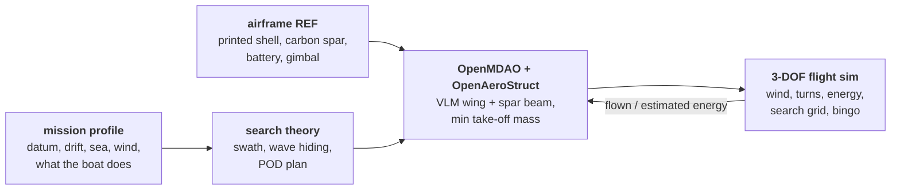
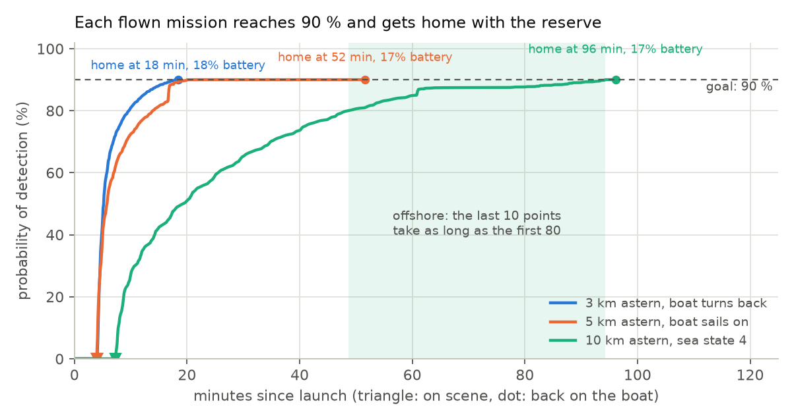
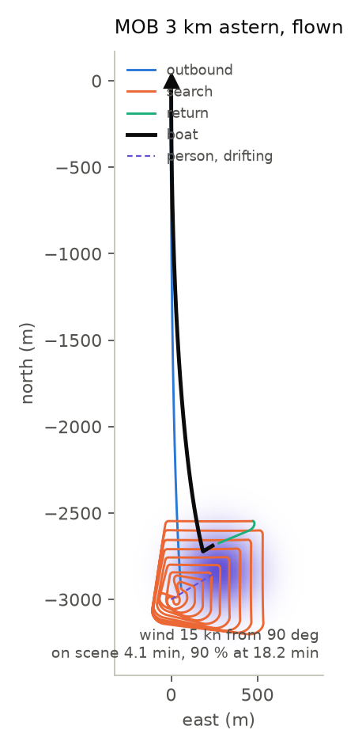
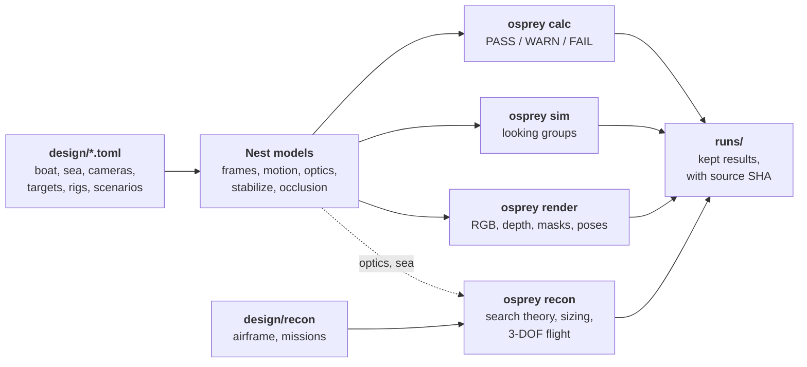

# Osprey

**Eyes for a sailboat, designed in simulation first.** *Osprey Nest* puts camera pods on the mast that keep
watch over the whole horizon, find a person in the water and guide the boat into a slip. *Osprey Recon*
is a 3D-printed search drone that the boat launches when the person is beyond what the mast can see.

<picture>
  <source media="(prefers-color-scheme: dark)" srcset="docs/img/hero-dark.png">
  
</picture>

<sub>Left: the four lower pod cameras during a synthetic docking run
([`runs/2026-11-06_gecko-docking-render`](runs/2026-11-06_gecko-docking-render/)); every frame also has
metric depth, a class mask and the camera's exact pose. Right: the Recon drone sized for the 10 km
offshore mission, rendered banking over the sea with the sailboat below (`osprey recon-render`).</sub>

> **Status: screening models, not specifications.** Every input is a REF stand-in (a reference 40 ft
> sloop, typical cameras, electronics, batteries and printed materials), all in [`design/`](design/). The
> numbers show which way the design should move; measurements replace them as hardware arrives.

## Two products, one system

| | Osprey Nest | Osprey Recon |
|---|---|---|
| **What** | "Gecko pods" on the mast: a PTZ camera on top and one hung below, with a computer, a 6-axis IMU and PoE between them | A printed fixed-wing drone with a gimbal camera, launched from the boat and recovered to it |
| **Job** | Horizon watch, man overboard (MOB), docking, guidance for an AI pilot | Search and rescue beyond the mast's reach |
| **Designed with** | Seakeeping, optics, occlusion and tasking models; MuJoCo synthetic camera data | Mission profiles, search theory, OpenMDAO + OpenAeroStruct sizing, a 3-DOF flight sim |
| **Read more** | [Nest below](#osprey-nest-pods-on-the-mast), [architecture](docs/architecture.md) | [Recon below](#osprey-recon-a-search-drone-sized-around-its-mission), [docs/recon.md](docs/recon.md), [issue #1](https://github.com/zacharyelston/Osprey/issues/1) |

### At a glance

<table>
<tr><th colspan="4" align="left">Nest (kept sweeps of 2026-11-06)</th></tr>
<tr>
<td align="center" width="25%"><h3>100 %</h3>of the time the whole horizon is swept under sail<br><sub>gecko5, 8 s worst revisit; 0 % for the single-camera rigs</sub></td>
<td align="center" width="25%"><h3>2,044 m</h3>to detect a person in the water from the masthead, sea state 3<br><sub>249 m from deck height</sub></td>
<td align="center" width="25%"><h3>96.5 %</h3>of the water within 3 m of the hull seen by two cameras when docking<br><sub>4.6 cm stereo depth (p95) at the hull edge</sub></td>
<td align="center" width="25%"><h3>11.9 kg</h3>masthead-equivalent mass aloft, against a 4 kg budget<br><sub>the next design problem</sub></td>
</tr>
<tr><th colspan="4" align="left">Recon (phase 1, 2026-11-06)</th></tr>
<tr>
<td align="center" width="25%"><h3>1.56 kg</h3>drone, 1.20 m span, for a man overboard 3 km astern<br><sub>printed in 6 panels on a 220 mm bed</sub></td>
<td align="center" width="25%"><h3>18 min</h3>from launch to a 90 % chance of having found the person<br><sub>back on the boat with 18 % battery</sub></td>
<td align="center" width="25%"><h3>2.73 kg</h3>drone, 2.03 m span, for 10 km offshore in sea state 4<br><sub>90 % at 94 min, home with 17 %</sub></td>
<td align="center" width="25%"><h3>20 s</h3>to size, calibrate and fly all three missions on a laptop<br><sub>OpenMDAO, OpenAeroStruct, 3-DOF sim</sub></td>
</tr>
</table>

## Osprey Nest: pods on the mast

<picture>
  <source media="(prefers-color-scheme: dark)" srcset="docs/img/nest-layout-dark.png">
  
</picture>

<sub>The `gecko5` rig from [`design/rigs/gecko5.toml`](design/rigs/gecko5.toml): five pods (ten cameras).
Port and starboard sit on the upper spreader tips; each pod faces out and sweeps a sector that overlaps its
neighbours'.</sub>

<picture>
  <source media="(prefers-color-scheme: dark)" srcset="docs/img/rig-compare-dark.png">
  
</picture>

The three rigs share the boat and the scenarios ([`gecko-sweep`](runs/2026-11-06_gecko-sweep/summary.md),
[`first-sweep`](runs/2026-11-06_first-sweep/summary.md)). `mast5` and `mast5-spreaders` have one PTZ per
station and keep one camera in reserve for watch. `gecko5` has two PTZs per pod and watches by sectors.

### 1. Height pays, mostly through the waves

The same long-zoom PTZ sees a person in the water at 2,044 m from the masthead and at 249 m from deck
height in sea state 3. In sea state 4 it is 793 m against 100 m. Both are limited by waves hiding the
target, not by pixels. From 18.9 m the camera looks down past the crests.


### 2. Under sail, the sails blind cameras on the mast. Sectors fix that

Heeled 15° with main and jib up, the sails hide the lee side from cameras on mast brackets. On `mast5`,
only 68.1 % of the horizon is seen without the masthead camera. The gecko pods sit on the spreader tips
and at the masthead, so ten eyes cover 100 % of it, and every bearing lies in two or more watch sectors.

| `mast5`: four cameras on mast brackets | `gecko5`: ten eyes in five pods |
|---|---|
|  |  |

| coastal-watch, need met | buoy | kayak | ferry | sloop | whole horizon swept |
|---|---|---|---|---|---|
| `mast5` | 87 % | 57 % | **0 %** | 96 % | 0 % of the time |
| `mast5-spreaders` | 86 % | 84 % | 86 % | 88 % | 0 % of the time |
| `gecko5` | 80 % | 88 % | 84 % | 99 % | **100 %** (8 s worst revisit) |

### 3. A man-overboard group no longer starves everything else

Any eye can join a *looking group* on one target, as long as every bearing keeps a watcher. In the MOB
scenario every rig gives the person in the water a group of 3 or 4 and meets the need 99 % of the time.
On `mast5-spreaders` that group takes every camera except the reserve, so a buoy 900 m off the bow gets
no camera for the whole five minutes. On `gecko5` the buoy is kept in view 99 % of the time, and the
person in the water still gets a group of 4.

| `mast5-spreaders`: buoy-2 never served | `gecko5`: buoy-2 served by `fwd` |
|---|---|
|  |  |

### 4. Docking works without giving up the watch

With aims chosen by `calcs.optimize_aims`, the lower eyes see 96.5 % of the 3 m band round the hull with
two cameras. 89 % of the hull edge has a stereo pair, at 4.6 cm depth (p95). The `top`, `fwd` and `aft`
upper eyes stay on the horizon.

| Docking, optimized aims | water band, 2+ cameras | hull edge with a stereo pair |
|---|---|---|
| `mast5` | 94.3 % | 80 % |
| `mast5-spreaders` | 94.6 % | 88 % |
| `gecko5` | **96.5 %** | **89 %** (4.6 cm p95) |
| `pods5`, fixed fisheye under each pod (dropped) | 96.9 % | 91 % (13.6 cm p95 with the scenario aims) |

No mast rig gets more than 91 % of the hull edge into stereo: from the mast, the deck edge hides the
water right against the topsides. That band will need deck-level cameras.

<details>
<summary>More docking detail</summary>

- With the scenario's hand-picked aims, two-camera coverage of the band is only 65.8-75.5 % on the
  one-PTZ-per-station rigs and 75.5 % on `gecko5`.
- The aft camera under the gooseneck sees the coachroof and cockpit, not the water astern. It is a crew
  camera, not a docking camera.
- The fisheye pod needed no aiming, but its 1.1 mrad pixels gave 13.6 cm depth at the hull edge, and it
  could not join the horizon watch. Its reports are in
  [`runs/2026-11-06_pods-fisheye-sweep`](runs/2026-11-06_pods-fisheye-sweep/summary.md).

</details>

### 5. The pod electronics are what make a group work on a bending mast

- **Gyros.** The mast's 2.4 Hz bending moves the masthead pod against the gooseneck pod by 846 µrad
  (p95) in sea state 4. Stereo range at 2 km then degrades from ±14 m to ±221 m. Each pod's gyro between
  5 Hz horizon fixes brings the relative orientation to 57 µrad.
- **Accelerometers alone do not work aloft.** They misjudge tilt by 27.7° (p95) at the masthead,
  because the mast's own acceleration swamps gravity's direction.
- **PTP time.** Hardware-timestamped shutter sync costs 0.18 µrad of pointing. Software timestamps
  would cost 367 µrad.
- **Compute on the pod.** The masthead pod's two 4K sensors make 5,972 Mb/s raw, 6.0x one gigabit
  link. Frames are encoded on the pod (40 Mb/s), and small, distant targets are searched for before
  compression smears them.

### The gecko pod

<picture>
  <source media="(prefers-color-scheme: dark)" srcset="docs/img/gecko-pod-dark.svg">
  
</picture>

- **Two eyes that point on their own.** The pod body splits the sphere: the upper eye cannot see under
  the pod and the lower eye cannot see over it. Together they cover everything from straight down to
  30° up. One eye can watch the horizon while the other works the dock.
- **Pairs inside a pod or across pods.** The two eyes of one pod share a rigid body (no mast flex
  between them) but only a 0.36 m baseline. Eyes on different pods have metres of baseline and need the
  pod gyros to hold 50 µrad.
- **One cable.** Power and gigabit Ethernet come up a single PoE cable. The other four pods peak at
  68.1 W, inside 802.3bt Type 4. The masthead pod, with the long zoom, peaks at 81.4 W and does not fit.

The kits, power and network numbers are in [`design/electronics.toml`](design/electronics.toml); the
camera classes in [`design/cameras.toml`](design/cameras.toml). More in
[docs/architecture.md](docs/architecture.md#gecko-pods-two-eyes-one-cable).

#### The budgets fail, and they are the next design problem

<picture>
  <source media="(prefers-color-scheme: dark)" srcset="docs/img/budgets-dark.png">
  
</picture>

17.8 kg goes up the mast in all, 11.9 kg as a masthead equivalent. Each pod's electronics and housing
weigh 0.92 kg; for all five that is 3.0 kg masthead equivalent. The system draws 12.7 A on watch and 31.9 A active from the 12.6 V house bank, so a day
underway (20 h watch, 4 h active) takes 381 Ah against a 120 Ah budget. Ways down:

- sleep the idle pods on watch;
- go lighter on the lower eyes, or drop the long PTZ at the masthead if a drone (Osprey Recon) takes over
  long-range search;
- power the masthead pod from two cables.

## Osprey Recon: a search drone sized around its mission

When the mast has lost the person, or never saw them, Recon flies to the datum and searches it from up to
120 m. From there it looks almost straight down, so wave crests hide almost nothing: the effect that
limits the masthead to 2 km in sea state 3. Each drone is designed for a mission rather than the other
way round.



- **Search theory** turns the gimbal camera, the sea state and the target into a swath and a per-pass
  detection probability, then plans the cheapest square and track spacing that reach 90 % POD.
- **Sizing:** OpenMDAO with OpenAeroStruct. It couples a vortex-lattice wing to a carbon-tube spar at a
  search point and a 3 g manoeuvre, and minimizes take-off mass. Constraints:
  - stall speed of at most 12 m/s, for recovery on a moving boat;
  - the printer bed;
  - the spar fitting inside the section;
  - a chord Reynolds-number floor;
  - endurance for the mission plus a 20 % reserve.
- **Flight:** a point-mass sim flies the result through the same mission:
  - wind triangle and banked turns;
  - an expanding square that drifts with the person;
  - "bingo" fuel for the trip home;
  - recovery to a boat that turns back or sails on.

  Its energy recalibrates the sizing until the two agree.

<picture>
  <source media="(prefers-color-scheme: dark)" srcset="docs/img/recon-wings-dark.png">
  
</picture>

| Mission | Take-off mass | Span (aspect ratio) | Battery | On scene | 90 % POD | Back on board |
|---|---|---|---|---|---|---|
| MOB 3 km astern, sea state 3, boat turns back | 1.56 kg | 1.20 m (9.5) | 0.23 kg | 4.1 min | 18.2 min | 18.4 min, 18 % left |
| 5 km astern, boat sails on at 6 kn | 1.89 kg | 1.36 m (10.2) | 0.52 kg | 4.0 min | 20.2 min | 51.6 min, 17 % left |
| MOB 10 km astern, sea state 4, 20 kn | 2.73 kg | 2.03 m (15.7) | 1.28 kg | 7.3 min | 94.3 min | 96.1 min, 17 % left |

<picture>
  <source media="(prefers-color-scheme: dark)" srcset="docs/img/recon-pod-dark.png">
  
</picture>

### The bird

<table>
<tr>
<td width="55%"></td>
<td width="45%"><br><sub>How it prints: ten span-wise panels on a 220 x 220 x 250 mm bed, threaded on the carbon spar.</sub></td>
</tr>
</table>


<sub>Each mission's drone, to scale (orthographic). The wings are the sized ones. The pod, gimbal, booms,
tail and prop are reference geometry; the tail is set by volume coefficients, with an 8 cm chord floor, and
is not optimized yet. `uv run osprey recon-render --mission all`.</sub>

<details>
<summary>Three-view of the offshore drone</summary>


</details>

What phase 1 says:

- **The fixed parts set the size.** Body, avionics, gimbal and motor weigh 1.18 kg, more than everything
  the optimizer controls on the short missions. Their drag holds lift-to-drag at 6 to 9: a cleaner
  fuselage and gimbal fairing is worth more than a better wing.
- **Stall speed and Reynolds number set the wing.** Every design sits on the 12 m/s stall limit and the
  150,000 chord-Reynolds floor, so the chord stays near 13 cm and the span grows with the battery.
- **Long searches are a sensing problem, not an airframe problem.** Offshore, the last 10 points of POD
  take as long as the first 80. A second drone or a thermal camera beats a bigger battery.
- **What the boat does matters as much as the drone.** If the boat sails on, the drone spends its
  endurance chasing it home upwind. Turning back to the datum, the usual MOB drill, is what makes the
  offshore case work.

<details>
<summary>The 3 km mission, flown</summary>

<picture>
  <source media="(prefers-color-scheme: dark)" srcset="docs/img/recon-track-dark.png">
  
</picture>

</details>

Not modelled yet: low-Reynolds section data, tail sizing and stability (6-DOF), load in the printed shell,
and launch and recovery on a moving deck. See [docs/recon.md](docs/recon.md) for the models and the
roadmap: CadQuery panels for printing, AVL or VSPAERO derivatives, SU2 and surrogates.

## How Nest and Recon work together

1. **Nest sees it happen.** The pods see a person go over the side, or a lookout calls it, and the
   looking groups keep a track and a datum as long as the mast can hold one: about 2 km in sea state 3,
   800 m in sea state 4.
2. **Recon takes it from there.** The datum, its drift and its error are exactly what a Recon mission
   profile starts from. The drone searches beyond the mast's horizon and its wave limit.
3. **Nest brings the drone home.** The pods' lower eyes see the deck and the drone's final approach
   for recovery onto a moving, heeling boat.
4. **Recon lightens the mast.** If the drone does the long-range searching, the masthead's long-zoom PTZ
   can become a mid-zoom one. In the same models that takes about 1.2 kg off the 11.9 kg masthead
   equivalent, and brings the masthead pod's peak draw from 81.4 W to 68.1 W, inside one PoE cable. The
   mass budget still needs more than that.

## How the simulation works



<details>
<summary>What each stage does</summary>

1. **Design inputs.** Everything numeric lives in TOML under `design/`. Code never hard-codes a boat or
   a camera. A rig is a list of stations or pods; any number of cameras works.
2. **Models.** Wave spectra drive the boat's roll, pitch, heave and the mast's bending. Optics turns
   pixels on target into detect, recognize and identify ranges (Johnson criteria), including how often
   waves hide a target. Occlusion ray-casts the mast, sails, hull and pod bodies.
3. **Tasking.** `tasking.Sim` assigns looking groups every tick, in priority order, and charges slew
   and zoom time on every reassignment. With sector watch, an eye may leave its sector only while a
   neighbour still covers it.
4. **Checks.** `osprey calc` reports motion, stabilization, reach, ranging, coverage, docking, mass,
   power, network and timing as PASS, WARN or FAIL. It exits 1 on a FAIL, which is a design finding,
   not a crash.
5. **Synthetic data.** `osprey render` drives a MuJoCo scene with the same motion model and writes, for
   every camera and frame, RGB, metric depth, a class mask and `labels.jsonl` with intrinsics and the
   camera-to-world pose. Real captures from the Phase 0 pod will use the same format.

</details>

<picture>
  <source media="(prefers-color-scheme: dark)" srcset="docs/img/synthetic-frame-dark.png">
  
</picture>

<sub>The `port-down` camera at frame 50 of the kept `gecko5` docking render: RGB, metric depth and the
class mask (`self` is our own hull, `boat` the neighbour in the next slip).</sub>

## Quickstart

```bash
uv sync
uv run pytest
uv run osprey calc --scenario coastal-watch --rig gecko5    # PASS/WARN/FAIL checks + figures
uv run osprey sim --scenario mob --rig gecko5               # looking-group timeline
uv run osprey render --scenario docking --rig gecko5        # RGB, depth, class masks, poses
uv run osprey sweep --workers 8                             # every scenario x rig
uv run osprey recon --mission all                           # Recon: size, calibrate and fly each mission
uv run osprey recon-render --mission all                    # Recon: render each sized drone
```

Output goes to `out/` (gitignored). Long sweeps and GPU renders run on two workstations, `gpu1` and
`gpu2`, from a committed snapshot: see [docs/remote-simulation.md](docs/remote-simulation.md).

## Repository layout

| Path | What |
|---|---|
| [`design/boat.toml`](design/boat.toml) | Reference 40 ft sloop: hull, mast, sail plan, motion responses |
| [`design/sea.toml`](design/sea.toml) | Sea states, refraction, visibility |
| [`design/cameras.toml`](design/cameras.toml) | Camera classes: long-zoom PTZ, mid-zoom PTZ (upright and inverted), fixed wide, interior dome, fisheye |
| [`design/electronics.toml`](design/electronics.toml) | Pod kits: SOC, IMU, housing, PoE, network and power budgets |
| [`design/targets.toml`](design/targets.toml) | Target classes and Johnson criteria |
| [`design/rigs/`](design/rigs/) | `gecko5` (pods), `mast5` (1 top + 4 round the mast), `mast5-spreaders`, `whole-boat` |
| [`design/scenarios/`](design/scenarios/) | `coastal-watch` (sea state 4), `mob` (sea state 3), `docking` |
| [`design/recon/`](design/recon/) | Recon: the reference printed airframe and the mission profiles |
| [`src/osprey/`](src/osprey/) | `frames`, `motion`, `optics`, `stabilize`, `occlusion`, `rig`, `tasking`, `calcs`, `figures`, `render/scene`, `cli` |
| [`src/osprey/recon/`](src/osprey/recon/) | `search` (sweep width, POD), `flight` (3-DOF), `sizing` (OpenMDAO + OpenAeroStruct), `geometry` and `render` (the bird in MuJoCo), `figures` |
| [`runs/`](runs/README.md) | Kept runs, never edited after they are archived |
| [`docs/`](docs/) | [Architecture](docs/architecture.md), [Recon](docs/recon.md), [remote runs](docs/remote-simulation.md), README figures |

## Kept runs

| Run | What it shows |
|---|---|
| [`2026-11-06_recon-phase1`](runs/2026-11-06_recon-phase1/) | Recon: each mission's sized airframe, flight report, planform, track and timeline |
| [`2026-11-06_gecko-sweep`](runs/2026-11-06_gecko-sweep/summary.md) | Every scenario x rig with sector watch; `gecko5` reports in full |
| [`2026-11-06_gecko-docking-render`](runs/2026-11-06_gecko-docking-render/) | 10 s docking render on `gecko5` with optimized aims: video, one frame of `port-down`, all labels |
| [`2026-11-06_pods-fisheye-sweep`](runs/2026-11-06_pods-fisheye-sweep/summary.md) | The dropped design: pods with a down-looking fisheye |
| [`2026-11-06_first-sweep`](runs/2026-11-06_first-sweep/summary.md) | Every scenario x rig before pods: calc reports, figures, looking-group timelines |
| [`2026-11-06_docking-render`](runs/2026-11-06_docking-render/) | 20 s docking render on `mast5-spreaders` |

Source SHAs and hosts are in [runs/README.md](runs/README.md).

<details>
<summary>The earlier single-PTZ rig, rendered</summary>


<sub>`mast5-spreaders` docking render: masthead PTZ looking straight down, forward, port and starboard
spreader cameras, the aft camera under the gooseneck, and an overview.</sub>

</details>

## Phases

0. **Bosun's Chair:** a halyard-hoisted pod with an action camera, IMU and GNSS. It measures the real
   masthead motion that replaces the REF motion model.
1. **Look-down docking:** stereo pairs plus deck registration give a costmap for the pilot.
2. **Spotting:** horizon-band detection, horizon-dip ranging and thermal.
3. **Inspection:** the long-zoom PTZ, cued and slewed to targets.

Recon has its own roadmap in [docs/recon.md](docs/recon.md#roadmap):
- design for additive manufacturing in CadQuery;
- stability derivatives and a 6-DOF sim;
- SU2, printed-shell FEA and surrogates.

README figures in `docs/img/` other than the renders and run plots are made from the files in this
repository by [`docs/img/make_readme_figures.py`](docs/img/make_readme_figures.py)
(`uv run python docs/img/make_readme_figures.py`).
