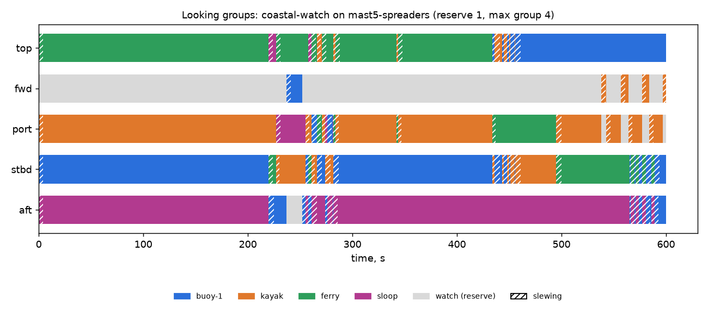

# Osprey: mast-mounted multi-camera vision for sailboats

Models, simulations and synthetic camera data for a masthead vision system:
spotting and inspection from height, plus a look-down view that guides
docking and the AI pilot. See [docs/architecture.md](docs/architecture.md).

Status: screening models with REF inputs (a reference 40 ft sloop and typical
camera classes). The numbers below show which way the design should move;
they are not specifications. Kept runs: [runs/](runs/README.md).


*Synthetic frames from `osprey render` on gpu1: masthead PTZ looking straight
down, forward, port and starboard spreader cameras, the aft camera under the
gooseneck, and an overview. Each frame also has metric depth, a class mask
and its exact camera pose.*

## What the first sweep says (2026-11-06, `runs/2026-11-06_first-sweep`)

**Height pays, mostly through the waves.** The same long-zoom camera detects a
person in the water at 2.0 km from the masthead and 250 m from deck height in
sea state 3. In sea state 4 it's 790 m vs 100 m. Both are wave-limited (seen at
least half the time, worst-case long-crested waves), not resolution-limited.


**Cameras on mast brackets are blind to leeward under sail.** Heeled 15 deg
with main and jib up, the sails hide the whole lee side from all four lower
cameras. Only the masthead PTZ sees past them; without it, 68 % of the horizon
is covered. Moving port and starboard to the upper spreader tips puts them
outboard of the sails:

| coastal-watch, need met | buoy (P1) | kayak (P2) | ferry (P3) | sloop (P4) |
|---|---|---|---|---|
| `mast5`, side cameras on mast brackets | 87 % | 57 % | **0 %** | 96 % |
| `mast5-spreaders`, side cameras on spreader tips | 86 % | 84 % | **86 %** | 88 % |

| `mast5` | `mast5-spreaders` |
|---|---|
|  |  |

**Looking groups work, and they need a policy.** One camera is always on
watch in every scenario and rig. A man-overboard target gets a group of 3-4
and 0.1 % range precision. On the spreader rig, though, that group takes every
camera except the reserve, so a buoy on the bow gets no camera for the whole
MOB. Whether MOB should take everything is a product decision, not a physics
one.



**Docking: aim well, then add deck cameras.**
- With hand-picked aims, only 66-76 % of the water within 3 m of the hull is
  seen by two cameras.
- With optimized aims (`calcs.optimize_aims`) that rises to about 94 % on every
  rig. Stereo depth is 3.4 cm (p95) where a pair exists.
- No aim gets more than 80-88 % of the hull edge into stereo: the deck edge
  hides the last half metre against the topsides from the mast. That band
  needs deck-level cameras.
- The aft camera under the gooseneck sees the coachroof and cockpit, not the
  water astern. It is a crew camera, not a docking camera.

**Hardware budget flags (WARN).**
- The four cameras put 5.0 kg masthead-equivalent aloft, against a 4 kg REF
  budget.
- The masthead sees 0.54 g (p95) in sea state 4.
- The mid-zoom PTZs without a fast stage are right at 1 px of blur at 120 mm
  and 1 ms. All of these depend on REF motion numbers that the Phase 0 pod will
  measure.

## Gecko pods (2026-11-06, `runs/2026-11-06_gecko-sweep`)

`gecko5` puts a pod at each station.
- **Top and bottom:** a PTZ on top and another hung underneath, pointing
  independently.
- **In the middle:** a SOC, a 6-axis IMU and PoE on a single gigabit cable.

See [docs/architecture.md](docs/architecture.md#gecko-pods-two-eyes-one-cable).

**Docking works without giving up the watch.**
- **Coverage:** the lower eyes take the water round the hull. Optimized
  aims see 96.5 % of the 3 m band with two cameras.
- **Hull edge:** 89 % of it has a stereo pair, at 4.6 cm depth (p95). That
  beats every single-PTZ rig.
- **Watch:** the top, forward and aft upper eyes stay on the horizon.
- **The trade:** the pod blinds its upper eye straight down. The fisheye
  version of the pod (dropped) also saw 97 % of the band, but only at 14 cm
  depth, and couldn't join the watch.

**The pod electronics are what make a looking group work on a bending mast.**
- **Flex:** without pod gyros, mast flex puts 850 urad (p95) between the
  masthead and gooseneck pods. Stereo range at 2 km degrades from about 14 m
  to 220 m.
- **Gyros:** each pod's gyro between 5 Hz horizon fixes brings that to
  57 urad.
- **Timing:** PTP shutter sync matters just as much. Software timestamps
  would add 370 urad at the mast's angular rates.
- **Accelerometers alone don't work:** at the masthead they misjudge tilt by
  28 deg (p95).

**The budgets fail, and they are the next design problem (all REF numbers).**

| Budget | gecko5 | Limit |
|---|---|---|
| Mass on the mast, masthead equivalent | 11.9 kg (17.8 kg total) | 4 kg |
| Masthead pod peak draw | 81 W | 71.3 W, 802.3bt Type 4 |
| Other pods peak draw | 68 W each | Type 4 |
| House bank, watch / active | 13 / 32 A at 12.6 V | |
| Energy per day underway (20 h watch, 4 h active) | 381 Ah | 120 Ah |

Ways down:
- Sleep the idle pods on watch.
- Go lighter on the lower eyes, or drop the long PTZ at the masthead if a
  drone takes over long-range search.
- Power the masthead pod from two cables.

## Quickstart

```bash
uv sync
uv run pytest
uv run osprey calc --scenario coastal-watch           # PASS/WARN/FAIL checks + figures
uv run osprey sim --scenario mob                      # looking-group timeline
uv run osprey render --scenario docking --rig mast5-spreaders   # RGB, depth, class masks, poses
uv run osprey sweep --workers 8                       # every scenario x rig
```

Long sweeps and GPU renders go to the ML hosts:
[docs/remote-simulation.md](docs/remote-simulation.md).

## Layout

| Path | What |
|---|---|
| `design/boat.toml` | Reference 40 ft sloop: hull, mast, sail plan, motion responses |
| `design/sea.toml` | Sea states, refraction, visibility |
| `design/cameras.toml` | Camera classes: long-zoom PTZ, mid-zoom PTZ, fixed wide, interior dome |
| `design/targets.toml` | Target classes and Johnson criteria |
| `design/rigs/` | `mast5` (1 top + 4 around the mast), `mast5-spreaders`, `whole-boat` |
| `design/scenarios/` | `coastal-watch`, `mob`, `docking` |
| `src/osprey/` | `frames`, `motion`, `optics`, `stabilize`, `occlusion`, `rig`, `tasking`, `calcs`, `figures`, `render/scene`, `cli` |
