# Osprey

**The first mate's best friend: eyes for a sailboat, designed in simulation first.** *Osprey Nest* puts
camera pods on the mast that keep watch over the whole horizon, spot a person in the water and guide the
boat into a slip. *Osprey Recon* is the boat's scout: a 3D-printed drone that flies out to look at
whatever the captain needs to know about, from the anchorage ahead and the vessel on a crossing course to
the wildlife and hazards round a remote island, and a person in the water.

<picture>
  <source media="(prefers-color-scheme: dark)" srcset="docs/img/hero-dark.png">
  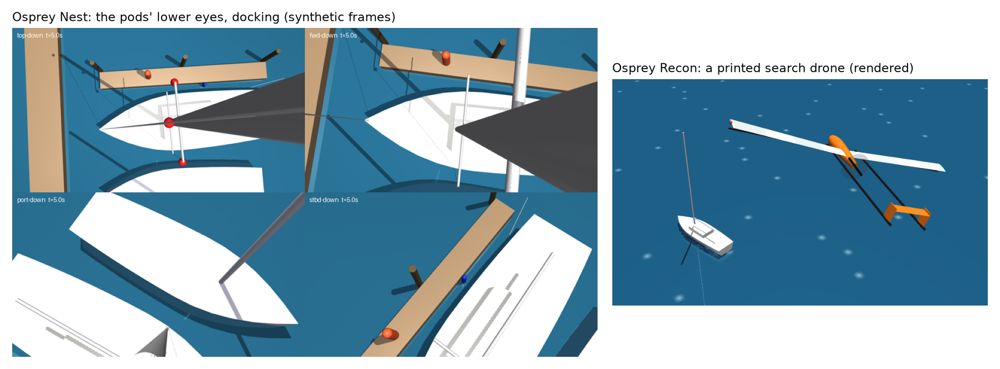
</picture>

<sub>Left: the four lower pod cameras during a synthetic docking run
([`runs/2026-11-06_gecko-docking-render`](runs/2026-11-06_gecko-docking-render/)); every frame also has
metric depth, a class mask and the camera's exact pose. Right: the Recon drone, the airframe that does
all seven scouting, search and escort jobs, rendered banking over the sea with the sailboat below
(`osprey recon-render`).</sub>

> **Status: screening models, not specifications.** Every input is a REF stand-in (a reference 40 ft
> sloop, typical cameras, electronics, batteries and printed materials), all in [`design/`](design/). The
> numbers show which way the design should move; measurements replace them as hardware arrives.

## Two products, one system

| | Osprey Nest | Osprey Recon |
|---|---|---|
| **What** | "Gecko pods" on the mast: a PTZ camera on top and one hung below, with a computer, a 6-axis IMU and PoE between them | A printed fixed-wing drone with a gimbal camera, launched from the boat and recovered to it |
| **Job** | The watch, all the time: the horizon, traffic, man overboard (MOB), docking, guidance for an AI pilot | Going to look, on demand: the anchorage ahead, a landing site, another vessel, wildlife and hazards ashore, a person in the water |
| **Designed with** | Seakeeping, optics, occlusion and tasking models; MuJoCo synthetic camera data | Mission profiles (search, survey, inspect), OpenMDAO + OpenAeroStruct sizing, a 3-DOF flight sim, MuJoCo renders |
| **Read more** | [Nest below](#osprey-nest-pods-on-the-mast), [architecture](docs/architecture.md) | [Recon below](#osprey-recon-the-scout), [docs/recon.md](docs/recon.md), [issue #1](https://github.com/zacharyelston/Osprey/issues/1) |

### At a glance

<table>
<tr><th colspan="4" align="left">Nest (kept sweeps of 2026-11-06)</th></tr>
<tr>
<td align="center" width="25%"><h3>100 %</h3>of the time the whole horizon is swept under sail<br><sub>gecko5, 8 s worst revisit; 0 % for the single-camera rigs</sub></td>
<td align="center" width="25%"><h3>2,044 m</h3>to detect a person in the water from the masthead, sea state 3<br><sub>249 m from deck height</sub></td>
<td align="center" width="25%"><h3>96.5 %</h3>of the water within 3 m of the hull seen by two cameras when docking<br><sub>4.6 cm stereo depth (p95) at the hull edge</sub></td>
<td align="center" width="25%"><h3>11.9 kg</h3>masthead-equivalent mass aloft, against a 4 kg budget<br><sub>the next design problem</sub></td>
</tr>
<tr><th colspan="4" align="left">Recon (kept run of 2026-11-06)</th></tr>
<tr>
<td align="center" width="25%"><h3>1 bird, 7 jobs</h3>a 2.73 kg, 2.02 m printed drone does every job and gets home<br><sub>2.13 kg with a PTZ eye each side instead of a gimbal</sub></td>
<td align="center" width="25%"><h3>1.7 cm</h3>per pixel over an anchorage 8 km ahead, imaged before arrival<br><sub>a mooring buoy is 17 px across</sub></td>
<td align="center" width="25%"><h3>13 min</h3>to fly 5 km, identify a vessel from 200 m and come home<br><sub>37 px across the boat</sub></td>
<td align="center" width="25%"><h3>35 s</h3>to size, calibrate and fly seven jobs on a laptop<br><sub>OpenMDAO, OpenAeroStruct, 3-DOF sim</sub></td>
</tr>
</table>

## Osprey Nest: pods on the mast

<picture>
  <source media="(prefers-color-scheme: dark)" srcset="docs/img/nest-layout-dark.png">
  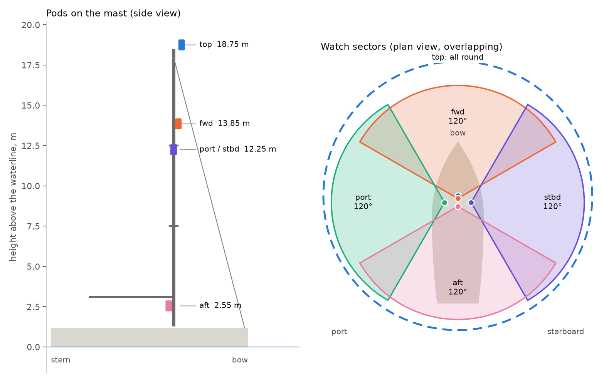
</picture>

<sub>The `gecko5` rig from [`design/rigs/gecko5.toml`](design/rigs/gecko5.toml): five pods (ten cameras).
Port and starboard sit on the upper spreader tips; each pod faces out and sweeps a sector that overlaps its
neighbours'.</sub>

<picture>
  <source media="(prefers-color-scheme: dark)" srcset="docs/img/rig-compare-dark.png">
  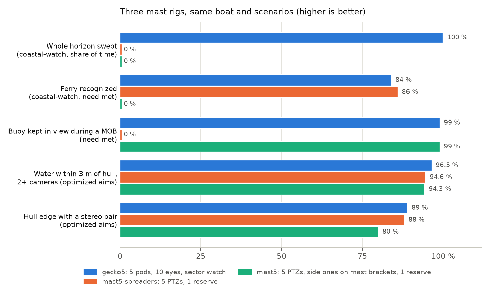
</picture>

The three rigs share the boat and the scenarios ([`gecko-sweep`](runs/2026-11-06_gecko-sweep/summary.md),
[`first-sweep`](runs/2026-11-06_first-sweep/summary.md)). `mast5` and `mast5-spreaders` have one PTZ per
station and keep one camera in reserve for watch. `gecko5` has two PTZs per pod and watches by sectors.

### 1. Height pays, mostly through the waves

The same long-zoom PTZ sees a person in the water at 2,044 m from the masthead and at 249 m from deck
height in sea state 3. In sea state 4 it is 793 m against 100 m. Both are limited by waves hiding the
target, not by pixels. From 18.9 m the camera looks down past the crests.


### 2. Under sail, the sails blind cameras on the mast. Sectors fix that

Heeled 15° with main and jib up, the sails hide the lee side from cameras on mast brackets. On `mast5`,
only 68.1 % of the horizon is seen without the masthead camera. The gecko pods sit on the spreader tips
and at the masthead, so ten eyes cover 100 % of it, and every bearing lies in two or more watch sectors.

| `mast5`: four cameras on mast brackets | `gecko5`: ten eyes in five pods |
|---|---|
| 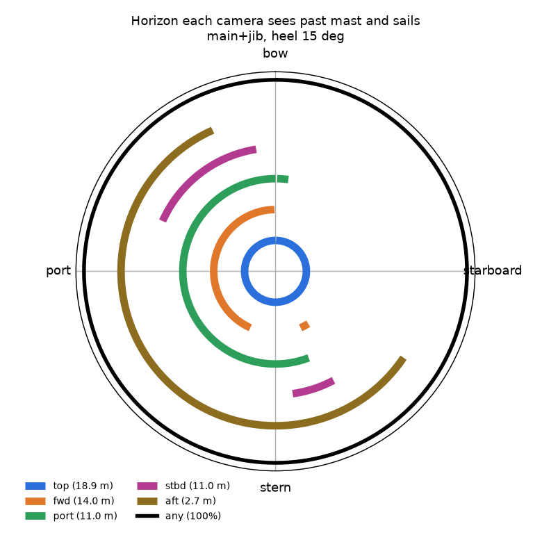 | 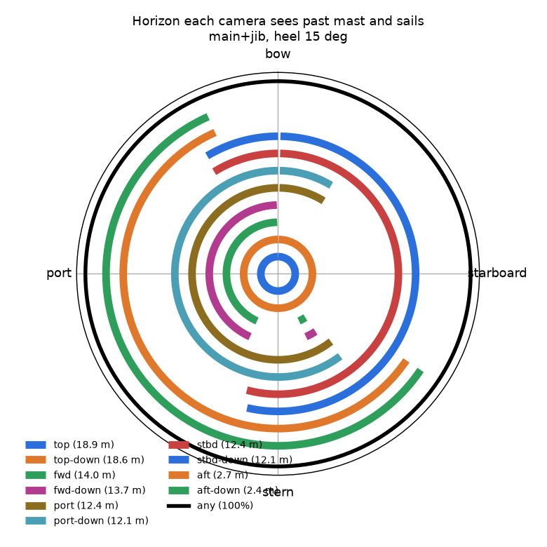 |

| coastal-watch, need met | buoy | kayak | ferry | sloop | whole horizon swept |
|---|---|---|---|---|---|
| `mast5` | 87 % | 57 % | **0 %** | 96 % | 0 % of the time |
| `mast5-spreaders` | 86 % | 84 % | 86 % | 88 % | 0 % of the time |
| `gecko5` | 80 % | 88 % | 84 % | 99 % | **100 %** (8 s worst revisit) |

### 3. A man-overboard group no longer starves everything else

Any eye can join a *looking group* on one target, as long as every bearing keeps a watcher. In the MOB
scenario every rig gives the person in the water a group of 3 or 4 and meets the need 99 % of the time.
On `mast5-spreaders` that group takes every camera except the reserve, so a buoy 900 m off the bow gets
no camera for the whole five minutes. On `gecko5` the buoy is kept in view 99 % of the time, and the
person in the water still gets a group of 4.

| `mast5-spreaders`: buoy-2 never served | `gecko5`: buoy-2 served by `fwd` |
|---|---|
| 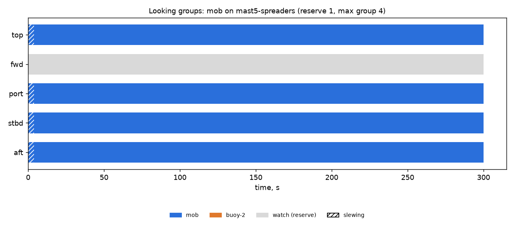 | 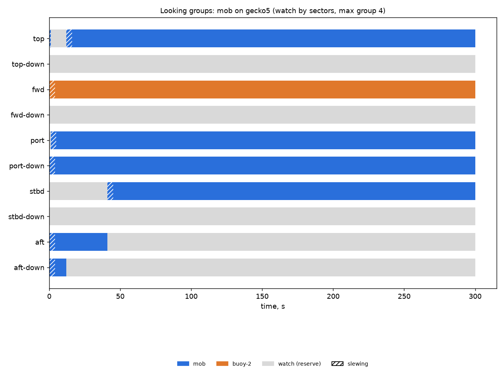 |

### 4. Docking works without giving up the watch

With aims chosen by `calcs.optimize_aims`, the lower eyes see 96.5 % of the 3 m band round the hull with
two cameras. 89 % of the hull edge has a stereo pair, at 4.6 cm depth (p95). The `top`, `fwd` and `aft`
upper eyes stay on the horizon.

| Docking, optimized aims | water band, 2+ cameras | hull edge with a stereo pair |
|---|---|---|
| `mast5` | 94.3 % | 80 % |
| `mast5-spreaders` | 94.6 % | 88 % |
| `gecko5` | **96.5 %** | **89 %** (4.6 cm p95) |
| `pods5`, fixed fisheye under each pod (dropped) | 96.9 % | 91 % (13.6 cm p95 with the scenario aims) |

No mast rig gets more than 91 % of the hull edge into stereo: from the mast, the deck edge hides the
water right against the topsides. That band will need deck-level cameras.

<details>
<summary>More docking detail</summary>

- With the scenario's hand-picked aims, two-camera coverage of the band is only 65.8-75.5 % on the
  one-PTZ-per-station rigs and 75.5 % on `gecko5`.
- The aft camera under the gooseneck sees the coachroof and cockpit, not the water astern. It is a crew
  camera, not a docking camera.
- The fisheye pod needed no aiming, but its 1.1 mrad pixels gave 13.6 cm depth at the hull edge, and it
  could not join the horizon watch. Its reports are in
  [`runs/2026-11-06_pods-fisheye-sweep`](runs/2026-11-06_pods-fisheye-sweep/summary.md).

</details>

### 5. The pod electronics are what make a group work on a bending mast

- **Gyros.** The mast's 2.4 Hz bending moves the masthead pod against the gooseneck pod by 846 µrad
  (p95) in sea state 4. Stereo range at 2 km then degrades from ±14 m to ±221 m. Each pod's gyro between
  5 Hz horizon fixes brings the relative orientation to 57 µrad.
- **Accelerometers alone do not work aloft.** They misjudge tilt by 27.7° (p95) at the masthead,
  because the mast's own acceleration swamps gravity's direction.
- **PTP time.** Hardware-timestamped shutter sync costs 0.18 µrad of pointing. Software timestamps
  would cost 367 µrad.
- **Compute on the pod.** The masthead pod's two 4K sensors make 5,972 Mb/s raw, 6.0x one gigabit
  link. Frames are encoded on the pod (40 Mb/s), and small, distant targets are searched for before
  compression smears them.

### 6. A new layout: back-to-back dual mounts on the spreaders

A $59 back-to-back camera mount (two bullets on one conduit fitting) suggested a different split of the
work, rig [`spreader-pairs`](design/rigs/spreader-pairs.toml):
- **Spreader tips:** a dual mount at each tip, one fixed camera looking forward and one aft.
- **Pairs across the boat:** the two forward cameras are a stereo pair with the spreaders' full span
  between them, and so are the two aft ones.
  - The lower pair is opened to 4 mm and tilted 30° down, for the water round the bow and the stern.
  - The upper pair is level, for the horizon ahead and astern.
- **Masthead:** keeps its gecko pod, for the all-round view, the long zoom and the look straight down.
- **Beams:** left to Recon, flying escort.

<picture>
  <source media="(prefers-color-scheme: dark)" srcset="docs/img/pairs-layout-dark.png">
  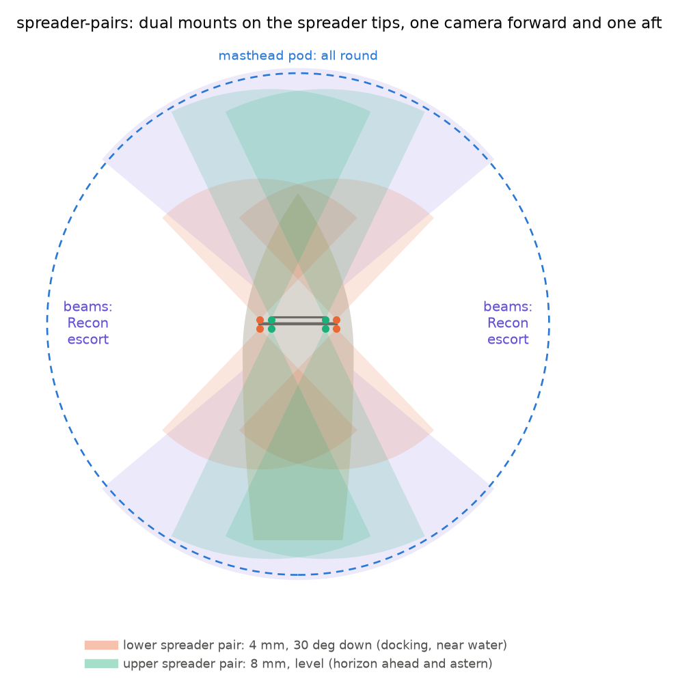
</picture>

| [`runs/2026-11-06_pairs-sweep`](runs/2026-11-06_pairs-sweep/summary.md) | `gecko5` | `spreader-pairs` |
|---|---|---|
| Mass aloft, masthead equivalent | 11.9 kg | **7.7 kg** |
| Energy per day underway | 381 Ah | **259 Ah** |
| Whole horizon swept under sail | 100 % (8 s revisit) | 100 % (7 s revisit) |
| Stereo range at 30 m / 200 m, lower pair (sea state 4) | | ±7 cm / ±3.2 m with synced shutters; ±14 cm / ±6.3 m on the cameras' own clocks |
| Docking: water within 3 m seen by 2+ cameras | 96.5 % | 44 % (bow and stern only) |
| Hull edge with a stereo pair, depth p95 | 89 %, 4.6 cm | 35 %, **1.3 cm** |
| Coastal watch, boat alone: kayak / ferry / sloop | 88 / 84 / 99 % | 23 / 11 / 0 % |

- **Same-height pairs don't need gyros.** The mast's fore-aft bending moves both cameras of a pair
  together: 0 µrad between them, against 846 µrad between the masthead and gooseneck pods.
- **Synced shutters do matter.** Bullets running on their own clocks (about 2 ms apart) lose 370 µrad
  while the boat rolls, which halves the stereo precision at 200 m. Hardware-synced shutters, or a pod
  computer that grabs both frames, fix it.
- **The pairs are near-boat tools.** At 1 km even a synced lower pair ranges to ±81 m.
- **The boat alone loses identification at range and on the beams.** The fixed 8 mm bullets can't
  recognize a kayak at 1.8 km. The coastal targets sit 25-60° off the bow, at or past the edge of their
  view. That is the work this layout hands to Recon: escort for the beams, inspection for anything to be
  identified.
- **Docking alongside needs the beams covered from the boat.** The tilted lower pair gives centimetre
  stereo at the bow and stern, but in a slip the pier is abeam, and a fixed-wing drone can't hold station
  there. The masthead's lower eye or deck cameras have to cover it.

<p align="center">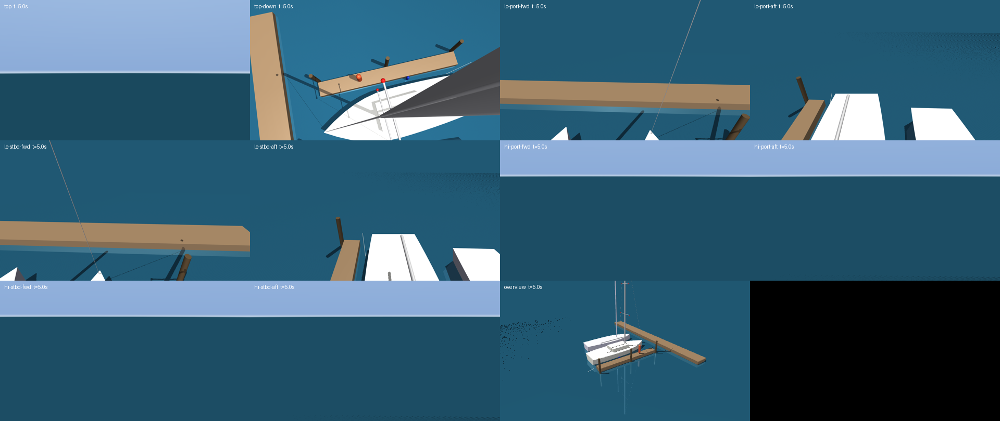</p>

<sub>Frame 50 of the `spreader-pairs` docking render on gpu1
([`runs/2026-11-06_pairs-docking-render`](runs/2026-11-06_pairs-docking-render/)).</sub>

### The gecko pod

<picture>
  <source media="(prefers-color-scheme: dark)" srcset="docs/img/gecko-pod-dark.svg">
  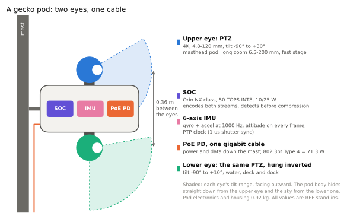
</picture>

- **Two eyes that point on their own.** The pod body splits the sphere: the upper eye cannot see under
  the pod and the lower eye cannot see over it. Together they cover everything from straight down to
  30° up. One eye can watch the horizon while the other works the dock.
- **Pairs inside a pod or across pods.** The two eyes of one pod share a rigid body (no mast flex
  between them) but only a 0.36 m baseline. Eyes on different pods have metres of baseline and need the
  pod gyros to hold 50 µrad.
- **One cable.** Power and gigabit Ethernet come up a single PoE cable. The other four pods peak at
  68.1 W, inside 802.3bt Type 4. The masthead pod, with the long zoom, peaks at 81.4 W and does not fit.

The kits, power and network numbers are in [`design/electronics.toml`](design/electronics.toml); the
camera classes in [`design/cameras.toml`](design/cameras.toml). More in
[docs/architecture.md](docs/architecture.md#gecko-pods-two-eyes-one-cable).

#### The budgets fail, and they are the next design problem

<picture>
  <source media="(prefers-color-scheme: dark)" srcset="docs/img/budgets-dark.png">
  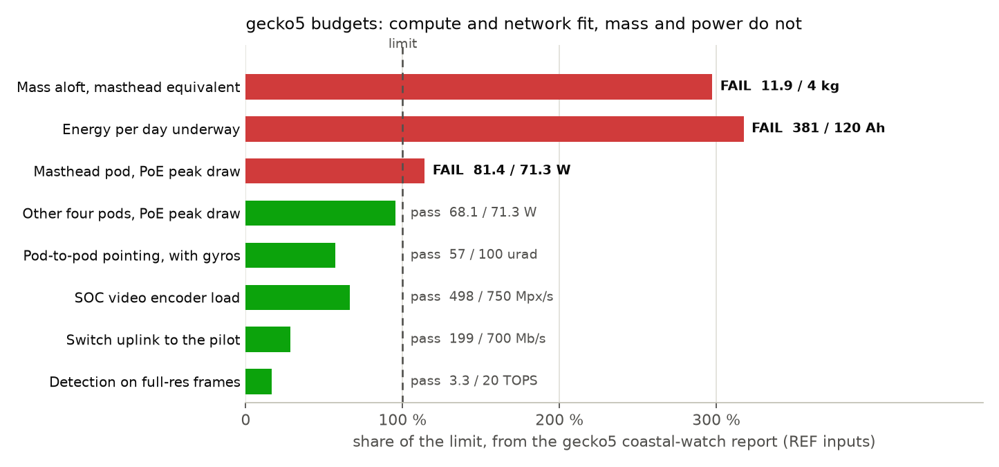
</picture>

17.8 kg goes up the mast in all, 11.9 kg as a masthead equivalent. Each pod's electronics and housing
weigh 0.92 kg; for all five that is 3.0 kg masthead equivalent. The system draws 12.7 A on watch and 31.9 A active from the 12.6 V house bank, so a day
underway (20 h watch, 4 h active) takes 381 Ah against a 120 Ah budget. Ways down:

- sleep the idle pods on watch;
- go lighter on the lower eyes, or drop the long PTZ at the masthead if a drone (Osprey Recon) takes over
  long-range search;
- power the masthead pod from two cables.

## Osprey Recon: the scout

Recon is the boat's eyes and ears beyond the horizon. It is a printed fixed-wing drone that the crew
launches whenever the captain needs to know something the mast can't see:
- **What's at the anchorage** before the boat gets there: moorings, pot lines, rocks, debris, room to swing.
- **Who's around:** an unknown vessel on a crossing course, inspected and identified from a respectful
  standoff.
- **What's ashore** off a remote island or park: a landing beach, wildlife, the lie of the land, hazards
  before anyone goes in the dinghy.
- **Where the person is** when someone goes over the side and the mast has lost them.

It flies from up to 120 m. There it looks nearly straight down, so wave crests hide almost nothing: the
effect that limits the masthead to 2 km for a person in the water.

**Designed around its jobs.** Each job is a mission profile: where the task is, what the boat does
meanwhile, the sea and the wind. A task tells the drone what to do on arrival:
- **search:** an expanding square drifting with the datum, until the probability of detection (POD)
  reaches the goal;
- **survey:** lawnmower legs with the gimbal pointing straight down, until the site is imaged;
- **inspect:** orbits round a moving vessel, zoomed in to identify it;
- **escort:** circles the boat as it sails, watching the beams.

OpenMDAO sizes an airframe for each job, and a 3-DOF flight sim flies it through. Then every airframe is
flown through every job, to find the one bird a crew should actually build.

<picture>
  <source media="(prefers-color-scheme: dark)" srcset="docs/img/recon-jobs-dark.png">
  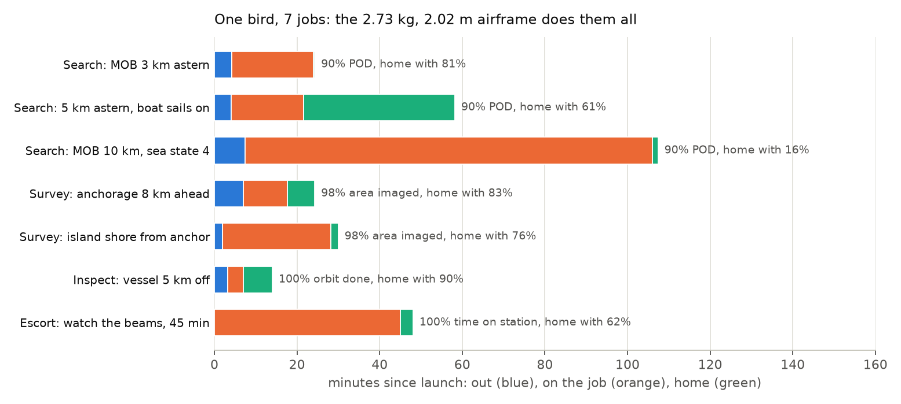
</picture>

<picture>
  <source media="(prefers-color-scheme: dark)" srcset="docs/img/recon-tracks-dark.png">
  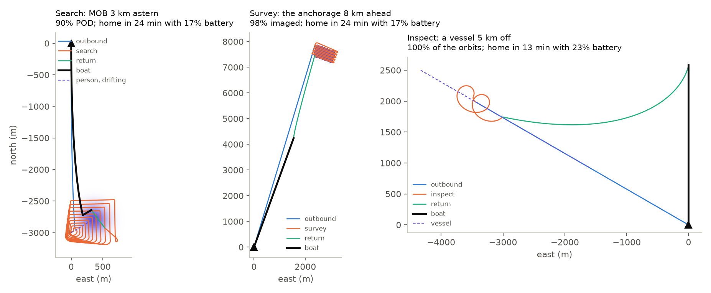
</picture>

| Job ([`runs/2026-11-06_recon-payloads`](runs/2026-11-06_recon-payloads/gimbal/matrix.md), gimbal) | Kind | Its own airframe | Result | Back aboard |
|---|---|---|---|---|
| MOB 3 km astern, sea state 3, boat turns back | search | 1.60 kg, 1.20 m | 90 % POD at 23.5 min | 23.8 min, 17 % left |
| 5 km astern, boat sails on at 6 kn | search | 1.87 kg, 1.36 m | 90 % POD at 20.3 min | 53.6 min, 15 % left |
| MOB 10 km astern, sea state 4, 20 kn | search | 2.73 kg, 2.02 m | 90 % POD at 106 min | 107 min, 16 % left |
| Anchorage 8 km ahead, 500 x 800 m bay | survey | 1.58 kg, 1.20 m | 98 % imaged at 1.7 cm per pixel; a mooring buoy 17 px across | 24.4 min, 17 % left |
| Island shore from anchor, 900 x 1500 m | survey | 1.67 kg, 1.21 m | 98 % imaged at 2.1 cm per pixel; a person 12 px across | 29.2 min, 17 % left |
| Vessel 5 km off on a crossing course | inspect | 1.47 kg, 1.20 m | two orbits at 200 m, 37 px across the boat | 12.9 min, 23 % left |
| The beams, 45 min, boat sailing at 6.5 kn | escort | 1.92 kg, 1.39 m | circling at 1.5 km, watching out to 6.7 km for a 30 ft boat | 47.1 min, 17 % left |

**One bird, many jobs.** Each airframe sized for one job, flown through all seven:

<picture>
  <source media="(prefers-color-scheme: dark)" srcset="docs/img/recon-matrix-dark.png">
  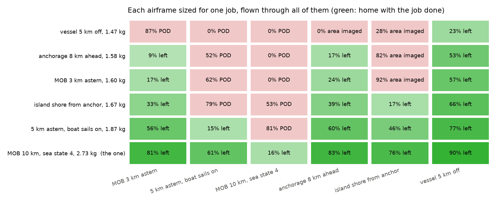
</picture>

The airframe sized for the hardest job, the 10 km offshore search, does every job and gets home with 16 to
90 % of its battery left. Each lighter one fails somewhere, mostly on the long searches. The anchorage and
vessel jobs barely use it: that headroom is time on scene, or a second sortie.

**A PTZ eye on each side.** The same dual mount, turned sideways under the bird, gives `--payload dual`:
- **Eyes:** a small PTZ looking out to the left and another to the right.
- **Belly fisheye:** looks straight down, for inspection and landings.
- **Searching:** each eye works its own strip beside the track, and the belly fills the gap underneath.
- **Surveying:** both eyes turn down to image two strips at once, at the gimbal's pixels.
- **Inspecting:** the inboard eye holds the vessel round the orbit.

<picture>
  <source media="(prefers-color-scheme: dark)" srcset="docs/img/recon-payloads-dark.png">
  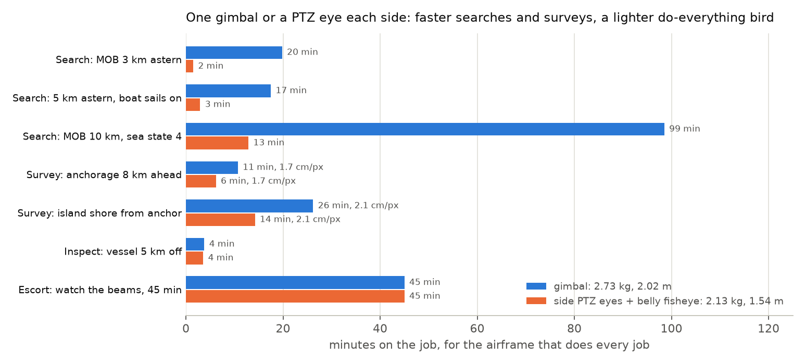
</picture>

| | One gimbal | Side PTZ eyes + belly fisheye |
|---|---|---|
| Lightest airframe that does all seven jobs | 2.73 kg, 2.02 m | **2.13 kg, 1.54 m** |
| What sizes it | the 10 km search (99 min on task) | the 45 min escort (the search drops to 13 min) |
| Payload | 0.35 kg, 6 W | 0.51 kg, 10 W |

- **Searching:** looking sideways is mostly what does it. The gimbal searches ahead and down, so the
  narrow side of its image lies across the track: about 100 m of effective sweep at 80 m. Two side eyes
  and the belly make about 600 m. A single gimbal turned to one side would get one strip, about half
  that.
- **The edges of the strips:** they are about 340 m slant away, where a person is 2-3 pixels across. The
  detector recall assumed everywhere (0.9) matters most there.

<table>
<tr>
<td width="50%">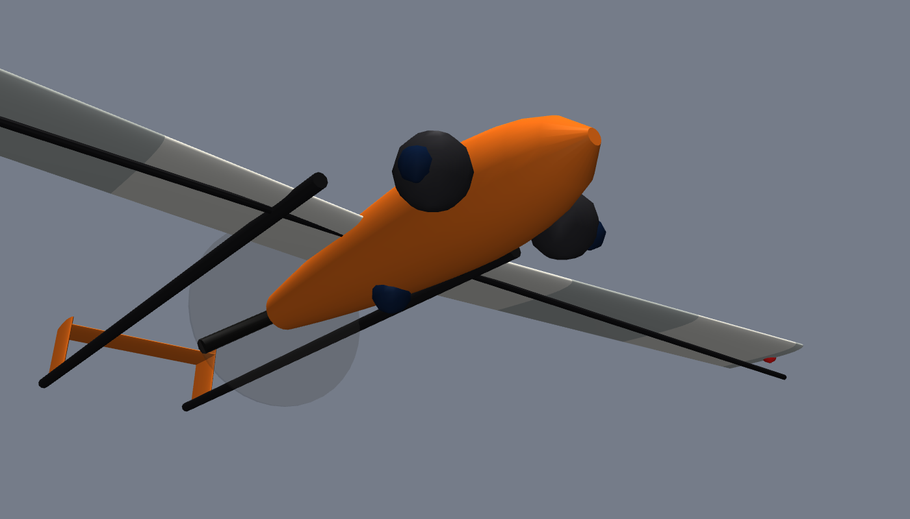</td>
<td width="50%">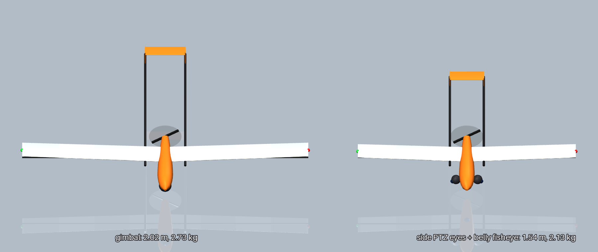</td>
</tr>
</table>

### The bird

<table>
<tr>
<td width="55%">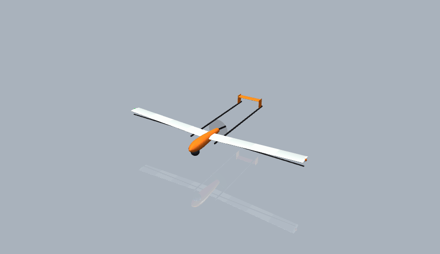</td>
<td width="45%">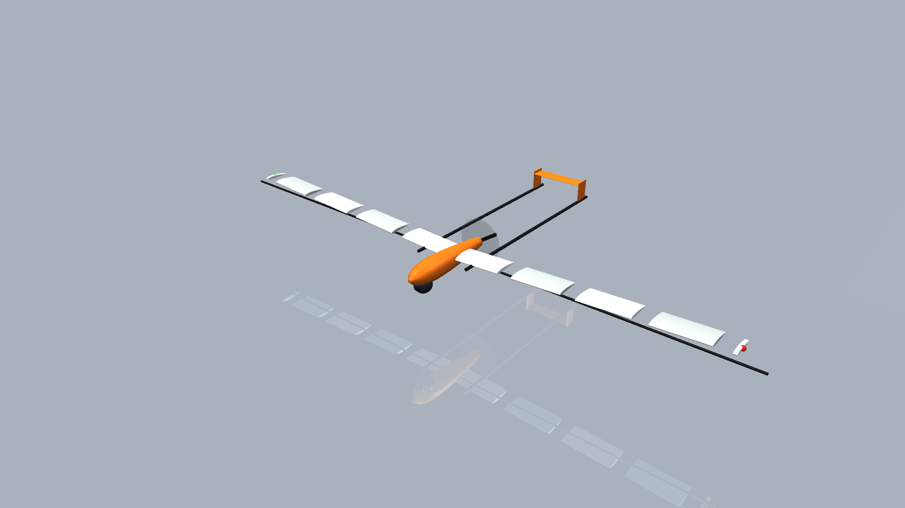<br><sub>How it prints: ten span-wise panels on a 220 x 220 x 250 mm bed, threaded on the carbon spar.</sub></td>
</tr>
</table>

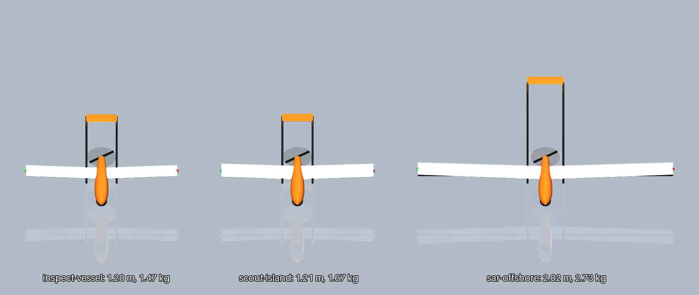

<sub>The lightest, a mid-size and the do-everything airframe, to scale (orthographic). The wings are the
sized ones. The pod, gimbal, booms, tail and prop are reference geometry; the tail is set by volume
coefficients, with an 8 cm chord floor, and is not optimized yet. `uv run osprey recon-render --mission
all`.</sub>

<details>
<summary>Three-view, and each job's own wing</summary>

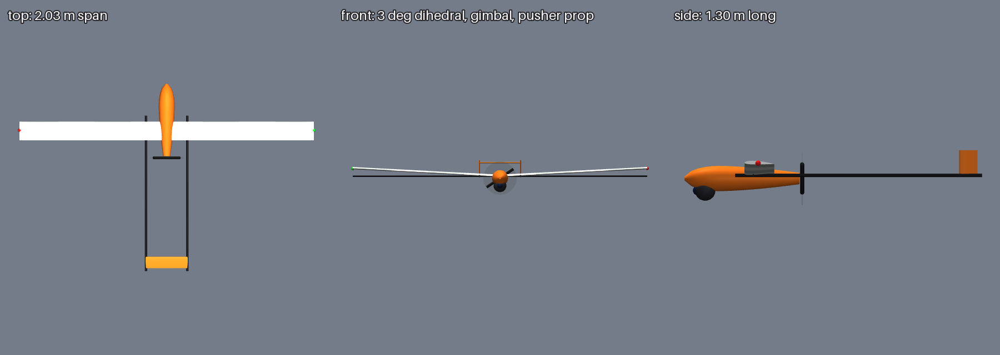

<picture>
  <source media="(prefers-color-scheme: dark)" srcset="docs/img/recon-wings-dark.png">
  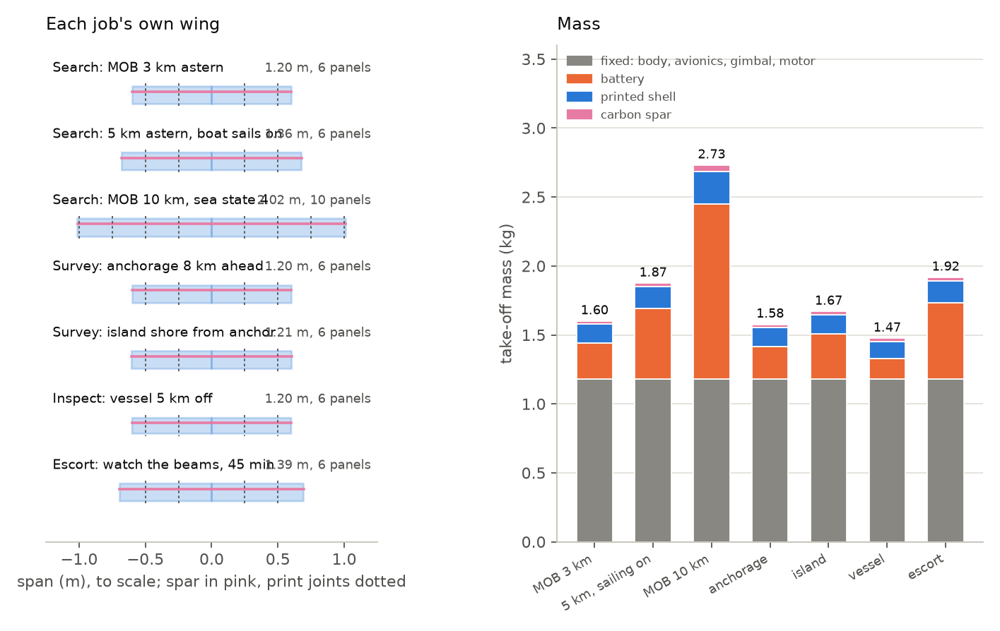
</picture>

</details>

### Flying wings (in progress)

Two tailless airframes are in design: a moulded blended wing body and a printed crescent flying wing,
after the NX-2. The lightest that does all seven jobs is 1.80 kg (blended wing, a PTZ eye each side),
against 2.13 kg for the twin-boom. `osprey recon-buck` turns them into files for mould bucks. The design
notebook, with results, renders and the open questions, is
[docs/blended-wing](docs/blended-wing/README.md).

### Anti-piracy awareness

How far each eye sees a fast skiff coming, and the warning that buys at 30 kn (`osprey recon-awareness`):

<picture>
  <source media="(prefers-color-scheme: dark)" srcset="docs/img/awareness-dark.png">
  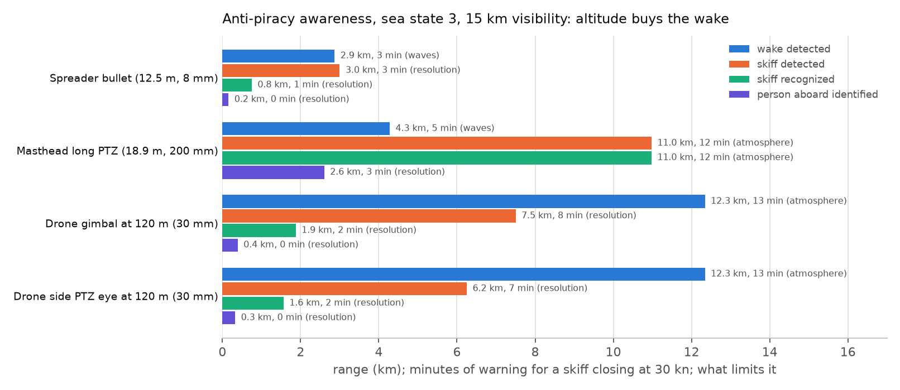
</picture>

- **Altitude buys the wake, not the boat.** A planing skiff's wake is flat on the water. Waves hide it
  from the masthead beyond 1-4 km; from 120 m only the haze limits it, at 12 km in clear air.
- **The mast's 200 mm stabilized PTZ out-ranges the drone's 30 mm gimbal on the skiff itself**: 11 km
  against 7.5 km to detect, 11 km against 1.9 km to recognize. Climbing above 120 m changes nothing with
  these cameras: resolution and haze bind first.
- **So the drone's value is position.** Flying picket 5 km out on the threat side, it sees a wake about
  17 km from the boat: roughly 18 minutes of warning, against 12 from the masthead.
- **Identifying who is aboard still means getting close**: the inspect job, or a longer zoom than this
  gimbal's 30 mm.

What the models say so far:

- **The fixed parts set the size.** Body, avionics, gimbal and motor weigh 1.18 kg, more than everything
  the optimizer controls on most jobs. Their drag holds lift-to-drag at 6 to 9: a cleaner fuselage and
  gimbal fairing is worth more than a better wing. Most jobs want the smallest wing allowed.
- **Stall speed and Reynolds number set the wing.** Every design sits on the 12 m/s stall limit and the
  150,000 chord-Reynolds floor, so the chord stays near 13 cm and the span grows with the battery.
- **Scouting is cheap, searching is not.** Imaging a whole bay 8 km ahead takes 11 minutes on task, and
  identifying a passing vessel two and a half. A 10 km search takes an hour and a half. Offshore, the
  last 10 points of POD take as long as the first 80: a second drone or a thermal camera beats a bigger
  battery.
- **What the boat does matters as much as the drone.** Sailing on, the drone chases the boat home; turning
  back, or sailing for the anchorage being scouted, shortens every flight.

Not modelled yet: low-Reynolds section data, tail sizing and stability (6-DOF), load in the printed shell,
launch and recovery on a moving deck, thermal and night work, and the CV models that would turn the
imagery into a chart of hazards. See [docs/recon.md](docs/recon.md) for the models and the roadmap.

## How Nest and Recon work together

Together they are the first mate's best friend: Nest watches everything within the horizon, all the
time; Recon goes and looks at whatever the captain asks about beyond it.

1. **Nest keeps the watch.** The pods sweep the horizon, track traffic and docking, and see a person go
   over the side. They hold a track and a datum as long as the mast can: about 2 km for a person in the
   water in sea state 3, 800 m in sea state 4.
2. **Recon goes and looks.** Nest's tracks become Recon's tasks: the datum for a search, a vessel to
   inspect, the anchorage on the chart to survey. The drone works beyond the mast's horizon and its wave
   limit, and its imagery comes back into the same picture.
3. **Or they split the circle.** With `spreader-pairs`, the mast's fore and aft pairs take ahead and
   astern, and Recon flies escort round the boat to take the beams. On the bird, the same back-to-back
   mount turned sideways puts a PTZ eye on each side.
4. **Nest brings the drone home.** The pods' lower eyes see the deck and the drone's final approach
   for recovery onto a moving, heeling boat.
5. **Recon lightens the mast.** If the drone does the long-range looking, the masthead's long-zoom PTZ
   can become a mid-zoom one. In the same models that takes about 1.2 kg off the 11.9 kg masthead
   equivalent, and brings the masthead pod's peak draw from 81.4 W to 68.1 W, inside one PoE cable. The
   mass budget still needs more than that.

## How the simulation works

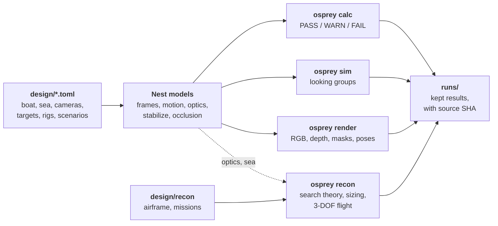

<details>
<summary>What each stage does</summary>

1. **Design inputs.** Everything numeric lives in TOML under `design/`. Code never hard-codes a boat or
   a camera. A rig is a list of stations or pods; any number of cameras works.
2. **Models.** Wave spectra drive the boat's roll, pitch, heave and the mast's bending. Optics turns
   pixels on target into detect, recognize and identify ranges (Johnson criteria), including how often
   waves hide a target. Occlusion ray-casts the mast, sails, hull and pod bodies.
3. **Tasking.** `tasking.Sim` assigns looking groups every tick, in priority order, and charges slew
   and zoom time on every reassignment. With sector watch, an eye may leave its sector only while a
   neighbour still covers it.
4. **Checks.** `osprey calc` reports motion, stabilization, reach, ranging, coverage, docking, mass,
   power, network and timing as PASS, WARN or FAIL. It exits 1 on a FAIL, which is a design finding,
   not a crash.
5. **Synthetic data.** `osprey render` drives a MuJoCo scene with the same motion model and writes, for
   every camera and frame, RGB, metric depth, a class mask and `labels.jsonl` with intrinsics and the
   camera-to-world pose. Real captures from the Phase 0 pod will use the same format.

</details>

<picture>
  <source media="(prefers-color-scheme: dark)" srcset="docs/img/synthetic-frame-dark.png">
  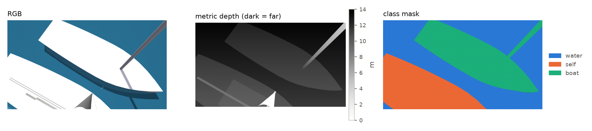
</picture>

<sub>The `port-down` camera at frame 50 of the kept `gecko5` docking render: RGB, metric depth and the
class mask (`self` is our own hull, `boat` the neighbour in the next slip).</sub>

## Quickstart

```bash
uv sync
uv run pytest
uv run osprey calc --scenario coastal-watch --rig gecko5    # PASS/WARN/FAIL checks + figures
uv run osprey sim --scenario mob --rig gecko5               # looking-group timeline
uv run osprey render --scenario docking --rig gecko5        # RGB, depth, class masks, poses
uv run osprey sweep --workers 8                             # every scenario x rig
uv run osprey recon --mission all                           # Recon: size and fly each job, then the matrix
uv run osprey recon-render --mission all                    # Recon: render each sized drone
uv run osprey recon --mission all --airframe crescent       # Recon: the crescent flying wing (or bwb)
uv run osprey recon-buck --mission sar-offshore --airframe bwb   # Recon: OML and buck halves for moulds
uv run osprey recon-awareness                               # Recon: anti-piracy ranges
```

Output goes to `out/` (gitignored). Long sweeps and GPU renders run on two workstations, `gpu1` and
`gpu2`, from a committed snapshot: see [docs/remote-simulation.md](docs/remote-simulation.md).

## Repository layout

| Path | What |
|---|---|
| [`design/boat.toml`](design/boat.toml) | Reference 40 ft sloop: hull, mast, sail plan, motion responses |
| [`design/sea.toml`](design/sea.toml) | Sea states, refraction, visibility |
| [`design/cameras.toml`](design/cameras.toml) | Camera classes: long-zoom PTZ, mid-zoom PTZ (upright and inverted), fixed wide, interior dome, fisheye |
| [`design/electronics.toml`](design/electronics.toml) | Pod kits: SOC, IMU, housing, PoE, network and power budgets |
| [`design/targets.toml`](design/targets.toml) | Target classes and Johnson criteria |
| [`design/rigs/`](design/rigs/) | `gecko5` (pods), `spreader-pairs` (dual mounts on the spreader tips), `mast5` (1 top + 4 round the mast), `mast5-spreaders`, `whole-boat` |
| [`design/scenarios/`](design/scenarios/) | `coastal-watch` (sea state 4), `mob` (sea state 3), `docking` |
| [`design/recon/`](design/recon/) | Recon: the reference printed airframe, airframe variants (blended wing, crescent), payload variants, and the mission profiles (search, survey, inspect, escort) |
| [`src/osprey/`](src/osprey/) | `frames`, `motion`, `optics`, `stabilize`, `occlusion`, `rig`, `tasking`, `calcs`, `figures`, `render/scene`, `cli` |
| [`src/osprey/recon/`](src/osprey/recon/) | `tasks` (search, survey, inspect, escort), `search` (sweep width, POD), `flight` (3-DOF), `sizing` (OpenMDAO + OpenAeroStruct, trim and stability for flying wings), `fleet` (one bird, many jobs), `geometry` and `render` (the bird in MuJoCo), `buck` (mould files), `awareness` (anti-piracy ranges), `figures` |
| [`runs/`](runs/README.md) | Kept runs, never edited after they are archived |
| [`docs/`](docs/) | [Architecture](docs/architecture.md), [Recon](docs/recon.md), [remote runs](docs/remote-simulation.md), README figures |

## Kept runs

| Run | What it shows |
|---|---|
| [`2026-11-06_recon-wings`](runs/2026-11-06_recon-wings/) | Recon: the blended wing and crescent flying wing, each payload, seven jobs and capability matrices; awareness ranges; bucks for the blended wings |
| [`2026-11-06_recon-payloads`](runs/2026-11-06_recon-payloads/) | Recon: seven jobs (search, survey, inspect, escort) for each payload (gimbal, side PTZ eyes), each one's sized airframe and flight, and both capability matrices |
| [`2026-11-06_pairs-sweep`](runs/2026-11-06_pairs-sweep/summary.md) | Every scenario x rig, now with `spreader-pairs` (dual mounts on the spreaders) in full |
| [`2026-11-06_pairs-docking-render`](runs/2026-11-06_pairs-docking-render/) | 10 s docking render on `spreader-pairs`: video, one frame of `lo-port-fwd`, all labels |
| [`2026-11-06_recon-missions`](runs/2026-11-06_recon-missions/matrix.md) | Recon: the first six jobs, gimbal only |
| [`2026-11-06_recon-phase1`](runs/2026-11-06_recon-phase1/) | Recon phase 1: the three search missions only |
| [`2026-11-06_gecko-sweep`](runs/2026-11-06_gecko-sweep/summary.md) | Every scenario x rig with sector watch; `gecko5` reports in full |
| [`2026-11-06_gecko-docking-render`](runs/2026-11-06_gecko-docking-render/) | 10 s docking render on `gecko5` with optimized aims: video, one frame of `port-down`, all labels |
| [`2026-11-06_pods-fisheye-sweep`](runs/2026-11-06_pods-fisheye-sweep/summary.md) | The dropped design: pods with a down-looking fisheye |
| [`2026-11-06_first-sweep`](runs/2026-11-06_first-sweep/summary.md) | Every scenario x rig before pods: calc reports, figures, looking-group timelines |
| [`2026-11-06_docking-render`](runs/2026-11-06_docking-render/) | 20 s docking render on `mast5-spreaders` |

Source SHAs and hosts are in [runs/README.md](runs/README.md).

<details>
<summary>The earlier single-PTZ rig, rendered</summary>

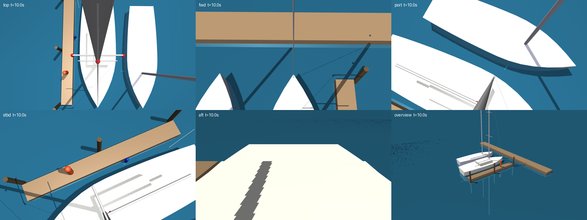

<sub>`mast5-spreaders` docking render: masthead PTZ looking straight down, forward, port and starboard
spreader cameras, the aft camera under the gooseneck, and an overview.</sub>

</details>

## Phases

0. **Bosun's Chair:** a halyard-hoisted pod with an action camera, IMU and GNSS. It measures the real
   masthead motion that replaces the REF motion model.
1. **Look-down docking:** stereo pairs plus deck registration give a costmap for the pilot.
2. **Spotting:** horizon-band detection, horizon-dip ranging and thermal.
3. **Inspection:** the long-zoom PTZ, cued and slewed to targets.

Recon has its own roadmap in [docs/recon.md](docs/recon.md#roadmap):
- design for additive manufacturing in CadQuery;
- stability derivatives and a 6-DOF sim;
- SU2, printed-shell FEA and surrogates.

README figures in `docs/img/` other than the renders and run plots are made from the files in this
repository by [`docs/img/make_readme_figures.py`](docs/img/make_readme_figures.py)
(`uv run python docs/img/make_readme_figures.py`).
