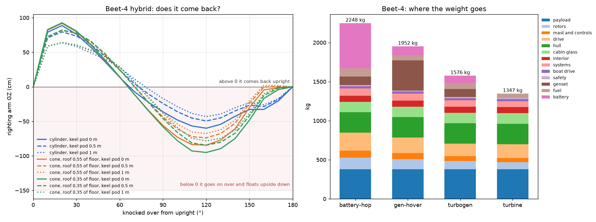

# The Beet: a flying buoy

The Beet is a boat first. It is a circular RIB with a 360° glass observation
cabin and its mass low. A coaxial rotor sits on a mast at the top, a little
like the Roton's cone. It floats like any boat, and makes powered hops to
height before landing back on the water. From 150 m the horizon is 44 km away;
from the deck it is 5 km.

The rotor is traditional, so its lift is known. It is driven electrically,
and a battery or an engine-driven genset supplies the power. This page asks
what the numbers look like: how heavy it is, how big the rotor, how much
power, and whether it comes back upright when a wave knocks it over.

```bash
uv run osprey beet               # out/beet: beet.md, beet.json, beet.png
```

The inputs are in [`design/beet.toml`](../../design/beet.toml), and every
number is a REF stand-in. The kept run is
[`runs/2026-11-11_beet`](../../runs/2026-11-11_beet/beet.md).



## How it is sized

- **Rotor.** Momentum theory sets hover power: ideal induced power over one
  rotor's disc, times 1.16 for the coaxial pair, over a figure of merit of
  0.70. Put through an R44 at its max weight, the model gives 136 kW. The R44
  is rated 153 kW continuous and 168 kW for take-off.
- **Rule of thumb.** At a fixed disc loading, hover power grows with weight
  alone. At 30 kg/m² it is about **180 W of shaft power per kg**.
- **The hop.**
  - Climb to 150 m at 3 m/s.
  - Look for 5 minutes.
  - Come down at 2 m/s, well under vortex-ring onset.
  - Land on the water.
  - Installed power is 1.3× hover, for climb and gusts.
- **Four ways to power it:**
  - **Battery hop:** the battery flies the hop, and a genset of a quarter of
    hover power recharges it afloat.
  - **Hybrid, piston:** a piston genset carries the hover. The battery tops
    it up to installed power and can land the craft from the top if the
    genset stops.
  - **Hybrid, turbine:** the same, with a turbo-generator, which is three
    times lighter per kW and thirstier.
  - **Turbine baseline:** a turboshaft through a coaxial gearbox, no battery.
- **The boat.**
  - The cabin is annular, the seats facing out round a central column. Up to
    six fit inside a 4.3 m hull.
  - The hull costs 18 kg per m² of planform and the glass 9 kg per m².
  - The battery, genset and fuel sit in the bilge, or in a keel pod below it.
- **Afloat.**
  - The hull, its tube, the deck, the cabin and the mast are revolved into one
    sealed mesh and floated at the craft's weight.
  - It is then knocked over by every angle to 180°. GZ, the righting arm,
    must stay above zero all the way round for it to always come back.

## What the numbers say

| 4 seats | Max weight | Rotor | Hover | Genset | Battery |
|---|---|---|---|---|---|
| Turbine baseline | 1,347 kg | 7.6 m | 240 kW | — | — |
| Hybrid, turbine | 1,576 kg | 8.2 m | 281 kW | 311 kW, 104 kg | 15 kWh, 93 kg |
| Hybrid, piston | 1,952 kg | 9.1 m | 348 kW | 386 kW, 386 kg | 18 kWh, 116 kg |
| Battery hop | 2,248 kg | 9.8 m | 401 kW | 111 kW, 111 kg | 76 kWh, 577 kg |
| *R44, for scale* | *1,134 kg* | *10.1 m* | | | |

- **The genset is what buys time at the top.**
  - With a genset carrying the hover, staying up for 15 minutes instead of 5
    costs nothing beyond fuel, about 60 kg per 30 minutes.
  - The battery hop grows from 2,250 kg at 5 minutes to 2,830 kg at 10 and
    5,340 kg at 15, because every kilogram of battery needs more battery to
    lift it.
  - A high-power pack (2 kW/kg) brings the 5-minute battery hop down to
    1,930 kg. That helps, but it doesn't change the curve.
- **Which genset matters most.**
  - A piston genset at 1 kW/kg weighs 386 kg. A turbo-generator weighs 104 kg.
  - With the turbo-generator, the hybrid is within 230 kg of the plain
    turbine.
- **Being a boat first costs 400 kg.** That's the hull (261 kg) and the glass
  (133 kg). It is most of the difference between the turbine Beet-4 and an
  R44.
- **It scales almost linearly.**
  - The hybrid with a piston genset: Beet-2 is 1,509 kg, Beet-4 1,952 kg and
    Beet-6 2,396 kg.
  - The turbine baseline: 1,041, 1,347 and 1,653 kg.
  - The uncrewed buoy with a 20 kg sensor mast is 165–276 kg, depending on
    how it is powered.
- **Disc loading trades rotor size against power.** At 15 kg/m² the hybrid
  Beet-4 needs 199 kW and has an 11.6 m rotor, with 7.7 m/s of downwash. At
  30 kg/m² it needs 348 kW, has a 9.1 m rotor and 11 m/s of downwash, which
  throws heavy spray over the glass and into the engine intake.

## Afloat: stiff, shallow, and it doesn't come back

- **Upright, the disc is very stiff.**
  - It floats 12–23 cm deep.
  - Its metacentric height is 5–10 m, and it rolls back in about a second.
  - So it follows every wave's slope like a cork: hard on the passengers, and
    the rotor tilts with the wave at lift-off.
  - Knocked over 20°, it pushes back with a righting arm of 60–90 cm.
- **Past 70–80° it goes on over and floats upside down.**
  - The curves cross zero at 70–80°, and from there to 180° GZ is strongly
    negative.
  - This holds whatever the cabin shape: a cylinder, or a cone leaning in to
    40% of the floor's radius.
  - It also holds with the battery, genset and fuel lowered into a keel pod a
    metre below the hull.
  - Upside down, it floats on its glass cabin. That is a liferaft's failure
    mode, not a lifeboat's.
- **This corrects the first look.** That estimate checked only the stability
  of the inverted float and suggested a cone and a keel pod would make it
  right itself. The full curve shows the capsize happens long before that,
  at 70–80°.
- **The fixes all point the same way.**
  - A self-righting volume high up: a buoyant mast-top pod, or an inflatable
    bag like those on the RNLI's Atlantic-class RIBs.
  - Or a deep spar keel, which is the layout the spar Puffin's righting study
    found ([docs/puffin](../puffin/README.md)). Literally a flying buoy: a
    spar buoy with a rotor on top.
  - Both cost the shallow disc its cork-like stiffness, which the passengers
    wouldn't miss.

## Not modelled

- Forward flight. The Beet hops up and down.
- Ground effect over water at lift-off.
- The rotor's blades in a knockdown: they are taken as point masses at the
  hub, with no buoyancy.
- Waves and wind on the righting curve. It is computed in calm water.
- Spray and salt ingestion, and noise.
- Any certification. As a boat it could carry up to six paying passengers;
  as soon as it lifts off it is a helicopter carrying passengers (see
  [docs/puffin/markets.md](../puffin/markets.md)).
