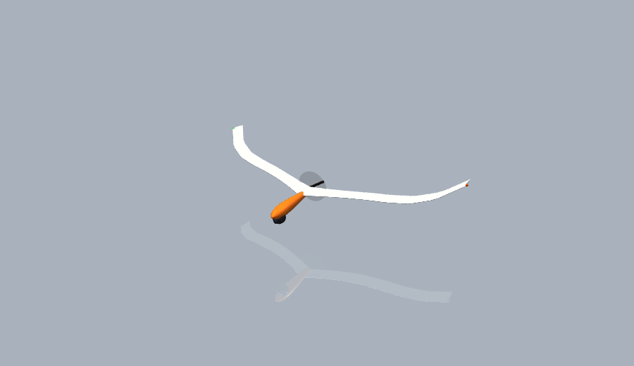
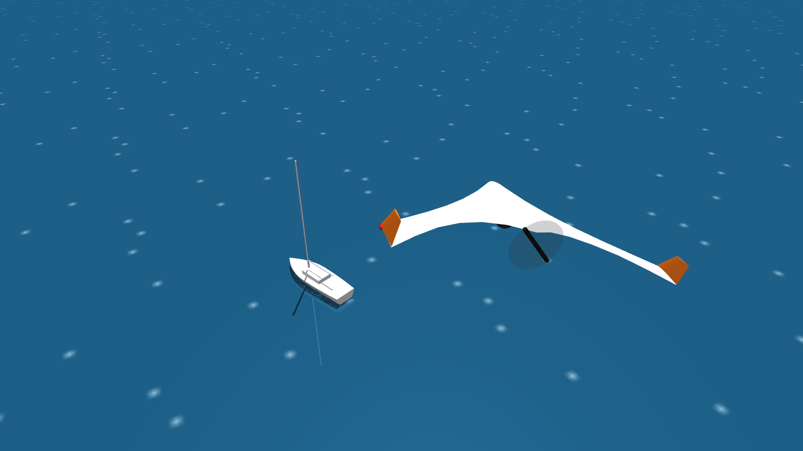
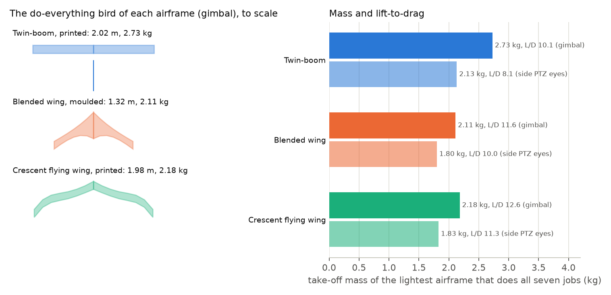
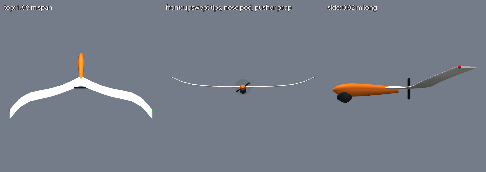
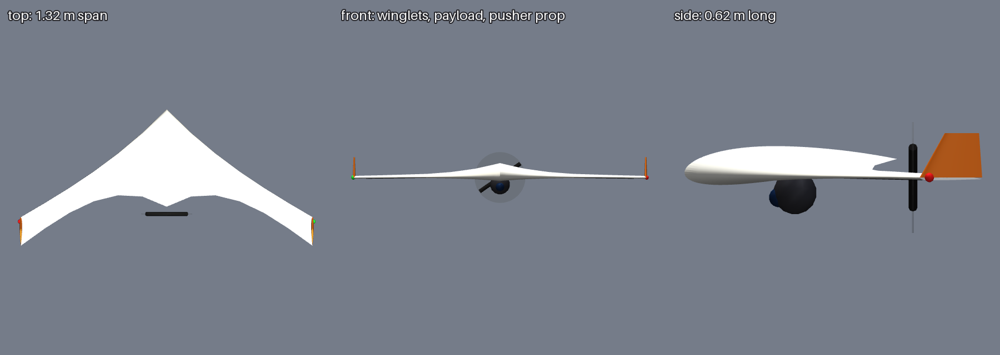
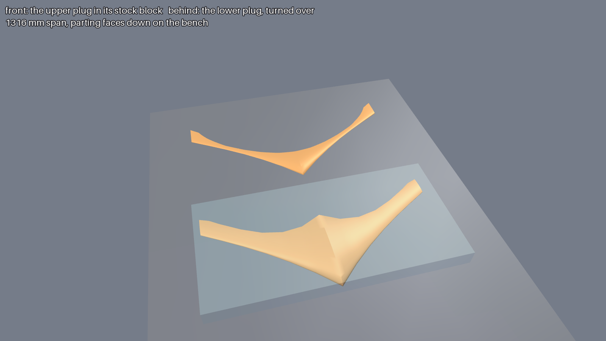
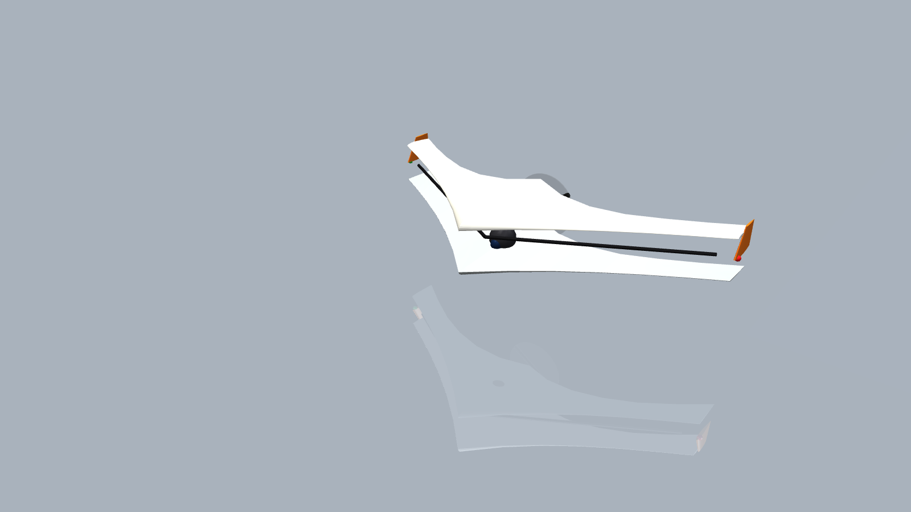
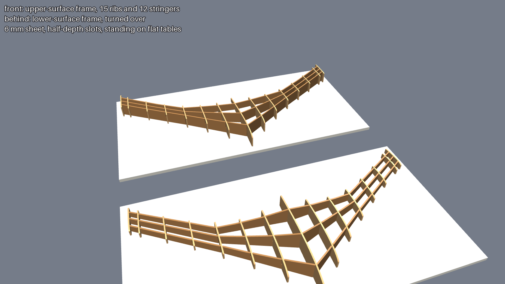
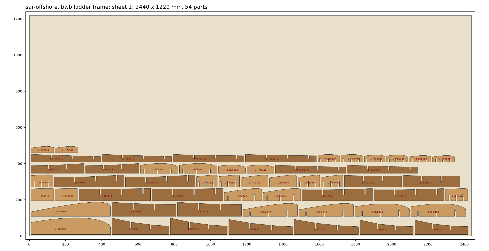
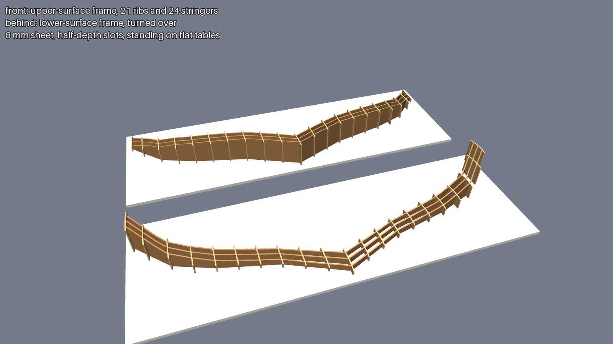

# Osprey Recon: blended-wing and crescent airframes

**Status: work in progress.** This is the design notebook for Recon's tailless airframes, kept here until
the design settles. The main [README](../../README.md) carries only a pointer, and the Recon models are
described in [docs/recon.md](../recon.md). Every input is a REF stand-in, so the numbers show which way
the design should move, not what to build.

<table>
<tr>
<td width="50%"></td>
<td width="50%"></td>
</tr>
</table>

## Why a flying wing

On the twin-boom drone, the fuselage pod, booms and tail are most of the drag (0.010 m² of drag area)
and 0.45 kg of the mass. On wings this small that holds lift-to-drag at 6 to 10. A tailless flying wing
drops the booms and tail and carries the payload inside the wing or a small pod. The price is that the
wing has to trim and stabilize itself.

## Two candidates

**`bwb`: a blended wing body** ([`design/recon/airframes/bwb.toml`](../../design/recon/airframes/bwb.toml)).
- **Shape:** swept and tailless, with a thick centre body (17 % thick at the root, at least 75 mm deep)
  that holds the battery and payload.
- **Construction:** moulded composite skins (REF 0.35 kg/m² of wetted area). The chord is not limited by a
  printer bed, so it needs moulds, and the moulds need plugs.
- **Controls:** winglets for yaw, elevons, and a pusher on the centreline.

**`crescent`: an organic crescent flying wing**
([`design/recon/airframes/crescent.toml`](../../design/recon/airframes/crescent.toml)), after printed
AI-optimized wings like the
[Neuronautics NX-2](https://cults3d.com/en/3d-model/gadget/neuronaut-nx-2-ai-optimized-organic-flying-wing).
- **Planform:** the leading edge's curve is a design variable (OpenAeroStruct x shear at five points
  along the span), so sweep can grow toward the tips.
- **Tips:** they curve up into blended winglets (fixed z shear).
- **Payload:** a slim nose pod carries the camera and battery, so the wing stays thin.
- **Construction:** printed LW-PLA panels on carbon tubes, with nylon-hinged elevons. No moulds, but the
  printer bed limits the chord.

## How they are sized

Same loop as the twin-boom (see [docs/recon.md](../recon.md)): OpenMDAO with OpenAeroStruct, minimizing
take-off mass. The mission-time model is calibrated against the 3-DOF flight sim, then every sized
airframe is flown through all seven jobs. A tailless airframe adds:

- **Trim:** zero pitching moment at the task point, about the CG.
- **Pitch stability:** a static margin of at least 6 % of the reference chord. It comes from the moment
  slope between the task point and a probe point one degree higher.
- **The CG as a design variable:** where the CG of everything but the wing sits, which is where the
  battery goes, within bounds per airframe.
- **Shape:**
  - twist at four or five points along the span (washout for stability);
  - sweep for the blended wing, the leading-edge curve for the crescent;
  - the chord distribution.
- **Volume:** for the blended wing, a centre body deep enough for the battery and payload.

Run it:

```bash
uv run osprey recon --mission all --airframe bwb            # or crescent; add --payload dual for side eyes
uv run osprey recon-render --mission all --airframe bwb     # renders of each sized airframe
uv run osprey recon-plug --mission sar-offshore --airframe bwb    # OML and plug halves for the moulds
uv run osprey recon-frame --mission sar-offshore --airframe bwb   # CNC ladder-frame layout (DXF, SVG, cut list)
```

## Results so far

The lightest airframe that does all seven jobs (search, survey, inspect, escort), from
[`runs/2026-11-06_recon-wings`](../../runs/2026-11-06_recon-wings/) (and the twin-boom from
[`runs/2026-11-06_recon-payloads`](../../runs/2026-11-06_recon-payloads/)):

<picture>
  <source media="(prefers-color-scheme: dark)" srcset="../img/airframes-dark.png">
  
</picture>

| | One gimbal | A PTZ eye each side |
|---|---|---|
| Twin-boom, printed | 2.73 kg, 2.02 m, L/D 10.1 | 2.13 kg, 1.54 m, L/D 8.1 |
| Blended wing, moulded | 2.11 kg, 1.32 m, L/D 11.6 | **1.80 kg, 1.15 m**, L/D 10.0 |
| Crescent, printed | 2.18 kg, 1.98 m, **L/D 12.6** | 1.83 kg, 1.69 m, L/D 11.3 |

The do-everything blended wing with the gimbal (sized for the 10 km offshore search):
- **Planform:** aspect ratio 7.0, 36° mean leading-edge sweep.
- **Stability:** static margin 6 %, CG 0.28 m behind the root leading edge.
- **Power:** 72 W at task speed.

The crescent (same job):
- **Planform:** aspect ratio 16.1, uniform chord of about 13 cm.
- **Stability:** static margin 14 %.
- **Power:** 69 W at task speed.
- **Printing:** 8 panels.

What it says:
- **Losing the tail and booms saves about 0.6 kg**, whichever payload.
- **The two flying wings weigh about the same and differ in kind.** The blended wing is compact, with
  5.8 l inside and room to grow the battery or payload. The crescent is the efficient one, and needs no
  moulds.
- **Side-looking PTZ eyes make the escort, not the long search, the sizing job.** The eyes search far
  faster, which is why the side-eyed birds are lighter.





## From design to moulds

Two words get in the way here. A boat builder's **buck** is the plug a mould is taken off; a car builder's
**buck** is the interlocking ladder frame that sheet or skin is formed over. Osprey keeps them apart:

- **plug**: the positive shape the moulds are taken off (`osprey recon-plug`);
- **ladder frame**: the CNC-cut egg-crate a plug or skin is built over (`osprey recon-frame`).

### Plugs

`osprey recon-plug` writes these for a sized flying wing, in millimetres, x forward, y port, z up:

| File | What |
|---|---|
| `oml.stl` | The outer mould line, both sides |
| `plug_upper.stl`, `plug_lower.stl` | The solids above and below each section's chord line: closed meshes with a flat face where the two moulds part, for a CNC toolpath or a slicer |
| `sections.csv` | Every station's upper and lower points, for hot-wire templates, a CadQuery loft, or checking a cut plug |
| `plug.md` | Sizes, the stock block each half needs, skin area and laminate weight |
| `plugs.png` | A picture of the two plugs on a bench, the upper one in its stock block |

For the gimbal blended wing ([its plug files](../../runs/2026-11-06_recon-wings/bwb/gimbal/sar-offshore/plug/)):

| | |
|---|---|
| Span, root and tip chord | 1316 mm, 441 / 129 mm |
| Centre-body depth | 75 mm |
| Stock, upper / lower plug (25 mm margin) | 667 × 1366 × 119 mm / 666 × 1366 × 104 mm |
| Skin | 0.56 m², about 0.2 kg of laminate |



<sub>The two plugs for the gimbal blended wing, as `osprey recon-plug` writes them: the upper plug in front,
inside a ghost of the 667 × 1366 × 119 mm block it is cut from, and the lower plug behind it, turned over.
Both sit on their parting faces.</sub>



### Ladder frames

Instead of machining a plug from a block, build it over a frame: flat ribs and stringers cut from one sheet
of 6 mm MDF or birch ply, slotted together half-depth into an egg-crate that stands on a flat table. Their top
edges trace the surface 3 mm inside the outer mould line, so planking or foam faired to the frame lands on
the designed shape. There are two frames, one for each mould half; the lower one is built upside down.
`osprey recon-frame` writes them from the sized wing ([`src/osprey/recon/frame.py`](../../src/osprey/recon/frame.py),
settings in `[frame]` of [`design/recon/airframe.toml`](../../design/recon/airframe.toml)):

| File | What |
|---|---|
| `frame_sheet<N>.dxf` | One per sheet, R12, millimetres. Layer CUT: each part's closed outline with its slots. LABEL: part names to engrave or ignore. SHEET: the stock outline, not cut |
| `frame_sheet<N>.svg` | The same sheet, to look at |
| `frame_sheets.png` | All the sheets |
| `frame.md` | The cut list (each part's size, slots and sheet) and how it goes together |
| `frame.png` | Both frames assembled on their tables |

How the frame is laid out:
- **Ribs** sit every 100 mm across the span, in planes of constant y, so each one is a wing section.
- **Stringers** follow 20, 50 and 80 % of the chord on each wing half. A wing whose edges curve can't take a
  straight stringer from root to tip, and a curved one won't cut flat. So each stringer is a few straight
  runs that break at the same ribs (the fewest runs that stay inside the planform with a slot's worth of rib
  either side). Runs breaking together can't cross.
- **Joints:** where a rib and a stringer cross, each part gets a slot half the local depth, the rib's from
  below and the stringer's from above. A swept stringer crosses at an angle, so both slots widen by 1/sin of
  it. Run ends butt the faces of the root, tip and break ribs, and get glued there.





| | Blended wing ([files](../../runs/2026-11-06_recon-wings/bwb/gimbal/sar-offshore/frame/)) | Crescent ([files](../../runs/2026-11-06_recon-wings/crescent/gimbal/sar-offshore/frame/)) |
|---|---|---|
| Parts, upper + lower frames | 54: 30 ribs, 24 stringer runs | 90: 42 ribs, 48 stringer runs |
| Slotted joints per frame | 30 | 36 |
| Tallest part off the table | 92 mm | 160 mm |
| Stock | One 2440 × 1220 × 6 mm sheet, 0.75 m² of it used | One sheet, 1.63 m² used |



## Not worked out yet

**Aerodynamics**
- **Airfoils:** the vortex-lattice model has flat panels. Reflexed sections, the usual way a flying wing
  trims, aren't modelled; twist and sweep do all of it. Section polars (XFOIL), or AVL with real
  sections, are the next fidelity step.
- **Lateral and directional stability:** winglets, dihedral effect and Dutch roll aren't modelled; only
  pitch is. That needs AVL or VSPAERO derivatives and a 6-DOF sim.
- **Elevons:** no sizing for control power, trim drag or pitch authority at low speed, which matters for
  recovery to the boat.
- **The stall:** swept tips stall first. Tip stall and spin resistance aren't checked.

**Sizing**
- **The crescent's chord:** it sits at the 150,000 Reynolds floor everywhere. The NX-2's wide root
  would come from a payload or volume requirement in the wing, which the optimizer doesn't have.
- **The blended wing's span:** it sits on its 1.0 m minimum for most single jobs. That bound is mine
  (handling), not physics.
- **Packaging:** the CG range is a pair of bounds, not a check that the battery, payload and wiring
  actually fit there.

**Structure and making it**
- **The shell carries no load in the model**, and printed LW-PLA is weak between layers.
- **The parting surface follows each section's chord line, so with washout it is gently twisted.** The
  plugs need a parting board shaped to it, plus flanges, draft and a release finish.
- **Separate parts:** winglets, the payload fairing, the hatch and the motor mount aren't in the plug or
  frame files.
- **The ladder frames:**
  - The nesting packs bounding boxes in rows; it doesn't interlock the curved parts.
  - Slot corners aren't dog-boned for a round bit.
  - The frames stand on one flat table. The crescent's lower frame has its upswept tips at the bottom, so
    most of its root ribs are blank board below the surface. A stepped table would save it.
  - The crescent's tip runs have one slot each; closer ribs there would hold them better.
- **CNC:** these are meshes. A smooth STEP loft from `sections.csv` (CadQuery) is the next step for
  toolpaths.
- **The crescent's printing:** panel splits, dowels and tube channels for it aren't generated yet.
