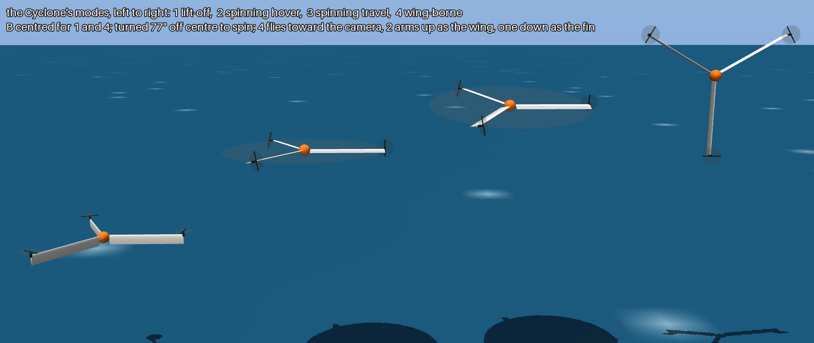
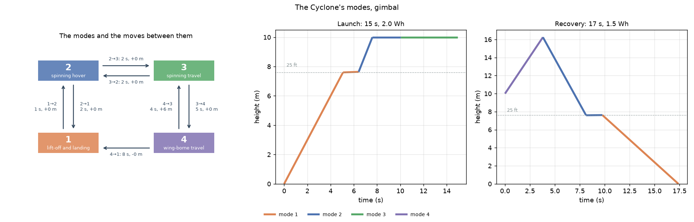
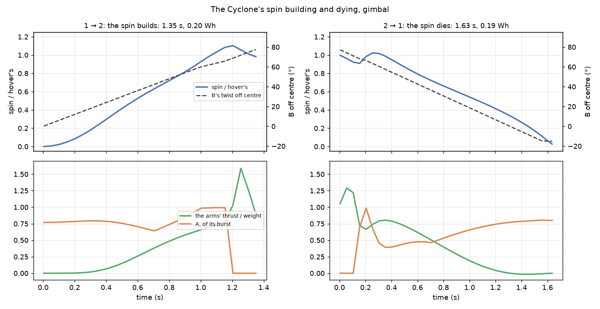
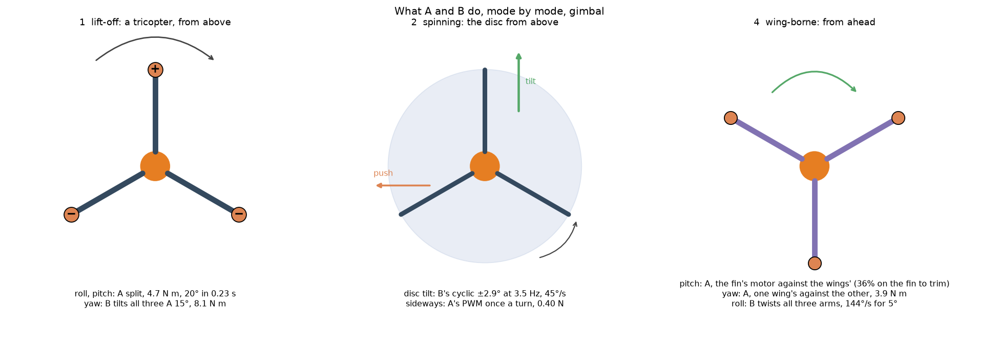
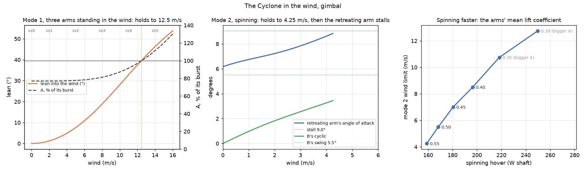
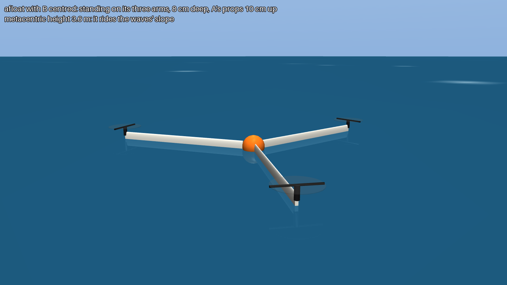
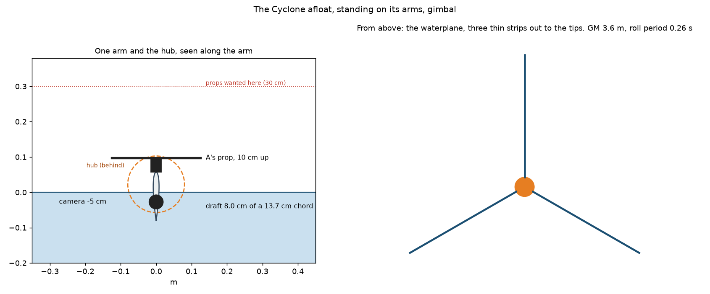
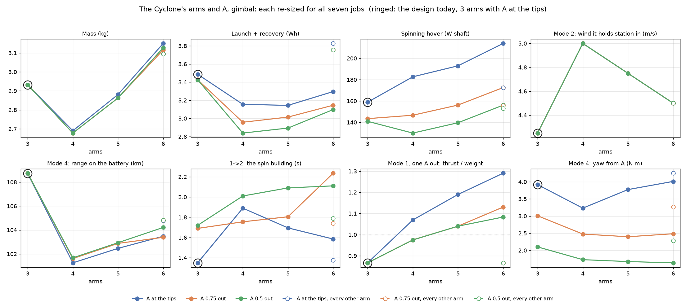
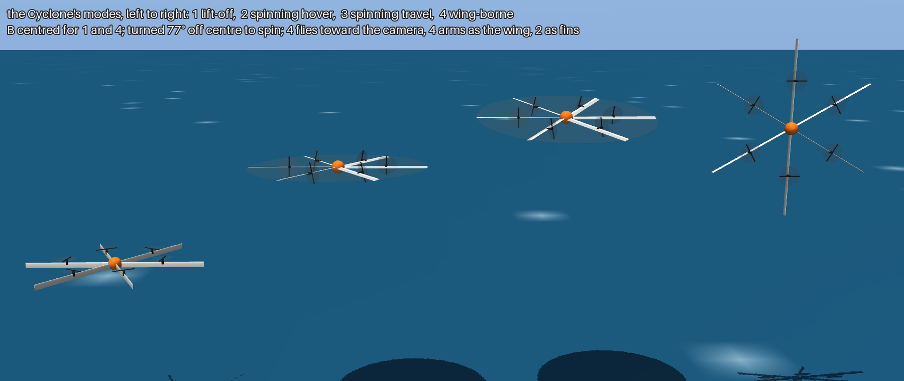

# The Cyclone

**Status: work in progress.** Recon built as a Cyclone: three wing arms that spin as one rotor to hover
and stop to fly as a wing, after Nick Rehm's Cyclone-Rotor tricopter. Every input is a REF stand-in, in
[`design/recon/cyclone.toml`](../../design/recon/cyclone.toml), so the numbers show which way the design
should move, not what to build. How it compares with the float plane and the tailsitter is in
[docs/float-launch](../float-launch/README.md).



<sub>The gimbal Cyclone in its four modes, rendered from the sized design. Left to right: 1 lifting on A
with B centred; 2 spinning (the disc it sweeps is drawn); 3 the spinning disc tilted to travel; 4
wing-borne, two arms up as a 30° dihedral wing and one down as the fin, flying toward the camera.</sub>

## The parts

- **A:** the motors at the arm tips. They lift in mode 1, push the arms round in modes 2 and 3, and push
  forward in mode 4.
- **A2**, optional: motors half-way along each arm. They share mode 1's lift and cover a motor out there.
- **B:** the blade servos. Each twists its arm, and the A motor on it, about the arm's own axis.

| Mode | B | A | What it is |
|---|---|---|---|
| **1** lift-off and landing | centred: the chords and A point up | lifting | a tricopter, for the first and last 25 ft (7.6 m) |
| **2** spinning hover | turned 77° off centre, left or right | pushing round | the whole bird one spinning prop |
| **3** spinning travel | as 2 | as 2, the disc tilted | a slow rotorcraft |
| **4** wing-borne travel | centred again, with the old spin axis now pointing along the flight path | pushing forward | mode 1 turned horizontal |

A modes manager moves the bird between modes only along the edges shown below, and only when each
move's guard holds. It charges every move's time, height and energy to the sortie
([`cyclone_modes.py`](../../src/osprey/recon/cyclone_modes.py)).



## The bird

Each Cyclone is re-sized from the twin-boom one-bird until it does all seven jobs as a wing
([`runs/2026-11-09_recon-cyclone-arms`](../../runs/2026-11-09_recon-cyclone-arms/cyclone/)).

| | Gimbal | A PTZ eye each side |
|---|---|---|
| Mass (tailsitter) | **2.93 kg** (2.96) | **2.30 kg** (2.22) |
| Rotor, flying span | 2.18 m, 1.89 m | 1.70 m, 1.47 m |
| A, rated | 423 W, 0.15 kg | 293 W, 0.12 kg |
| Spinning hover (tailsitter) | 159 W at 209 rpm (410 W) | 122 W at 217 rpm (265 W) |
| Launch + recovery (tailsitter) | 15 + 17 s, **3.5 Wh** (6.0) | 14 + 14 s, **2.3 Wh** (3.9) |
| Wing-borne: stall, best L/D | 14.7 m/s, 8.0 | 12.1 m/s, 7.8 |
| Wing-borne: endurance, range | 1.7 h, 109 km | 1.0 h, 54 km |
| Motors off | seeds down at 3.2 m/s | 3.7 m/s |

## The spin building and dying

Each arm is a blade made of elements, with a symmetric section that lifts linearly up to its stall at 9°
and acts as a flat plate beyond it. The air through the disc comes from momentum theory, worked out ring
by ring. To carry the weight at the hover's 209 rpm, the arms sit 12.5° to the spin plane. The tips then
meet the air at 6.2°, 2.9° under the stall. The blade elements' hover power, 80 W into the air, agrees
with the rotor model's 75 W.

The moves into and out of the spin are stepped through time
([`cyclone_dynamics.py`](../../src/osprey/recon/cyclone_dynamics.py), the loop in
[`sim/src/rotor.rs`](../../sim/src/rotor.rs)):

- **1 → 2, the spin builds.** B turns at 60°/s. Each step it turns as far as A, at up to its burst, can
  still hold the height.
- **2 → 1, the spin dies.** B turns back as fast as A can take the weight. The arms, now broadside to
  their own motion, brake the spin. Past centre, B turns A 15° against the spin to finish it.



- **Building takes 1.35 s and dying 1.63 s**, with the height held to within 6 cm. The spin builds about
  as fast as B can turn, so B's slew sets it, not A's power. The modes manager now charges these times;
  before, it assumed a flat 3 s, which stays as B's budget for the move.
- Charged at their real length, the moves brought launch and recovery down from 6.0 to 5.4 Wh with the
  gimbal. Flying the pitch-over properly ([below](#the-pitch-over-from-3-to-4)) brings it to 3.5 Wh, and
  2.3 Wh with the side eyes.
- Mode 1 is still the exposed window. A fall from 25 ft takes 1.2 s, against the 1.3 s B needs to turn
  the bird into a spin.

## What A and B can control



| Mode | Axis | By | Can do (gimbal) |
|---|---|---|---|
| 1 | roll, pitch | A, one up and two down | tilts 20° in 0.23 s |
| 1 | yaw | B, all three A tilted 15° | 8.1 N m |
| 2 | disc tilt | B's cyclic once a turn, at 3.5 Hz | ±2.9°, as far as the stall allows: tilts the disc at 45°/s |
| 2 | sideways | A's PWM once a turn, ±30% | 0.4 N, about the push of a 0.8° lean |
| 4 | pitch | A, the fin's motor against the wings' | trims with 36% of the thrust on the fin's motor |
| 4 | yaw | A, one wing's motor against the other's | 3.9 N m at cruise thrust |
| 4 | roll | B, all three arms twisted the same way | 144°/s for 5° of twist |

- **Mode 4 is your split: A's PWM gives the fine control, B the large corrections.** Pitch and yaw are
  A's. Twisting the fin alone only gives a side force, because the fin sits level with the centre of
  gravity, with nothing behind it to turn the bird. Roll is B's. Rolling in mode 4 is turning about the
  old spin axis, so all three arms damp it.
- **In mode 2, B steers.** A's thrust is nearly in the spin plane, so pulsing it once a turn barely tilts
  the disc. It does push the whole bird sideways, which can help hold station without tilting.

## Wind



- **Mode 1 holds station up to 12.5 m/s** (10.2 m/s with the side eyes). Standing chord-up, the three
  arms are flat plates to the wind: their pushes add up to 1.5 arms' worth. The bird leans into the wind
  on A's burst, until the lean uses all of it.
- **Mode 2 holds station only up to 4.25 m/s** (3.5 m/s), the bird's first hard limit. In a wind, the
  advancing arm meets the air faster than the retreating one. B's cyclic trims out the roll this causes,
  but that drives the retreating arm's angle of attack up to its stall. Before B can answer, a 1 m/s gust
  tips the disc at 15°/s; B's cyclic tilts it at 45°/s.
- **Mode 3 tops out at the same speed**, about 4 m/s. The rotor model had assumed mode 3 could reach
  0.35 of the tip speed (8.4 m/s). The range on the battery falls from 44 to 25 km with the gimbal.
- **Spinning faster fixes it.** Spinning faster for the same thrust lowers the arms' mean lift
  coefficient from its present 0.55, leaving the retreating arm more of the stall:

| Mean lift coefficient | rpm | Spinning hover | Mode 2 wind limit | Fits A's rating? |
|---|---|---|---|---|
| 0.55 (now) | 209 | 159 W | 4.25 m/s | yes |
| 0.45 | 231 | 180 W | 7.0 m/s | yes |
| **0.40** | 244 | 196 W | **8.5 m/s** | yes: 398 W peak against 423 W |
| 0.35 | 261 | 218 W | 10.75 m/s | no: bigger motors |

At 0.40, the spinning hover costs 23% more power, but the mode 2 wind limit doubles. A is rated for
mode 1's burst, not for the spin, so the motors don't change, and the same holds with the side eyes. Until
then, in more than about 4 m/s of wind, recover by going **4 → 1** straight, since mode 1 holds station
in 12 m/s.

## On the water



Afloat with B centred, it stands on its three arms' trailing edges, chords up and A's props up, just as
in mode 1 ([`cyclone_water.py`](../../src/osprey/recon/cyclone_water.py)).



| | Gimbal | Side eyes |
|---|---|---|
| Draft | 8.0 cm of a 13.7 cm chord | 8.8 cm of a 21.0 cm chord |
| Sealed volume / displaced | 2.4× | 4.7× |
| Metacentric height | **3.6 m** | 2.7 m |
| Roll, heave periods | 0.26 s, 0.42 s | 0.27 s, 0.42 s |
| A's props above the water | **10 cm** (30 cm wanted) | 16 cm |
| The camera | **5 cm under the water** | at the waterline |
| Clear of the water on A's burst | 0.14 s | 0.14 s |
| Launches up to | sea state 4 | sea state 3 |

- **It sits very stiffly.** Its waterplane is three thin strips reaching out to the tips, so the
  metacentre is metres up. Its natural periods are a quarter of a second, so it rides the waves' slope
  instead of rolling to them. Each B servo holds its arm chord-up with 0.07 N m at 10° off, well within
  what it can hold.
- **It leaves the water edge first in 0.14 s.** Surface tension along both faces is 1.5% of the weight,
  so there is nothing to break free of.
- **The launch limit is mode 1:** sea state 5's design wave rises faster than mode 1 climbs, and its
  wind is past mode 1's lean.
- **Two fixes for the water.** Raise A on motor mounts about 20 cm taller, so the props are out of the
  spray. Fold the gimbal up into the hub when afloat, since it hangs in the water.
- **After a seed fall it lies flat**, with A's props in the water. B has to stand the arms up before it
  can launch, and that hasn't been modelled.

## The pitch-over from 3 to 4

Going wing-borne, the spin dies with B back at centre and A pointing up, and the bird pitches over until
the wing carries it. The first model swung the nose down at a fixed 30°/s, with A pushing only enough to
hold the height. It was level in under 3 s at mode 3's 4 m/s, a quarter of the speed the wing needs, so it
dived to gain speed. That cost 17 m (gimbal) to 53 m (six arms, A half-way), and every launch climbed in
mode 2 to that much above the 10 m safety height first.

Now it is flown as a transition should be ([`sim/src/cyclone.rs`](../../sim/src/cyclone.rs)):

- It starts from mode 3's climb, at 2 m/s up.
- A runs at its burst throughout.
- The bird tilts forward only as far as A's thrust and the wing's growing lift still hold the height,
  never faster than 30°/s. The rest of the thrust speeds it up.
- It is done at 1.2 times the stall, where the wing takes the weight and A throttles back.

The gimbal bird is wing-borne in **3.2 s and 31 m, losing no height**. It now starts from the 10 m safety
height instead of 27 m, so launch drops from 3.4 to 2.0 Wh. Recovery starts from the same height, so it
drops too: launch and recovery together go from 5.4 to **3.5 Wh**, against the tailsitter's 6.0. Every
combination in the sweep below also loses no height in the pitch-over.

## How many arms, and where A goes



Three to six arms; A at the tip, three-quarters or half-way out; on every arm, or on every other arm with
six. Each combination is re-sized for all seven jobs ([`cyclone_sweep.py`](../../src/osprey/recon/cyclone_sweep.py),
[`runs/2026-11-09_recon-cyclone-arms`](../../runs/2026-11-09_recon-cyclone-arms/sweep/)).

**In mode 4 the arms make the wing.** An arm more than 30° off vertical lifts; the rest are fins:

| Arms | Mode 4 |
|---|---|
| 3 | two lifting at 30° dihedral, a fin straight down |
| 4 | an X: all four lifting, at 45° |
| 5 | four lifting, a fin straight down |
| 6 | four lifting, 30° above and below level, a fin straight up and one straight down |

The wing's area is the lifting arms', so with four or more each arm is about half the chord. Six arms fly
mode 4 exactly like three: the same area, span and lift-to-drag, 8.0.



<sub>Six arms, A half-way out, gimbal. In mode 4 (right) four arms lift at 30° either side of level and
two are fins, one straight up and one straight down.</sub>

The gimbal bird, best first by launch and recovery:

| | Mass | Spinning hover | Mode 2 wind | Launch + recovery | Range | One A out in mode 1 |
|---|---|---|---|---|---|---|
| **4 arms, A half-way** | **2.68 kg** | **130 W** | **5.0 m/s** | **2.8 Wh** | 102 km | 0.98 × weight |
| 5 arms, A half-way | 2.86 kg | 140 W | 4.75 m/s | 2.9 Wh | 103 km | 1.04 × |
| 6 arms, A half-way | 3.13 kg | 156 W | 4.5 m/s | 3.1 Wh | 104 km | 1.08 × |
| 6 arms, A at the tips | 3.15 kg | 214 W | 4.5 m/s | 3.3 Wh | 103 km | **1.29 ×** |
| 3 arms, A half-way | 2.93 kg | 141 W | 4.25 m/s | 3.4 Wh | 109 km | 0.87 × |
| 3 arms, A at the tips (now) | 2.93 kg | 159 W | 4.25 m/s | 3.5 Wh | **109 km** | 0.87 × |
| 6 arms, A on every other arm | 3.10 kg | 153–172 W | 4.5 m/s | 3.8 Wh | 105 km | 0.87 × |

The side eyes' bird ranks the same way: 4 or 5 arms with A half-way at 1.9–2.0 Wh, against 2.3 Wh now
(`sweep/dual/sweep.md`).

- **A further in pays when spinning.** Its nacelles go round slower: with three arms, at half-way they
  cost 3 W in place of 20 W. A pushes a little less efficiently there (0.56 in place of 0.60), but that
  costs less than the nacelles save: 141 W to hover in place of 159 W. The spin's inertia drops too, so B
  tilts the disc faster: 69°/s in place of 45°/s.
- **What A further in costs** is leverage. Mode 1 takes 0.25 s rather than 0.23 s to tilt 20°. Mode 4's
  yaw from A falls from 3.9 to 2.1 N m with three arms. The wings' motors sit closer together, so a motor
  out yaws it less, but the corrections are smaller too.
- **Four arms, as an X, is the best fit.** It is the lightest at 2.68 kg. Its four 7 cm arms have 30%
  less area than three 14 cm arms, and there is no fin, so it has less profile drag and needs 0.19 kg less
  battery for the same seven jobs. Its lift-to-drag is about the same, 7.9 against 8.0, so the smaller
  battery is why its range is 102 km against 109. It also spins on the least power and holds station
  spinning in the most wind.
- **Six arms buy redundancy, not efficiency.** It is 0.2 kg heavier than three, for the extra spars, B
  servos and motors. With A at the tips it can lose one A in mode 1 and still climb, at 1.29 × the
  weight. That is the exposed window for every three-arm design, which has 0.87 ×. With A half-way, six
  arms still hold 1.08 ×. A on every other arm gives that back, with no gain.
- **The catch with four or more arms is the chord**, about 7 cm in place of 14. Afloat they stand on
  those chords, so A's props are only 5 cm above the water and the camera is 7–8 cm under it. And a 7 cm
  section at these speeds runs at half the Reynolds number, which the sweep doesn't charge for: the
  section's drag and stall are held at the 14 cm chord's.

## Not modelled yet

- Closed-loop stability and control in each mode: the authority is here, but the controller isn't.
- The arms flexing, and their loads while spinning.
- Gust dynamics beyond the first moment, and the wind's lift on the arms in mode 1 as the bird leans.
- The arms twisting from flat to standing in the water, waves breaking over the bird, and the hub's seals.
- A de-spun camera mount: in modes 2 and 3 the camera spins with the bird and is blind.
- The narrower arms' lower Reynolds number with four or more arms, and the non-planar wing's induced drag
  (mode 4 is charged on its projected span alone).

## Run it

```bash
uv run osprey recon-cyclone --payload all
uv run osprey recon-cyclone-sweep --payload all     # three to six arms, A along them; about 10 min on 8 cores
```

For each payload this writes `cyclone.md` (the bird and each mode's abilities), `modes.md` (every move's
guard and cost), `dynamics.md` (spin, control, wind), `water.md` and `cyclone.json`, with every figure
and render on this page; the sweep writes `sweep.md`, `sweep.json`, `sweep.png` and renders of six arms
with A half-way and of the best. The blade elements, the spin's moves, the wind trims and the water launch run
in Rust ([`sim/`](../../sim/)).
