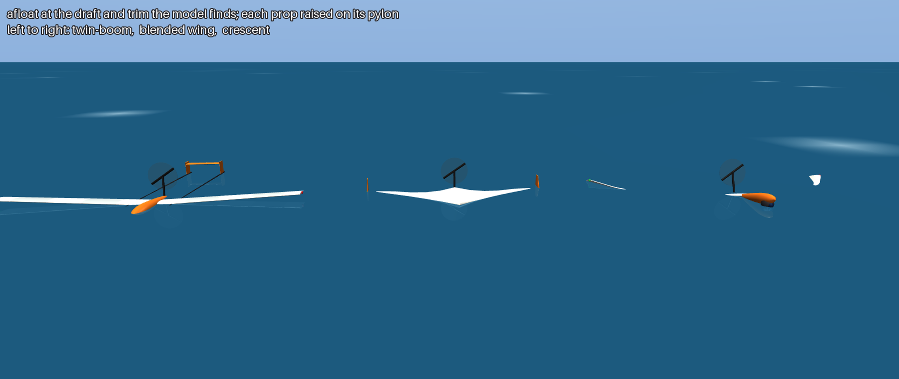
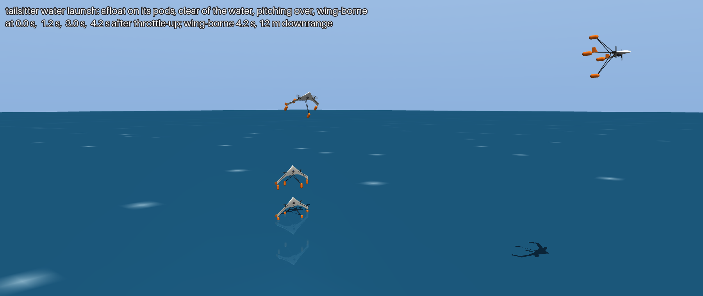
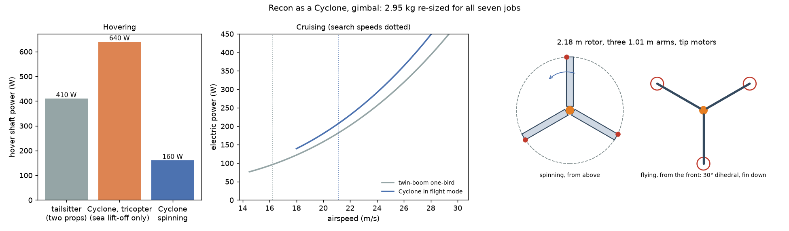
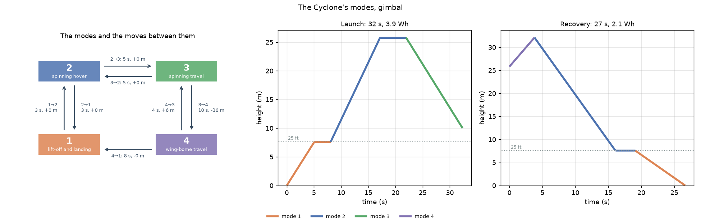

# Osprey Recon: landing on the sea and taking off from it

**Status: work in progress.** This is the design notebook for Recon's water operations, kept here until
the design settles. The main [README](../../README.md) carries only a pointer, and the Recon models are
described in [docs/recon.md](../recon.md). Every input is a REF stand-in, so the numbers show which way
the design should move, not what to build.



## Why the bird needs to float

Recon is recovered to a moving boat. Sometimes it won't make the boat: the sea is too rough for a hand or
net catch, the battery is low, or something has failed. Then it should come down on the water nearby,
float and wait for a boathook. And in a quiet anchorage, a bird that takes off from the water can be
launched off the swim platform, with no catapult and no throw.

## What water asks of the bird

The spec, in `[water]` of [`design/recon/airframe.toml`](../../design/recon/airframe.toml), with an overlay
per airframe:

| Requirement | Spec (REF) | Why |
|---|---|---|
| Reserve buoyancy | Sealed volume at least 2 × what it displaces | Floats with half its volume dry; seaplane floats carry 1.8 |
| Floating trim | About level | Nose high or tail low puts the prop or the elevons in the water and makes the take-off run start badly |
| Prop clear of the water | Tips 5 cm above the calm waterline, afloat | Spray in the first metres of the run eats a prop, and a pusher sits in the worst of it |
| Cameras clear of the water | Out of it, afloat | Salt on a lens, and a gimbal under the belly is the first thing to hit |
| Getting over the hump | Thrust, less air drag and water resistance, at least 0.10 × weight all the way | Water resistance peaks at the hump before the hull climbs onto its step and planes; a hull that can't get over it never gets off |
| Waves for take-off | Significant height up to 10 % of the planing shoe's length | A rule of thumb from floatplanes |
| Landing loads | FAR 23.527 hull load factor, against the 3 g the structure is sized for | Touching down on water is a slam, and it grows with the square of the touchdown speed |
| The float kit | 0.10–0.14 kg: a planing shoe with a step and a 20° V bottom, seals and gaskets, a prop pylon; 0.0015 m² of drag area | Sized and flown with the bird |

## How the model works

[`src/osprey/recon/water.py`](../../src/osprey/recon/water.py), run with `osprey recon-water`:

- **Afloat:** it floats the sized bird's own meshes (the ones the renders draw: wing, pod, booms, tail). The
  volume below the waterline comes from the divergence theorem over the clipped surface. It solves for the
  draft that displaces the bird's weight and the trim that puts the centre of buoyancy under the CG, then
  measures the prop's and the cameras' clearance.
- **Take-off:** a run on calm water at full power. Static thrust is momentum theory with a figure of merit
  (18 N from the REF 400 W motor and 23 cm prop), falling off with speed. Water resistance is a hump curve
  on the weight still on the water, and air drag uses the sized polar. Lift-off is at 1.15 × stall.
- **Landing:** the FAR 23.527 hull load factor from stall speed, weight and the shoe's deadrise.
- **Mass:** every job is flown again with the kit. `--water` sizes the bird with the kit aboard from the
  start, like any other fixed mass.

```bash
uv run osprey recon-water --run runs/2026-11-06_recon-wings/bwb/gimbal --mission sar-offshore --airframe bwb
uv run osprey recon --mission all --airframe bwb --water      # size and fly all seven jobs with the kit aboard
uv run osprey recon-water --mission sar-offshore --airframe bwb --water
```

## Results: the float plane

Each airframe's do-everything bird, with each payload, from
[`runs/2026-11-07_recon-water`](../../runs/2026-11-07_recon-water/). `bolt-on/` takes the birds sized
without the kit and adds it. `sized/` sizes and flies all seven jobs again with the kit aboard from the
start, and the same jobs set the one-bird as before.

| Bird | Without the kit | Kit bolted on | Sized with the kit | Reserve buoyancy | Trim afloat | Prop pylon | Take-off run | Landing load |
|---|---|---|---|---|---|---|---|---|
| Twin-boom, gimbal | 2.73 kg | 2.85 kg, eats the reserve | **3.01 kg** | 2.5 | level | 18 cm | 18 m | 6.3 g |
| Twin-boom, side eyes | 2.13 kg | 2.25 kg, eats the reserve | **2.33 kg** | 2.7 | level | 18 cm | 15 m | 7.4 g |
| Blended wing, gimbal | 2.11 kg | 2.21 kg, eats the reserve | **2.38 kg** | 2.9 | level | 17 cm | 15 m | 7.4 g |
| Blended wing, side eyes | 1.80 kg | 1.90 kg, eats the reserve | **1.97 kg** | 2.9 | level | 17 cm | 12 m | 7.9 g |
| Crescent, gimbal | 2.18 kg | 2.32 kg, eats the reserve | **2.51 kg** | **1.6** | **12° nose up** | 19 cm | 16 m | 7.2 g |
| Crescent, side eyes | 1.83 kg | 1.97 kg, eats the reserve | **2.05 kg** | **1.7** | **16° nose up** | 24 cm | 13 m | 7.7 g |

<sub>Reserve buoyancy is sealed volume over volume displaced (spec ≥ 2). The pylon is what lifts the prop
tips 5 cm clear of the calm water, afloat. The run is on calm water at full power. The landing load is
FAR 23.527 with a 20° V shoe; the structure is sized for 3 g. "Eats the reserve": the hardest job lands
with 2–9 % of the battery left, against the 17 % the missions keep. Each bird's full sheet is
`water/water.md` in its directory.</sub>

What it says:
- **Floating is the easy part, except for the crescent.** The twin-boom and the blended wing float level
  on their wings with 2.5–2.9 × the volume they need. The crescent's slim pod is forward and its mass is
  aft, so it floats 12–16° nose up with its swept wings awash, at 1.6–1.7 ×. It needs more sealed volume
  aft: foam-filled panels, or sponsons at the wing roots.
- **Every pusher prop sits 12–18 cm under the water.** Each layout needs its prop raised 17–24 cm on a
  pylon, or a different arrangement: a tractor prop on the nose, or two motors on top of the wing. This is
  the biggest change to the layouts, and a high thrust line pitches the nose down, which the elevons
  would have to hold.
- **The cameras are in the water.** The belly gimbal sits 3–12 cm under it, and so do the side eyes. They
  need to retract, or move up.
- **Getting off is not the problem.** The REF 400 W motor and 23 cm prop give 18 N of static thrust (T/W
  0.6–1.0). That clears the hump with 0.4–0.8 × the weight to spare, against the 0.1 asked, in a 12–18 m
  run of about 2 s using 0.3 Wh.
- **The sea is the problem.** A planing shoe 42–50 cm long takes off in waves of 4–5 cm at most: a
  marina, a glassy anchorage, or a slick in the boat's lee. In the sea states Recon works in (sea state
  3–4, 0.9–1.9 m), take-off from the water is out. Launch from the deck and come down on the water.
- **Landing on the water is a slam.** At 6–8 g, landing loads are two to three times what the structure is
  sized for. A sharper V helps (a 30° shoe takes about a quarter off), so does a slower touchdown, and so
  does a parachute.
- **The kit costs twice its weight.** The 0.10–0.14 kg kit, bolted onto birds sized without it, eats the
  energy reserve on their hardest job. Sized in from the start, it adds 0.17–0.33 kg: a bigger wing and
  battery to carry it. The blended wing with side eyes stays lightest, at 1.97 kg.

## Prior art: the WingtraRAY

The [WingtraRAY](https://wingtra.com/ray/) is a commercial survey drone of about Recon's class that takes
the other road. It never touches the water.

| | WingtraRAY | Recon blended wing (gimbal, today) |
|---|---|---|
| Layout | Tailsitter VTOL flying wing: takes off and lands standing on its tail, flies as a wing | Tailless flying wing, thrown or catapulted, caught in a net or by hand |
| Span | 125 cm (125 × 68 × 12 cm without the landing fin) | 132 cm |
| Take-off mass | 5.2 kg, 1.25 kg of payload | 2.1 kg |
| Battery | Two 99 Wh packs, either one enough to get home | 0.88 kg of Li-ion, about 175 Wh |
| Flight time, speed | 59 min (RGB), 16–22 m/s | About 2 h at 17 m/s |
| Weather | 12 m/s sustained wind; IP53, not for rain, fog or snow | Not rated |
| Water | Nothing claimed; IP53 is splash-proof, not floating | Floats; this notebook |
| Safety | Optional parachute, automatic or manual | None |

<sub>Numbers from Wingtra's product page and vendor listings
([volatusdrones.ca](https://volatusdrones.ca/products/wingtraray),
[geo-matching.com](https://geo-matching.com/products/wingtraray)); Recon's from
[`runs/2026-11-06_recon-wings`](../../runs/2026-11-06_recon-wings/).</sub>

What it says for Recon:
- **Vertical take-off and landing removes the problem this notebook is trying to solve.** A tailsitter
  launches and lands on a few square metres of deck: no catapult, no net, and no water take-off. Floating
  then becomes only the ditching case.
- **It costs mass and endurance.** The Ray weighs two and a half times what Recon does, and flies half as
  long on a little more battery. Hover power sets its motors, and the transitions spend energy.
- **A boat's deck moves.** The Ray lands on ground. Landing a tailsitter on a pitching, rolling stern in
  sea state 3–4, with apparent wind, is the hard part, and Osprey already models the boat's motion (Nest).
- **Two batteries, each under 100 Wh**, give redundancy, and packs under 100 Wh fly as airline carry-on:
  that matters to a cruising boat.
- **A parachute is a third option.** It lowers a fixed wing onto the water at a few metres per second,
  straight down. There's no planing slam, so the 7–8 g landing load goes, and so do the shoe and the step.
  The bird still has to float, seal and keep its prop and cameras safe, but it no longer takes off from
  the water.

So there are three ways to go:

| | Float plane (this notebook) | Fixed wing + parachute to the water | Tailsitter VTOL (Wingtra's way) |
|---|---|---|---|
| Launch | From the water in flat calm; from the deck otherwise | From the deck (throw or catapult) | From the deck, vertically |
| Recovery | Planing landing on the water, then the boathook | Parachute onto the water, then the boathook | Vertically onto the deck |
| What it adds | Shoe and step, prop pylon, 7–8 g structure, seals | Parachute and its bay, seals, floating volume | Hover motors and battery, deck-landing control |
| Limit | Waves of a few cm for take-off | Wind drift under the canopy; finding it in the water | Deck motion and gusts on landing; wind heeling it afloat |

## The tailsitter: afloat upright, launched straight up

The third way, modelled ([`src/osprey/recon/tailsitter.py`](../../src/osprey/recon/tailsitter.py),
[`design/recon/airframes/tailsitter.toml`](../../design/recon/airframes/tailsitter.toml)). The blended wing
becomes a tailsitter:
- **Props:** two 30 cm tractor props on the leading edge, sized for 1.6 × the weight in the hover.
- **Floats:** four float pods on struts at the trailing edge, one under each wing tip and two on struts
  50 cm either side of the wing plane.
- **Deck:** it stands on the pods on deck.
- **Water:** it floats upright on them, props high, and launches straight up.



**Sizing.** The motors are set from the hover (momentum theory, figure of merit 0.65). Every sortie is
charged 45 s of hover for the launch and the landing. Sized and flown through all seven jobs
([`runs/2026-11-07_recon-water/tailsitter`](../../runs/2026-11-07_recon-water/tailsitter/)):

| | Gimbal | A PTZ eye each side |
|---|---|---|
| Do-everything bird | 2.96 kg, 181 cm (sar-offshore) | 2.22 kg, 140 cm (escort-flanks) |
| Against the blended wing: plain / float plane | 2.11 / 2.38 kg | 1.80 / 1.97 kg |
| Hover motors | 828 W peak, 0.22 kg | 537 W peak, 0.16 kg |
| Hover energy per sortie | 6.0 Wh | 3.9 Wh |
| Cruise power at task speed | 106 W | 105 W |

**Afloat and the launch**, for the gimbal bird (the side-eye bird is lighter and does slightly better).
Its full sheet is
[`tailsitter/gimbal/sar-offshore/water/tailsitter.md`](../../runs/2026-11-07_recon-water/tailsitter/gimbal/sar-offshore/water/tailsitter.md).

| | |
|---|---|
| Afloat | On its pods alone, 11 cm deep, the wing clear; 5 × the volume it needs |
| Props and camera above the water | 56 cm and 51 cm |
| Metacentric height (stays upright), tipping across the span / along it | 79 / 332 cm |
| Throttle-up to clear of the water | 0.37 s |
| To 3 m up, then wing-borne after the pitch-over | 2.1 s, then **4.3 s**: against the 15 s asked; 10 m downrange, lowest point 3 m up |
| Surface tension at the waterline | 0.09 N: 0.3 % of the 29 N weight. The props give 47 N; at rest, buoyancy holds the whole 29 N |
| Landing: settling onto the pods at 1.5 m/s | 2.0 g, against 6–8 g for the float plane's planing landing |
| Strongest wind it can hover in, broadside | 11.9 m/s, close to the 12 m/s Wingtra rates the Ray to |

**The sea.** For the float plane, the waves were the limit: its shoe takes off in 4–5 cm at most. A
vertical launch only cares how far the water tips the bird and how fast it rises. Even sea state 5's
design wave tips it less than 8°, and the climb out beats the water's rise. **What limits it is the wind.**
Standing upright, the wing is a 0.3 m² sail, 51 cm above the pods' grip. The strut pods across the wing
plane hold it, and the launch is allowed 30° of slope and heel together, since full thrust still lifts it
at 1.4 × its weight.

| Struts either side of the wing | Gimbal bird launches to | Side-eye bird launches to |
|---|---|---|
| ±30 cm | Falls over (negative metacentric height) | |
| ±40 cm | Sea state 2 (5 m/s) | Sea state 3 (8 m/s) |
| **±50 cm (the spec)** | **Sea state 3 (8 m/s): heels 20°** | Sea state 4 (11 m/s) |
| ±60 cm | Sea state 4 (11 m/s) | Sea state 4 |

Sea state 5 (14 m/s) is beyond the hover's 11.9 m/s whatever the struts.

What it says:
- **Fifteen seconds is easy.** Out of the water in under half a second and wing-borne in about 4. Surface
  tension doesn't matter at this scale: a fraction of a percent of the weight. Buoyancy holds the bird
  until the props take it, and the pods' drag and the water they carry are what slow the first few
  centimetres.
- **The tailsitter launches from the water in the seas Recon works in, up to sea state 3–4, where the
  float plane needs a flat calm.** It also lands at 2 g on its pods, not 6–8 g on its belly, and keeps its
  props and cameras half a metre clear.
- **It costs 0.25–0.6 kg against the float plane**, and 0.4–0.85 kg against the plain blended wing. The
  weight goes into the hover motors, the pods and struts, and a cruise prop sized for the hover. The
  side-eye bird is the one to build: 2.22 kg, 0.25 kg more than its float plane, launching to sea state 4.
- **The struts set the sea state.** A wider stance is cheap on paper, but it's a big cross of carbon to
  stow on a boat.

## The Cyclone: spinning instead of standing

A fourth way, after Nick Rehm's Cyclone-Rotor tricopter (shown at Flite Fest 2023): three arms that are
wings, with a motor at each tip. The arms twist about their own axes, and the motors twist with them
([`src/osprey/recon/cyclone.py`](../../src/osprey/recon/cyclone.py),
[`design/recon/cyclone.toml`](../../design/recon/cyclone.toml)). For Recon, each arm is one of the
twin-boom one-bird's wing halves, a third arm replaces the booms and tail, and three tip motors replace the
pusher.



**The actuators:** **A**, the motors at the arm tips; **A2**, optional motors half-way along each arm;
**B**, the blade servos that twist each arm about its own axis, and its motors with it.

**The modes** ([`src/osprey/recon/cyclone_modes.py`](../../src/osprey/recon/cyclone_modes.py), REF inputs
in `[modes]` of the toml):

| Mode | B | A (A2) | What it is |
|---|---|---|---|
| **1** lift-off and landing | centred: the chords and A point up | lifting | a tricopter, straight up the first 25 ft (7.6 m) clear of the deck, the water and anything near, or down the last |
| **2** spinning hover | pitched off centre, left or right (which way it spins) | pushing round; PWM, varied once a turn, steers | the whole bird a spinning prop |
| **3** spinning travel | as 2 | as 2, the disc tilted | a rotorcraft going somewhere, up to the retreating arm's stall |
| **4** wing-borne travel | forward: two arms up as the 30° dihedral wing, one down as the fin | pushing forward; PWM fine, B large | mode 1 turned horizontal |

**The moves**, each with a guard (what has to be true first) and a cost:
- **1 → 2** at 25 ft: B pitched off centre over 3 s while A holds the height and the spin builds.
  **2 → 1** is the reverse, then down in mode 1.
- **2 → 3** tilts the disc and speeds up; **3 → 2** slows back to a hover.
- **3 → 4** at height: B driven to centre as the spin dies, A takes the weight pushing up, and the bird
  pitches over to level, A now pushing forward, until wing-borne. A 2-D point mass sets the height it
  needs.
- **4 → 3** is the forced move: pull up hard, the zoom trades speed for height, B twists the arms to the
  spin setting and the inflow spins them up, as an autogyro.
- **4 → 1**, tried: pitch up from level until A points up again, A carrying the weight as the wing lets
  go, then down in mode 1.

The manager holds the bird's mode, height and speed, refuses a move whose guard fails (and says why), and
routes any other request along the edges (1 to 4 is 1 → 2 → 3 → 4). The sizing charges each sortie the
manager's own launch and recovery, not a flat hover allowance.



**The sections have to be symmetric.** Spinning, the three blades all have the same handedness. Flying,
the two wings must be mirror images, and twisting an arm about its own axis can't turn one into the other.
A symmetric section at a small angle of attack lifts either way, set by each arm's B servo.

Re-sized to do all seven jobs, A alone ([`runs/2026-11-07_recon-cyclone-modes`](../../runs/2026-11-07_recon-cyclone-modes/)).
Recovery is vertical, so the 12 m/s stall limit for a catch doesn't apply; the search-speed margin over
the banked stall does:

| | Gimbal | A PTZ eye each side |
|---|---|---|
| Do-everything Cyclone | **2.95 kg**, 2.18 m rotor, searching at 21 m/s | **2.32 kg**, 1.70 m rotor, chord ×1.59 |
| Against: tailsitter / float plane / plain twin-boom | 2.96 / 3.01 / 2.73 kg | 2.22 / 2.33 / 2.13 kg |
| A, rated (tailsitter's motors) | 426 W, 0.15 kg (828 W, 0.22 kg) | 297 W, 0.13 kg (537 W, 0.16 kg) |
| Launch + recovery (tailsitter) | 32 + 27 s, **6.0 Wh** (6.0) | 25 + 19 s, **3.5 Wh** (3.9) |

What each mode can do:

| | Gimbal | A PTZ eye each side |
|---|---|---|
| **1** hover on A | 432 W | 300 W |
| **2** spinning hover (tailsitter's props) | **160 W** (410 W); 70 min on the battery | **123 W** (265 W); 39 min |
| **2** climb, on the rating / at the burst | 6.1 / 10.1 m/s | 5.3 / 9.0 m/s |
| **2** wind it can hold station in (tailsitter) | 8.4 m/s (11.9) | 6.8 m/s (11.9) |
| **3** spinning travel | 8 m/s at 122 W, 44 km on the battery | 7 m/s at 85 W, 22 km |
| **4** stall, best L/D (twin-boom) | 14.8 m/s, 8.0 (11.7 m/s, 12.2) | 12.1 m/s, 7.8 (12.0 m/s, 9.8) |
| **4** top speed, on the rating / at the burst | 29 / 33 m/s | 25 / 29 m/s |
| **4** endurance, range on the battery (twin-boom) | 1.7 h, 108 km (2.8 h, 142 km) | 1.1 h, 55 km (1.2 h, 64 km) |
| **3 → 4** start height, height lost | 26 m, 16 m | 17 m, 7 m |
| **4 → 3** net height | +6 m | +1 m |
| **4 → 1**, tried | works from 10 m: 18 s to the deck, A at its burst the whole way | the same, 16 s |
| **A off** | seeds down at 3.2 m/s; the spin holds 5.7× the sink's energy to flare | 3.7 m/s; 3.5× |

**A or A2.** A2 (three more motors half-way along the arms, the same props) lifts on about 27% less power
in mode 1, and with more thrust the pitch-over loses less height. That cuts launch and recovery from 6.0
to 4.7 Wh (gimbal) and 3.5 to 2.2 Wh (side eyes). It costs 0.06 kg, which is more than that energy is
worth: 0.06 kg of battery holds about 10 Wh. What it really buys is the one window the rest of the
design can't cover: **mode 1**. That is 19 s a sortie at or
under 25 ft with A carrying the weight. Three motors can't lose one; a fall from 25 ft takes 1.2 s, less
than B's 3 s turn into the spin, and it hits at 12 m/s. With A2, five of six props hold 1.5× the weight.
Everywhere else a motor out is a seed fall or a glide.

What it says:
- **With the modes flown as you set them, the gimbal Cyclone matches the tailsitter**: 2.95 kg against
  2.96, the same 6.0 Wh launch and recovery. The side-eye one is 0.1 kg heavier.
- **Mode 1 is now the costly part of launch and recovery**: 432 W on A against 160 W spinning. The
  first and last 25 ft take nearly half of the sortie's energy off the wing. The 3 → 4 pitch-over is the other
  big cost, because the bird sinks until the wing takes over.
- **Spinning travel is a real mode**: 8 m/s on less power than the spinning hover, 44 km on the gimbal
  bird's battery. It is slow and blind (the camera spins), but it reaches a point and hovers there.
- **4 → 1 works.** The pitch-up from 18 m/s loses almost no height and ends hovering on A at 0.77× its
  burst. It is the quickest recovery (18 s against 27), but it keeps A at its burst low down for the
  whole of it, which is exactly the window a motor out can't be survived without A2.
- **The cost is still the wing:** symmetric sections, dihedral and the fin's drag. Best L/D is 8 against
  the twin-boom's 10–12.

Next: wind in modes 1 and 2, the spin dying and building as dynamics rather than fixed times, and A's PWM
and B's authority in each mode.

## Not worked out yet

- **The hydrodynamics are REF.** The hump and planing resistance, the hump speed, the take-off attitude
  and the wave rule are stand-ins from floatplane practice. Tank data for a small shoe would replace them.
- **Calm water only.** Waves, spray, porpoising and weathercocking afloat aren't modelled.
- **Upright only.** It isn't checked whether a bird turned over on landing rights itself, or floats
  inverted.
- **The pylon's pitching moment** and the elevon trim it costs aren't in the sizing.
- **The meshes overlap.** Where the wing passes through the pod, the volume counts twice, so reserve
  buoyancy is a little high on the twin-boom and the crescent.
- **Salt.** Sealing and the motor's tolerance of a dunking are mass in the kit, not a design.
- **The tailsitter's launch is a point mass.** The pitch-over has prescribed pitch and thrust, with lift
  and drag past the stall; it has no control loop, no prop wash over the elevons, and no wind. Its wind
  limits are static: heel against metacentric height, and side force against the thrust margin.
- **Upright in waves**, the pods follow the water's slope. Roll and pitch dynamics, and a wave crest
  slapping a pod as it lifts, aren't modelled. The radii of gyration for the natural periods are REF.
- **Landing on the deck** of a pitching boat isn't modelled yet; the Nest motion model can supply the deck
  motion.
- **The struts' and pods' mass and drag** are REF, and don't change with strut length.
- **The Cyclone is first-order.** Uniform-lift blade elements and momentum theory for the spin, the
  symmetric-section penalties, A's burst factor and burst time, the mode rates and the autorotation drag
  coefficient are REF. The spin dying (3 → 4) and building (1 → 2, 4 → 3) are fixed times, not
  dynamics. It isn't floated. Wind in modes 1 and 2, stability and control in each mode, A's PWM and B's
  authority, a de-spun camera mount and the arms' loads in the spin aren't modelled.
