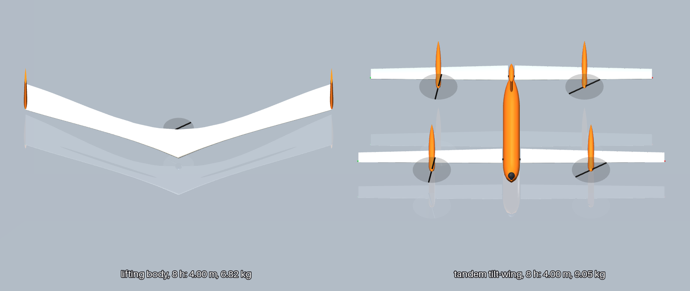
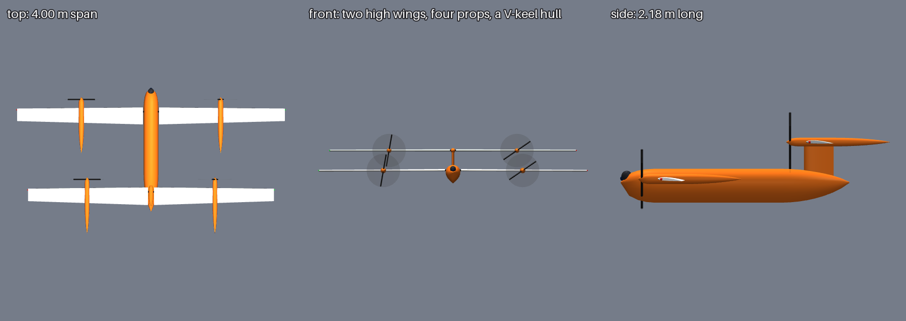
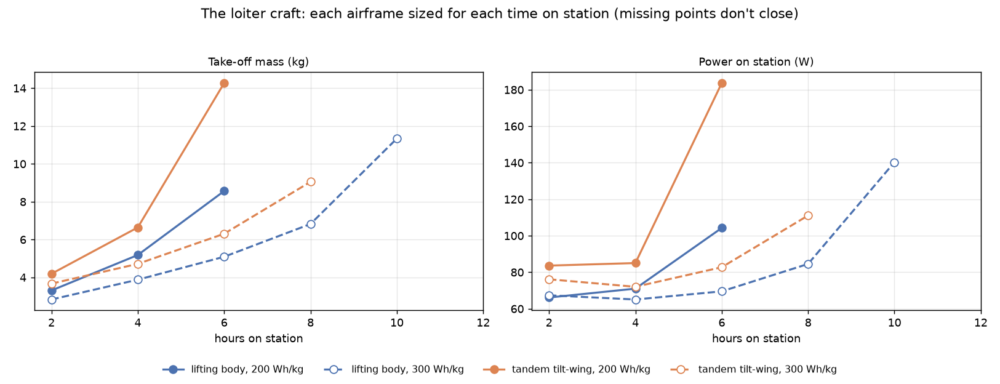
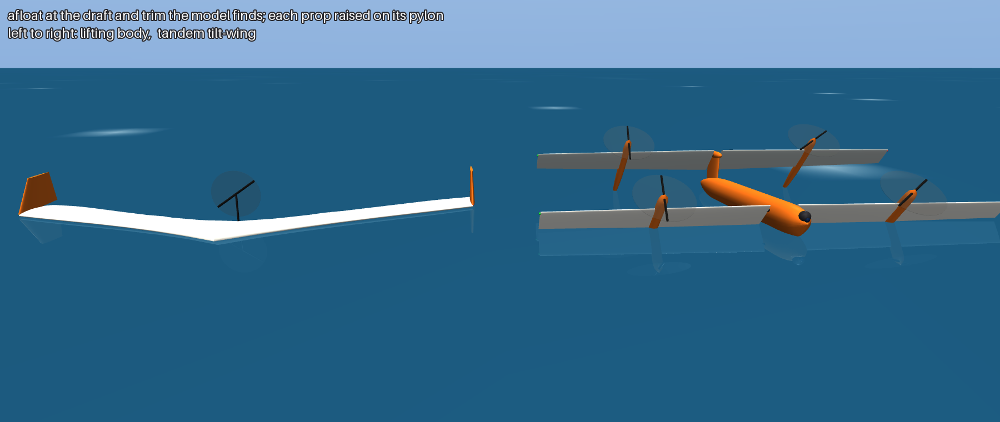
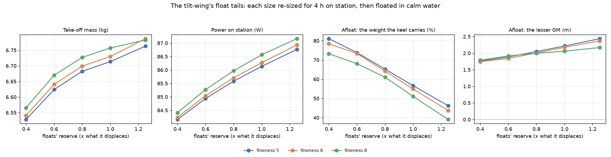

# The loiter craft: hours on station

**Status: work in progress.** A larger Recon for one job: watching the water round the boat for as long as
possible. Speed is not the problem; time to observe is. Two layouts are sized side by side: a lifting body
and a tandem tilt-wing. Every input is a REF stand-in, in
[`design/recon/loiter.toml`](../../design/recon/loiter.toml) and the two airframe overlays
([`liftbody.toml`](../../design/recon/airframes/liftbody.toml),
[`tiltwing.toml`](../../design/recon/airframes/tiltwing.toml)), so the numbers show which way the design
should move, not what to build.



<sub>Both sized for 8 h on station at 300 Wh/kg: the lifting body (6.8 kg, 4.0 m) and the tandem
tilt-wing (9.1 kg, 4.0 m front wing and 3.7 m rear).</sub>

## The job

The `watch-passage` escort: circle the boat at 2 km and 120 m as it sails on at 6.5 kn, in 15 kn of wind and
sea state 3, watching for a fast skiff. The sortie is the flight out, the hours on station, the flight back
and a 20 % reserve. Time on station is fixed, whatever the speed, so the sizing is pushed toward low power,
not a fast cruise.

Both craft are moulded and carry the same gimbal, avionics and long-range link (0.30 kg, 10 W). Both stow
in panels to at most 4 m of span, and carry a battery of at most 10 kg, so one or two people can handle
them from a boat.

## The two layouts

- **Lifting body** (`--airframe liftbody`): a blended wing body with the battery inside its thick centre
  body, long outer panels and one pusher. It takes off from the water on a planing shoe and lands on it.
- **Tandem tilt-wing** (`--airframe tiltwing`): two high wings, the rear 1.2 m aft on a pylon 30 cm up,
  each turning on a spanwise shaft. One prop a side on each wing; each nacelle runs prop, motor, through the
  wing, then on behind the trailing edge as a float. The hull is a teardrop point down: a round top over a
  V keel. It hovers with the wings turned up, lifts straight off the water, and turns the wings forward to
  fly. All four props pull in cruise.



## Results

Each airframe is sized (OpenMDAO and OpenAeroStruct) for 2–12 h on station and for 200 and 300 Wh/kg
cells, then flown through the job in the 3-DOF sim and floated. The run is
[`runs/2026-11-11_recon-loiter`](../../runs/2026-11-11_recon-loiter/).



| Hours on station | Lifting body, 200 Wh/kg | Lifting body, 300 Wh/kg | Tilt-wing, 200 Wh/kg | Tilt-wing, 300 Wh/kg |
|---|---|---|---|---|
| 2 h | 3.3 kg | 2.8 kg | 4.2 kg | 3.7 kg |
| 4 h | 5.2 kg | 3.9 kg | 6.6 kg | 4.7 kg |
| 6 h | 8.6 kg | 5.1 kg | 14.3 kg | 6.3 kg |
| 8 h | doesn't close | 6.8 kg | doesn't close | 9.1 kg |
| 10 h | doesn't close | 11.3 kg | doesn't close | doesn't close |
| 12 h | solver didn't settle | doesn't close | doesn't close | doesn't close |

"Doesn't close": no design meets every constraint with the battery within its bounds. "Solver didn't
settle": the coupled wing-and-spar solve failed from every start, so that case is unknown rather than
infeasible.

What this says:

- **The battery matters more than the airframe.** At 200 Wh/kg both stop at 6 h; at 300 Wh/kg the lifting
  body reaches 10 h and the tilt-wing 8 h.
- **The lifting body is lighter at every point**, by 17–40 %. It carries one motor, no tilt drives and no
  hover props, and its battery sits inside the wing.
- **The tilt-wing pays for vertical take-off, and buys calm-water independence.** It hovers on 240–930 W
  for about a minute a sortie, 5–18 Wh (1.8 kW and 36 Wh for the 14 kg one at 6 h, 200 Wh/kg). The lifting body needs the water flat: its take-off run works only
  in waves under 5 cm, and afloat its pusher sits 17–20 cm in the water.
- **Both settle near L/D 19 and 11–13 m/s** once the span reaches the 4 m stowage limit. Past that, more
  hours only add battery, and mass climbs steeply.

## How the tilt-wing got its shape

The tandem started as a BlackFly-style tilt-body: two staggered wings fixed to the body, with the whole craft
pitching up to hover. That came out heavy and draggy. It became a tilt-wing on the layout of a quad
tilt-wing model built in Onshape: the wings turn, the body stays level.

- **The floats are the nacelles' tails.** Each nacelle carries on behind the wing's trailing edge as a
  streamlined float, so the floats cost little drag in flight.
- **Both wings high, the rear on a pylon.** With the wings 15 cm apart in height, the coupled solve failed
  past 4 h on station. Bending at the 3 g manoeuvre brought each wing's tips close to the other's wake
  sheet, and the vortex-lattice model broke. A 30 cm gap fixes it, and closes 8 h at 300 Wh/kg. The rear
  wing now sits on a pylon over the tail, which also serves as the fin.
- **A V-keel hull that floats it.** The hull's sections are a teardrop point down, its keel 1.5× the
  half-beam below the beam (a 37° deadrise). On the water the wings turn 55° up. The props stand 14–22 cm
  clear, the front float tails dip in either side as outriggers, and the keel carries about 70 % of the
  weight. It sits level, trimmed 1–4° nose up, and the keel holds it straight. Turn the wings down a little
  and the props drive it along. The rear nacelles, a pylon higher, stay dry.
- **The gimbal moved to a nose turret** so it stays 11–19 cm above the water.



## How small can the float tails be?

`osprey recon-loiter --floats` re-sizes the 4 h, 200 Wh/kg tilt-wing with the float tails at each
buoyancy reserve (all four floats' sealed volume, over what the craft displaces) and fineness. Each one is
then flown and floated. With the keel carrying most of the weight, the tails only need to be outriggers.



- **The floats barely matter in flight.** From 0.4× to 1.25× reserve the craft goes from 6.53 to 6.79 kg
  and 84 to 87 W on station. Fineness matters even less.
- **Every size floats it upright.** The smallest float tails still give a roll metacentric height of
  1.7 m, because they sit far out on the wing. Pitch is stiffer still, 3–4 m.
- **Smaller tails put more on the keel**: 81 % at 0.4× reserve, 39–46 % at 1.25×.
- **The clearances hardly move.** In every case the props are 14–15 cm above the water, the gimbal 11–13 cm,
  and the front wing's trailing edges 1–2 cm.

The design keeps 0.6× at fineness 6: tails 41 cm long and 6.8 cm across, behind the wing, and the keel
carries three quarters of the weight. 0.4× at fineness 5 would save another 0.1 kg with tails 31 cm long. A
deeper keel, not bigger floats, is what would lift the wings' trailing edges further out of the water.

## The Onshape model

[`design/recon/onshape/tiltwing.fs`](../../design/recon/onshape/tiltwing.fs) is the tilt-wing as one
Onshape custom feature, "Osprey loiter tilt-wing". Paste it into a Feature Studio and add the feature to a
Part Studio. Its parameters are the sizing's: spans, chords, stagger, gap, thickness, pivot, prop size and
station, float size, and hull length, beam and keel. Its defaults are the 4 h, 200 Wh/kg design. Set the
wing tilt to 0° for cruise, 55° afloat or 90° to hover.

## Running it

```bash
uv run osprey recon-loiter --workers 8                       # both airframes, every time on station and battery
uv run osprey recon-loiter --run out/recon-loiter            # redraw the sheet and renders from sweep.json
uv run osprey recon-loiter --floats --workers 8              # the tilt-wing's float-tail sweep
```

The 24 cases ran in about 20 min on `gpu1`'s 32 cores; long runs go there (see
[docs/remote-simulation.md](../remote-simulation.md)).

## What is not modelled yet

- **The transition** from hover to wing-borne flight and back. The hover is charged as a minute of power at
  the figure of merit; the wings' stall as they turn, and the prop wash over them, are not modelled.
- **The props' wash over the wings in cruise**, which BlackFly-style blown wings exploit.
- **Waves.** Afloat is calm water; the tilt-wing's sea state for a vertical lift-off isn't checked, and nor
  is taxiing on the props.
- **The tilt drives' loads**, and the pylon's own structure and its drag beyond a drag-area estimate.
- **Cell energy densities** are REF: 300 Wh/kg is a semi-solid-state pack, not a stock one.
