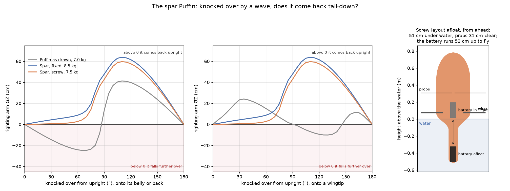

# The spar Puffin: a tailsitter that always bobs back

**Status: work in progress.** A new concept for Osprey, based on NASA's Puffin electric tailsitter
([Moore, NASA Langley, 2010](https://ntrs.nasa.gov/citations/20110011311)). Both a UAS-sized version and a
single-seater are of interest; this notebook covers the UAS, about a third of the Puffin's size. Every input is a
REF stand-in, in [`design/recon/puffin.toml`](../../design/recon/puffin.toml), so the numbers show which way the
design should move, not what to build.



## The Puffin

The Puffin is a 600 lb electric tailsitter with the pilot lying prone:
- **Weights:** 300 lb empty, 100 lb of batteries, 200 lb of payload.
- **Props:** two slow, quiet four-blade props at the wingtips, at 400 ft/s tip speed.
- **Performance:** hovers on about 60 hp and cruises on under 20 hp at 100 mph. At 200 Wh/kg cells it has about
  50 miles of range.

It has no cyclic: it is controlled through surfaces in the props' wash. Its landing legs swing out for tip-over
stability. NASA flew a one-third-scale model in hover; the full-size aircraft was never built.

## The requirement: float tail-down and always come back

At sea, a tailsitter that a wave knocks flat can't take off again. So this one must float tail-down, the attitude
it lifts off from, and bob back upright from any knockdown. Waterproofing the lower metre or so is easy.

The test for each layout is its righting curve. Knock it over by every angle up to 180°, onto its belly or back
and onto a wingtip, and find where it floats. GZ, the righting arm, is the horizontal distance from the centre of
gravity to the centre of buoyancy. Above zero, the water pushes it back upright; above zero all the way round, it
always comes back (`recon/puffin.py`).

## What the curves say

- **The Puffin as drawn settles lying flat.**
  - Upright, its CG sits above the centre of buoyancy on a waterline only 20 cm across, so it falls over from
    5°.
  - Lying flat, it stays there.
- **Girth alone doesn't fix it.** A fatter hull just floats higher on its pointed tail. Girth helps only at the
  waterline, and only with the weight below it.
- **A spar does.** A slender boom at the tail carries the battery and ballast, the keel. The hull flares to a
  40 cm girth where it floats, then rounds into the dome. The wings and nacelles free-flood, so lying flat they
  don't hold it there.
  - It floats with half a metre under water and the props 27–31 cm clear.
  - It always comes back, and from lying flat it snaps back hard: a righting arm of 40–60 cm.
- **The catch: flight wants the CG at the wing.** With 1 kg of fixed ballast in the boom, the CG sits 1.25
  chords behind the wing, so the tail has to lift.
- **The battery on a screw removes both the ballast and the lifting tail.** The 3 kg battery runs down the boom
  to float and up to the wing to fly.
  - With the wing's leading edge 70 cm up and a 0.3 kg gimbal in the dome, that is 52 cm of travel.
  - The craft weighs 7.5 kg, against 8.5 kg with fixed ballast, and flies on an ordinary 10 % static margin.

## The battery on a screw: travel, wing station and the dome's payload

The table in the run's [`puffin.md`](../../runs/2026-11-11_recon-puffin/puffin.md) sweeps the screw layout:
- the wing's leading edge at 0.6 to 0.9 m up the hull;
- 0.3 to 1 kg in the dome;
- with or without 0.5 kg of ballast.

What it shows:

- **The higher the wing, the further the props clear the water** (20 cm at 0.6 m, 50 cm at 0.9 m). The battery
  must then run further, and past about 0.8 m it runs into the nose.
- **Weight in the dome costs righting.** The dome is the top of the craft afloat. A 0.3 kg gimbal rights itself
  with no ballast; 0.6–1 kg needs 0.5 kg of ballast, or more girth.
- **Near upright the righting is soft:** a centimetre or so at 15°. It always comes back, but it rocks in a
  sea. Ballast or girth stiffens it.

## Design points

- **The drive must fail safe.** A screw jammed with the battery forward floats it like the Puffin as drawn, and
  it settles lying flat.
  - A back-drivable ball screw with a brake that releases on power loss drops the battery into the boom by
    gravity whenever the craft is nose-up.
  - Lying flat, gravity doesn't pull along the hull, so it still needs a powered or sprung return.
- **The sequence.**
  - Lift off with the battery low, hover while it runs forward (about 10 s at 5 cm/s), then transition.
  - Landing reverses it.
  - The single-seater's pilot is the same kind of mass: crouching low in the cockpit until it is out of the water
    and transitioning.
- **The dome is the payload bay.** In flight its gimbal looks ahead. Afloat it is the craft's highest point,
  about 0.8 m up, so it can keep watch round the horizon from a drifting buoy on almost no power. Swappable
  payloads change the trim, which the screw takes up in flight but not afloat.

## The Onshape model

[`design/recon/onshape/spar-puffin.fs`](../../design/recon/onshape/spar-puffin.fs) is the craft as one Onshape
feature, "Osprey spar Puffin", drawn standing on its tail.
- **Inputs:**
  - a layout (as drawn, fixed ballast, battery on a screw);
  - whether the battery is in its flight position;
  - the water surface;
  - the hull's length, girth, boom and flare;
  - the wing, props, nacelles and strakes.
- **Named parts:** each component (hull, wings, nacelles, props, strakes, battery, ballast, dome camera) is its own
  named part, ready to drop into an assembly.
- **Stations:** the wing's station, the battery's and the water surface come from the righting model, and a test
  keeps them in step with it.

## Running it

```bash
uv run osprey recon-puffin --workers 8    # the three layouts' righting curves and the screw sweep, about 30 s
```

## What is not modelled yet

- **Flight:** the spar's drag (a 40 cm girth on a 1.3 m hull is stubby), the tail's sizing, and the transition.
  The Puffin's flight numbers are from its paper, not sized here.
- **Hover:** lifting off with the CG low and the battery moving, and the ride while it moves.
- **Waves and dynamics:** the righting curves are static, in calm water. Rolling period, slamming and a
  breaking-wave knockdown are not modelled.
- **The screw drive's mass** (about 0.2–0.3 kg), and the strakes' buoyancy (taken as free-flooding).
- **The single-seater:** a 90 kg pilot as part of the moving mass.
