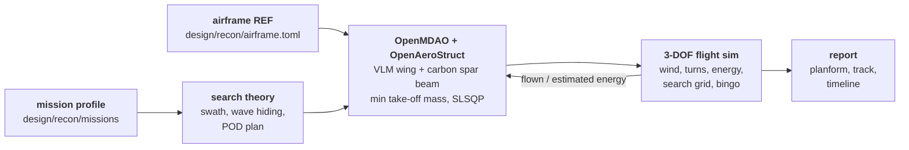
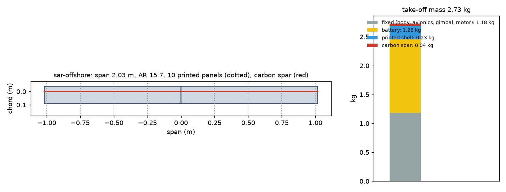

# Osprey Recon: a search drone sized around its mission

Recon is the aerial half of Osprey (issue #1). The mast sees a person in the
water out to about 2 km in sea state 3. A drone at 120 m looks almost straight
down past the crests and can fly to wherever the person is. Recon is a printed
fixed-wing drone, launched from the boat and recovered to it.

The design method is multidisciplinary design optimization (MDO) around a
mission profile:
- a mission says what has to be found, where, in what sea and wind, and what
  the boat does meanwhile;
- search theory turns the camera and the sea into a swath and a probability
  of detection (POD);
- OpenMDAO sizes the airframe around OpenAeroStruct;
- a 3-DOF flight simulation flies the result through the same mission;
- the optimizer's simple mission-time model is calibrated against the flight
  sim until the two agree.



## Running it

```bash
uv run osprey recon --mission all          # size, calibrate and fly every mission
uv run osprey recon-size --mission sar-datum
uv run osprey recon-fly --mission sar-datum --design out/recon/sar-datum/design.json
```

Each mission writes `report.md`, `design.json`, `flight.json`, `planform.png`,
`track.png` and `timeline.png` to `out/recon/<mission>/`. All three missions
take about 20 s on a laptop.

## Missions

| Mission | Datum | Datum error (1 σ) | Sea, wind | Boat after launch |
|---|---|---|---|---|
| `sar-datum` | 3 km astern | 150 m | sea state 3, 15 kn | turns back to the datum and heaves to |
| `sar-convoy` | 5 km astern | 200 m | sea state 3, 15 kn | sails on at 6 kn |
| `sar-offshore` | 10 km astern | 400 m | sea state 4, 20 kn | turns back to the datum and heaves to |

The datum drifts with current and leeway, and the search pattern drifts with
it. Recovery happens within 30 m of the boat.

## Models

**Search theory** (`recon/search.py`).
- **Swath:** the gimbal camera looks ahead and down at 35°, at a fixed 8 mm
  focal length. Its swath is the footprint's width, cut short where the person
  is too small to resolve (Johnson detect), lost in haze, or behind a wave
  crest. Crests are handled by the same wave model the mast uses, here at the
  drone's much steeper look angle.
- **Detection:** one pass over a person finds them with probability 0.9 (the
  detector's recall) times the chance they aren't hidden.
- **Plan:** POD follows Koopman's random-search law. The planner picks the
  square and the coverage that reach the POD goal with the least track.
- **Search:** the flight sim flies an expanding square in the water's frame,
  and repeats it, turned and offset, if it ends short of the goal.

**Flight** (`recon/flight.py`). A point-mass model:
- a wind triangle to hold the ground track;
- turns limited by bank angle, with their load factor and induced drag;
- climb limited by excess shaft power;
- an electric power and energy budget;
- best-range speed for the wind on transits.

It leaves the search at the POD goal, at the mission's search-time cap, or at
bingo: the energy to get home, with the boat possibly sailing away, plus the
reserve.

**Sizing** (`recon/sizing.py`). OpenMDAO with OpenAeroStruct.
- **Aerostructure:** a vortex-lattice wing coupled to a carbon-tube spar
  beam, at two flight points: the search speed for drag, and a 3 g
  manoeuvre for the spar.
- **Design variables:** span, chord at root and tip, twist, spar radius and
  wall, battery mass, search speed, and the two angles of attack.
- **Objective:** take-off mass.
- **Constraints:**
  - lift equals weight at both points;
  - spar stress;
  - the tube fits inside the section;
  - the chord fits the printer bed's diagonal;
  - chord Reynolds number of at least 150,000;
  - no reverse taper;
  - stall speed of at most 12 m/s, for net or hand recovery on a moving
    boat;
  - search speed at least 1.25 times the stall speed in a 35° bank;
  - battery endurance of at least the mission time plus 20 %.
- **Derivatives:** analytic from OpenAeroStruct, complex step for the Osprey
  components (`tests/test_recon.py` checks them against finite differences).

## Phase 1 results (2026-11-06, `runs/2026-11-06_recon-phase1`)

| Mission | Take-off mass | Span (AR) | Battery | Search speed | On scene | POD 90 % at | Flight | Battery left |
|---|---|---|---|---|---|---|---|---|
| `sar-datum` | 1.56 kg | 1.20 m (9.5) | 0.23 kg | 17.7 m/s | 4.1 min | 18.2 min | 18.4 min | 18 % |
| `sar-convoy` | 1.89 kg | 1.36 m (10.2) | 0.52 kg | 16.7 m/s | 4.0 min | 20.2 min | 51.6 min | 17 % |
| `sar-offshore` | 2.73 kg | 2.03 m (15.7) | 1.28 kg | 17.2 m/s | 7.3 min | 94.3 min | 96.1 min | 17 % |

Every flown mission reaches 90 % POD and lands back on the boat with the 20 %
reserve intact. Other findings:

- **The fixed parts set the size.** Body, avionics, gimbal and motor are
  1.18 kg, more than everything the optimizer controls on the short missions.
  The body's drag area (0.010 m²) caps L/D at 6-9 on these small wings. A
  cleaner fuselage and gimbal fairing is worth more than a better wing.
- **Stall speed and Reynolds number set the wing.** Every design sits on the
  12 m/s stall limit and the 150,000 tip-Reynolds floor, so the chord is about
  13 cm and the span grows with the battery it has to carry.
- **Long searches are a POD problem, not an airframe problem.** Offshore, POD
  reaches 80 % about 45 minutes into the search, and the last 10 points take
  roughly as long again. A second drone or a thermal camera beats a bigger
  battery there.
- **The boat matters as much as the drone.** With the boat sailing on, the
  first offshore sizing spent 80 minutes chasing it home upwind. Turning back
  to the datum, the usual man-overboard drill, is what makes the offshore
  case work. `sar-convoy` keeps the sail-on case.
- **Calibration:** the optimizer's mission-time model needs 0.79-1.05x
  corrections from the flight sim. Its constant-speed, straight-leg
  assumptions miss the wind geometry, the turns and the boat's motion in both
  directions.
- **Printing:** the wings print as 6 to 10 span-wise panels on a
  220 × 220 × 250 mm bed, with the carbon spar running through them.




## What is not modelled yet

- **Low-Reynolds aerodynamics:** OpenAeroStruct's viscous drag is a flat-plate
  estimate. The Reynolds floor stands in for real section data (XFOIL, or
  AVL with section polars).
- **Stability and control:** no tail sizing, no stability derivatives and no
  6-DOF. AVL or VSPAERO derivatives would feed a 6-DOF sim for launch,
  recovery and gusts.
- **Printed material:**
  - the shell's mass is counted, but it carries no load in the beam model;
  - no anisotropy (weak between layers);
  - no panel-joint flex.
- **Launch and recovery** on a moving, heeling deck: the motion model already
  gives the deck's motion.
- **Sensing:** no thermal camera, no night searching, no cooperative search
  with the mast pods or a second drone.

## Roadmap

1. **Phase 1, low-fidelity loop (this):** mission → search theory →
   OpenMDAO/OpenAeroStruct → 3-DOF flight, calibrated.
2. **Phase 2, design for additive manufacturing:**
   - airfoil sections into CadQuery;
   - a hollow single-wall or rib structure for vase-mode printing;
   - automatic span and chord partitioning into bed-sized panels with
     alignment dowels and a spar channel;
   - overhang checks with trimesh.
3. **Phase 3, fidelity and speed:**
   - AVL or VSPAERO stability derivatives and a 6-DOF sim;
   - SU2 checks of the chosen geometry;
   - orthotropic FEA of the printed shell (CalculiX);
   - surrogate models to make sweeps over mission envelopes fast.
