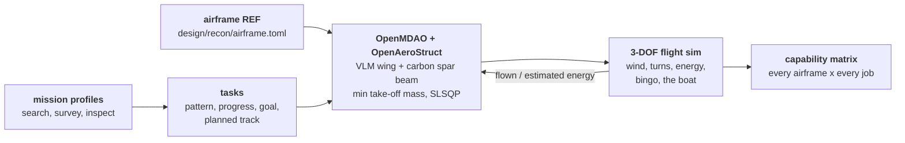
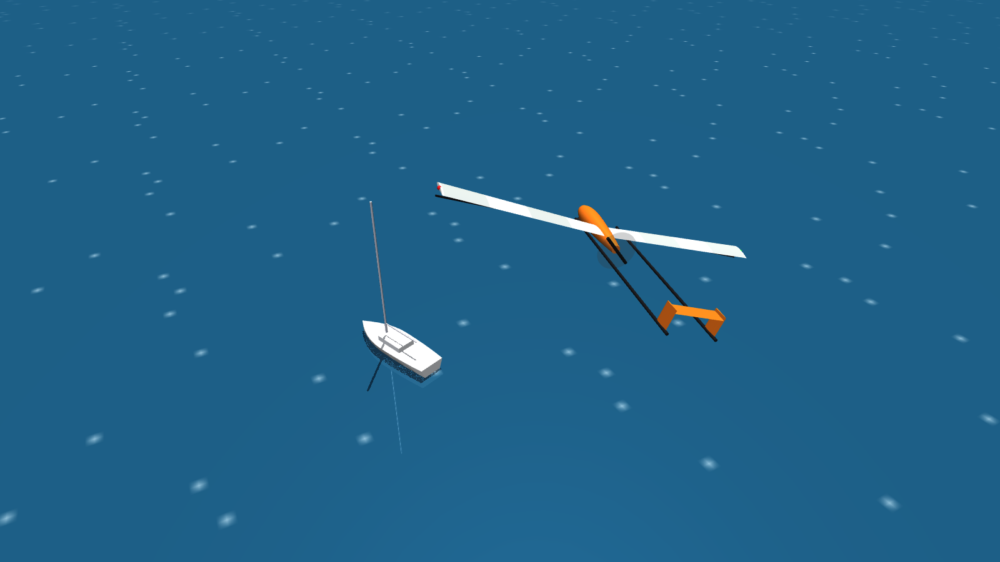
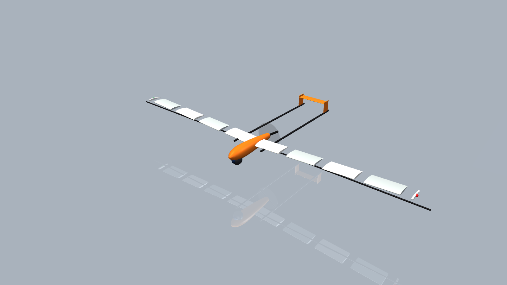
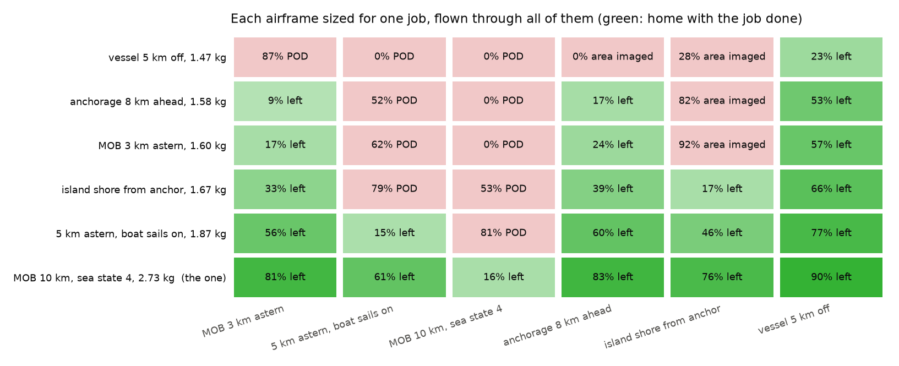

# Osprey Recon: the scout

Recon is the boat's eyes and ears beyond the horizon, the half of Osprey
that goes and looks (issue #1). The mast pods keep the watch within the
horizon all the time. Recon flies out whenever the captain needs to know
something they can't see:
- **The anchorage ahead:** moorings, pot lines, rocks and debris, before
  the boat arrives.
- **A landing site:** a beach or a dock, checked before the dinghy goes in.
- **Another vessel:** inspected and identified from a respectful standoff.
- **Remote islands and parks:** wildlife, the lie of the land, hazards
  ashore.
- **A person in the water:** found when the mast has lost them.

It is a printed fixed-wing drone, launched from the boat and recovered to it.
From up to 120 m it looks nearly straight down, so wave crests hide almost
nothing. That is the effect that limits the masthead to about 2 km for a
person in the water.

The design method is multidisciplinary design optimization (MDO) around
mission profiles:
- a mission says where the task is, what the boat does meanwhile, and the
  sea and wind;
- a task says what to do there: search, survey or inspect;
- OpenMDAO sizes an airframe around OpenAeroStruct;
- a 3-DOF flight sim flies the result through the same mission, and its
  energy recalibrates the sizing's simple mission-time model until the two
  agree;
- every sized airframe is then flown through every mission, to find the one
  bird a crew should actually build.



## Running it

```bash
uv run osprey recon --mission all          # size and fly every job, then the capability matrix
uv run osprey recon-size --mission scout-anchorage
uv run osprey recon-fly --mission inspect-vessel --design out/recon/sar-offshore/design.json
uv run osprey recon-render --mission all   # render each sized drone
```

Each mission writes these to `out/recon/<mission>/`:
- `report.md`, `design.json` and `flight.json`;
- `planform.png`, `track.png` and `timeline.png`.

`--mission all` also writes `matrix.md`, `matrix.json` and `matrix.png`. The
six jobs and the matrix take about 30 s on a laptop.

## The bird

`uv run osprey recon-render --mission all` builds each sized drone as meshes (`recon/geometry.py`) and
renders it in MuJoCo (`recon/render.py`): a hero shot over the sea with the sailboat below, an orthographic
three-view, an exploded view of the printed panels on the spar, a turntable GIF, and every mission's
drone side by side to scale (the lightest, a middle one and the heaviest). Use `--run runs/2026-11-06_recon-missions` to render the kept designs.

The wing comes from the sizing: span, chords, twist, the NACA 2412 section at the design's 12 % thickness,
3 deg dihedral, and the print joints where the bed splits it. Everything else is REF geometry from
`[geometry]` in `design/recon/airframe.toml`:
- the pod, gimbal ball, twin carbon booms and a pusher prop;
- an H-tail and two fins sized by tail volume coefficients (0.40 horizontal, 0.030 vertical), with an
  8 cm chord floor.

The tail is not optimized yet; it is the first thing a stability model will change.





## Missions

| Mission | Task | Where | Sea, wind | Boat meanwhile |
|---|---|---|---|---|
| `sar-datum` | search: MOB, 150 m datum error | 3 km astern | sea state 3, 15 kn | turns back to the datum |
| `sar-convoy` | search, 200 m datum error | 5 km astern | sea state 3, 15 kn | sails on at 6 kn |
| `sar-offshore` | search: MOB, 400 m datum error | 10 km astern | sea state 4, 20 kn | turns back to the datum |
| `scout-anchorage` | survey a 500 x 800 m bay at 90 m | 8 km ahead | sea state 2, 12 kn | sails for the anchorage |
| `scout-island` | survey 900 x 1500 m of shore at 110 m | 1.5 km from anchor | sea state 1, 10 kn | at anchor |
| `inspect-vessel` | inspect a 30 ft sailboat at 200 m standoff, 2 orbits | 5 km off, crossing at 8 kn | sea state 3, 15 kn | sails on |

## Models

**Tasks** (`recon/tasks.py`). What the drone does on arrival:
- **Search:** the gimbal camera looks ahead and down at 35° at 8 mm.
  - Swath: the footprint's width, cut short where the person is too small to
    resolve (Johnson detect), lost in haze, or behind a wave crest (the mast's
    wave model at the drone's steep look angle).
  - Detection: one pass finds a person with probability 0.9 (the detector's
    recall) times the chance they aren't hidden.
  - Plan: POD follows Koopman's random-search law. The planner picks the
    square and coverage that reach the goal with the least track.
  - Search: an expanding square drifts with the water, and repeats, turned
    and offset, if it ends short of the goal.
- **Survey:** lawnmower legs across the site with the gimbal straight down,
  spaced for the sidelap, until the site is imaged. The task reports the
  ground sample distance and how many pixels across each class to look for
  (a mooring buoy, a log, a kayak, a person).
- **Inspect:** orbits round a moving vessel at a standoff distance for a set
  number of laps. The task reports the focal length needed to identify it
  and the pixels across it.

**Flight** (`recon/flight.py`). A point-mass model:
- a wind triangle to hold the ground track;
- turns limited by bank angle, with their load factor and induced drag;
- climb limited by excess shaft power;
- an electric power and energy budget;
- best-range speed for the wind on transits.

It leaves the task when the task's goal is met or its pattern ends, at the
mission's task-time cap, or at bingo: the energy to get home along the line to
the boat as it is now, against that line's headwind and the boat's speed away
along it, plus the reserve.

**Sizing** (`recon/sizing.py`). OpenMDAO with OpenAeroStruct.
- **Aerostructure:** a vortex-lattice wing coupled to a carbon-tube spar
  beam, at two flight points: the search speed for drag, and a 3 g
  manoeuvre for the spar.
- **Design variables:** span, chord at root and tip, twist, spar radius and
  wall, battery mass, search speed, and the two angles of attack.
- **Objective:** take-off mass.
- **Constraints:**
  - lift equals weight at both points;
  - spar stress;
  - the tube fits inside the section;
  - the chord fits the printer bed's diagonal;
  - chord Reynolds number of at least 150,000;
  - no reverse taper;
  - stall speed of at most 12 m/s, for net or hand recovery on a moving
    boat;
  - search speed at least 1.25 times the stall speed in a 35° bank;
  - battery endurance of at least the mission time plus 20 %.
- **Derivatives:** analytic from OpenAeroStruct, complex step for the Osprey
  components (`tests/test_recon.py` checks them against finite differences).

## Results (2026-11-06, `runs/2026-11-06_recon-missions`)

| Job | Its own airframe | Result | Back aboard |
|---|---|---|---|
| `sar-datum` | 1.60 kg, 1.20 m, 0.26 kg battery | 90 % POD at 23.5 min | 23.8 min, 17 % left |
| `sar-convoy` | 1.87 kg, 1.36 m, 0.51 kg | 90 % POD at 20.3 min | 53.6 min, 15 % left |
| `sar-offshore` | 2.73 kg, 2.02 m, 1.27 kg | 90 % POD at 106 min | 107 min, 16 % left |
| `scout-anchorage` | 1.58 kg, 1.20 m, 0.23 kg | 98 % imaged, 1.7 cm per pixel, 11 legs | 24.4 min, 17 % left |
| `scout-island` | 1.67 kg, 1.21 m, 0.33 kg | 98 % imaged, 2.1 cm per pixel, 15 legs | 29.2 min, 17 % left |
| `inspect-vessel` | 1.47 kg, 1.20 m, 0.15 kg | 2 orbits at 200 m, 37 px across the boat | 12.9 min, 23 % left |

**One bird, many jobs.** Every airframe flown through every job
(`matrix.md`). The airframe sized for the offshore search, 2.73 kg and
2.02 m, is the lightest that does all six. It gets home with 16 to 90 % of
its battery left. Every lighter one fails at least one of the longer
searches.



Findings:

- **The fixed parts set the size.** Body, avionics, gimbal and motor are
  1.18 kg, more than everything the optimizer controls on most jobs. The
  body's drag area (0.010 m²) holds L/D at 6-9 on these small wings. A
  cleaner fuselage and gimbal fairing is worth more than a better wing. Five
  of the six jobs sit at the 1.2 m minimum span.
- **Stall speed and Reynolds number set the wing.** Every design sits on the
  12 m/s stall limit and the 150,000 tip-Reynolds floor, so the chord is
  about 13 cm and the span grows with the battery it has to carry.
- **Scouting is cheap; long searches are a POD problem.** Imaging a bay 8 km
  ahead takes 11 minutes on task, and identifying a vessel two and a half. A
  10 km search takes an hour and a half. There, the last 10 points of POD
  take as long as the first 80: a second drone or a thermal camera beats a
  bigger battery.
- **The boat matters as much as the drone.** Sailing on, the drone chases
  the boat home. Turning back to the datum, or sailing for the anchorage
  being scouted, shortens every flight.
- **Calibration:** the optimizer's mission-time model needs 0.57-1.09x
  corrections from the flight sim. Its constant-speed, straight-leg
  assumptions miss the wind geometry, the turns and the boat's motion.
- **Bingo has to use the real way home.** A worst-case rule (wind and boat
  dead against) turned the drone round the moment it reached a vessel it was
  sent to inspect.
- **Printing:** the wings print as 6 to 10 span-wise panels on a
  220 × 220 × 250 mm bed, with the carbon spar running through them.

## What is not modelled yet

- **Low-Reynolds aerodynamics:** OpenAeroStruct's viscous drag is a flat-plate
  estimate. The Reynolds floor stands in for real section data (XFOIL, or
  AVL with section polars).
- **Stability and control:** no tail sizing, no stability derivatives and no
  6-DOF. AVL or VSPAERO derivatives would feed a 6-DOF sim for launch,
  recovery and gusts.
- **Printed material:**
  - the shell's mass is counted, but it carries no load in the beam model;
  - no anisotropy (weak between layers);
  - no panel-joint flex.
- **Launch and recovery** on a moving, heeling deck: the motion model already
  gives the deck's motion.
- **Sensing:** no thermal camera and no night work. No CV yet to turn survey
  imagery into a chart of moorings, rocks and wildlife, or to identify a
  vessel. No cooperative tasking with the mast pods or a second drone.
- **One airframe for all jobs is picked, not optimized:** the matrix flies
  each job's own design through every job. A multi-mission sizing (every
  job's endurance as a constraint at once) is the next step.

## Roadmap

1. **Phase 1, low-fidelity loop (this):**
   - mission profiles for search, survey and inspect;
   - OpenMDAO/OpenAeroStruct sizing, calibrated against the 3-DOF flight;
   - the capability matrix;
   - renders.
2. **Phase 2, design for additive manufacturing:**
   - airfoil sections into CadQuery;
   - a hollow single-wall or rib structure for vase-mode printing;
   - automatic span and chord partitioning into bed-sized panels with
     alignment dowels and a spar channel;
   - overhang checks with trimesh.
3. **Phase 3, fidelity and speed:**
   - AVL or VSPAERO stability derivatives and a 6-DOF sim;
   - SU2 checks of the chosen geometry;
   - orthotropic FEA of the printed shell (CalculiX);
   - surrogate models to make sweeps over mission envelopes fast.
4. **Alongside:**
   - multi-mission sizing;
   - Recon imagery in Nest's synthetic-data format, for the hazard and vessel CV models;
   - tasking shared with the pods.
