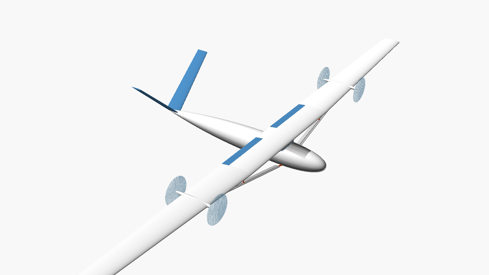
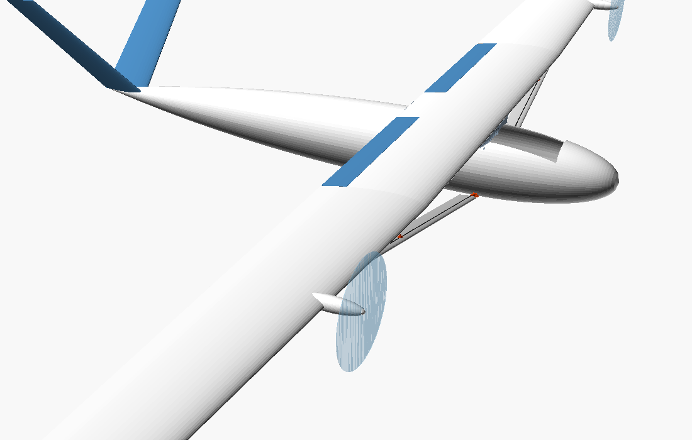
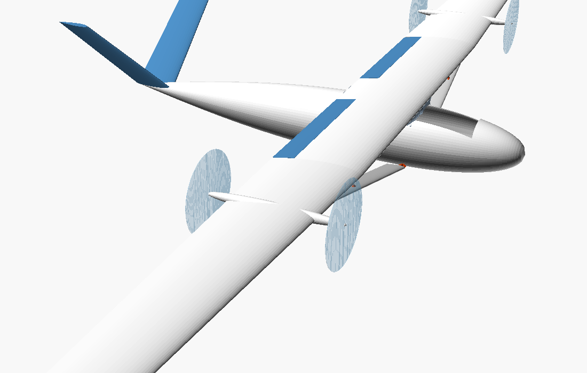
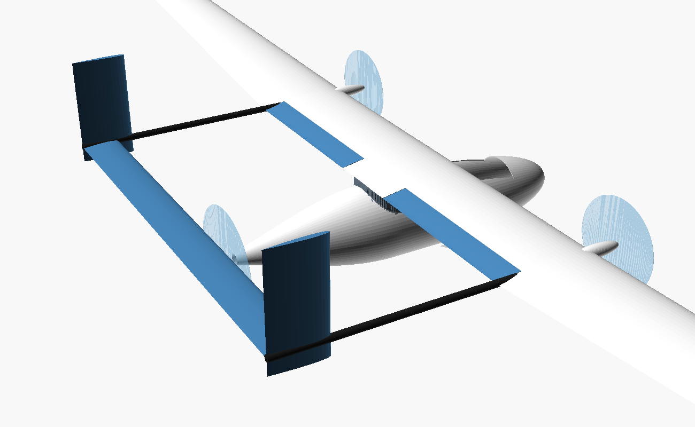

# The sailplane: a soaring relay with a truss-braced wing

**Status: work in progress.** A thermal-soaring sailplane that loiters for hours as an airborne radio relay
and spectrum scanner: a laminar body of revolution and a thin, high-aspect-ratio wing in three pieces with
swappable outer panels (solar by day, light by night). The wing is braced as NASA's transonic truss-braced
wing is: one brace a side from low on the body up to the wing, and a jury strut from each brace up to the wing.

It arrived as an engineering handoff package. Its numbers are in
[`design/recon/sailplane.toml`](../../design/recon/sailplane.toml); where the package was silent the value is a
REF stand-in. Three designs come out of it:

| | |
|---|---|
|  | **Pusher**: the package's own body, tail and 4.8 m span, kept as the record of what was handed over. One prop in the tail cone. |
|  | **Twin** ([`twin.toml`](../../design/recon/sailplanes/twin.toml)): a push-pull pod on each wing where the brace meets it, an upright V-tail, a 6.0 m wing and a 2.3 m body. |
|  | **Boom** ([`boom.toml`](../../design/recon/sailplanes/boom.toml)): the tail on twin booms from the wing's pods, a short body hung from the wing with a pusher at its back, a tractor on each pod, the same 6.0 m wing. |

```
uv run osprey recon-sailplane                      # the pusher; out/recon-sailplane/pusher
uv run osprey recon-sailplane --variant twin       # or boom
uv run osprey recon-sailplane --variant twin --pods front    # the twin's props at the front, back or both
```

Each writes `sailplane.md`, `cutlist.csv`, `wing.png` and `scad/`, and exits 1 while any finding fails. The
pusher fails three, all in the package's own numbers. The twin and the boom fail none.

| | Span, m | All-up, kg | Motors | Tail, m² | Tail volumes | L/D | Sink, m/s | Stall, m/s | Under power, h | One motor out | Fails |
|---|---|---|---|---|---|---|---|---|---|---|---|
| pusher (the package) | 4.8 | 18.0 | 1 | 0.22 | 0.18, 0.009 | 27.1 | 0.53 | 11.1 | 5.8 | no thrust | 3 |
| twin | 6 | 21.3 | 4 | 0.31 | 0.40, 0.020 | 30.1 | 0.48 | 10.8 | 5.5 | 2.1 m/s, tail CL 0.62 | none |
| boom | 6 | 19.5 | 3 | 0.44 | 0.40, 0.020 | 31.8 | 0.46 | 10.7 | 6.5 | 1.8 m/s, tail CL 0.40 | none |

The pusher's glide is with a tail less than half the size it needs. A variant's all-up weight is worked out:
the package's 18.0 kg plus what its propulsion, tail, booms, body skin and longer panels add.

## What was wrong, and what was done

| Flaw | Where | Fix |
|---|---|---|
| A "Warren space-frame truss" inside the wing: 56 mm deep in a 35 mm section, and its chords buckled at 4 g | the package | A misreading of *truss-braced wing*. One spar inside the section, and braces outside it |
| Tail volumes of 0.18 and 0.009 against 0.40 and 0.020 | the package: 0.22 m² of tail 0.74 m behind the wing | The twin's body is stretched and its V-tail sized, and angled, to just meet both; the boom's tail is sized the same way |
| The tail cone is at 7 mm radius at the firewall, not the spinner's 22: a 62 mm parallel stinger | the package | The boom's body is cut at x = 1352, where the cubic meets the spinner. The twin has no spinner there |
| 72 cells are 1,296 Wh, not the quoted 488 | the package | The pack is right and the figure was wrong: holding height under power takes about 200 W, so 4 h needs the 72 cells. The variants quote what the cells hold |
| The sink quoted, 0.52 m/s, is what a wing with no braces and an undersized tail gives | the package | Induced drag is most of the sink. The wing is stretched to 6.0 m: 0.48 m/s on the twin with braces, pods and a full-sized tail |
| One of two motors out: the tail cannot hold the yaw | the twin with props at the front or back only | A prop at both ends of each pod: one of four out leaves 75 % of the thrust and half the yaw |
| Brace pins at 57 to 63 MPa of bearing in a printed tang, against 60 | all three | 6 mm pins through 7 mm tangs: 39 MPa on the twin and 45 on the boom, with the solved lift |
| A 30 mm spar at 7 % of its strength, 645 g | my first sizing | A 27.3 x 25.3 mm tube and 1 mm joiners: 541 g of carbon in the pusher's wing, was 1,006 |
| A brace fairing slimmed to 68 mm and 20 % thick: four times the drag under its lift at a Reynolds number of 70,000 | my second sizing | 120 mm and 11 % thick, found with the sections' polars |
| The boom's tail load twists the wing, unchecked | the boom | Checked: 0.66° in the skin box between body and boom, against 1° allowed |
| All-up weights set by hand | the variants | Worked out from what each variant adds; a motor's weight follows the climb's power |

## The science

Ting, Reynolds, Nguyen and Totah, *Aerodynamic Analysis of the Truss-Braced Wing Aircraft Using
Vortex-Lattice Superposition Approach* (AIAA), on the Boeing SUGAR truss-braced wing. Three things are taken
from it:

- The wing is braced "at approximately mid-span" with one jury strut a side. So are the pusher and the twin.
- The braces are lifting surfaces. In their component build-up the braces carry 8.5 % of the lift and about
  8 % of the drag. Here the braces carry that share of the lift in the load cases, and their fairing is an
  aerofoil, not a streamlined tube.
- Their drag build-up (their Eqs. 1–4): each component's skin friction with transition, times a form factor,
  times its wetted area, plus induced drag. It leaves out interference where the parts meet, as theirs does.

Their superposition method is used too, on a vortex lattice: see below.

## The lift, solved

`src/osprey/recon/sailplane_vlm.py` solves the lift with a vortex lattice (OpenAeroStruct, which the other
Recon airframes are already sized with): camber sheets for the wing, the braces and the tail. It is solved two
ways, as the paper does. All together, each surface in the others' wash; and each surface alone with the
forces added, their superposition method 2, which they found close to CFD where the whole lattice was not. The
loads take the second (`[aero] lift = "vlm"`; `"elliptic"` is the old assumption). For the twin, at the
loiter's lift:

| | Lift-curve slope, /rad | Lift at zero angle | Angle, deg | Wing's share | Braces' share | Tail, untrimmed | Span efficiency |
|---|---|---|---|---|---|---|---|
| each surface alone, summed | 6.47 | 0.27 | 4.9 | 87.9% | 12.1% | +4.7% | n/a |
| all in one lattice | 5.83 | 0.26 | 5.5 | 89.7% | 10.3% | +3.3% | 0.99 |
| no braces | 5.52 | 0.25 | 5.9 | 100.0% | 0.0% | +5.7% | 0.99 |

- **The braces carry 12.1%** by components and 10.3% all together; the paper has 8.5 % for the SUGAR
  wing. The boom's short braces carry 5.7%.
- **The lift sits further out than an ellipse**: centred 1.34 m along the wing in the pull-up, not 1.27. A
  constant-chord centre section and moderate taper do that. So the wing is loaded harder than was assumed: on
  the twin each brace pulls 1026 N, not 959, and is at 0.67 of its buckling load. On the boom the pull went
  from 1,047 to 1190 N, which put its pins over; they are now 6 mm in 7 mm tangs.
- **Span efficiency is 0.99** for the lattice, with no body and nothing viscous. The drag build-up takes
  0.96 for the induced drag, now that the sections' own lift-dependent drag is counted apart.


The lattice has no body, pods or booms, no thickness and no stall, and its tail is at zero incidence, not
trimmed. The brace-station and pod sweeps still use the elliptic lift.

## The sections

`src/osprey/recon/sailplane_polars.py` gives each surface's section its own polar from NeuralFoil, a
neural-network stand-in for XFOIL. For the SD7037 it agrees with the UIUC tunnel: a most lift of 1.34 and a
drag of 0.009 at a lift coefficient of 0.8 and a Reynolds number of 300,000. Two things use it
(`[aero] sections = "polars"`; `"flat-plate"` is the old way):

- **The stall** is where a strip of the wing first reaches its own section's most lift at its own Reynolds
  number, with the lattice's lift. On the twin that is 1.55 m out, at 10.8°, and 10.8 m/s. It was a stand-in
  lift coefficient of 1.30.
- **The profile drag** of the wing, braces and tail is each strip's section drag at its own lift and Reynolds
  number. It was a flat plate's skin friction.

For the twin at the loiter's slow end:

| Surface | Chord, mm | Reynolds number | Most lift | Drag | at lift | Upper surface turbulent from | Confidence |
|---|---|---|---|---|---|---|---|
| wing | 380 | 377,397 | 1.35 | 0.0090 | 0.82 | 45% chord | 0.98 |
| wing tip | 240 | 238,356 | 1.34 | 0.0104 | 0.82 | 51% chord | 0.98 |
| brace | 120 | 119,178 | 1.24 | 0.0147 | 0.00 | 95% chord | 0.96 |
| tail | 180 | 178,767 | 0.86 | 0.0102 | 0.00 | 99% chord | 0.95 |

**What it found: the brace fairing.** The fairing I had slimmed to 68 mm and 20 % thick works at a Reynolds
number of 70,000 and a lift coefficient near 0.6. There a thick section's drag is four times what a flat
plate suggests: the braces cost 100 counts, more than the wing's own 85. A 120 mm fairing 11 % thick, round
the same 12 mm tube, costs 23. It carries more lift (12%, not 7.6 %) at the same lift coefficient, and that
lift is no longer expensive.

## The wing and its braces

One spar inside the SD7037 at 30 % chord, a square carbon tube whose bore takes the outer panels' 25 mm
joiners. A brace a side, a 12 mm tube in an aerofoil fairing, from a pin outside the hull on the front main
bulkhead to a pin under the wing. A jury strut from the middle of each brace up to the spar halves the brace's
buckling length.


The loads are a +4 g pull-up and a -2 g push-over at a 1.5 ultimate factor, day and night wings, on a frame
of beam elements pinned to the body at the wing's saddle and at the braces' roots, under the lattice's lift.

| | Spar bending with no braces, N m | with braces | Tip's rise with no braces, mm | with braces | Each brace pulls, N |
|---|---|---|---|---|---|
| pusher, braces at mid-span | 246 | 42 | 262 | 22 | 770 |
| twin, braces at mid-span | 332 | 61 | 544 | 49 | 1026 |
| boom, braces at the panels' joint | 315 | 152 | 514 | 164 | 1190 |

Where the braces meet the wing, on the pusher:


| Brace at y, mm | Spar bending, N m | at the root, N m | Tip in the pull-up, mm | Brace tension, N | Brace compression in the push-over, N | Spar compression, N | Brace used | Most used |
|---|---|---|---|---|---|---|---|---|
| no braces | 228 | 228 | 234 | 0 | -0 | 0 | 0.00 | 0.77 |
| 500 | 124 | 46 | 88 | 940 | 470 | 783 | 0.13 | 0.38 |
| 650 | 100 | 43 | 65 | 858 | 429 | 773 | 0.11 | 0.30 |
| 800 | 79 | 41 | 47 | 806 | 403 | 754 | 0.15 | 0.23 |
| 1000 | 55 | 39 | 30 | 762 | 381 | 732 | 0.22 | 0.22 |
| 1200 | 40 | 40 | 18 | 726 | 363 | 704 | 0.31 | 0.31 |
| 1400 | 43 | 43 | 10 | 700 | 350 | 682 | 0.41 | 0.41 |

At mid-span the brace's wing pin is on the outer panel, so swapping a panel means pulling it. At the joint
(800) the panels swap freely, for about twice the bending.

## The twin


- **Wing.** 6.0 m: the outer panels are 2.2 m each, not 1.6. Best sink is 0.48 m/s at 14.5 m/s and the stall
  10.8 m/s. The brace is at 0.67 of its buckling load in the push-over, the most-used tube.
- **Body.** 2.3 m. With the tail sized at each length, the best for this wing is 2.4 m and the curve is
  flat; 2.3 m is 0.7 kg lighter than 2.6. The cubic tail cone can be drawn out to 3.07 m before it swells
  past the body's radius.
- **Tail.** A V of 0.31 m² at 43.7° from the horizontal: the angle at which one area meets both volumes.
- **Weight.** 21.3 kg. That is 3.3 kg over the package's 18: longer panels, more body skin, a bigger tail
  and four motors.
- **Balance.** The battery slides 39 mm aft of where the package has it, of 160 mm either way.

### Where the props go on the pods

| | | |
|---|---|---|
|  |  |  |
| front | back | both |

| Props | Motors | Pod, mm | Pod, kg | All-up, kg | Battery slides aft, mm | Pods, counts | L/D | Sink, m/s | Props' efficiency | Shaft a motor, W | One out: thrust left | climb, m/s | yaw, N m | tail CL | Brace pull at 4 g, N |
|---|---|---|---|---|---|---|---|---|---|---|---|---|---|---|---|
| front | 2 | 200 | 0.33 | 20.8 | 72 of 160 | 1.8 | 30.3 | 0.478 | 56% | 637 | 50% | 1.3 | 37 | 1.20 **over** | 1032 |
| back | 2 | 200 | 0.33 | 20.8 | 17 of 160 | 1.8 | 30.3 | 0.478 | 55% | 644 | 50% | 1.3 | 37 | 1.20 **over** | 1032 |
| both | 4 | 535 | 0.58 | 21.3 | 39 of 160 | 3.3 | 30.1 | 0.482 | 52% | 346 | 75% | 2.1 | 19 | 0.62 | 1026 |

- **Front and back fail with one motor out.** Half the thrust is gone, 1.5 m off the centre line, and the
  V-tail is asked for a lift coefficient of 1.21. It has about 0.9.
- **Both holds**, at 0.62, with 2.1 m/s of climb left. It costs 0.5 kg and almost nothing in sink.
- **Front against back is a draw** but for the balance: a back prop's weight is further aft.

### How long the body can be

| Length, m | Fineness | Tail arm, m | Tail, m^2 | Volumes, horizontal and vertical | Body skin, m^2 | Body, counts | Tail, counts | All-up, kg | Tail cone's steepest, deg | L/D | Sink, m/s | |
|---|---|---|---|---|---|---|---|---|---|---|---|---|
| 2.3 | 7.7 | 1.59 | 0.31 | 0.40, 0.020 | 1.59 | 23 | 16 | 21.3 | 10.9 | 30.1 | 0.482 | as designed |
| 1.45 | 4.8 | 0.74 | 0.67 | 0.40, 0.020 | 1.00 | 14 | 34 | 20.0 | 16.0 | 29.2 | 0.496 |  |
| 1.6 | 5.3 | 0.89 | 0.56 | 0.40, 0.020 | 1.10 | 15 | 29 | 20.1 | 13.3 | 29.7 | 0.488 |  |
| 1.8 | 6.0 | 1.09 | 0.45 | 0.40, 0.020 | 1.23 | 17 | 23 | 20.4 | 11.3 | 30.0 | 0.483 |  |
| 2 | 6.7 | 1.29 | 0.38 | 0.40, 0.020 | 1.37 | 20 | 20 | 20.7 | 11.0 | 30.1 | 0.481 |  |
| 2.2 | 7.3 | 1.49 | 0.33 | 0.40, 0.020 | 1.52 | 22 | 17 | 21.0 | 10.9 | 30.1 | 0.481 |  |
| 2.3 | 7.7 | 1.59 | 0.31 | 0.40, 0.020 | 1.59 | 23 | 16 | 21.3 | 10.9 | 30.1 | 0.482 |  |
| 2.4 | 8.0 | 1.69 | 0.29 | 0.40, 0.020 | 1.67 | 24 | 15 | 21.5 | 10.9 | 30.0 | 0.483 |  |
| 2.6 | 8.7 | 1.89 | 0.26 | 0.40, 0.020 | 1.84 | 27 | 13 | 21.9 | 10.9 | 29.8 | 0.486 |  |
| 2.8 | 9.3 | 2.09 | 0.24 | 0.40, 0.020 | 2.01 | 29 | 12 | 22.4 | 10.9 | 29.6 | 0.490 |  |
| 3 | 10.0 | 2.29 | 0.22 | 0.40, 0.020 | 2.19 | 32 | 11 | 22.9 | 10.9 | 29.3 | 0.495 |  |
| 3.2 | 10.7 | 2.49 | 0.20 | 0.40, 0.020 | 2.38 | 35 | 10 | 23.5 | 10.9 | 29.0 | 0.501 | swells |

A short body pays in tail area, a long one in skin and weight. From about 2.0 m the tail cone is never steeper
than its 11° closing angle; at the package's 1.45 m it reaches 16°.

## The boom

| | |
|---|---|
|  |  |

- **The braces, pods and booms are at the outer panels' joint**, y = ±800. The booms are 1.6 m apart and the
  outer panels swap without touching brace or boom. A tailplane between booms at mid-span would be twice as
  wide and half the chord.
- **The tail sizes itself.** The tailplane spans the booms 250 mm behind the pusher's disc, 144 mm in
  chord; two fins 525 mm tall. Longer booms than the first cut: 0.44 m² of tail, not 0.52.
- **Booms.** Two 25 mm carbon tubes 1241 mm long, 290 g the pair, at 0.27 of their strength under the
  tailplane's most lift, bending 26 mm. The load twists the wing 0.66° at each pod.
- **Three motors.** One pod motor out leaves two thirds of the thrust, 1.8 m/s of climb, and the fins hold
  the yaw at a lift coefficient of 0.41. With the pusher out there is no yaw at all.
- **Weight and balance.** 19.5 kg, 1.8 kg lighter than the twin, on the package's short body. The battery
  sits 5 mm from where the package has it.
- **The wing bends more.** With the braces at the joint of a 6.0 m wing the tip rises 164 mm in the pull-up,
  5 % of the half-span, against the twin's 49.

## How long the wing can be

The outer panels stretched, the tubes as they are. On the twin:

| Span, m | Area, m^2 | Aspect ratio | All-up, kg | Brace, mm | Most-used tube | Joiner | Tip's rise | What limits | L/D | Sink, m/s | Vertical tail volume | |
|---|---|---|---|---|---|---|---|---|---|---|---|---|
| 4.8 | 1.60 | 14.4 | 20.0 | 1127 | 0.33 | 0.12 | 1.1% | brace (buckling, night wings, -2 g), 0.33 | 25.4 | 0.57 | 0.0200 | ok |
| 5.4 | 1.79 | 16.3 | 20.6 | 1275 | 0.48 | 0.11 | 1.3% | brace (buckling, night wings, -2 g), 0.48 | 28.0 | 0.52 | 0.0200 | ok |
| 6 | 1.97 | 18.3 | 21.3 | 1422 | 0.67 | 0.24 | 1.6% | brace (buckling, night wings, -2 g), 0.67 | 30.1 | 0.48 | 0.0200 | ok |
| 6.6 | 2.16 | 20.2 | 21.9 | 1571 | 0.90 | 0.26 | 1.9% | brace (buckling, night wings, -2 g), 0.90 | 31.7 | 0.46 | 0.0200 | ok |
| 7.2 | 2.34 | 22.1 | 22.5 | 1719 | 1.18 | 0.29 | 2.3% | brace (buckling, night wings, -2 g), 1.18 | 33.0 | 0.44 | 0.0200 | **over** |
| 7.8 | 2.53 | 24.0 | 23.1 | 1868 | 1.51 | 0.32 | 2.7% | brace (buckling, night wings, -2 g), 1.51 | 33.9 | 0.43 | 0.0200 | **over** |
| 8.4 | 2.72 | 26.0 | 23.8 | 2017 | 1.90 | 0.34 | 3.1% | brace (buckling, night wings, -2 g), 1.90 | 34.5 | 0.42 | 0.0200 | **over** |
| 9 | 2.90 | 27.9 | 24.4 | 2166 | 2.35 | 0.37 | 3.5% | brace (buckling, night wings, -2 g), 2.35 | 34.8 | 0.42 | 0.0200 | **over** |
| 9.6 | 3.09 | 29.8 | 25.0 | 2316 | 2.88 | 0.40 | 3.9% | brace (buckling, night wings, -2 g), 2.88 | 35.0 | 0.41 | 0.0200 | **over** |
| 10.2 | 3.27 | 31.8 | 25.7 | 2465 | 3.47 | 0.42 | 4.4% | brace (buckling, night wings, -2 g), 3.47 | 35.0 | 0.41 | 0.0200 | **over** |

What stops the wing is the 12 mm brace tube buckling in the push-over as the brace gets longer. At 6.0 m it is
at 0.67 of its buckling load. Both variants carry the same 6.0 m wing, so they share outer panels.

## The drag

Counts of 0.0001 on the wing's area, for the twin. The wing, braces and tail are their sections' own drag; the
body and pods are the paper's skin-friction build-up.

| Speed, m/s | CL | Wing | Braces | Tail | Body | Pods | Induced | L/D | Sink, m/s | L/D, no braces | Sink, no braces |
|---|---|---|---|---|---|---|---|---|---|---|---|
| 14.5 | 0.82 | 85 | 23 | 16 | 23 | 3 | 122 | 30.1 | 0.48 | 32.9 | 0.44 |
| 16.5 | 0.63 | 70 | 21 | 15 | 22 | 3 | 73 | 31.1 | 0.53 | 34.7 | 0.48 |
| 18.5 | 0.50 | 63 | 20 | 14 | 22 | 3 | 46 | 30.1 | 0.61 | 34.2 | 0.54 |

It is optimistic: no interference, gaps, antennas, jury struts or stopped propellers, and an induced drag that
takes a span efficiency of 0.96.

## The parts

`osprey recon-sailplane` writes `scad/params.scad` from the design file, beside the modules in
[`src/osprey/recon/scad`](../../src/osprey/recon/scad). Change the design file, not the SCAD.

| File | What it draws |
|---|---|
| `assembly.scad` | The whole aircraft, with the variant's tail, pods, booms and props; `-D see_inside=true` clears the skin and takes the brace fairings off |
| `brace_fittings.scad` | A brace's fittings where they go: the fork under the wing, the root fork on the bulkhead, the jury strut's fork and collar, the tube ends. `-D part="wing_fork"` and so on give one for the printer |
| `end_rib.scad` | The centre section's end rib: the spar's mouth for the joiner, and pockets for the MPX and XT30 connectors in the mating face |
| `center_wing.scad` | The SD7037 lofted over the two spars: skin, ribs, flaps with hinge pockets, and the root fairing |
| `nadir_belly.scad` | The belly shell with a flat for the camera: a 110 mm window, the pane's recess, bosses for a camera plate |


- **Tube ends.** A bonded socket 20 mm deep with two adhesive grooves, and a tang for the pin.
- **Forks.** The wing and jury forks are cradles bonded round the lower half of the square spar, with two
  cheeks down to the pin. The root fork bolts to the front main bulkhead through the hull.
- **Flaps.** Hinged on the lower surface at 75 % chord. Fully down as brakes, a flap's trailing edge is
  below the body's crown, so the flaps start outboard of the fairing and the trailing edge over the body is
  fixed.
- **Belly flat.** The body is cut by one plane through the hull at the pane's two ends, 7.8° nose-up. A
  convex body cut by a plane leaves a flat with no step.


## Not done

- The parts build in OpenSCAD as closed solids (the tests export them), but none has been sliced or printed.
  The pods, booms, tails, root fairing and outer panels are drawn for the look, not for making.
- The outer panels' structure, the tails' structure, the hatch and the wing's saddle pins are not designed.
- The lift is a vortex lattice's and the sections' drag a surrogate's: no body in either, and no wind-tunnel or
  CFD check of this aircraft. No trim, gust,
  landing or flutter case. A braced wing this slender, and booms, want an aeroelastic check.
- The props: their wash over the wing, braces and tailplane, the thrust's bending of the wing fore and aft,
  a back prop's clearance from a deflected aileron.
- The CG is only moved, never found: the balance is each variant against the package, not against the wing.
- The braces' roots, and the boom's lower fin tips, are low on a belly-landing aircraft.
- Bond and fitting strength are not checked, beyond the pins' bearing.
