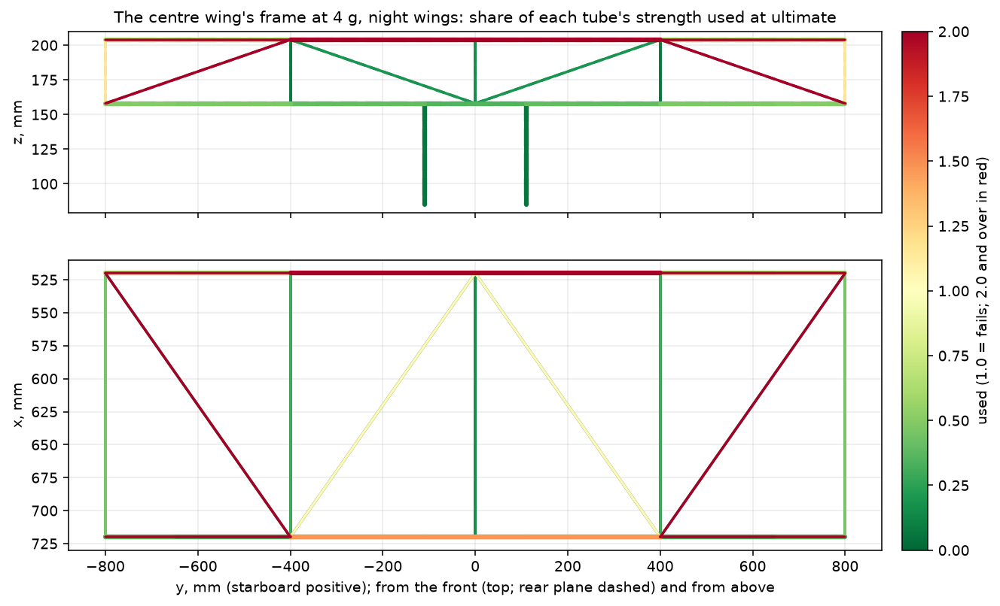

# The sailplane: a soaring relay's centre wing, from handoff to parts

**Status: work in progress.** A 4.8 m, 18 kg thermal-soaring sailplane that loiters for hours as an airborne
radio relay and spectrum scanner: a laminar body of revolution, a three-piece wing with swappable outer
panels (solar by day, light by night) and a pusher in the tail cone. It arrived as an engineering handoff
package: a specification, a parametric OpenSCAD baseline and five deliverables. Its numbers are in
[`design/recon/sailplane.toml`](../../design/recon/sailplane.toml); where the package was silent (tube bores,
laminate allowables, panel masses, connector bodies) the value is a REF stand-in. The section's coordinates
are the UIUC SD7037, in [`design/recon/airfoils/sd7037.dat`](../../design/recon/airfoils/sd7037.dat).

```
uv run osprey recon-sailplane      # out/recon-sailplane: sailplane.md, cutlist.csv, frame.png, scad/
```

It exits 1 while any finding fails. As drawn, six do.



<sub>The centre wing's frame in the 4 g pull-up at ultimate. Red tubes fail: the front top chord between
the inner stations, and the shallow diagonals in the outer bays.</sub>

## What the package gets wrong

| Check | | |
|---|---|---|
| frame inside the wing section | **FAIL** | the frame is 56 mm deep over its chords; inside the SD7037's skin there is 29.2 mm at the front plane and 17.5 mm at the rear. The deepest frame that fits has its chords' centres 19.2 mm apart at the front and 7.5 mm at the rear |
| chords at 4 g x 1.5 | **FAIL** | buckling 2.18 of critical (FT-400>FT+0: 2989 N on 400 mm, critical 2056 N); stress 0.71 of allowable (FT-782>FT-652: 236 MPa) |
| posts, braces and diagonals at 4 g x 1.5 | **FAIL** | buckling 8.09 of critical (FB-800>FT-400: 1927 N on 403 mm, critical 357 N); stress 1.16 of allowable (FB-800>FT-800: 695 MPa) |
| pylons at 4 g x 1.5 | ok | all in tension; stress 0.06 of allowable (FB+110>FP+110: 37 MPa) |
| every tube longer than its sockets | ok | all are |
| chords clear the body's crown | ok | 3.0 mm under the bottom chords |
| pylon feet land in the main bulkheads' webs | ok | feet at radius 139.0 mm; the web runs 125.5 to 147.5 mm |
| joiner sleeve between the planform diagonals | ok | 1.2 mm to spare |
| joiner sleeve inside the wing's skin | **FAIL** | -3.5 mm: a 25 mm joiner tilted 2.75 deg over 150 mm needs 37.5 mm of depth |
| tail cone meets the spinner at the firewall | **FAIL** | the cubic is down to 7.2 mm radius at x = 1415, not 22: it reaches the spinner's radius at x = 1352, and held there the last 62 mm are a parallel stinger. Cut at x = 1352 or close the cubic on the spinner. Its steepest slope is 16.0 deg |
| belly flat ends ahead of the tail cone's recovery | ok | one plane tilted 7.8 deg nose-up, flat from x = 93 to 546, up to 138 mm wide and 18.9 mm off the round |
| battery holds what it weighs | **FAIL** | 72 cells are 4.97 kg and 1296 Wh (12P, 60 Ah), not 488 Wh; 21 Ah at 6S is 24 cells, 1.7 kg. The loiter needs 400 Wh |
| wing area | note | 1.600 m^2 from the planform (quoted 1.63), aspect ratio 14.4 (quoted 14.1), 112 g/dm^2 by day |
| stall speed | note | 11.2 m/s clean at 18 kg takes a lift coefficient of 1.44 |
| centre flaps | note | hinge at x = 745; 60 deg down the trailing edge is at z = 88, inside the body within 120 mm of the centreline, so the flaps start at y = +/-143 and the middle is fixed |

The three that matter most:

- **The frame does not fit in the wing.** The SD7037 at 380 mm chord is 35 mm thick; the frame is 56 mm deep
  over its chords. Either the centre section gets a thicker section or a longer chord, or the frame becomes
  two shallow spars. Every part below is drawn to the package's frame, so the tubes show through the skin.
- **The top chords buckle at 4 g.** A 10 x 8 mm tube 400 mm between lugs holds 2.1 kN; the pull-up asks
  3.0 kN before the 1.5 factor. The face diagonals lie 6.6° off the chords (46 mm deep on a 400 mm bay), so
  they carry the shear at nearly nine times its size, and buckle far sooner. A deeper frame with shorter
  bays fixes both.
- **The pack is either three times the energy or a third of the weight.** 72 cells are 5 kg and about
  1.3 kWh. The quoted 488 Wh is 24 cells, 1.7 kg.

## The pull-up

All the lift is taken on the wing, elliptic over the span, at stall x sqrt(n), and the wing's own weight
comes off where it is. The frame is solved as beam elements with moment-carrying joints (the lugs are
bonded), pinned at the four pylon feet. The outer panels load it through the joiner box's two plates. Each
tube is checked at ultimate for Euler buckling between its ends, pinned, and for axial plus bending stress.
The full table is in `sailplane.md`.

## The parts

`osprey recon-sailplane` writes `scad/params.scad` from the design file and the solved lugs, beside the
modules in [`src/osprey/recon/scad`](../../src/osprey/recon/scad). Change the design file, not the SCAD.

| File | What it draws |
|---|---|
| `lugs.scad` | The 24 printed PA12-CF node lugs, replacing the baseline's spheres: 15 mm sockets, 0.15 mm bond line, 2 mm walls, two adhesive grooves and an injection port in every socket. `-D lug_index=k` gives one lug for the printer |
| `joiner_box.scad` | An outer panel's receptacle: a sleeve for the 25 mm square joiner at 2.75°, two plates that thread onto the four chords, and pockets for the MPX and XT30 connectors on the mating face |
| `center_wing.scad` | The SD7037 lofted over the frame: skin, ribs, the two flaps with their hinge pockets, and the root fairing with its fillets |
| `nadir_belly.scad` | The belly shell with a flat for the camera: a 110 mm window, the pane's recess, and bosses for an interchangeable camera plate |
| `assembly.scad` | All of it on the body, with the bulkheads and rails |

How each was decided:

- **Lugs.** A tube stops where its bore leaves 1 mm of material to every other bore at the node. Posts and
  braces sit 6.5 mm from the node's centre. A face diagonal, 6.6° off its chord, does not clear it until
  81.5 mm out, so its lug has a long arm along the chord. The cut list takes each tube's length from its two
  seats. The chords are one piece each, through every lug, and run 5 mm on into a cap at the tips: the tip
  lugs stand 7 mm outside y = ±800, and the outer panels' root ribs must clear them.
- **Joiner box.** The joiner is tilted, not the sleeve's mouth. Its bending goes into the chords as a couple
  between a plate just inboard of the tip lugs and one at the joiner's inboard end. The outer plate is also
  the shear web at the tip, where the package's diagonal would cross the joiner. The plates thread onto the
  chords before the tip lugs go on.
- **Flaps.** Hinged on the lower surface at 75 % chord. Fully down as brakes, a flap's trailing edge is
  below the body's crown, so the flaps start outboard of the fairing and the trailing edge over the body is
  fixed.
- **Root fairing.** Lofted in 5 mm slices: at each station the body's circle, a web up to the wing's
  underside and the wing are joined, and the inside corners filled to an 18 mm radius.
- **Belly flat.** The body is cut by one plane through the hull at the pane's two ends. A convex body cut by
  a plane leaves a flat with no step, so the flat follows the nose's slope (7.8° nose-up) instead of
  being recessed across it. It runs from x = 93 to 546, well ahead of the tail cone. The
  bulkheads it passes under are cut to it. The baseline's bulkhead relief was on the port side, not the
  bottom; it is at the bottom here.

## Not done

- The SCAD has not been rendered: OpenSCAD is not on the machine this was written on. The tests build the
  printable parts when it is (`tests/test_sailplane.py`).
- The pylons' feet on the main bulkheads, the tail, the outer panels and the hatch are not designed.
- The loads are one symmetric pull-up. No gust, landing, torsion from the flaps or tail load.
- Lug and bond strength are not checked, only the tubes.
