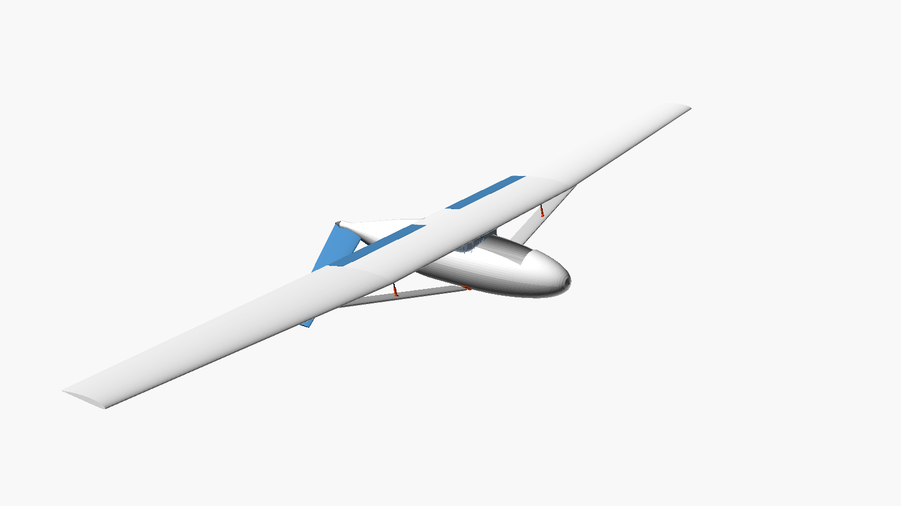
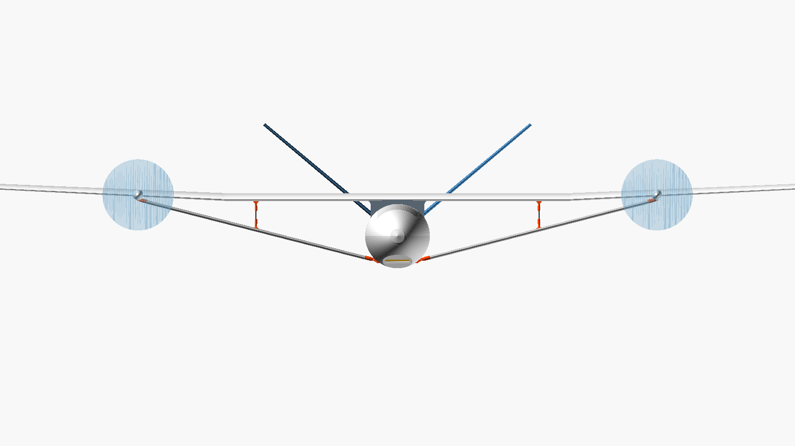

# The sailplane: a soaring relay with a truss-braced wing

**Status: work in progress.** A 4.8 m, 18 kg thermal-soaring sailplane that loiters for hours as an airborne
radio relay and spectrum scanner: a laminar body of revolution, a thin wing of aspect ratio 14 in three
pieces with swappable outer panels (solar by day, light by night), and a pusher in the tail cone. The wing is
braced as NASA's transonic truss-braced wing is: one brace a side from low on the body up to the wing at
mid-span, and a jury strut from each brace up to the wing.



| | |
|---|---|
|  |  |

It arrived as an engineering handoff package. Its numbers are in
[`design/recon/sailplane.toml`](../../design/recon/sailplane.toml); where the package was silent the value is a
REF stand-in. The section's coordinates are the UIUC SD7037, in
[`design/recon/airfoils/sd7037.dat`](../../design/recon/airfoils/sd7037.dat).

```
uv run osprey recon-sailplane      # out/recon-sailplane: sailplane.md, cutlist.csv, wing.png, scad/
```

It exits 1 while any finding fails. For the pusher three do, all in the package's own numbers: the tail cone,
the battery, and a tail less than half the size its body's length asks for. The twin variant below fixes the
first and the last.

## What changed from the package

The package drew a "Warren space-frame truss" inside the centre wing: four chords in a box 56 mm deep, in a
section 35 mm thick. That was a misreading of *truss-braced wing*. The first pass here built it as drawn and
found it could not fit and buckled at 4 g. This is the wing the name means:

- **One spar** inside the section at 30 % chord, a 30 x 25.3 mm square carbon tube. The outer panels'
  25 mm joiners slide into its ends, so the dihedral is built into the panels, not the centre.
- **A brace a side**, from a pin outside the hull on the front main bulkhead (x = 520, z = -110) to a pin
  under the wing at y = ±1200. It is a 12 mm tube inside a 90 mm aerofoil fairing.
- **A jury strut** from the middle of each brace up to the spar. It halves the brace's buckling length.

The braces meet the wing on the outer panels, 400 mm beyond the joint, so swapping a panel also means pulling
the brace's wing pin. The package did not give the station; mid-span is from the paper below.

## The science

Ting, Reynolds, Nguyen and Totah, *Aerodynamic Analysis of the Truss-Braced Wing Aircraft Using
Vortex-Lattice Superposition Approach* (AIAA), on the Boeing SUGAR truss-braced wing. Three things are taken
from it:

- The wing is braced "at approximately mid-span" with one jury strut a side. So is this one.
- The braces are lifting surfaces. In their component build-up the braces carry 8.5 % of the lift and about
  8 % of the drag. Here the braces carry that share of the lift in the load cases (`[aero] brace_lift_frac`),
  and their fairing is an aerofoil, not a streamlined tube.
- Their drag build-up (their Eqs. 1–4): each component's skin friction with transition, times a form factor,
  times its wetted area, plus induced drag. It leaves out interference where the parts meet, as theirs does.

What is not taken: their vortex-lattice superposition itself. The lift here is an assumed elliptic
distribution, not a solved one.

## Findings

| Check | | |
|---|---|---|
| spar inside the wing section | ok | a 30 mm spar at 30% chord; 31.0 mm inside the SD7037's skin |
| centre spar at ultimate | ok | 0.07 of what it can take (night wings, +4 g: stress, 22 MPa) |
| outer panel spar at ultimate | ok | 0.03 of what it can take (night wings, +4 g: stress, 11 MPa) |
| brace at ultimate | ok | 0.30 of what it can take (night wings, -2 g: buckling, 378 N on 563 mm against 1884 N) |
| jury strut at ultimate | ok | 0.06 of what it can take (day wings, +4 g: stress, 21 MPa) |
| wing joiners at ultimate | ok | 19.8 N m at the joint, 23 MPa in a 25 mm square tube |
| brace pins in a printed tang | ok | 756 N on a 4 mm pin through 5 mm is 57 MPa in bearing against 60: printed will do |
| brace tube inside its fairing | ok | 15.0 mm inside a 90 mm, 18% thick fairing for a 12 mm tube |
| what the braces buy | note | in the pull-up the spar's bending falls from 228 to 41 N m and the tip's rise from 85 to 8 mm; each brace pulls 713 N and puts 690 N of compression in the spar; in the push-over it carries 356 N in compression |
| glide and sink | note | best sink 0.56 m/s at 14.5 m/s with the braces (L/D 26), 0.52 without (L/D 28); the package quotes 0.52. The braces are 7% of the drag there. Skin friction and induced drag only: no interference, gaps, antennas or propeller |
| tail cone meets the spinner at the firewall | **FAIL** | the cubic is down to 7.2 mm radius at x = 1415, not 22: it reaches the spinner's radius at x = 1352, and held there the last 62 mm are a parallel stinger. Cut at x = 1352 or close the cubic on the spinner. Its steepest slope is 16.0 deg |
| belly flat ends ahead of the tail cone's recovery | ok | one plane tilted 7.8 deg nose-up, flat from x = 93 to 546, up to 138 mm wide and 18.9 mm off the round |
| battery holds what it weighs | **FAIL** | 72 cells are 4.97 kg and 1296 Wh (12P, 60 Ah), not 488 Wh; 21 Ah at 6S is 24 cells, 1.7 kg. The loiter needs 400 Wh |
| wing area | note | 1.600 m^2 from the planform (quoted 1.63), aspect ratio 14.4 (quoted 14.1), 112 g/dm^2 by day |
| stall speed | note | 11.2 m/s clean at 18 kg takes a lift coefficient of 1.44 |
| centre flaps | note | hinge at x = 745; 60 deg down the trailing edge is at z = 88, inside the body within 120 mm of the centreline, so the flaps start at y = +/-143 and the middle is fixed |

## The loads

A +4 g pull-up and a -2 g push-over at a 1.5 ultimate factor, day and night wings. The wing is solved
as a frame of beam elements, pinned to the body at its saddle and at the braces' roots. In the pull-up the
braces cut the spar's bending from 228 to 41 N m and the tip's rise from
85 to 8 mm. Each brace pulls 713 N, and squeezes the spar by 690 N.


| Brace at y, mm | Spar bending, N m | at the root, N m | Tip in the pull-up, mm | Brace tension, N | Brace compression in the push-over, N | Spar compression, N | Brace used | Most used |
|---|---|---|---|---|---|---|---|---|
| no braces | 228 | 228 | 85 | 0 | -0 | 0 | 0.00 | 0.31 |
| 500 | 124 | 44 | 33 | 920 | 460 | 763 | 0.08 | 0.15 |
| 650 | 100 | 42 | 25 | 840 | 420 | 755 | 0.10 | 0.15 |
| 800 | 79 | 40 | 18 | 789 | 394 | 737 | 0.14 | 0.14 |
| 1000 | 55 | 39 | 12 | 746 | 373 | 716 | 0.22 | 0.22 |
| 1200 | 41 | 41 | 8 | 713 | 356 | 690 | 0.30 | 0.30 |
| 1400 | 45 | 45 | 5 | 685 | 342 | 668 | 0.40 | 0.40 |

Moving the braces outboard keeps cutting the tip's rise, but the spar's bending bottoms out near mid-span and
the longer brace is closer to buckling in the push-over. The paper's mid-span is about the best station here
too. At the panel joint (800) the panels would swap without touching the braces, for about twice the bending.

## The drag

| Speed, m/s | CL | Wing | Braces | Tail | Body | Induced | L/D | Sink, m/s | L/D, no braces | Sink, no braces |
|---|---|---|---|---|---|---|---|---|---|---|
| 14.5 | 0.86 | 89 | 24 | 16 | 23 | 180 | 25.7 | 0.56 | 27.7 | 0.52 |
| 16.5 | 0.66 | 86 | 23 | 16 | 22 | 108 | 26.1 | 0.63 | 28.7 | 0.58 |
| 18.5 | 0.53 | 82 | 22 | 15 | 21 | 68 | 25.2 | 0.73 | 28.2 | 0.66 |

Counts of 0.0001 on the wing's area. The braces cost about two points of glide ratio and 0.04 m/s of sink at
the slow end. The package's 0.52 m/s is what this method gives with no braces at all, and it is optimistic:
no interference, gaps, antennas, jury struts or stopped propeller.

## The twin: props on the braces' pods, a V-tail, a longer body

```
uv run osprey recon-sailplane --variant twin      # out/recon-sailplane/twin
```

A variant, laid over the pusher's design file by
[`design/recon/sailplanes/twin.toml`](../../design/recon/sailplanes/twin.toml): two tractor props on pods on the
wing where the braces' pins are, an upright V-tail, and no propeller in the tail cone, which now closes to a
point.




What moving the props does:

- **Loads.** A pod's 0.45 kg hangs on the wing right where the brace holds it, so in the pull-up it takes load
  off the brace: 719 N a side. Every tube passes.
- **Balance.** 0.9 kg leaves the tail cone for the wing, and the CG comes 45 mm forward. The
  battery slides 174 mm aft on its rails to put it back, of the 320 mm they leave it.
- **Tail cone.** With no spinner to meet, the pusher's parallel stinger is gone.
- **Drag.** The pods add about 2 counts. Best sink is 0.58 m/s (L/D 25) against the
  pusher's 0.56 as quoted; but the pusher's figure is with a tail less than half the size it needs.

Not looked at: one prop stopped (the yaw it makes, 1.2 m off the centre line, against the V-tail), the props'
wash over the wing and braces, the thrust's bending of the wing fore and aft, and where the tail's weight and
the longer cone put the CG.

### How long the body can be

The package's body is 1.45 m long under a 4.8 m wing, and its 0.22 m² tail sits 0.74 m behind the wing. That
gives tail volumes of 0.18 horizontal and 0.009 vertical, against the 0.40 and 0.020 a sailplane this shape
wants (REF targets). On that arm it needs 0.50 m² of tail.

So the sweep stretches the tail cone and, at each length, sizes the tail to just meet both volumes. A short
body pays in tail area; a long one in skin and weight.

| Length, m | Fineness | Tail arm, m | Tail, m^2 | Volumes, horizontal and vertical | Body skin, m^2 | Body, counts | Tail, counts | All-up, kg | Tail cone's steepest, deg | L/D | Sink, m/s | |
|---|---|---|---|---|---|---|---|---|---|---|---|---|
| 2 | 6.7 | 1.29 | 0.29 | 0.41, 0.020 | 1.37 | 26 | 22 | 19.2 | 11.0 | 24.8 | 0.585 | as designed |
| 1.45 | 4.8 | 0.74 | 0.50 | 0.41, 0.020 | 1.00 | 19 | 38 | 18.4 | 16.0 | 24.3 | 0.597 |  |
| 1.6 | 5.3 | 0.89 | 0.42 | 0.41, 0.020 | 1.10 | 21 | 31 | 18.6 | 13.3 | 24.6 | 0.590 |  |
| 1.8 | 6.0 | 1.09 | 0.34 | 0.41, 0.020 | 1.23 | 23 | 25 | 18.9 | 11.3 | 24.8 | 0.586 |  |
| 2 | 6.7 | 1.29 | 0.29 | 0.41, 0.020 | 1.37 | 26 | 22 | 19.2 | 11.0 | 24.8 | 0.585 |  |
| 2.2 | 7.3 | 1.49 | 0.25 | 0.41, 0.020 | 1.52 | 29 | 19 | 19.6 | 10.9 | 24.8 | 0.586 |  |
| 2.4 | 8.0 | 1.69 | 0.22 | 0.41, 0.020 | 1.67 | 31 | 16 | 20.0 | 10.9 | 24.6 | 0.589 |  |
| 2.6 | 8.7 | 1.89 | 0.20 | 0.41, 0.020 | 1.84 | 34 | 15 | 20.5 | 10.9 | 24.5 | 0.593 |  |
| 2.8 | 9.3 | 2.09 | 0.18 | 0.41, 0.020 | 2.01 | 38 | 13 | 21.0 | 10.9 | 24.3 | 0.598 |  |
| 3 | 10.0 | 2.29 | 0.16 | 0.41, 0.020 | 2.19 | 41 | 12 | 21.5 | 10.9 | 24.0 | 0.604 |  |
| 3.2 | 10.7 | 2.49 | 0.15 | 0.41, 0.020 | 2.38 | 44 | 11 | 22.0 | 10.9 | 23.8 | 0.610 | swells |

- **The longest it can be is 3.07 m.** The tail cone is a cubic held to an 11° closing angle. Past that
  length the cubic swells beyond the body's radius before it narrows.
- **The best is about 2.0 m**, and the curve is flat from 1.8 to 2.4 m. The twin is drawn at 2.0 m, with a
  0.29 m² tail, at 19.2 kg.
- **From 2.0 m on the tail cone is never steeper than its 11° closing angle.** At 1.45 m it reaches 16°, which
  is what the package wanted to avoid ahead of a pusher prop.

The weights behind this are stand-ins: 3 kg/m² for the shell and 1.5 kg/m² for the tail.

### How long the wing can be

A side result. The outer panels stretched, the braces kept at mid-span, the tubes as they are:

| Span, m | Area, m^2 | Aspect ratio | All-up, kg | Brace, mm | Most-used tube | Joiner | Tip's rise | What limits | L/D | Sink, m/s | Vertical tail volume | |
|---|---|---|---|---|---|---|---|---|---|---|---|---|
| 4.8 | 1.60 | 14.4 | 19.2 | 1127 | 0.30 | 0.05 | 0.3% | brace (buckling, night wings, -2 g), 0.30 | 24.8 | 0.58 | 0.0201 | ok |
| 5.4 | 1.79 | 16.3 | 19.7 | 1274 | 0.44 | 0.05 | 0.4% | brace (buckling, night wings, -2 g), 0.44 | 27.0 | 0.54 | 0.0160 | ok |
| 6 | 1.97 | 18.3 | 20.3 | 1422 | 0.61 | 0.12 | 0.5% | brace (buckling, night wings, -2 g), 0.61 | 28.6 | 0.51 | 0.0131 | ok |
| 6.6 | 2.16 | 20.2 | 20.8 | 1570 | 0.81 | 0.14 | 0.6% | brace (buckling, night wings, -2 g), 0.81 | 29.8 | 0.49 | 0.0109 | ok |
| 7.2 | 2.34 | 22.1 | 21.4 | 1719 | 1.05 | 0.15 | 0.7% | brace (buckling, night wings, -2 g), 1.05 | 30.7 | 0.47 | 0.0092 | **over** |
| 7.8 | 2.53 | 24.0 | 21.9 | 1868 | 1.34 | 0.16 | 0.8% | brace (buckling, night wings, -2 g), 1.34 | 31.3 | 0.46 | 0.0078 | **over** |
| 8.4 | 2.72 | 26.0 | 22.5 | 2017 | 1.68 | 0.17 | 0.8% | brace (buckling, night wings, -2 g), 1.68 | 31.6 | 0.46 | 0.0068 | **over** |
| 9 | 2.90 | 27.9 | 23.0 | 2166 | 2.06 | 0.19 | 0.9% | brace (buckling, night wings, -2 g), 2.06 | 31.8 | 0.46 | 0.0059 | **over** |
| 9.6 | 3.09 | 29.8 | 23.5 | 2316 | 2.50 | 0.20 | 1.0% | brace (buckling, night wings, -2 g), 2.50 | 31.9 | 0.45 | 0.0052 | **over** |
| 10.2 | 3.27 | 31.8 | 24.1 | 2465 | 2.99 | 0.21 | 1.1% | brace (buckling, night wings, -2 g), 2.99 | 31.9 | 0.45 | 0.0046 | **over** |

The wing passes out to about 7 m. What stops it is the 12 mm brace tube buckling in the push-over, as the
brace gets longer; the spar and the joiners are barely loaded. A stiffer brace would go further. The vertical
tail volume falls as the span grows, so a longer wing needs a bigger tail or a longer body again.

## The parts

`osprey recon-sailplane` writes `scad/params.scad` from the design file, beside the modules in
[`src/osprey/recon/scad`](../../src/osprey/recon/scad). Change the design file, not the SCAD.

| File | What it draws |
|---|---|
| `assembly.scad` | The whole aircraft, with the variant's tail and props; `-D see_inside=true` clears the skin and takes the brace fairings off |
| `brace_fittings.scad` | A brace's fittings where they go: the fork under the wing, the root fork on the bulkhead, the jury strut's fork and collar, the tube ends. `-D part="wing_fork"` and so on give one for the printer |
| `end_rib.scad` | The centre section's end rib: the spar's mouth for the joiner, and pockets for the MPX and XT30 connectors in the mating face |
| `center_wing.scad` | The SD7037 lofted over the two spars: skin, ribs, flaps with hinge pockets, and the root fairing |
| `nadir_belly.scad` | The belly shell with a flat for the camera: a 110 mm window, the pane's recess, bosses for a camera plate |


- **Tube ends.** A bonded socket 20 mm deep with two adhesive grooves, and a tang for the pin. At 4 g a
  brace's 4 mm pin puts 57 MPa of bearing in a 5 mm printed tang, against a stand-in allowable of 60. That
  is too close: make the two main brace ends and forks in aluminium.
- **Forks.** The wing and jury forks are cradles bonded round the lower half of the square spar, with two
  cheeks down to the pin. The root fork bolts to the front main bulkhead through the hull.
- **Flaps.** Hinged on the lower surface at 75 % chord. Fully down as brakes, a flap's trailing edge is
  below the body's crown, so the flaps start outboard of the fairing and the trailing edge over the body is
  fixed.
- **Belly flat.** The body is cut by one plane through the hull at the pane's two ends, 7.8° nose-up, from
  x = 93 to 546. A convex body cut by a plane leaves a flat with no step.

## Not done

- The parts build in OpenSCAD as closed solids (the tests export them), but none has been sliced or printed.
  The root fairing is stepped slices and the outer panels are a plain loft, for looking at.
- The outer panels' structure, the tail, the hatch and the wing's saddle pins are not designed.
- The lift is an assumed elliptic distribution with a fixed share on the braces. No vortex-lattice solution,
  no gust, landing or torsion case, no flutter. A braced wing this slender wants an aeroelastic check.
- The brace's root is low on a belly-landing aircraft. Nothing here checks what a landing does to it.
- Bond and fitting strength are not checked, beyond the pins' bearing.
