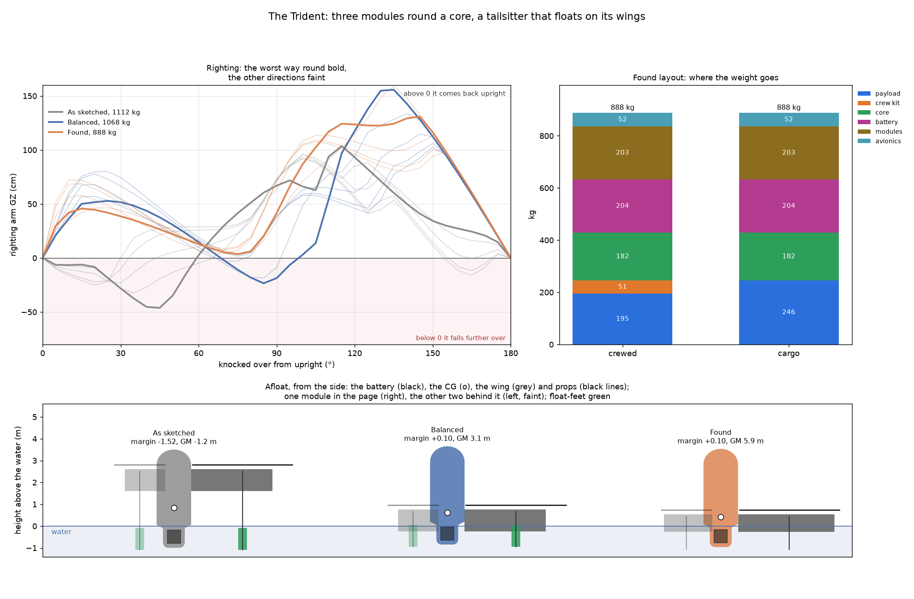
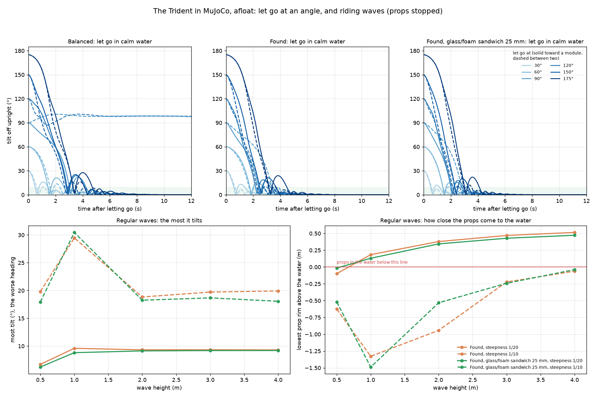
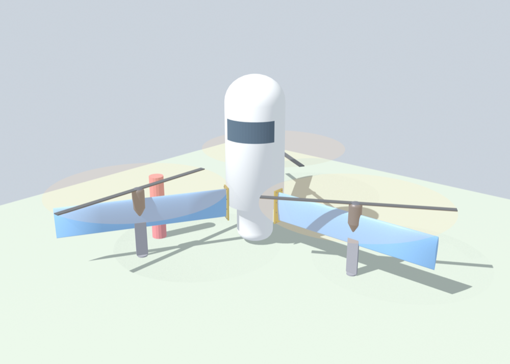
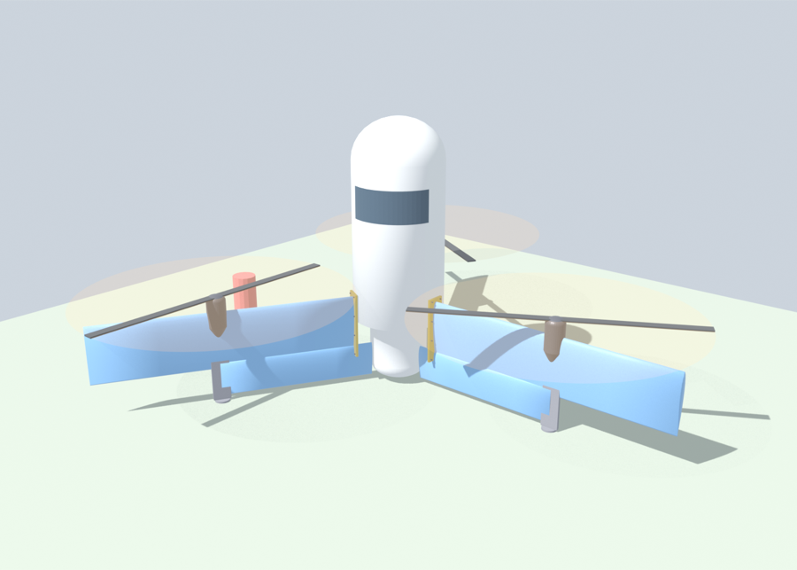

# The Trident: three modules round a core

**Status: first look.** A crewed tailsitter built from three identical modules, from a SketchUp massing sketch
(trident-1). Every input is a REF stand-in, in [`design/trident.toml`](../../design/trident.toml), so the numbers
show which way the design should move, not what to build. The run behind this page is
[`runs/2026-11-11_trident`](../../runs/2026-11-11_trident/trident.md).



## The idea

- **Three identical modules.** Each is an arm and a wing panel, a motor pod with a big slow prop, and a leg with a
  foot. The third module is extra on purpose:
  - it gives control authority in any attitude;
  - it is the fin in flight, so any of the three can be up;
  - a module unbolts and swaps, so it is serviceable and easy to adapt.
- **The core.** Sized round a 4x8 ft sheet: 1.22 m across and 2.44 m long inside. It has 15–20 cm foam walls and
  an aeroshell nose. Inside, one person and 100 kg of mission load ride in a padded, buoyant container.
- **The power cells.** They sit in a bay a metre long under the core: the keel afloat and the tail in flight.
- **The flight.** It lifts off standing on its tail, tips over and flies on the three wings in a Y, then lands
  back on its feet.

## The sketch

The SketchUp sketch is primitive shapes for the mass:
- three 4.57 m (15 ft) discs round a 1.22 m column 2.13 m tall;
- triangular webs from the column's foot up to each rotor;
- a 1 m bay below.

The model keeps the discs and adds what the sketch left out:
- the foam walls and their skin;
- the aeroshell;
- the wings under the props;
- the legs and feet;
- the battery sized for a trip.

The trip is 4 min of hover, 50 km of cruise and a 10 min reserve.

## What the numbers say

| | As sketched | Balanced | Found |
|---|---|---|---|
| Max weight (crewed) | 1,112 kg | 1,068 kg | 888 kg |
| Props' plane, up the axis | 3.80 m (the core's top) | 1.81 m | 1.70 m |
| Static margin | −1.52 chords: can't fly | +0.10 | +0.10 |
| Hover / cruise | 161 / 105 kW | 152 / 96 kW | 115 / 65 kW |
| Upright afloat (GM) | −1.2 m: falls over | 3.1 m | 5.9 m |
| Always comes back upright | no | no: held over at 70–90° | yes, least arm +4 cm |

- **As sketched, the module ring is in the wrong place, both for flight and for floating.**
  - With the props at the core's top, the wing sits 1.5 chords ahead of the centre of gravity. A tailsitter
    needs the CG just ahead of the wing, so it can't fly.
  - The same 230 kg of motors, props, pods and wings 3.8 m up puts the CG too high to float upright.
  - The 1 m float-feet sit wholly under water, so they give it no stance.
- **Balanced: slide the module ring down the core until the wing sits on the CG.** The props' plane drops to
  about 1.8 m up the axis, just above the core's floor.
  - That makes it flyable, and 44 kg lighter.
  - The wing panels now reach down into the water afloat. Foam-cored and buoyant, they are the floats.
- **The float-feet then make it worse.** Their buoyancy sits at the tail, the end that must sink for it to come
  back upright, so they hold it lying over. Every foot tried, from 15 x 80 cm to 25 x 160 cm, fails to right it.
  The legs still stand it on deck, but they end in pads, and the wings float it.
- **Found: balanced, with a glass skin, legs with pads, longer and narrower wings and the person crouched.**
  - **Weight:** 888 kg, carrying one person and 100 kg; uncrewed, 246 kg of cargo.
  - **Battery:** 41 kWh (204 kg), filling 13 % of the bay.
  - **Hover:** 115 kW, at a disc loading of 18 kg/m², about a third of a light helicopter's, with 8.5 m/s of
    downwash.
  - **Cruise:** 49 m/s on 65 kW.
  - **Afloat:** it rights itself from every angle and every direction, crewed and as cargo. The margin is thin: its
    least righting arm is +4 cm.

## What drives it

- **HDPE is heavy.** Wrapping 18 cm foam walls in 3 mm HDPE makes the core's walls weigh 176 kg. A glass-epoxy
  sandwich over the same foam is 116 kg. With the weight closed round it (the battery shrinks too), the craft comes
  out about 100 kg lighter.
- **Big props pay twice.** 4.57 m props against 3.05 m:
  - hover drops from 202 to 115 kW;
  - the craft gets 100 kg lighter.

  The cost is size: 10.8 m across the prop tips.
- **Crouching matters.** The person crouched low (the container's centre 0.5 m above the floor) rights itself;
  sitting up (0.9 m) it doesn't.
- **The wing is a float as well as a wing.** A panel running out 90 % of a prop radius past the motor, with a
  0.8 m chord, rights it.
  - A shorter panel gives less stance.
  - A deeper chord puts more buoyancy at the tail and holds it over.
- **Range.** Crewed, a 25 km trip needs 814 kg of craft; 100 km needs 1,091 kg. Flown uncrewed, the 50 km airframe
  carries 297 kg of cargo over 25 km, or 144 kg over 100 km.

## How to build the hull

Two ways to build the core were proposed: an HDPE skeleton, a tetrahedral lattice with its cells foam-filled and more
structure riveted on; or a foam-cored composite, moldless or molded. Each is sized and floated on the found layout
([`runs/2026-11-11_trident-hull`](../../runs/2026-11-11_trident-hull/trident.md)):

| Hull | Core walls | Inside | Max weight | Hover | Floor above water | Rights itself |
|---|---|---|---|---|---|---|
| HDPE-wrapped foam, 18 cm | 176 kg | 1.22 x 2.44 m | 987 kg | 135 kW | −2 cm | only just (0 cm) |
| Glass over foam, 18 cm (found) | 116 kg | 1.22 x 2.44 m | 888 kg | 115 kW | +4 cm | yes, +4 cm |
| HDPE lattice, foam-filled, 18 cm | 249 kg | 1.22 x 2.44 m | 1,109 kg | 161 kW | −7 cm | no |
| HDPE lattice, foam-filled, 10 cm | 146 kg | 1.22 x 2.44 m | 918 kg | 121 kW | +2 cm | no |
| Glass/foam sandwich 25 mm, outside shrunk | 46 + 32 kg | 1.22 x 2.44 m | 797 kg | 98 kW | +16 cm | no |
| Glass/foam sandwich 25 mm, same outside | 66 + 32 kg | 1.53 x 2.75 m | 857 kg | 109 kW | +12 cm | yes, +9 cm |
| Carbon/foam sandwich 25 mm, same outside | 52 + 32 kg | 1.53 x 2.75 m | 834 kg | 105 kW | +14 cm | yes, +9 cm |

- **The envelope is sealed, so it floats whatever its walls are.** The 18 cm of foam only matters if it is holed,
  and about 1 m³ of foam blocks round the container (32 kg) does that job. With the blocks, the walls and the wing
  panels, the foam alone floats it 2.7 times over.
- **So the wall can be a thin sandwich, and the outside kept.** The outside sets the floating and the drag; the
  room the thick wall took comes back inside, 1.53 x 2.75 m, which starts to suit the pilot-and-two-stretchers
  version. It is 31 kg lighter, sits 8 cm higher and rights itself by +9 cm. Shrinking the outside instead saves
  more weight but loses the buoyancy up high, and it no longer rights itself.
- **An HDPE lattice is a poor core.** HDPE is about a twentieth as stiff as a glass laminate, and a tetrahedral
  truss is about a ninth as stiff as its solid, scaled by how much of it is solid. At 4 % HDPE (38 kg/m³ before
  the foam) it is around 4 MPa, against about 80 MPa for an 80 kg/m³ PVC foam, so the foam in its cells does the
  work. It adds 130 kg over glass and foam at 18 cm, and doesn't right itself at 18 or 10 cm.
- **HDPE fights fasteners and glue.** It creeps under a rivet's clamp and grows about six times as much as aluminium
  with heat, so riveted metal works loose; it wants through-bolts with spacers or moulded-in inserts. Glue doesn't
  take without flame or plasma treatment; it is welded.
- **Where HDPE earns its weight is outside.** Wear plates on the bay's bottom, the leg pads and a rub strake: knocks,
  abrasion, and cheap to replace.
- **Moldless for the core, molded for the modules.** The core is one per craft: hot-wire foam and glass over it, no
  tooling. The three identical modules' wing panels and pods are made over and over, which is where molds pay.
  Carbon saves only another 23 kg over glass.
- **Not checked:** the walls are a weight per square metre. Stiffness, slamming, the module joints and whether 25 mm
  is enough are open; so is where the flotation blocks go and how much room they take.

## A tail ring

With the stall at 38–39 m/s, the found layout is either flying fast or hovering. A tail ring adds three more
panels at the bottom, from the bay out to each leg, so it flies as a tandem wing
([`runs/2026-11-12_trident-tail`](../../runs/2026-11-12_trident-tail/trident.md), on the sandwich hull):

- **The neutral point** is the two quarter chords weighted by area. The tail counts at 60 % because it flies in
  the wing's downwash. The module ring is balanced again for each case.
- **The tail panels free-flood.** A buoyant tail puts buoyancy at the tail, which holds the craft lying over, as
  the float-feet did.

| Wing chord / tail chord | Max weight | Stall | Cruise | Comes back upright? |
|---|---|---|---|---|
| 0.8 / none (the sandwich) | 857 kg | 38 m/s | 61 kW | yes, +9 cm |
| 0.8 / 0.6 | 913 kg | 34 m/s | 57 kW | yes, +18 cm; floor only +2 cm |
| **1.0 / 0.6** | **951 kg** | **32 m/s** | **58 kW** | **yes, +9 cm; floor +14 cm** |
| 1.0 / 1.0 | 1,004 kg | 30 m/s | 64 kW | yes, +12 cm |
| 1.0 / none | 881 kg | 35 m/s | 56 kW | no |
| 1.2 / 0.6 | 995 kg | 30 m/s | 63 kW | no |
| 1.0 / 1.0, buoyant tail | 1,004 kg | 30 m/s | 64 kW | no |

- **The pick is a 1.0 m wing with a 0.6 m tail.** It is 94 kg heavier than the sandwich and stalls at 32 m/s
  rather than 38, and cruise power stays about the same.
- **The tail helps it right itself.** A 1.0 m wing on its own doesn't come back upright, but with the tail it
  does, probably because the tail's weight sits low (not separated out here).
- **Wing chords of 1.2 m and up don't come back upright,** with or without a tail.
- **The best-range speed hardly moves** (40–48 m/s). A bigger wing lowers the stall, not the cruise.
- **It doesn't lift the props.** The props' plane stays at 1.6–1.7 m, so they clear the water by about the same.

## In MuJoCo, afloat

The righting curves are static: they say which way it is pushed at each angle, not what it does once it moves.
`osprey trident-sim` puts it in MuJoCo ([`src/osprey/trident_sim.py`](../../src/osprey/trident_sim.py), run
[`runs/2026-11-11_trident-sim`](../../runs/2026-11-11_trident-sim/trident_sim.md)).
- **MuJoCo carries the rigid body:** the mass, the inertia from where each part sits, and the integration.
- **The water is ours.** MuJoCo has no free surface. Each step the sealed meshes (the envelope and the buoyant
  wing panels) are clipped at the water's surface, curved in a wave, and the pressure under it is applied through
  `xfrc_applied`. On calm water that is the same sum as the righting curves; a test checks it rocks at the period
  its GM and inertia give.
- **Damping is a stand-in:** 20 % of critical in heave and 10 % in roll. Added mass, wave radiation, the wave's
  pressure fading with depth and breaking waves aren't modelled. The props are stopped.



- **Let go upside down, it comes back in under 5 s.** The found layout and the sandwich come back from every angle
  to 175°, in both directions. They swing back past upright by 8–24° and settle in 0.6–4.5 s.
- **Momentum helps the balanced layout, but not enough.** Statically it is held over at 70–90°. Dynamically it
  swings through from most angles, but let go at 90° or 120° between two modules it lies over and stays at
  about 92°.
- **In waves it follows the water like a raft.** Its roll period is about 1 s, much shorter than the waves', so it
  lies on the wave's slope rather than rolling against it. In a swell (steepness 1/20) it tilts about 9°, the
  slope itself; in steep waves (1/10) about 18–20°. It peaks at 30° in a 1 m wave 10 m long, closest to its own
  period. It never capsizes in regular waves up to 4 m.
- **The props are the problem, not the righting.** Lying on the slope, a prop 5 m out from the axis dips toward
  the water.
  - In a swell of 1 m and up, the props stay 0.1–0.5 m clear.
  - In steep waves, at every height tried, the props' rims go under, by up to 1.5 m in a 1 m wave 10 m long.
  - In a short 0.5 m chop they touch.

  So it can sit out a steep sea, but it can't start its props or lift off in one. Raising the props fights the
  balance that put them low; folding or feathering blades at rest, or lifting off only below a sea state, are the
  ways round it.
- **The core's floor edge goes under in most waves.** The found layout's floor is 4 cm above the water at rest,
  so a wave covers it; the sandwich, 12 cm up, keeps it at the surface in a swell. The hatch has to sit well above
  the floor.
- **What's uncertain:** without added mass the roll period is too short. The wings rolling through the water add a
  lot of inertia, so the real period is longer, and the 30° peak moves to longer waves. A tank test of a scale model
  would set the damping and the period.

## In Blender

`osprey trident-blend` builds the found layout in Blender ([`src/osprey/trident_blend.py`](../../src/osprey/trident_blend.py)
and [`src/osprey/blender/build_trident.py`](../../src/osprey/blender/build_trident.py)). Blender runs headless,
with no window, and writes `out/trident-blend/trident.blend` and three renders (angled, side and top) in about 10 s.

The core, bay, nose and wing panels go across as the sizing model meshes them, so they are the same sealed bodies
the flotation and MuJoCo runs use. Blender draws the rest from the model's numbers:

- the pods and props;
- the legs and pads;
- a canopy band;
- the bolted root flange at each wing root;
- a 1.8 m person for scale.

The pods', pads' and flanges' sizes are for the drawing only; the model carries their weights, not their shapes.
Z is the craft's axis, with z = 0 at the tail tip and module 1 along +X. Free-flooding tail panels, when there are
any, are drawn too.





## Watch-outs

- **The props sit 74 cm above the water afloat.** That is too little in a sea; on deck they are at head height.
- **The core's floor is only 4 cm above the waterline.** The hatch and any seams want to be well above it.
- **The wings sit in the water at rest.** Lifting off must break them free, and suction and spray on the wings
  aren't modelled.
- **The static margin counts the wing only.** The core ahead of it (destabilising) and the legs behind it
  (stabilising) are left out.

## Not modelled yet

- **Flight:** the transition, control in the props' wash, and a crewed tailsitter's ergonomics. The person rotates
  90° between hover and cruise.
- **The tail:** the tail ring's downwash share (`tail_eff`) is a stand-in; legs as fins, or strakes at the feet.
- **Waves and dynamics:** the MuJoCo runs are regular waves only, with stand-in damping and no added mass;
  irregular and breaking seas, and lifting off from the water with the props turning, are next.
- **Structure:** the arm's and wing's spar sizing; here they are weight per area.
- **The module joint:** how a module bolts on and what that costs in weight. The Blender scene draws a bolted
  flange there, but the model gives it no weight yet.

## Running it

```bash
uv run osprey trident --workers 8    # three layouts, the cargo case and the sweeps, about 25 s
uv run osprey trident-sim --workers 8    # in MuJoCo: let go at angles, and riding waves, about 4 min
uv run osprey trident-blend              # built in Blender, with three views rendered (needs Blender), about 10 s
```

Blender is found from `$BLENDER`, then `blender` on the path, then `/Applications/Blender.app`. On macOS,
`brew install --cask blender` installs it.
