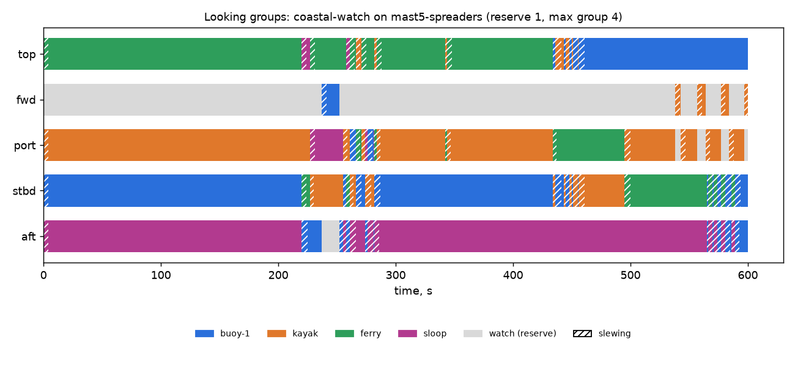

# Looking groups: coastal-watch on mast5-spreaders (reserve 1, max group 4)

Generated 2026-11-06 at unknown by `uv run osprey sim --scenario coastal-watch --rig mast5-spreaders`.

A camera always on watch: **yes**

| Task | Class | Need | Priority | Need met | Group median / max | px median | Range σ/R median | Starved |
|---|---|---|---|---|---|---|---|---|
| buoy-1 | lobster buoy | recognize | 1 | 86% | 1 / 3 | 43 | 4.0% | 0% |
| kayak | kayak | recognize | 2 | 84% | 1 / 1 | 73 | 3.9% | 0% |
| ferry | ship | recognize | 3 | 86% | 1 / 1 | 174 | 3.3% | 4% |
| sloop | sailboat 30ft | identify | 4 | 88% | 1 / 1 | 44 | 27.6% | 4% |

| Station | Tasked | Slewing | Watch |
|---|---|---|---|
| top | 89% | 11% | 0% |
| fwd | 3% | 3% | 94% |
| port | 86% | 10% | 4% |
| stbd | 84% | 16% | 0% |
| aft | 87% | 10% | 2% |

