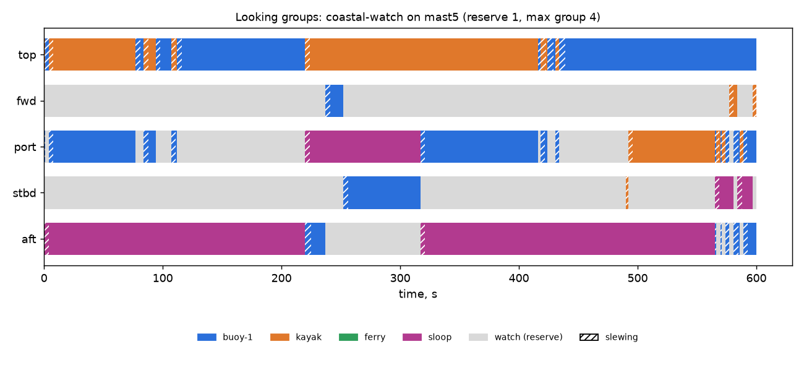

# Looking groups: coastal-watch on mast5 (reserve 1, max group 4)

Generated 2026-11-06 at unknown by `uv run osprey sim --scenario coastal-watch --rig mast5`.

A camera always on watch: **yes**

| Task | Class | Need | Priority | Need met | Group median / max | px median | Range σ/R median | Starved |
|---|---|---|---|---|---|---|---|---|
| buoy-1 | lobster buoy | recognize | 1 | 87% | 1 / 3 | 44 | 2.8% | 0% |
| kayak | kayak | recognize | 2 | 57% | 1 / 1 | 56 | 2.6% | 0% |
| ferry | ship | recognize | 3 | 0% | 0 / 0 | 0 | inf% | 1% |
| sloop | sailboat 30ft | identify | 4 | 96% | 1 / 1 | 45 | 25.7% | 1% |

| Station | Tasked | Slewing | Watch |
|---|---|---|---|
| top | 91% | 9% | 0% |
| fwd | 2% | 2% | 96% |
| port | 57% | 9% | 34% |
| stbd | 14% | 2% | 84% |
| aft | 80% | 4% | 16% |

