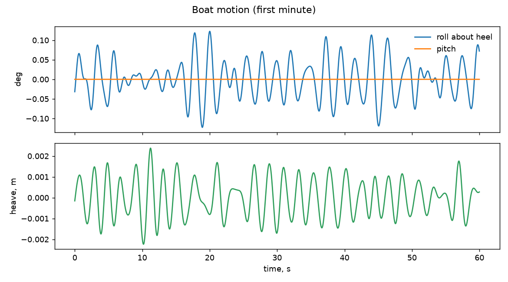
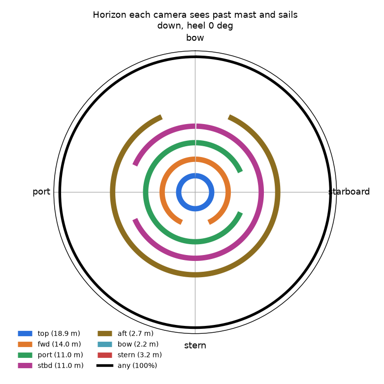
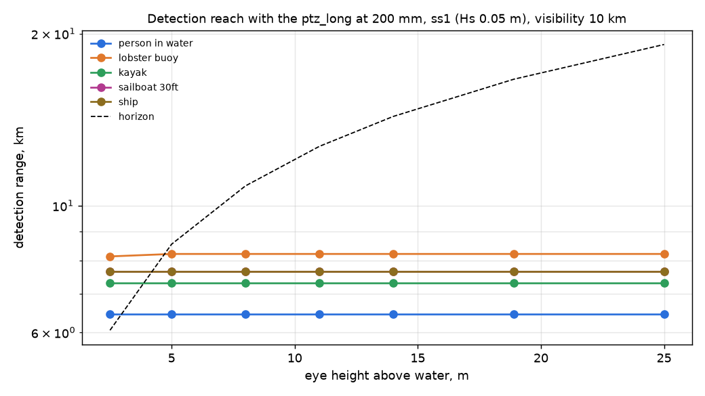
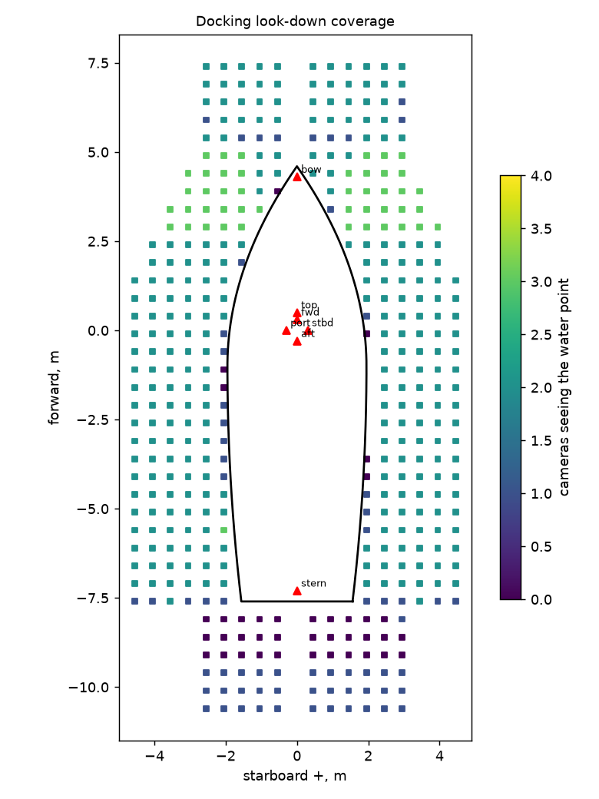

# docking on whole-boat: check report

Generated 2026-11-06 at unknown by `uv run osprey calc --scenario docking --rig whole-boat`. Screening-level models; REF inputs in `design/`.

**Result:** 1 FAIL, 2 WARN, 23 PASS

## Motion

| | Check | Value | Limit | Note |
|---|---|---|---|---|
| info | Roll about the 0 deg heel, rms / max | 0.0 / 0.1 deg |  | ss1, Hs 0.05 m, Tp 2.0 s, waves 90 deg off the bow |
| info | Pitch rms / max | 0.0 / 0.0 deg |  |  |
| info | Angular rate at the mounts, p95 / max | 0.6 / 0.7 deg/s |  | the same for every camera on a rigid hull |
| pass | Acceleration at top (18.9 m), p95 | 0.03 g | 0.5 g | sets the mount, connector and gimbal-motor ratings |
| info | Speed of top through the air, p95 | 0.1 m/s |  | parallax for near targets; adds to apparent wind on the housing |

## Stabilization

| | Check | Value | Limit | Note |
|---|---|---|---|---|
| pass | top: blur p95 at 200 mm, 1 ms | 0.00 px | 1 px | worst of 8 horizon bearings |
| pass | top: pointing jitter rms vs half-FOV at max zoom | 12 urad | 6399 urad | inner stage saturated 0% of the time |
| pass | fwd: blur p95 at 120 mm, 1 ms | 0.06 px | 1 px | worst of 8 horizon bearings |
| pass | fwd: pointing jitter rms vs half-FOV at max zoom | 434 urad | 7732 urad | no fast stage |
| pass | port: blur p95 at 120 mm, 1 ms | 0.06 px | 1 px | worst of 8 horizon bearings |
| pass | port: pointing jitter rms vs half-FOV at max zoom | 434 urad | 7732 urad | no fast stage |
| pass | stbd: blur p95 at 120 mm, 1 ms | 0.06 px | 1 px | worst of 8 horizon bearings |
| pass | stbd: pointing jitter rms vs half-FOV at max zoom | 434 urad | 7732 urad | no fast stage |
| pass | aft: blur p95 at 120 mm, 1 ms | 0.06 px | 1 px | worst of 8 horizon bearings |
| pass | aft: pointing jitter rms vs half-FOV at max zoom | 434 urad | 7732 urad | no fast stage |
| pass | bow: blur p95 at 3 mm, 2 ms | 0.04 px | 1 px | worst of 8 horizon bearings |
| pass | bow: pointing jitter rms vs half-FOV at max zoom | 24697 urad | 260844 urad | no fast stage |
| pass | stern: blur p95 at 3 mm, 2 ms | 0.04 px | 1 px | worst of 8 horizon bearings |
| pass | stern: pointing jitter rms vs half-FOV at max zoom | 24697 urad | 260844 urad | no fast stage |

## Ranging

| | Check | Value | Limit | Note |
|---|---|---|---|---|
| info | Horizon-dip range, top, at 1 km | +/- 1 m (0.1%) |  | refraction bias 3 m for dk = 0.04 |
| info | Horizon-dip range, top, at 2 km | +/- 1 m (0.1%) |  | refraction bias 10 m for dk = 0.04 |
| info | Horizon-dip range, top, at 5 km | +/- 6 m (0.1%) |  | refraction bias 54 m for dk = 0.04 |
| info | Group stereo top+bow, 16.7 m vertical baseline, at 2 km | +/- 54 m (2.7%) |  | relative orientation 50 urad from the shared horizon; a flexing rig without it: mrad |

## Coverage

| | Check | Value | Limit | Note |
|---|---|---|---|---|
| pass | Horizon seen by at least one camera (down, heel 0 deg) | 100.0% | >= 95% |  |
| info | Horizon seen without top | 100.0% |  | what is left when the masthead PTZ is busy in a group |
| info | Horizon seen by two or more cameras | 100.0% |  | where a looking group of 2+ is possible |

## Mass aloft

| | Check | Value | Limit | Note |
|---|---|---|---|---|
| WARN | Camera mass on the mast / masthead equivalent | 7.2 / 5.0 kg | 4 kg eq | equivalent = same heeling moment at the truck; cameras only, no brackets or cable |

## Docking

| | Check | Value | Limit | Note |
|---|---|---|---|---|
| WARN | Water within 3 m of the hull seen by 2+ cameras | 75.5% | >= 90% | one or more: 91.0% |
| **FAIL** | Hull edge (within 0.75 m) with a stereo pair | 64.3% | >= 90% |  |
| pass | Stereo depth where the hull edge has a pair, p95 | 3.4 cm | 5 cm |  |
| pass | Same, with aims optimized for two views | 94.3% | >= 90% | hull edge with a stereo pair: 80%; aims: top (0, -1) @ 6.5 mm, fwd (0, -1) @ 4.8 mm, port (-6, 2) @ 4.8 mm, stbd (-11, -5) @ 4.8 mm, aft (1, 3) @ 4.8 mm |
| pass | top: look-down blur p95 incl. parallax | 0.02 px | 1 px |  |
| pass | fwd: look-down blur p95 incl. parallax | 0.02 px | 1 px |  |
| pass | port: look-down blur p95 incl. parallax | 0.02 px | 1 px |  |
| pass | stbd: look-down blur p95 incl. parallax | 0.02 px | 1 px |  |
| pass | aft: look-down blur p95 incl. parallax | 0.00 px | 1 px |  |

## Figures

