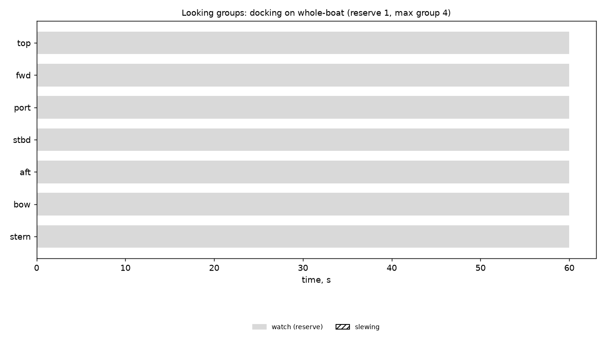

# Looking groups: docking on whole-boat (reserve 1, max group 4)

Generated 2026-11-06 at unknown by `uv run osprey sim --scenario docking --rig whole-boat`.

A camera always on watch: **yes**

| Task | Class | Need | Priority | Need met | Group median / max | px median | Range σ/R median | Starved |
|---|---|---|---|---|---|---|---|---|

| Station | Tasked | Slewing | Watch |
|---|---|---|---|
| top | 0% | 0% | 100% |
| fwd | 0% | 0% | 100% |
| port | 0% | 0% | 100% |
| stbd | 0% | 0% | 100% |
| aft | 0% | 0% | 100% |
| bow | 0% | 0% | 100% |
| stern | 0% | 0% | 100% |

