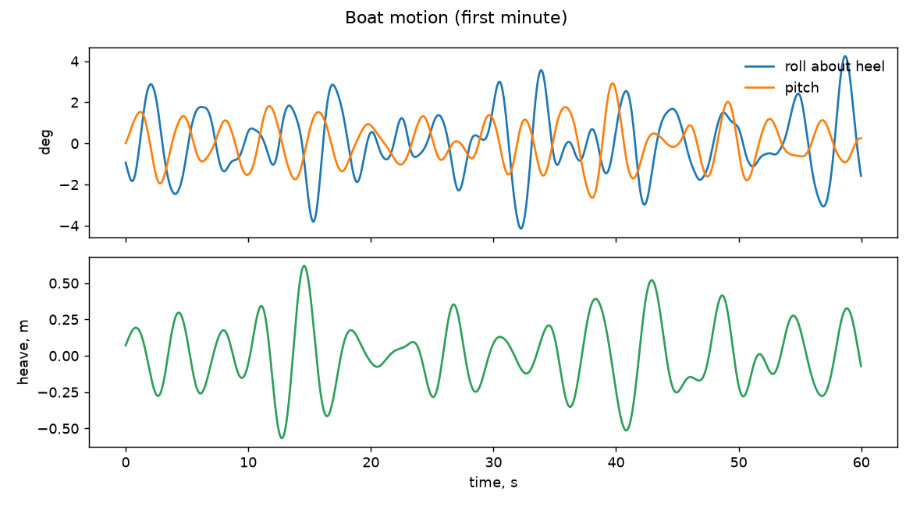
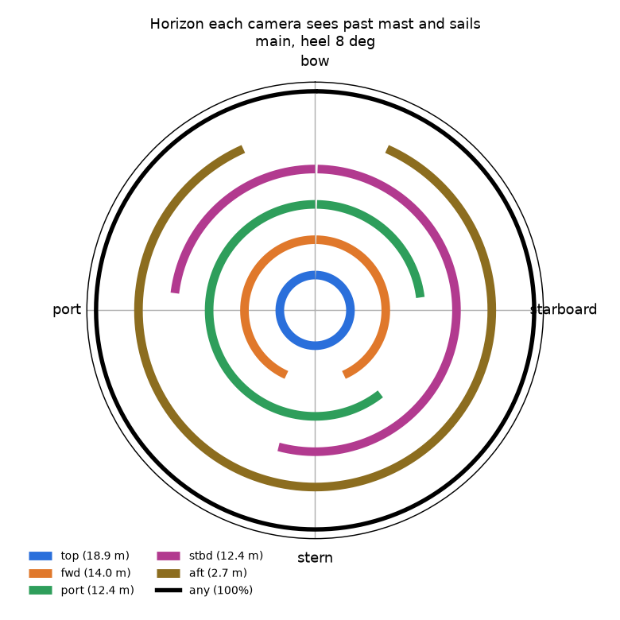
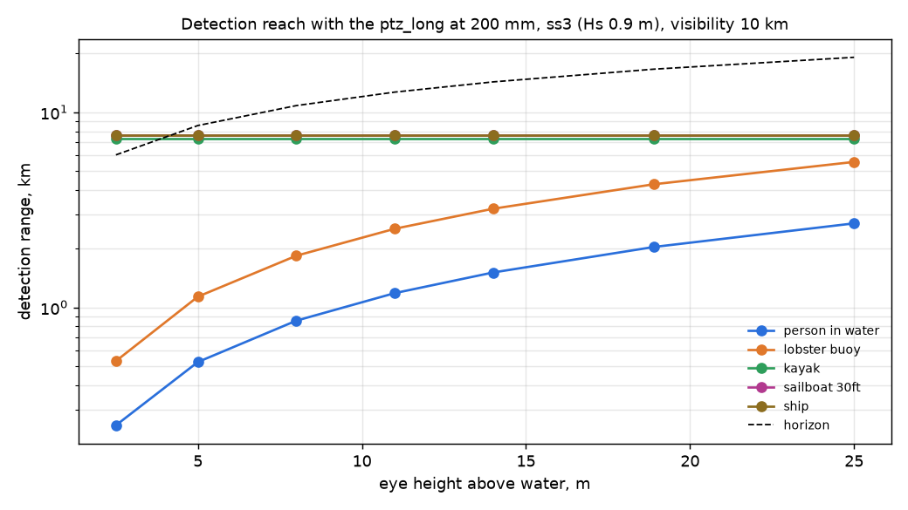

# mob on mast5-spreaders: check report

Generated 2026-11-06 at unknown by `uv run osprey calc --scenario mob --rig mast5-spreaders`. Screening-level models; REF inputs in `design/`.

**Result:** 0 FAIL, 1 WARN, 13 PASS

## Motion

| | Check | Value | Limit | Note |
|---|---|---|---|---|
| info | Roll about the 8 deg heel, rms / max | 1.6 / 4.3 deg |  | ss3, Hs 0.9 m, Tp 5.0 s, waves 120 deg off the bow |
| info | Pitch rms / max | 1.0 / 2.9 deg |  |  |
| info | Angular rate at the mounts, p95 / max | 5.7 / 9.4 deg/s |  | the same for every camera on a rigid hull |
| pass | Acceleration at top (18.9 m), p95 | 0.43 g | 0.5 g | sets the mount, connector and gimbal-motor ratings |
| info | Speed of top through the air, p95 | 1.9 m/s |  | parallax for near targets; adds to apparent wind on the housing |

## Stabilization

| | Check | Value | Limit | Note |
|---|---|---|---|---|
| pass | top: blur p95 at 200 mm, 1 ms | 0.01 px | 1 px | worst of 8 horizon bearings |
| pass | top: pointing jitter rms vs half-FOV at max zoom | 16 urad | 6399 urad | inner stage saturated 0% of the time |
| pass | fwd: blur p95 at 120 mm, 1 ms | 0.82 px | 1 px | worst of 8 horizon bearings |
| pass | fwd: pointing jitter rms vs half-FOV at max zoom | 2563 urad | 7732 urad | no fast stage |
| pass | port: blur p95 at 120 mm, 1 ms | 0.82 px | 1 px | worst of 8 horizon bearings |
| pass | port: pointing jitter rms vs half-FOV at max zoom | 2563 urad | 7732 urad | no fast stage |
| pass | stbd: blur p95 at 120 mm, 1 ms | 0.82 px | 1 px | worst of 8 horizon bearings |
| pass | stbd: pointing jitter rms vs half-FOV at max zoom | 2563 urad | 7732 urad | no fast stage |
| pass | aft: blur p95 at 120 mm, 1 ms | 0.82 px | 1 px | worst of 8 horizon bearings |
| pass | aft: pointing jitter rms vs half-FOV at max zoom | 2563 urad | 7732 urad | no fast stage |

## Reach

| | Check | Value | Limit | Note |
|---|---|---|---|---|
| pass | Detect person in water | 2,041 m (top, waves) | >= 1,000 m | same camera at deck height (2.5 m): 249 m |

## Ranging

| | Check | Value | Limit | Note |
|---|---|---|---|---|
| info | Horizon-dip range, top, at 1 km | +/- 12 m (1.2%) |  | refraction bias 3 m for dk = 0.04 |
| info | Horizon-dip range, top, at 2 km | +/- 24 m (1.2%) |  | refraction bias 10 m for dk = 0.04 |
| info | Horizon-dip range, top, at 5 km | +/- 66 m (1.3%) |  | refraction bias 54 m for dk = 0.04 |
| info | Group stereo top+aft, 16.2 m vertical baseline, at 2 km | +/- 12 m (0.6%) |  | relative orientation 50 urad from the shared horizon; a flexing rig without it: mrad |

## Coverage

| | Check | Value | Limit | Note |
|---|---|---|---|---|
| pass | Horizon seen by at least one camera (main, heel 8 deg) | 100.0% | >= 95% |  |
| info | Horizon seen without top | 100.0% |  | what is left when the masthead PTZ is busy in a group |
| info | Horizon seen by two or more cameras | 100.0% |  | where a looking group of 2+ is possible |

## Mass aloft

| | Check | Value | Limit | Note |
|---|---|---|---|---|
| WARN | Camera mass on the mast / masthead equivalent | 7.2 / 5.1 kg | 4 kg eq | equivalent = same heeling moment at the truck; cameras only, no brackets or cable |

## Figures

