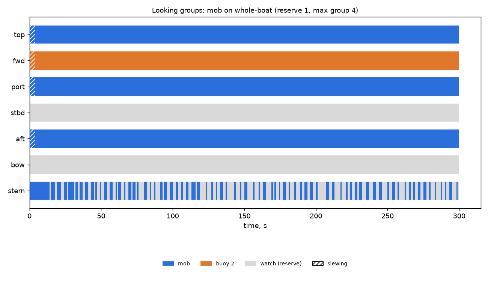

# Looking groups: mob on whole-boat (reserve 1, max group 4)

Generated 2026-11-06 at unknown by `uv run osprey sim --scenario mob --rig whole-boat`.

A camera always on watch: **yes**

| Task | Class | Need | Priority | Need met | Group median / max | px median | Range σ/R median | Starved |
|---|---|---|---|---|---|---|---|---|
| mob | person in water | recognize | 0 | 99% | 3 / 4 | 76 | 0.1% | 0% |
| buoy-2 | lobster buoy | detect | 2 | 99% | 1 / 1 | 44 | 1.6% | 0% |

| Station | Tasked | Slewing | Watch |
|---|---|---|---|
| top | 99% | 1% | 0% |
| fwd | 99% | 1% | 0% |
| port | 99% | 1% | 0% |
| stbd | 0% | 0% | 100% |
| aft | 99% | 1% | 0% |
| bow | 0% | 0% | 100% |
| stern | 44% | 0% | 56% |

