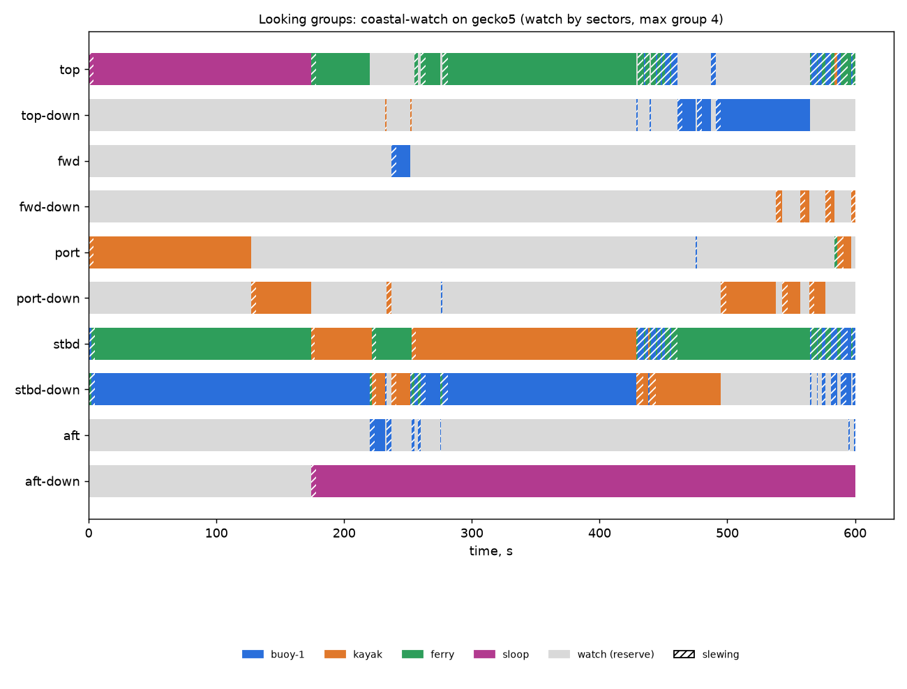

# Looking groups: coastal-watch on gecko5 (watch by sectors, max group 4)

Generated 2026-11-06 at unknown by `uv run osprey sim --scenario coastal-watch --rig gecko5`.

A camera always on watch: **yes**. Whole horizon swept: **100%** of the time (worst moment 100%); worst-bearing revisit 8 s median, 8 s p95. Pairs in groups: 20 within a pod, 4 across pods (pair-ticks).

| Task | Class | Need | Priority | Need met | Group median / max | px median | Range σ/R median | Starved |
|---|---|---|---|---|---|---|---|---|
| buoy-1 | lobster buoy | recognize | 1 | 80% | 1 / 3 | 45 | 4.1% | 0% |
| kayak | kayak | recognize | 2 | 88% | 1 / 1 | 85 | 4.0% | 0% |
| ferry | ship | recognize | 3 | 84% | 1 / 1 | 167 | 4.5% | 0% |
| sloop | sailboat 30ft | identify | 4 | 99% | 1 / 1 | 48 | 28.1% | 0% |

| Station | Tasked | Slewing | Watch |
|---|---|---|---|
| top | 62% | 14% | 24% |
| top-down | 14% | 3% | 83% |
| fwd | 2% | 1% | 98% |
| fwd-down | 1% | 2% | 96% |
| port | 22% | 2% | 76% |
| port-down | 17% | 4% | 80% |
| stbd | 87% | 13% | 0% |
| stbd-down | 75% | 10% | 15% |
| aft | 1% | 2% | 96% |
| aft-down | 70% | 1% | 29% |

