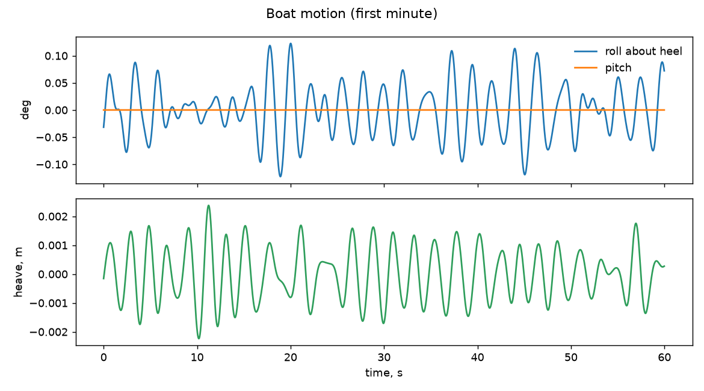
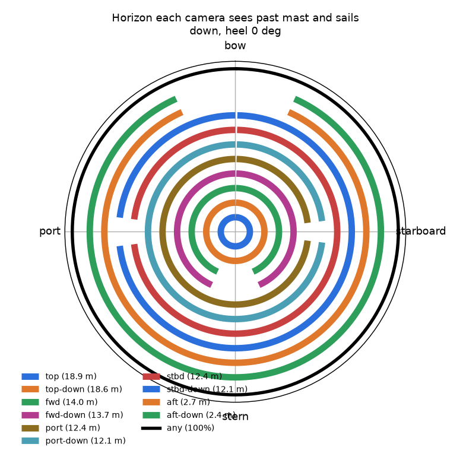
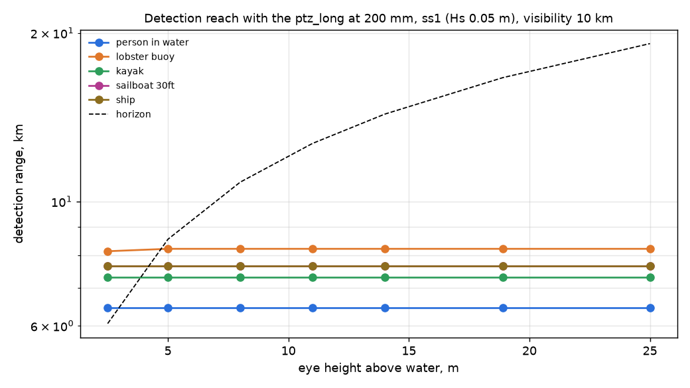
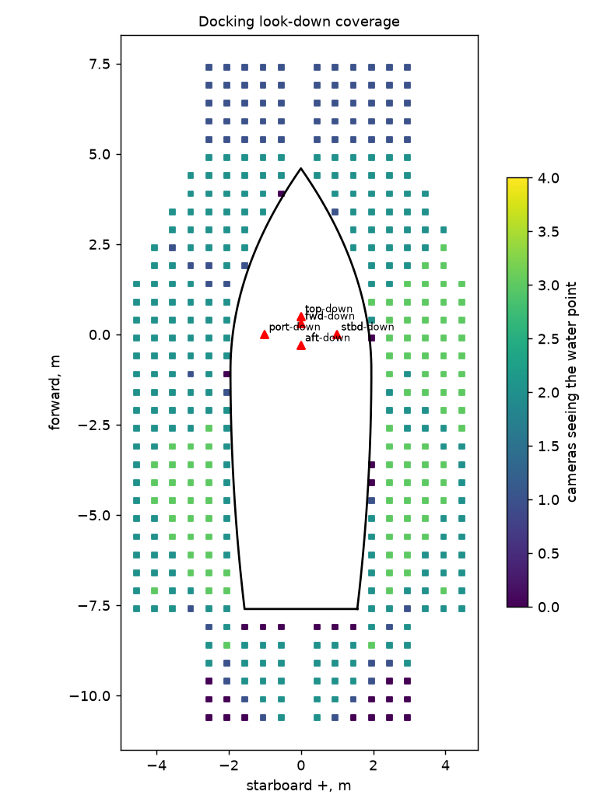

# docking on gecko5: check report

Generated 2026-11-06 at unknown by `uv run osprey calc --scenario docking --rig gecko5`. Screening-level models; REF inputs in `design/`.

**Result:** 3 FAIL, 3 WARN, 45 PASS

## Motion

| | Check | Value | Limit | Note |
|---|---|---|---|---|
| info | Roll about the 0 deg heel, rms / max | 0.0 / 0.1 deg |  | ss1, Hs 0.05 m, Tp 2.0 s, waves 90 deg off the bow |
| info | Pitch rms / max | 0.0 / 0.0 deg |  |  |
| info | Angular rate at the mounts, p95 / max | 0.6 / 0.7 deg/s |  | the same for every camera on a rigid hull |
| pass | Acceleration at top (18.9 m), p95 | 0.03 g | 0.5 g | sets the mount, connector and gimbal-motor ratings |
| info | Speed of top through the air, p95 | 0.1 m/s |  | parallax for near targets; adds to apparent wind on the housing |

## Stabilization

| | Check | Value | Limit | Note |
|---|---|---|---|---|
| pass | top: blur p95 at 200 mm, 1 ms | 0.00 px | 1 px | worst of 8 horizon bearings |
| pass | top: pointing jitter rms vs half-FOV at max zoom | 12 urad | 6399 urad | inner stage saturated 0% of the time |
| pass | top-down: blur p95 at 120 mm, 1 ms | 0.06 px | 1 px | worst of 8 horizon bearings |
| pass | top-down: pointing jitter rms vs half-FOV at max zoom | 434 urad | 7732 urad | no fast stage |
| pass | fwd: blur p95 at 120 mm, 1 ms | 0.06 px | 1 px | worst of 8 horizon bearings |
| pass | fwd: pointing jitter rms vs half-FOV at max zoom | 434 urad | 7732 urad | no fast stage |
| pass | fwd-down: blur p95 at 120 mm, 1 ms | 0.06 px | 1 px | worst of 8 horizon bearings |
| pass | fwd-down: pointing jitter rms vs half-FOV at max zoom | 434 urad | 7732 urad | no fast stage |
| pass | port: blur p95 at 120 mm, 1 ms | 0.06 px | 1 px | worst of 8 horizon bearings |
| pass | port: pointing jitter rms vs half-FOV at max zoom | 434 urad | 7732 urad | no fast stage |
| pass | port-down: blur p95 at 120 mm, 1 ms | 0.06 px | 1 px | worst of 8 horizon bearings |
| pass | port-down: pointing jitter rms vs half-FOV at max zoom | 434 urad | 7732 urad | no fast stage |
| pass | stbd: blur p95 at 120 mm, 1 ms | 0.06 px | 1 px | worst of 8 horizon bearings |
| pass | stbd: pointing jitter rms vs half-FOV at max zoom | 434 urad | 7732 urad | no fast stage |
| pass | stbd-down: blur p95 at 120 mm, 1 ms | 0.06 px | 1 px | worst of 8 horizon bearings |
| pass | stbd-down: pointing jitter rms vs half-FOV at max zoom | 434 urad | 7732 urad | no fast stage |
| pass | aft: blur p95 at 120 mm, 1 ms | 0.06 px | 1 px | worst of 8 horizon bearings |
| pass | aft: pointing jitter rms vs half-FOV at max zoom | 434 urad | 7732 urad | no fast stage |
| pass | aft-down: blur p95 at 120 mm, 1 ms | 0.06 px | 1 px | worst of 8 horizon bearings |
| pass | aft-down: pointing jitter rms vs half-FOV at max zoom | 434 urad | 7732 urad | no fast stage |

## Ranging

| | Check | Value | Limit | Note |
|---|---|---|---|---|
| info | Horizon-dip range, top, at 1 km | +/- 1 m (0.1%) |  | refraction bias 3 m for dk = 0.04 |
| info | Horizon-dip range, top, at 2 km | +/- 1 m (0.1%) |  | refraction bias 10 m for dk = 0.04 |
| info | Horizon-dip range, top, at 5 km | +/- 6 m (0.1%) |  | refraction bias 54 m for dk = 0.04 |
| info | Group stereo top+aft-down, 16.6 m vertical baseline, at 2 km | +/- 12 m (0.6%) |  | relative orientation 50 urad from the shared horizon; a flexing rig without it: mrad |

## Coverage

| | Check | Value | Limit | Note |
|---|---|---|---|---|
| pass | Horizon seen by at least one camera (down, heel 0 deg) | 100.0% | >= 95% |  |
| info | Horizon seen without top | 100.0% |  | what is left when the masthead PTZ is busy in a group |
| info | Horizon seen by two or more cameras | 100.0% |  | where a looking group of 2+ is possible |
| pass | Horizon inside a watch sector, unblocked | 100.0% | >= 95% | every bearing has a camera sweeping it |
| info | Horizon inside two or more watch sectors | 100.0% |  | overlap: a camera can leave its sector for a group while a neighbour keeps the watch |

## Mass aloft

| | Check | Value | Limit | Note |
|---|---|---|---|---|
| **FAIL** | Mass on the mast / masthead equivalent | 17.8 / 11.9 kg | 4 kg eq | equivalent = same heeling moment at the truck; cameras and pod electronics, no brackets or cable |
| info | Of which pod SOCs, IMUs and housings (masthead equivalent) | 3.0 kg |  | 0.92 kg a pod |

## Docking

| | Check | Value | Limit | Note |
|---|---|---|---|---|
| WARN | Water within 3 m of the hull seen by 2+ cameras | 75.5% | >= 90% | one or more: 93.9% |
| WARN | Hull edge (within 0.75 m) with a stereo pair | 77.6% | >= 90% |  |
| WARN | Stereo depth where the hull edge has a pair, p95 | 9.2 cm | 5 cm |  |
| pass | Same, with aims optimized for two views | 96.5% | >= 90% | hull edge with a stereo pair: 89%, depth p95 4.6 cm; aims: top watch, top-down (0, -1) @ 4.8 mm, fwd watch, fwd-down (0, -1) @ 4.8 mm, port (-11, -5) @ 4.8 mm, port-down (-2, 4) @ 4.8 mm, stbd (-11, -5) @ 4.8 mm, stbd-down (-3, -3) @ 4.8 mm, aft watch, aft-down watch |
| pass | top: look-down blur p95 incl. parallax | 0.02 px | 1 px |  |
| pass | top-down: look-down blur p95 incl. parallax | 0.02 px | 1 px |  |
| pass | fwd: look-down blur p95 incl. parallax | 0.02 px | 1 px |  |
| pass | fwd-down: look-down blur p95 incl. parallax | 0.02 px | 1 px |  |
| pass | port: look-down blur p95 incl. parallax | 0.02 px | 1 px |  |
| pass | port-down: look-down blur p95 incl. parallax | 0.02 px | 1 px |  |
| pass | stbd: look-down blur p95 incl. parallax | 0.02 px | 1 px |  |
| pass | stbd-down: look-down blur p95 incl. parallax | 0.02 px | 1 px |  |
| pass | aft: look-down blur p95 incl. parallax | 0.00 px | 1 px |  |
| pass | aft-down: look-down blur p95 incl. parallax | 0.01 px | 1 px |  |

## Pod power

| | Check | Value | Limit | Note |
|---|---|---|---|---|
| **FAIL** | top: peak draw at the PoE port | 81.4 W | 71.3 W | over 802.3bt Type 4: needs a second cable or local power |
| pass | fwd: peak draw at the PoE port | 68.1 W | 802.3bt Type 4 | needs 802.3bt Type 4 |
| pass | port: peak draw at the PoE port | 68.1 W | 802.3bt Type 4 | needs 802.3bt Type 4 |
| pass | stbd: peak draw at the PoE port | 68.1 W | 802.3bt Type 4 | needs 802.3bt Type 4 |
| pass | aft: peak draw at the PoE port | 68.1 W | 802.3bt Type 4 | needs 802.3bt Type 4 |
| info | Whole system from the house bank, watch / active | 12.7 / 31.9 A |  | 160 / 402 W at 12.6 V; watch = top working, other PTZs parked |
| **FAIL** | Energy per day underway | 381 Ah | 120 Ah | 20 h watch, 4 h active |

## Pod network

| | Check | Value | Limit | Note |
|---|---|---|---|---|
| info | top: raw sensor rate vs one gigabit link | 5,972 Mb/s | 1,000 Mb/s | 6.0x the link: frames must be encoded, and searched, on the pod |
| pass | top: encoded streams on its link | 40 Mb/s | 700 Mb/s | H.265 at 0.08 bit/px, 30 fps |
| pass | All pods on the switch uplink to the pilot | 199 Mb/s | 700 Mb/s |  |
| pass | top: SOC encoder load | 498 Mpx/s | 750 Mpx/s | Jetson Orin NX 16 GB class (dense INT8) |
| pass | top: detection on full-resolution frames | 3.3 TOPS | 20.0 TOPS | 10 fps, 20 GOP/Mpx, 40% of the NPU |

## Pod timing

| | Check | Value | Limit | Note |
|---|---|---|---|---|
| pass | Shutter sync error x mount rate, p95 (PTP) | 0.01 urad | 50 urad | with software timestamps (2000 us): 23 urad |
| pass | Mast flex between top and aft pods, p95, no IMU | 22 urad | 50 urad | 2.4 Hz bending; horizon fixes at 5 Hz cannot follow it |
| pass | Relative orientation with pod gyros between horizon fixes | 57 urad | 100 urad | 50 urad horizon fix (+) 28 urad gyro drift over 0.2 s, two pods |
| info | Stereo top+aft at 2 km (16.2 m baseline), no IMU / with | +/- 18 / 14 m |  | what the pod gyros buy a looking group |
| info | Accelerometer-only tilt error at top, p95 | 1.6 deg |  | specific force vs true vertical (roll p95 0 deg): accelerometers alone are not an attitude sensor aloft, the gyros are |

## Figures

