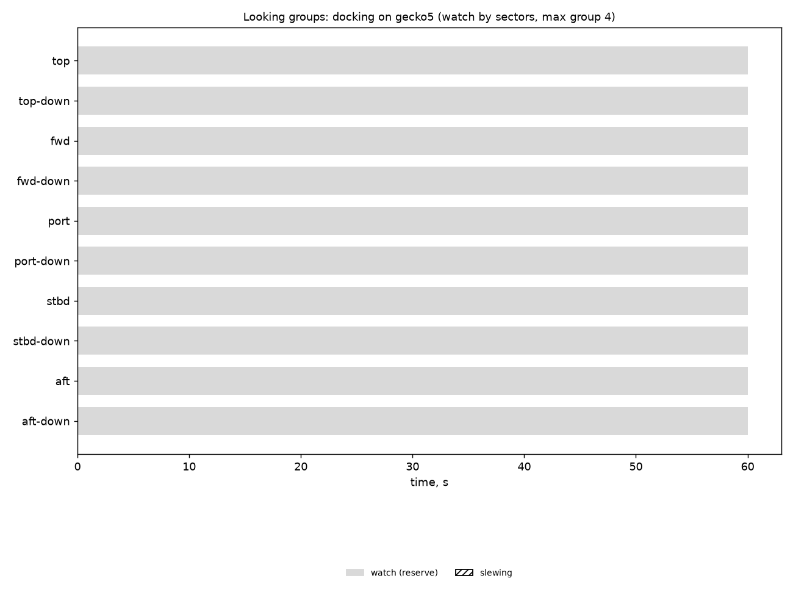

# Looking groups: docking on gecko5 (watch by sectors, max group 4)

Generated 2026-11-06 at unknown by `uv run osprey sim --scenario docking --rig gecko5`.

A camera always on watch: **yes**. Whole horizon swept: **100%** of the time (worst moment 100%); worst-bearing revisit 1 s median, 1 s p95. Pairs in groups: 0 within a pod, 0 across pods (pair-ticks).

| Task | Class | Need | Priority | Need met | Group median / max | px median | Range σ/R median | Starved |
|---|---|---|---|---|---|---|---|---|

| Station | Tasked | Slewing | Watch |
|---|---|---|---|
| top | 0% | 0% | 100% |
| top-down | 0% | 0% | 100% |
| fwd | 0% | 0% | 100% |
| fwd-down | 0% | 0% | 100% |
| port | 0% | 0% | 100% |
| port-down | 0% | 0% | 100% |
| stbd | 0% | 0% | 100% |
| stbd-down | 0% | 0% | 100% |
| aft | 0% | 0% | 100% |
| aft-down | 0% | 0% | 100% |

