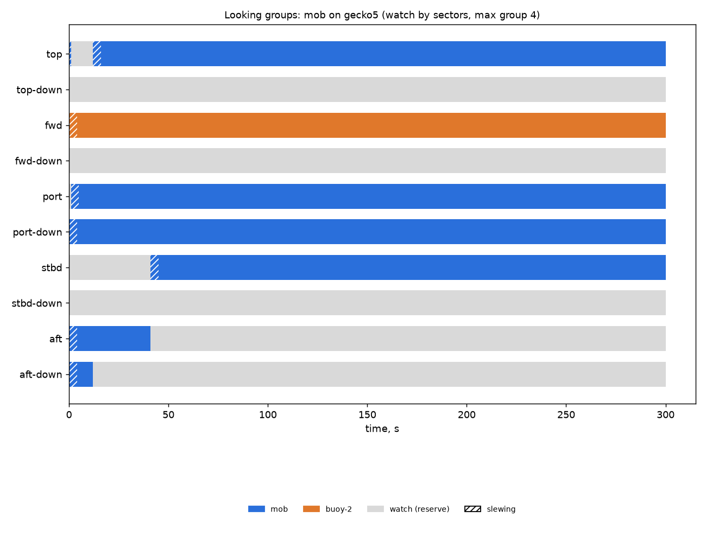

# Looking groups: mob on gecko5 (watch by sectors, max group 4)

Generated 2026-11-06 at unknown by `uv run osprey sim --scenario mob --rig gecko5`.

A camera always on watch: **yes**. Whole horizon swept: **100%** of the time (worst moment 100%); worst-bearing revisit 8 s median, 8 s p95. Pairs in groups: 311 within a pod, 1489 across pods (pair-ticks).

| Task | Class | Need | Priority | Need met | Group median / max | px median | Range σ/R median | Starved |
|---|---|---|---|---|---|---|---|---|
| mob | person in water | recognize | 0 | 99% | 4 / 4 | 80 | 0.3% | 0% |
| buoy-2 | lobster buoy | detect | 2 | 99% | 1 / 1 | 44 | 1.6% | 0% |

| Station | Tasked | Slewing | Watch |
|---|---|---|---|
| top | 95% | 2% | 4% |
| top-down | 0% | 0% | 100% |
| fwd | 99% | 1% | 0% |
| fwd-down | 0% | 0% | 100% |
| port | 98% | 1% | 0% |
| port-down | 99% | 1% | 0% |
| stbd | 85% | 1% | 14% |
| stbd-down | 0% | 0% | 100% |
| aft | 12% | 1% | 86% |
| aft-down | 3% | 1% | 96% |

