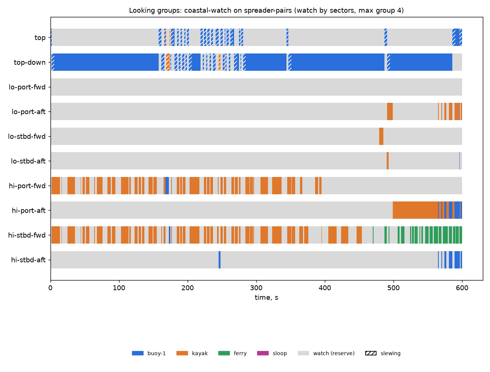

# Looking groups: coastal-watch on spreader-pairs (watch by sectors, max group 4)

Generated 2026-11-06 at unknown by `uv run osprey sim --scenario coastal-watch --rig spreader-pairs`.

A camera always on watch: **yes**. Whole horizon swept: **100%** of the time (worst moment 100%); worst-bearing revisit 7 s median, 8 s p95. Pairs in groups: 0 within a pod, 258 across pods (pair-ticks).

| Task | Class | Need | Priority | Need met | Group median / max | px median | Range σ/R median | Starved |
|---|---|---|---|---|---|---|---|---|
| buoy-1 | lobster buoy | recognize | 1 | 79% | 1 / 4 | 35 | 2.7% | 0% |
| kayak | kayak | recognize | 2 | 23% | 1 / 2 | 3 | 4.0% | 39% |
| ferry | ship | recognize | 3 | 11% | 0 / 1 | 0 | 5.1% | 89% |
| sloop | sailboat 30ft | identify | 4 | 0% | 0 / 0 | 0 | inf% | 100% |

| Station | Tasked | Slewing | Watch |
|---|---|---|---|
| top | 2% | 12% | 87% |
| top-down | 76% | 11% | 13% |
| lo-port-fwd | 0% | 0% | 100% |
| lo-port-aft | 5% | 0% | 95% |
| lo-stbd-fwd | 1% | 0% | 99% |
| lo-stbd-aft | 1% | 0% | 99% |
| hi-port-fwd | 34% | 0% | 66% |
| hi-port-aft | 17% | 0% | 83% |
| hi-stbd-fwd | 50% | 0% | 50% |
| hi-stbd-aft | 4% | 0% | 96% |

