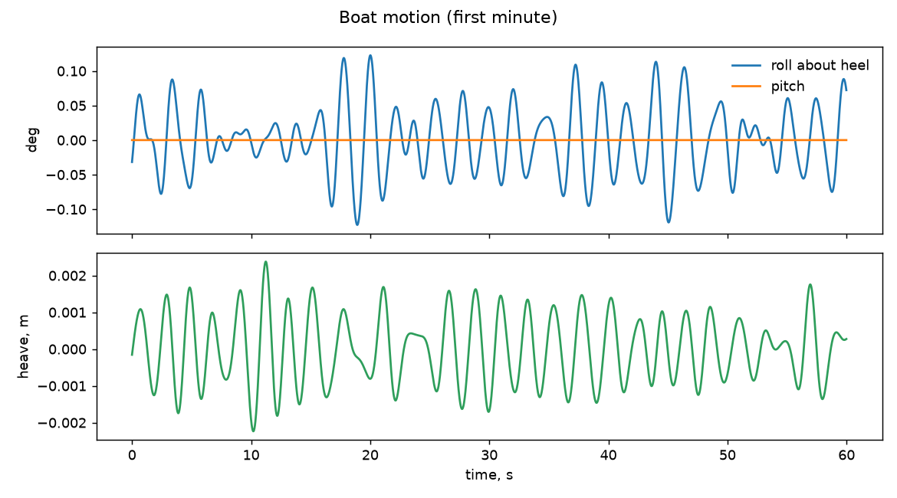
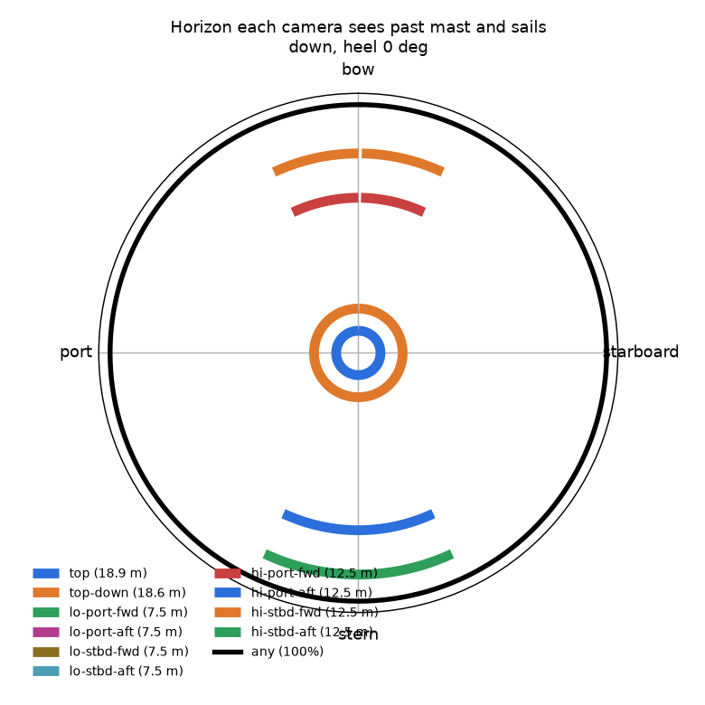
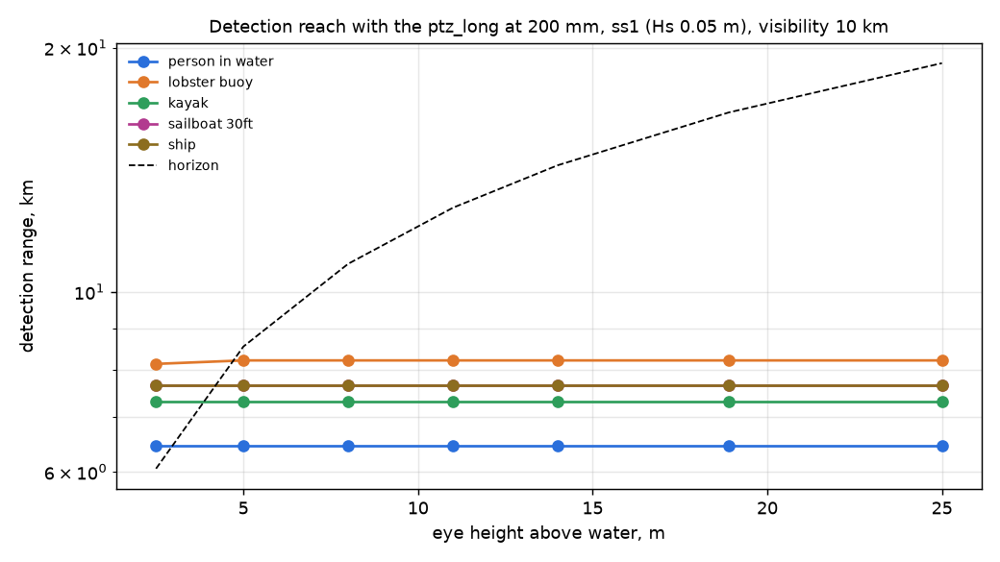
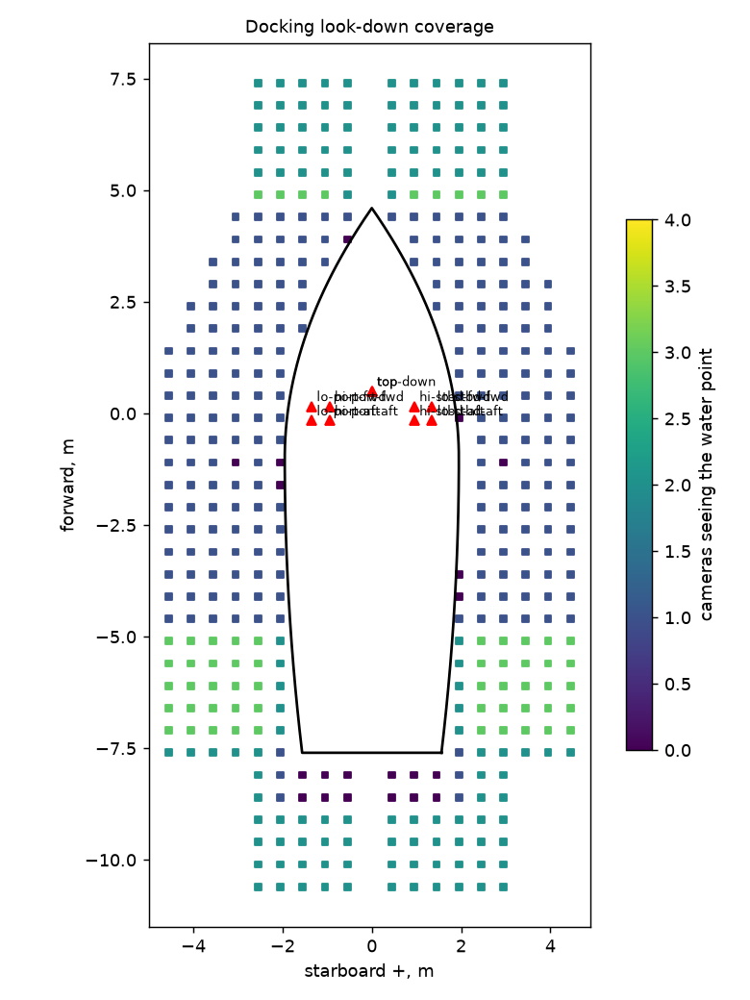

# docking on spreader-pairs: check report

Generated 2026-11-06 at unknown by `uv run osprey calc --scenario docking --rig spreader-pairs`. Screening-level models; REF inputs in `design/`.

**Result:** 7 FAIL, 1 WARN, 42 PASS

## Motion

| | Check | Value | Limit | Note |
|---|---|---|---|---|
| info | Roll about the 0 deg heel, rms / max | 0.0 / 0.1 deg |  | ss1, Hs 0.05 m, Tp 2.0 s, waves 90 deg off the bow |
| info | Pitch rms / max | 0.0 / 0.0 deg |  |  |
| info | Angular rate at the mounts, p95 / max | 0.6 / 0.7 deg/s |  | the same for every camera on a rigid hull |
| pass | Acceleration at top (18.9 m), p95 | 0.03 g | 0.5 g | sets the mount, connector and gimbal-motor ratings |
| info | Speed of top through the air, p95 | 0.1 m/s |  | parallax for near targets; adds to apparent wind on the housing |

## Stabilization

| | Check | Value | Limit | Note |
|---|---|---|---|---|
| pass | top: blur p95 at 200 mm, 1 ms | 0.00 px | 1 px | worst of 8 horizon bearings |
| pass | top: pointing jitter rms vs half-FOV at max zoom | 12 urad | 6399 urad | inner stage saturated 0% of the time |
| pass | top-down: blur p95 at 120 mm, 1 ms | 0.06 px | 1 px | worst of 8 horizon bearings |
| pass | top-down: pointing jitter rms vs half-FOV at max zoom | 434 urad | 7732 urad | no fast stage |
| pass | lo-port-fwd: blur p95 at 4 mm, 1 ms | 0.02 px | 1 px | worst of 8 horizon bearings |
| pass | lo-port-fwd: pointing jitter rms vs half-FOV at max zoom | 24697 urad | 254998 urad | no fast stage |
| pass | lo-port-aft: blur p95 at 4 mm, 1 ms | 0.02 px | 1 px | worst of 8 horizon bearings |
| pass | lo-port-aft: pointing jitter rms vs half-FOV at max zoom | 24697 urad | 254998 urad | no fast stage |
| pass | lo-stbd-fwd: blur p95 at 4 mm, 1 ms | 0.02 px | 1 px | worst of 8 horizon bearings |
| pass | lo-stbd-fwd: pointing jitter rms vs half-FOV at max zoom | 24697 urad | 254998 urad | no fast stage |
| pass | lo-stbd-aft: blur p95 at 4 mm, 1 ms | 0.02 px | 1 px | worst of 8 horizon bearings |
| pass | lo-stbd-aft: pointing jitter rms vs half-FOV at max zoom | 24697 urad | 254998 urad | no fast stage |
| pass | hi-port-fwd: blur p95 at 8 mm, 1 ms | 0.05 px | 1 px | worst of 8 horizon bearings |
| pass | hi-port-fwd: pointing jitter rms vs half-FOV at max zoom | 24697 urad | 149173 urad | no fast stage |
| pass | hi-port-aft: blur p95 at 8 mm, 1 ms | 0.05 px | 1 px | worst of 8 horizon bearings |
| pass | hi-port-aft: pointing jitter rms vs half-FOV at max zoom | 24697 urad | 149173 urad | no fast stage |
| pass | hi-stbd-fwd: blur p95 at 8 mm, 1 ms | 0.05 px | 1 px | worst of 8 horizon bearings |
| pass | hi-stbd-fwd: pointing jitter rms vs half-FOV at max zoom | 24697 urad | 149173 urad | no fast stage |
| pass | hi-stbd-aft: blur p95 at 8 mm, 1 ms | 0.05 px | 1 px | worst of 8 horizon bearings |
| pass | hi-stbd-aft: pointing jitter rms vs half-FOV at max zoom | 24697 urad | 149173 urad | no fast stage |

## Ranging

| | Check | Value | Limit | Note |
|---|---|---|---|---|
| info | Horizon-dip range, top, at 1 km | +/- 1 m (0.1%) |  | refraction bias 3 m for dk = 0.04 |
| info | Horizon-dip range, top, at 2 km | +/- 1 m (0.1%) |  | refraction bias 10 m for dk = 0.04 |
| info | Horizon-dip range, top, at 5 km | +/- 6 m (0.1%) |  | refraction bias 54 m for dk = 0.04 |
| info | Group stereo top+lo-port-fwd, 11.4 m vertical baseline, at 2 km | +/- 76 m (3.8%) |  | relative orientation 50 urad from the shared horizon; a flexing rig without it: mrad |

## Coverage

| | Check | Value | Limit | Note |
|---|---|---|---|---|
| pass | Horizon seen by at least one camera (down, heel 0 deg) | 100.0% | >= 95% |  |
| info | Horizon seen without top | 100.0% |  | what is left when the masthead PTZ is busy in a group |
| info | Horizon seen by two or more cameras | 100.0% |  | where a looking group of 2+ is possible |

## Mass aloft

| | Check | Value | Limit | Note |
|---|---|---|---|---|
| WARN | Mass on the mast / masthead equivalent | 10.3 / 7.7 kg | 4 kg eq | equivalent = same heeling moment at the truck; cameras and pod electronics, no brackets or cable |
| info | Of which pod SOCs, IMUs and housings (masthead equivalent) | 1.7 kg |  | 0.92 kg a pod |

## Docking

| | Check | Value | Limit | Note |
|---|---|---|---|---|
| **FAIL** | Water within 3 m of the hull seen by 2+ cameras | 43.9% | >= 90% | one or more: 95.3% |
| **FAIL** | Hull edge (within 0.75 m) with a stereo pair | 33.7% | >= 90% |  |
| pass | Stereo depth where the hull edge has a pair, p95 | 1.3 cm | 5 cm |  |
| **FAIL** | Same, with aims optimized for two views | 44.1% | >= 90% | hull edge with a stereo pair: 35%, depth p95 1.3 cm; aims: top watch, top-down (-1, -4) @ 4.8 mm |
| pass | top: look-down blur p95 incl. parallax | 0.02 px | 1 px |  |
| pass | top-down: look-down blur p95 incl. parallax | 0.02 px | 1 px |  |

## Pod power

| | Check | Value | Limit | Note |
|---|---|---|---|---|
| **FAIL** | top: peak draw at the PoE port | 81.4 W | 71.3 W | over 802.3bt Type 4: needs a second cable or local power |
| pass | lo-port-fwd: peak draw at the PoE port | 8.0 W | 802.3af | needs 802.3af |
| pass | lo-port-aft: peak draw at the PoE port | 8.0 W | 802.3af | needs 802.3af |
| pass | lo-stbd-fwd: peak draw at the PoE port | 8.0 W | 802.3af | needs 802.3af |
| pass | lo-stbd-aft: peak draw at the PoE port | 8.0 W | 802.3af | needs 802.3af |
| pass | hi-port-fwd: peak draw at the PoE port | 8.0 W | 802.3af | needs 802.3af |
| pass | hi-port-aft: peak draw at the PoE port | 8.0 W | 802.3af | needs 802.3af |
| pass | hi-stbd-fwd: peak draw at the PoE port | 8.0 W | 802.3af | needs 802.3af |
| pass | hi-stbd-aft: peak draw at the PoE port | 8.0 W | 802.3af | needs 802.3af |
| info | Whole system from the house bank, watch / active | 10.3 / 13.1 A |  | 130 / 165 W at 12.6 V; watch = top working, other PTZs parked |
| **FAIL** | Energy per day underway | 259 Ah | 120 Ah | 20 h watch, 4 h active |

## Pod network

| | Check | Value | Limit | Note |
|---|---|---|---|---|
| info | 4 mounts without a pod computer | lo-port, lo-stbd, hi-port, hi-stbd |  | each camera encodes itself: detection runs on compressed streams at the pilot computer |
| info | top: raw sensor rate vs one gigabit link | 5,972 Mb/s | 1,000 Mb/s | 6.0x the link: frames must be encoded, and searched, on the pod |
| pass | top: encoded streams on its link | 40 Mb/s | 700 Mb/s | H.265 at 0.08 bit/px, 30 fps |
| pass | All pods on the switch uplink to the pilot | 199 Mb/s | 700 Mb/s |  |
| pass | top: SOC encoder load | 498 Mpx/s | 750 Mpx/s | Jetson Orin NX 16 GB class (dense INT8) |
| pass | top: detection on full-resolution frames | 3.3 TOPS | 20.0 TOPS | 10 fps, 20 GOP/Mpx, 40% of the NPU |

## Pod timing

| | Check | Value | Limit | Note |
|---|---|---|---|---|
| pass | Shutter sync error x mount rate, p95 (PTP) | 0.01 urad | 50 urad | with software timestamps (2000 us): 23 urad |

## Pairs

| | Check | Value | Limit | Note |
|---|---|---|---|---|
| info | lo pair (lo-port+lo-stbd): baseline and mast flex between them | 2.70 m, 0 urad |  | same height: the mast's fore-aft bending moves both together |
| pass | lo pair (lo-port+lo-stbd): stereo range at 30 m, camera clocks / hardware sync | +/- 0.07 / 0.07 m | 1.5 m | 2 ms between frames at 0.6 deg/s costs 23 urad; hardware-synced shutters 0.0 urad |
| pass | lo pair (lo-port+lo-stbd): stereo range at 200 m, camera clocks / hardware sync | +/- 3.25 / 3.23 m | 10 m | 2 ms between frames at 0.6 deg/s costs 23 urad; hardware-synced shutters 0.0 urad |
| **FAIL** | lo pair (lo-port+lo-stbd): stereo range at 1000 m, camera clocks / hardware sync | +/- 81.15 / 80.72 m | 50 m | 2 ms between frames at 0.6 deg/s costs 23 urad; hardware-synced shutters 0.0 urad |
| info | hi pair (hi-port+hi-stbd): baseline and mast flex between them | 1.90 m, 0 urad |  | same height: the mast's fore-aft bending moves both together |
| pass | hi pair (hi-port+hi-stbd): stereo range at 30 m, camera clocks / hardware sync | +/- 0.06 / 0.06 m | 1.5 m | 2 ms between frames at 0.6 deg/s costs 23 urad; hardware-synced shutters 0.0 urad |
| pass | hi pair (hi-port+hi-stbd): stereo range at 200 m, camera clocks / hardware sync | +/- 2.51 / 2.47 m | 10 m | 2 ms between frames at 0.6 deg/s costs 23 urad; hardware-synced shutters 0.0 urad |
| **FAIL** | hi pair (hi-port+hi-stbd): stereo range at 1000 m, camera clocks / hardware sync | +/- 62.85 / 61.72 m | 50 m | 2 ms between frames at 0.6 deg/s costs 23 urad; hardware-synced shutters 0.0 urad |

## Pod timing

| | Check | Value | Limit | Note |
|---|---|---|---|---|
| info | Accelerometer-only tilt error at top, p95 | 1.6 deg |  | specific force vs true vertical (roll p95 0 deg): accelerometers alone are not an attitude sensor aloft, the gyros are |

## Figures

