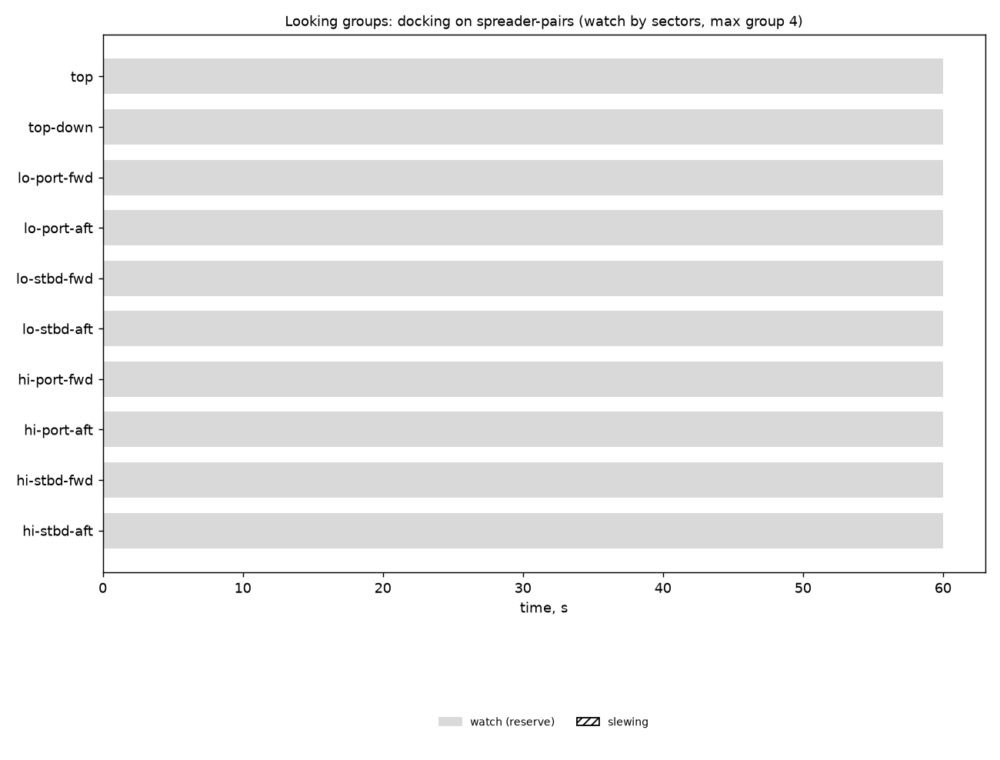

# Looking groups: docking on spreader-pairs (watch by sectors, max group 4)

Generated 2026-11-06 at unknown by `uv run osprey sim --scenario docking --rig spreader-pairs`.

A camera always on watch: **yes**. Whole horizon swept: **100%** of the time (worst moment 100%); worst-bearing revisit 4 s median, 4 s p95. Pairs in groups: 0 within a pod, 0 across pods (pair-ticks).

| Task | Class | Need | Priority | Need met | Group median / max | px median | Range σ/R median | Starved |
|---|---|---|---|---|---|---|---|---|

| Station | Tasked | Slewing | Watch |
|---|---|---|---|
| top | 0% | 0% | 100% |
| top-down | 0% | 0% | 100% |
| lo-port-fwd | 0% | 0% | 100% |
| lo-port-aft | 0% | 0% | 100% |
| lo-stbd-fwd | 0% | 0% | 100% |
| lo-stbd-aft | 0% | 0% | 100% |
| hi-port-fwd | 0% | 0% | 100% |
| hi-port-aft | 0% | 0% | 100% |
| hi-stbd-fwd | 0% | 0% | 100% |
| hi-stbd-aft | 0% | 0% | 100% |

