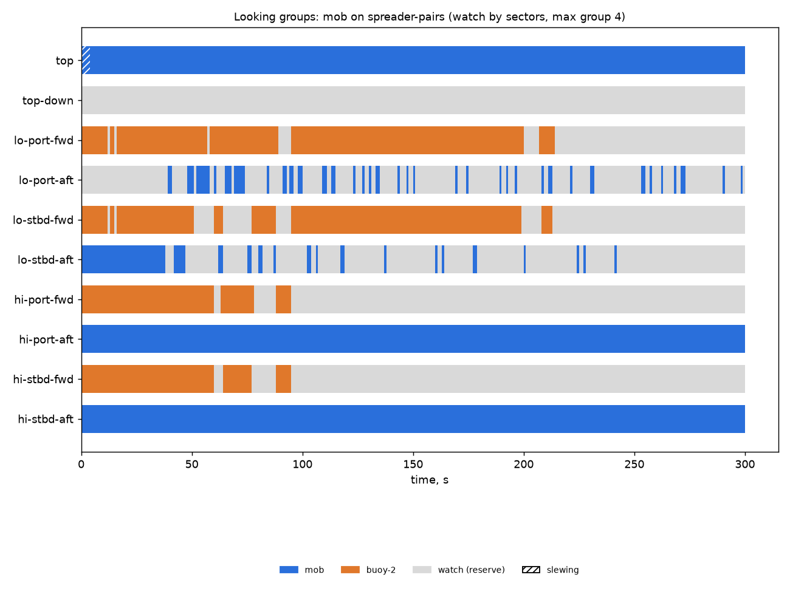

# Looking groups: mob on spreader-pairs (watch by sectors, max group 4)

Generated 2026-11-06 at unknown by `uv run osprey sim --scenario mob --rig spreader-pairs`.

A camera always on watch: **yes**. Whole horizon swept: **100%** of the time (worst moment 100%); worst-bearing revisit 8 s median, 8 s p95. Pairs in groups: 0 within a pod, 1766 across pods (pair-ticks).

| Task | Class | Need | Priority | Need met | Group median / max | px median | Range σ/R median | Starved |
|---|---|---|---|---|---|---|---|---|
| mob | person in water | recognize | 0 | 100% | 3 / 4 | 75 | 0.8% | 0% |
| buoy-2 | lobster buoy | detect | 2 | 18% | 2 / 4 | 1 | 3.1% | 31% |

| Station | Tasked | Slewing | Watch |
|---|---|---|---|
| top | 99% | 1% | 0% |
| top-down | 0% | 0% | 100% |
| lo-port-fwd | 66% | 0% | 34% |
| lo-port-aft | 20% | 0% | 80% |
| lo-stbd-fwd | 58% | 0% | 42% |
| lo-stbd-aft | 21% | 0% | 79% |
| hi-port-fwd | 27% | 0% | 73% |
| hi-port-aft | 100% | 0% | 0% |
| hi-stbd-fwd | 27% | 0% | 73% |
| hi-stbd-aft | 100% | 0% | 0% |

