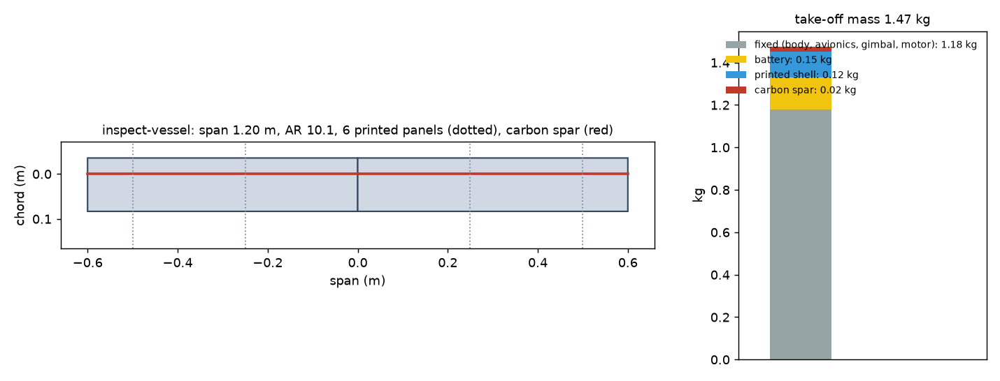
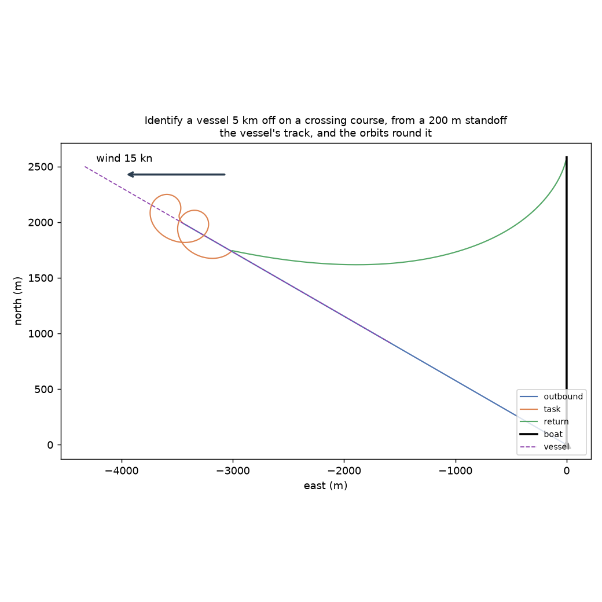
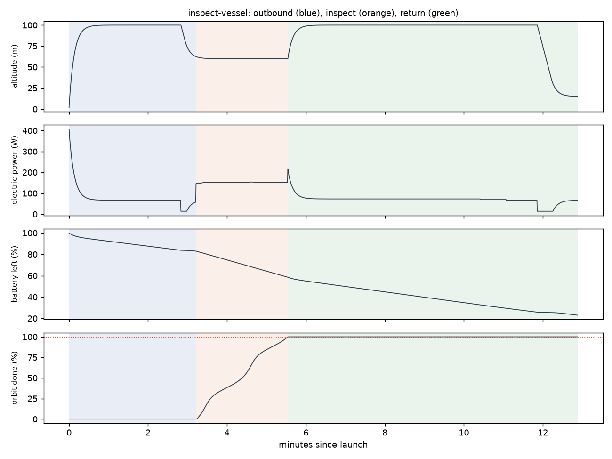

# Recon inspect-vessel: Identify a vessel 5 km off on a crossing course, from a 200 m standoff

Generated 2026-11-06 at 7f1236d by `uv run osprey recon --mission inspect-vessel`. Screening-level models; REF inputs in `design/recon/`.

## Sized airframe (OpenMDAO + OpenAeroStruct, SLSQP)

Optimizer converged: **yes**

| Quantity | Value |
|---|---|
| Task | inspect, 2.5 km of track planned |
| Take-off mass | 1.47 kg (battery 0.15, shell 0.12, spar 0.022, fixed 1.18) |
| Span / area / aspect ratio | 1.20 m / 0.143 m² / 10.1 |
| Root / tip chord | 11.9 / 11.9 cm (tip Re 167,962) |
| Spar tube, root / tip | r 4.0 / 4.0 mm, wall 0.50 / 0.50 mm |
| Task speed, CL, L/D | 20.9 m/s, 0.38, 4.2 |
| Stall speed (sea level) | 12.0 m/s (limit 12) |
| Task power / endurance | 151 W / 10 min |
| Mission time estimate (+20% reserve) | 7 min |
| Printed panels (220 x 220 x 250 mm bed) | 6, chord fits: yes |

### Calibrating the mission-time model against the flight sim

Each round sizes the airframe, flies it with an unlimited battery, and scales the optimizer's mission-time model by the energy the flight really used.

| Round | Time factor | Mass (kg) | Battery (kg) | Flown / estimated energy (Wh) | Progress flown | Task flown (min) |
|---|---|---|---|---|---|---|
| 1 | 1.00 | 1.55 | 0.22 | 18 / 29 | 100% | 3 |
| 2 | 0.62 | 1.47 | 0.15 | 18 / 32 | 100% | 2 |
| 3 | 0.57 | 1.47 | 0.15 | 18 / 33 | 100% | 2 |

## Flown through the mission (3-DOF point mass)

Outcome: **recovered**; left the task because: goal

| Quantity | Value |
|---|---|
| On scene | 3.2 min after launch |
| Orbit done reached | 100% (goal 100%); goal at 5.5 min |
| Time on task | 2.3 min |
| Inspection | 200 m standoff (207 m slant); 2.1 mm focal needed of 30 mm (gimbal); 37 px across; resolves it |
| Flight time / distance | 12.9 min / 9.8 km |
| Battery left at recovery | 23% |
| Mean power, max bank | 86 W, 35 deg |

