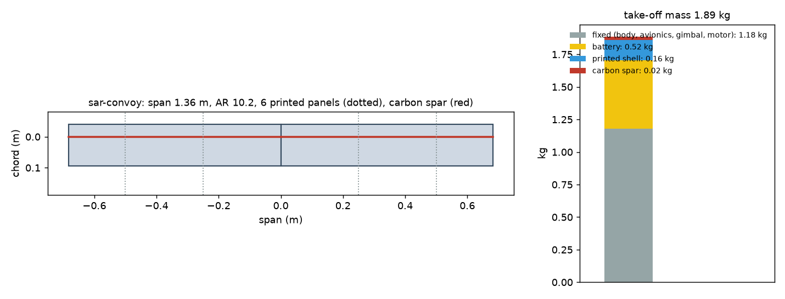
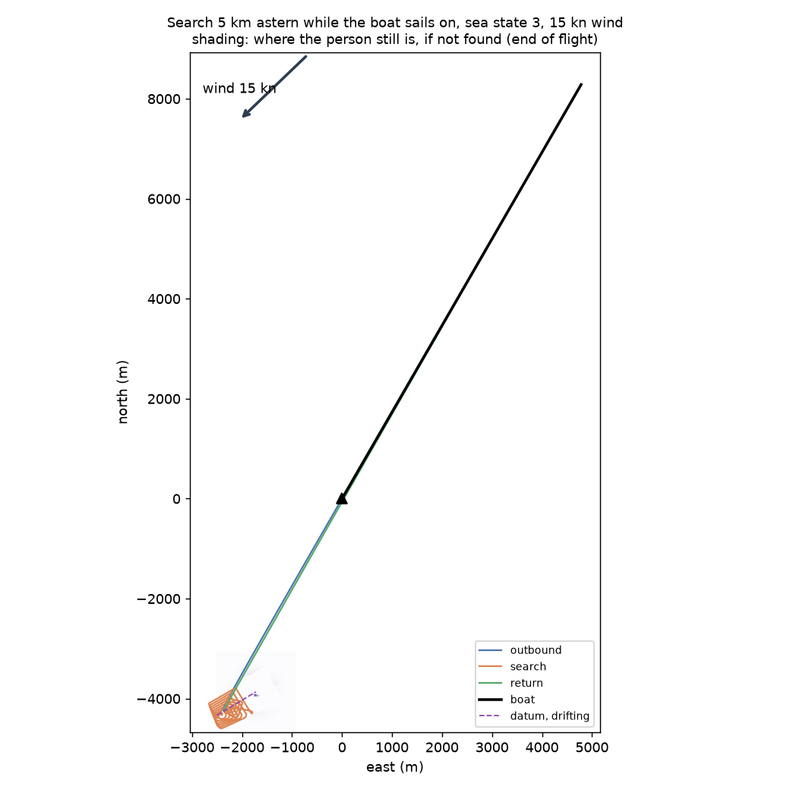
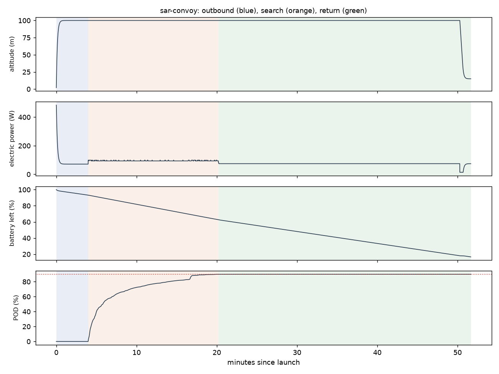

# Recon sar-convoy: Search 5 km astern while the boat sails on, sea state 3, 15 kn wind

Generated 2026-11-06 at ca12777 by `uv run osprey recon --mission sar-convoy`. Screening-level models; REF inputs in `design/recon/`.

## Sized airframe (OpenMDAO + OpenAeroStruct, SLSQP)

Optimizer converged: **yes**

| Quantity | Value |
|---|---|
| Take-off mass | 1.89 kg (battery 0.52, shell 0.16, spar 0.025, fixed 1.18) |
| Span / area / aspect ratio | 1.36 m / 0.182 m² / 10.2 |
| Root / tip chord | 13.4 / 13.4 cm (tip Re 150,000) |
| Spar tube, root / tip | r 4.0 / 4.0 mm, wall 0.50 / 0.50 mm |
| Search speed, CL, L/D | 16.7 m/s, 0.60, 7.3 |
| Stall speed (sea level) | 12.0 m/s (limit 12) |
| Search power / endurance | 94 W / 54 min |
| Mission time estimate (+20% reserve) | 45 min |
| Search plan | 19.2 km of track at 40 m spacing (effective sweep width 123 m) |
| Printed panels (220 x 220 x 250 mm bed) | 6, chord fits: yes |

### Calibrating the mission-time model against the flight sim

Each round sizes the airframe, flies it with an unlimited battery, and scales the optimizer's mission-time model by the energy the flight really used.

| Round | Time factor | Mass (kg) | Battery (kg) | Flown / estimated energy (Wh) | POD flown | Search flown (min) |
|---|---|---|---|---|---|---|
| 1 | 1.00 | 1.86 | 0.50 | 70 / 66 | 90% | 16 |
| 2 | 1.05 | 1.89 | 0.52 | 70 / 67 | 90% | 16 |

## Flown through the mission (3-DOF point mass)

Outcome: **recovered**; left the search because: pod

| Quantity | Value |
|---|---|
| On scene | 4.0 min after launch |
| POD reached | 90% (plan 90%); 50 % at 5.8 min, 90 % at 20.2 min |
| Search time | 16.2 min (2 pattern passes) |
| Flight time / distance | 51.6 min / 32.8 km |
| Battery left at recovery | 17% |
| Mean power, max bank | 81 W, 35 deg |

