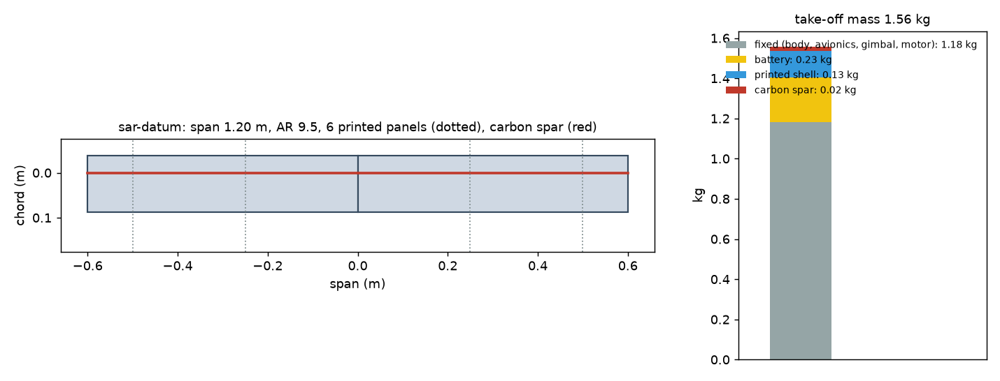
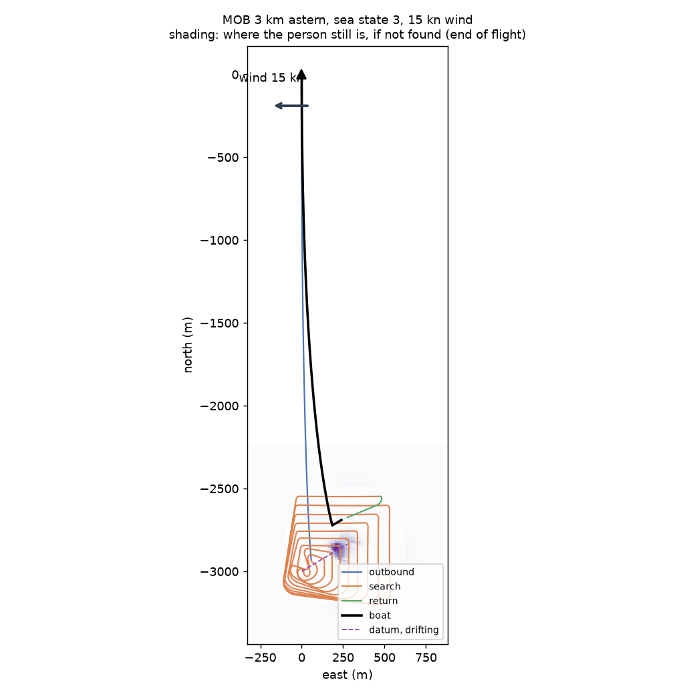
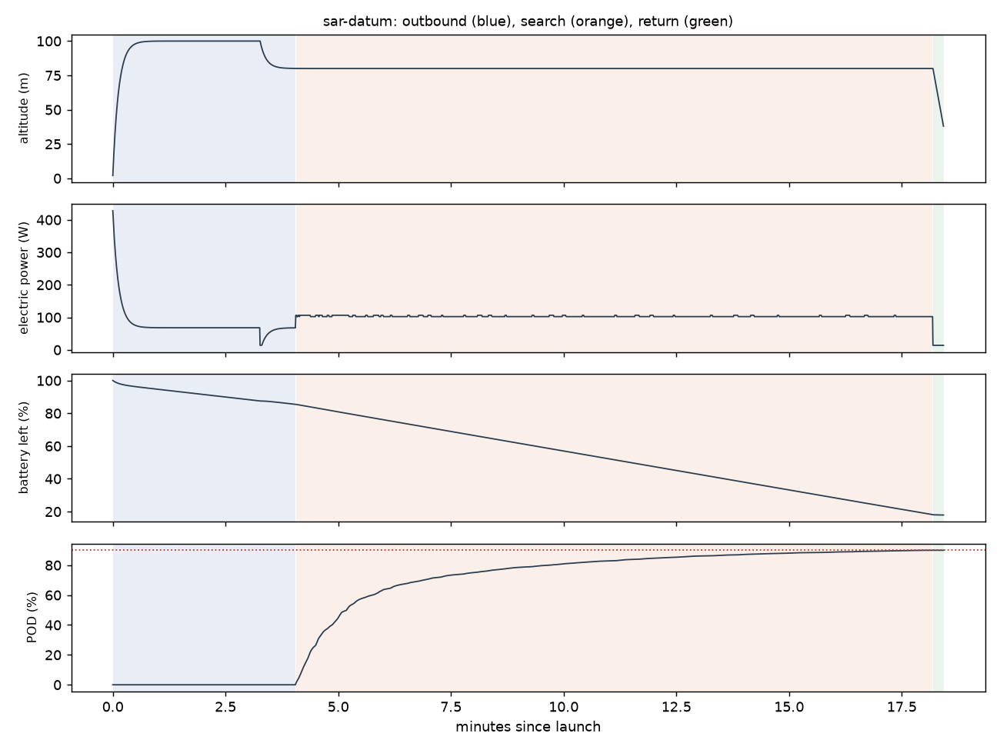

# Recon sar-datum: MOB 3 km astern, sea state 3, 15 kn wind

Generated 2026-11-06 at ca12777 by `uv run osprey recon --mission sar-datum`. Screening-level models; REF inputs in `design/recon/`.

## Sized airframe (OpenMDAO + OpenAeroStruct, SLSQP)

Optimizer converged: **yes**

| Quantity | Value |
|---|---|
| Take-off mass | 1.56 kg (battery 0.23, shell 0.13, spar 0.022, fixed 1.18) |
| Span / area / aspect ratio | 1.20 m / 0.151 m² / 9.5 |
| Root / tip chord | 12.6 / 12.6 cm (tip Re 150,000) |
| Spar tube, root / tip | r 4.0 / 4.0 mm, wall 0.50 / 0.50 mm |
| Search speed, CL, L/D | 17.7 m/s, 0.53, 5.8 |
| Stall speed (sea level) | 12.0 m/s (limit 12) |
| Search power / endurance | 102 W / 21 min |
| Mission time estimate (+20% reserve) | 18 min |
| Search plan | 13.5 km of track at 32 m spacing (effective sweep width 99 m) |
| Printed panels (220 x 220 x 250 mm bed) | 6, chord fits: yes |

### Calibrating the mission-time model against the flight sim

Each round sizes the airframe, flies it with an unlimited battery, and scales the optimizer's mission-time model by the energy the flight really used.

| Round | Time factor | Mass (kg) | Battery (kg) | Flown / estimated energy (Wh) | POD flown | Search flown (min) |
|---|---|---|---|---|---|---|
| 1 | 1.00 | 1.60 | 0.27 | 32 / 36 | 90% | 16 |
| 2 | 0.90 | 1.58 | 0.24 | 30 / 36 | 90% | 15 |
| 3 | 0.83 | 1.56 | 0.23 | 30 / 36 | 90% | 14 |

## Flown through the mission (3-DOF point mass)

Outcome: **recovered**; left the search because: pod

| Quantity | Value |
|---|---|
| On scene | 4.1 min after launch |
| POD reached | 90% (plan 90%); 50 % at 5.2 min, 90 % at 18.2 min |
| Search time | 14.1 min (1 pattern pass) |
| Flight time / distance | 18.4 min / 15.7 km |
| Battery left at recovery | 18% |
| Mean power, max bank | 96 W, 35 deg |

