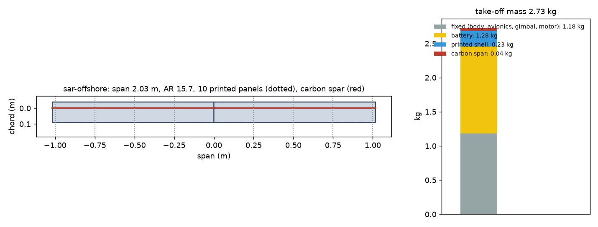
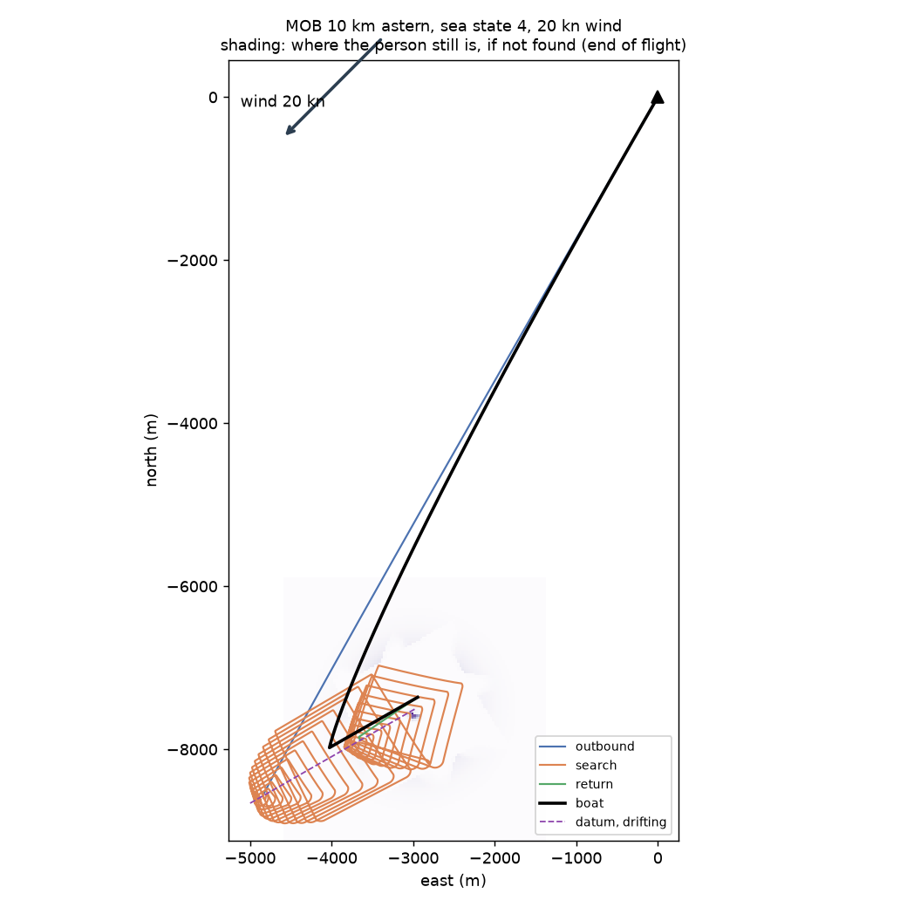
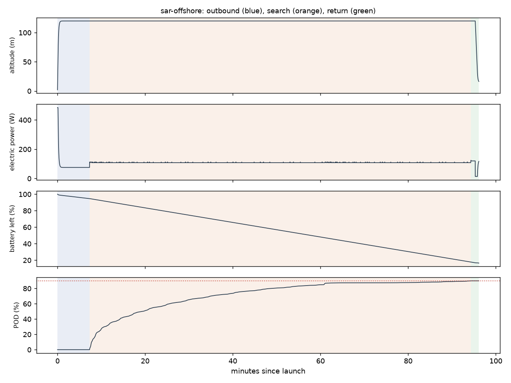

# Recon sar-offshore: MOB 10 km astern, sea state 4, 20 kn wind

Generated 2026-11-06 at ca12777 by `uv run osprey recon --mission sar-offshore`. Screening-level models; REF inputs in `design/recon/`.

## Sized airframe (OpenMDAO + OpenAeroStruct, SLSQP)

Optimizer converged: **yes**

| Quantity | Value |
|---|---|
| Take-off mass | 2.73 kg (battery 1.28, shell 0.23, spar 0.044, fixed 1.18) |
| Span / area / aspect ratio | 2.03 m / 0.264 m² / 15.7 |
| Root / tip chord | 13.0 / 13.0 cm (tip Re 150,000) |
| Spar tube, root / tip | r 5.4 / 4.0 mm, wall 0.50 / 0.50 mm |
| Search speed, CL, L/D | 17.2 m/s, 0.57, 9.4 |
| Stall speed (sea level) | 12.0 m/s (limit 12) |
| Search power / endurance | 107 W / 114 min |
| Mission time estimate (+20% reserve) | 95 min |
| Search plan | 63.8 km of track at 49 m spacing (effective sweep width 148 m) |
| Printed panels (220 x 220 x 250 mm bed) | 10, chord fits: yes |

### Calibrating the mission-time model against the flight sim

Each round sizes the airframe, flies it with an unlimited battery, and scales the optimizer's mission-time model by the energy the flight really used.

| Round | Time factor | Mass (kg) | Battery (kg) | Flown / estimated energy (Wh) | POD flown | Search flown (min) |
|---|---|---|---|---|---|---|
| 1 | 1.00 | 3.20 | 1.70 | 178 / 226 | 90% | 89 |
| 2 | 0.79 | 2.73 | 1.28 | 171 / 217 | 90% | 87 |

## Flown through the mission (3-DOF point mass)

Outcome: **recovered**; left the search because: pod

| Quantity | Value |
|---|---|
| On scene | 7.3 min after launch |
| POD reached | 90% (plan 90%); 50 % at 19.3 min, 90 % at 94.3 min |
| Search time | 87.0 min (2 pattern passes) |
| Flight time / distance | 96.1 min / 73.5 km |
| Battery left at recovery | 17% |
| Mean power, max bank | 107 W, 35 deg |

