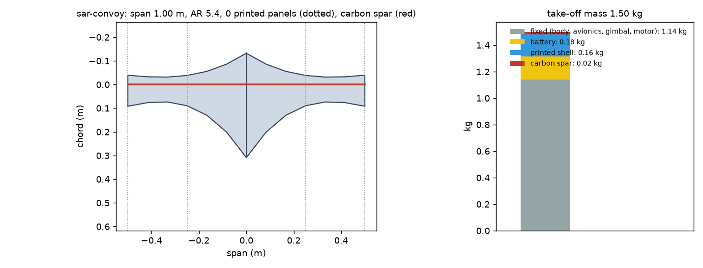
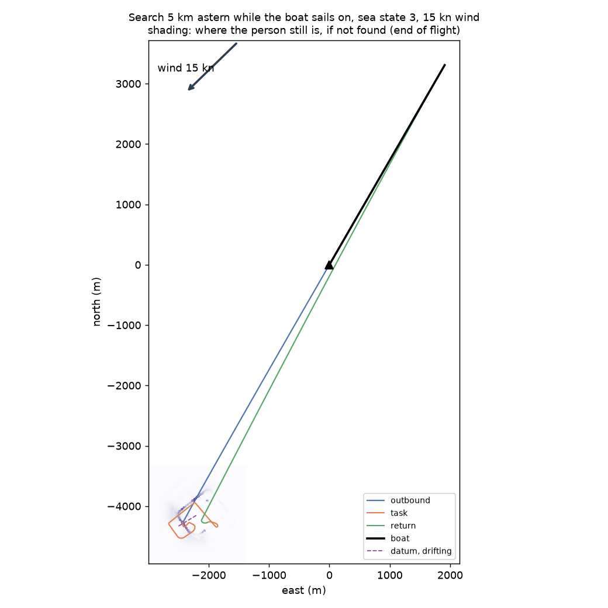
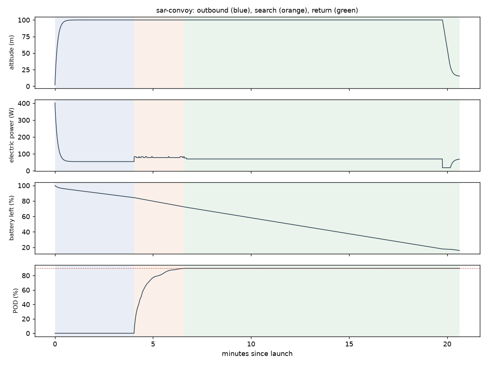

# Recon sar-convoy: Search 5 km astern while the boat sails on, sea state 3, 15 kn wind

Generated 2026-11-06 at unknown by `uv run osprey recon --mission sar-convoy`. Screening-level models; REF inputs in `design/recon/`.

## Sized airframe (OpenMDAO + OpenAeroStruct, SLSQP)

Optimizer converged: **yes**

| Quantity | Value |
|---|---|
| Task | search, 3.5 km of track planned |
| Take-off mass | 1.50 kg (battery 0.18, shell 0.16, spar 0.020, fixed 1.14) |
| Span / area / aspect ratio | 1.00 m / 0.184 m² / 5.4 |
| Root / tip chord | 44.1 / 13.1 cm (tip Re 162,960) |
| Spar tube, root / tip | r 4.0 / 4.0 mm, wall 0.50 / 0.50 mm |
| Task speed, CL, L/D | 18.4 m/s, 0.39, 8.5 |
| Stall speed (sea level) | 11.7 m/s (limit 12) |
| Task power / endurance | 78 W / 22 min |
| Mission time estimate (+20% reserve) | 18 min |
| Printed panels (220 x 220 x 250 mm bed) | 0, chord fits: yes |

### Calibrating the mission-time model against the flight sim

Each round sizes the airframe, flies it with an unlimited battery, and scales the optimizer's mission-time model by the energy the flight really used.

| Round | Time factor | Mass (kg) | Battery (kg) | Flown / estimated energy (Wh) | Progress flown | Task flown (min) |
|---|---|---|---|---|---|---|
| 1 | 1.00 | 1.49 | 0.16 | 23 / 22 | 90% | 3 |
| 2 | 1.07 | 1.50 | 0.18 | 24 / 22 | 90% | 3 |

## Flown through the mission (3-DOF point mass)

Outcome: **recovered**; left the task because: goal

| Quantity | Value |
|---|---|
| On scene | 4.0 min after launch |
| Pod reached | 90% (goal 90%); goal at 6.6 min |
| Time on task | 2.6 min |
| Search plan | 221 m track spacing, effective sweep width 674 m, 2 pattern pass(es) |
| Flight time / distance | 20.6 min / 15.8 km |
| Battery left at recovery | 16% |
| Mean power, max bank | 69 W, 35 deg |

