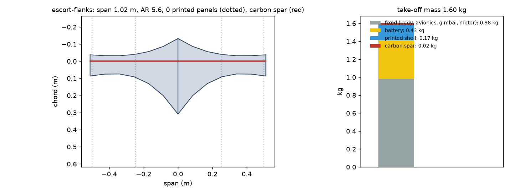
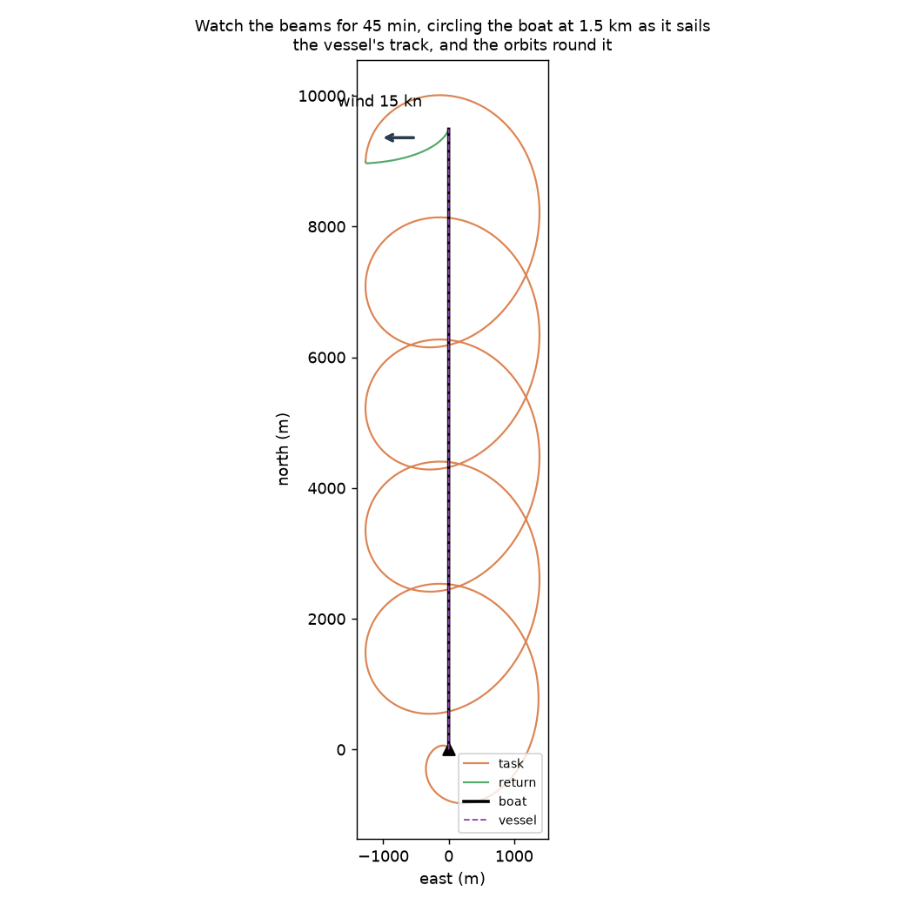
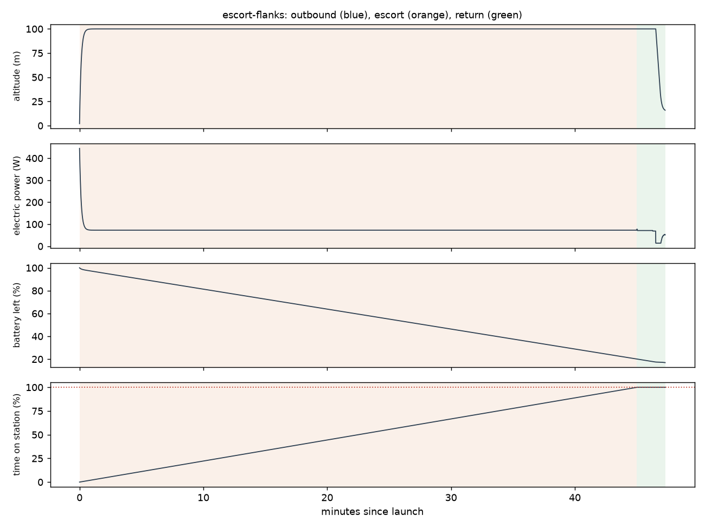

# Recon escort-flanks: Watch the beams for 45 min, circling the boat at 1.5 km as it sails

Generated 2026-11-06 at unknown by `uv run osprey recon --mission escort-flanks`. Screening-level models; REF inputs in `design/recon/`.

## Sized airframe (OpenMDAO + OpenAeroStruct, SLSQP)

Optimizer converged: **yes**

| Quantity | Value |
|---|---|
| Task | escort, 48.6 km of track planned |
| Take-off mass | 1.60 kg (battery 0.43, shell 0.17, spar 0.022, fixed 0.98) |
| Span / area / aspect ratio | 1.02 m / 0.188 m² / 5.6 |
| Root / tip chord | 44.1 / 12.4 cm (tip Re 152,015) |
| Spar tube, root / tip | r 4.0 / 4.0 mm, wall 0.50 / 0.50 mm |
| Task speed, CL, L/D | 18.2 m/s, 0.42, 9.2 |
| Stall speed (sea level) | 12.0 m/s (limit 12) |
| Task power / endurance | 73 W / 57 min |
| Mission time estimate (+20% reserve) | 48 min |
| Printed panels (220 x 220 x 250 mm bed) | 0, chord fits: yes |

### Calibrating the mission-time model against the flight sim

Each round sizes the airframe, flies it with an unlimited battery, and scales the optimizer's mission-time model by the energy the flight really used.

| Round | Time factor | Mass (kg) | Battery (kg) | Flown / estimated energy (Wh) | Progress flown | Task flown (min) |
|---|---|---|---|---|---|---|
| 1 | 1.00 | 1.77 | 0.58 | 57 / 78 | 100% | 45 |
| 2 | 0.73 | 1.58 | 0.41 | 58 / 76 | 100% | 45 |
| 3 | 0.76 | 1.60 | 0.43 | 58 / 76 | 100% | 45 |

## Flown through the mission (3-DOF point mass)

Outcome: **recovered**; left the task because: goal

| Quantity | Value |
|---|---|
| On scene | 0.0 min after launch |
| Time on station reached | 100% (goal 100%); goal at 45.0 min |
| Time on task | 45.0 min |
| Escort | 45 min circling the boat at 1.5 km; watches the beams out to 6.7 km for a sailboat 30ft |
| Flight time / distance | 47.3 min / 44.4 km |
| Battery left at recovery | 17% |
| Mean power, max bank | 73 W, 35 deg |

