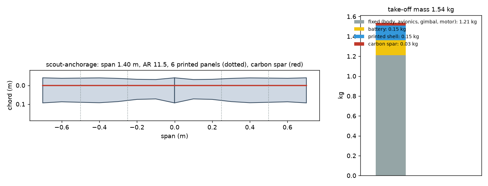
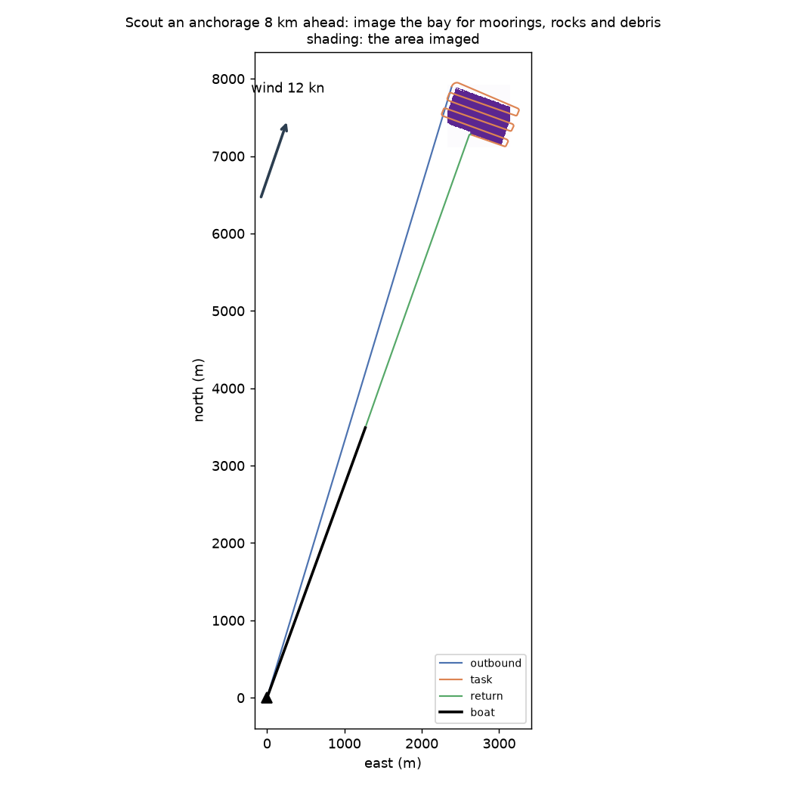
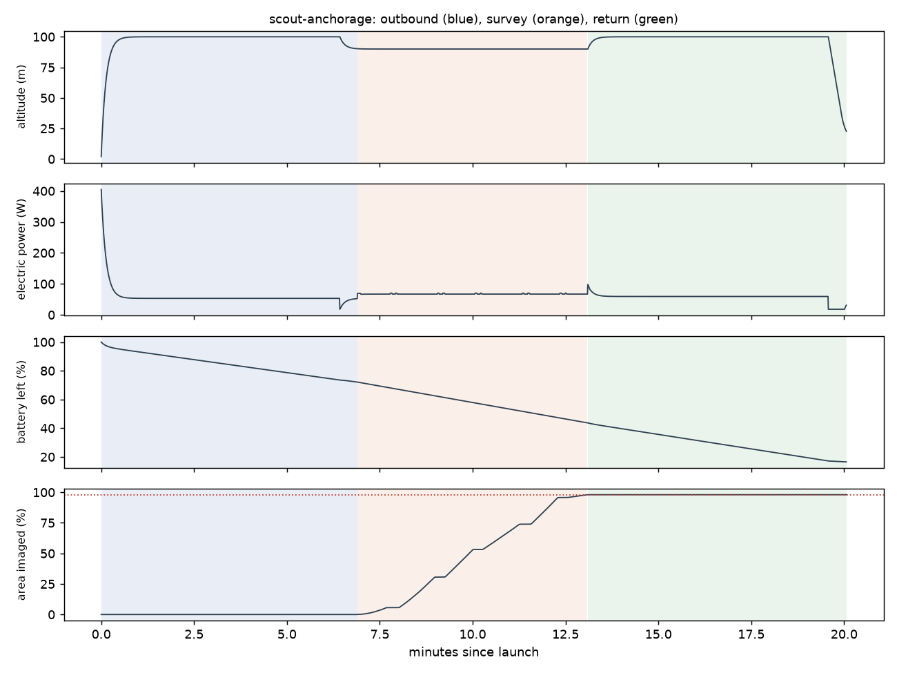

# Recon scout-anchorage: Scout an anchorage 8 km ahead: image the bay for moorings, rocks and debris

Generated 2026-11-06 at unknown by `uv run osprey recon --mission scout-anchorage`. Screening-level models; REF inputs in `design/recon/`.

## Sized airframe (OpenMDAO + OpenAeroStruct, SLSQP)

Optimizer converged: **yes**

| Quantity | Value |
|---|---|
| Task | survey, 6.1 km of track planned |
| Take-off mass | 1.54 kg (battery 0.15, shell 0.15, spar 0.027, fixed 1.21) |
| Span / area / aspect ratio | 1.40 m / 0.171 m² / 11.5 |
| Root / tip chord | 13.4 / 13.4 cm (tip Re 150,000) |
| Spar tube, root / tip | r 4.0 / 4.0 mm, wall 0.50 / 0.50 mm |
| Task speed, CL, L/D | 16.6 m/s, 0.53, 9.9 |
| Stall speed (sea level) | 12.0 m/s (limit 12) |
| Task power / endurance | 67 W / 22 min |
| Mission time estimate (+20% reserve) | 18 min |
| Printed panels (220 x 220 x 250 mm bed) | 6, chord fits: yes |

### Calibrating the mission-time model against the flight sim

Each round sizes the airframe, flies it with an unlimited battery, and scales the optimizer's mission-time model by the energy the flight really used.

| Round | Time factor | Mass (kg) | Battery (kg) | Flown / estimated energy (Wh) | Progress flown | Task flown (min) |
|---|---|---|---|---|---|---|
| 1 | 1.00 | 1.60 | 0.21 | 20 / 28 | 98% | 6 |
| 2 | 0.73 | 1.54 | 0.15 | 20 / 28 | 98% | 6 |

## Flown through the mission (3-DOF point mass)

Outcome: **recovered**; left the task because: goal

| Quantity | Value |
|---|---|
| On scene | 6.9 min after launch |
| Area imaged reached | 98% (goal 98%); goal at 13.1 min |
| Time on task | 6.2 min |
| Survey | 6 legs, 141 m swath at 106 m spacing; ground sample 1.7 cm (two side PTZs, turned down) |
| Pixels across each target | lobster buoy 17.2 px, debris log 22.9 px, kayak 51.6 px |
| Flight time / distance | 20.1 min / 17.8 km |
| Battery left at recovery | 17% |
| Mean power, max bank | 61 W, 35 deg |

