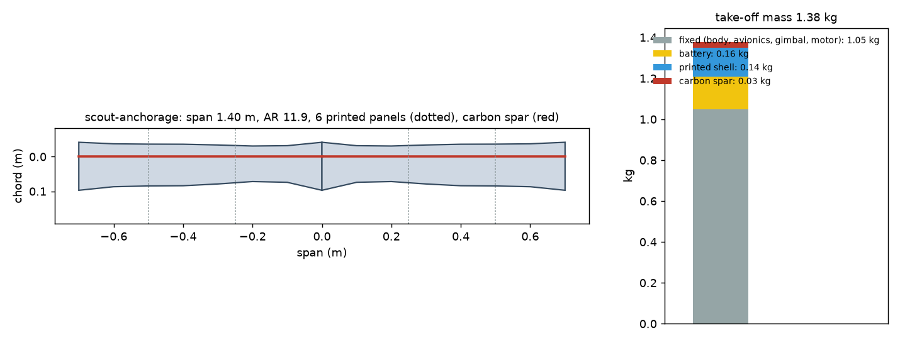
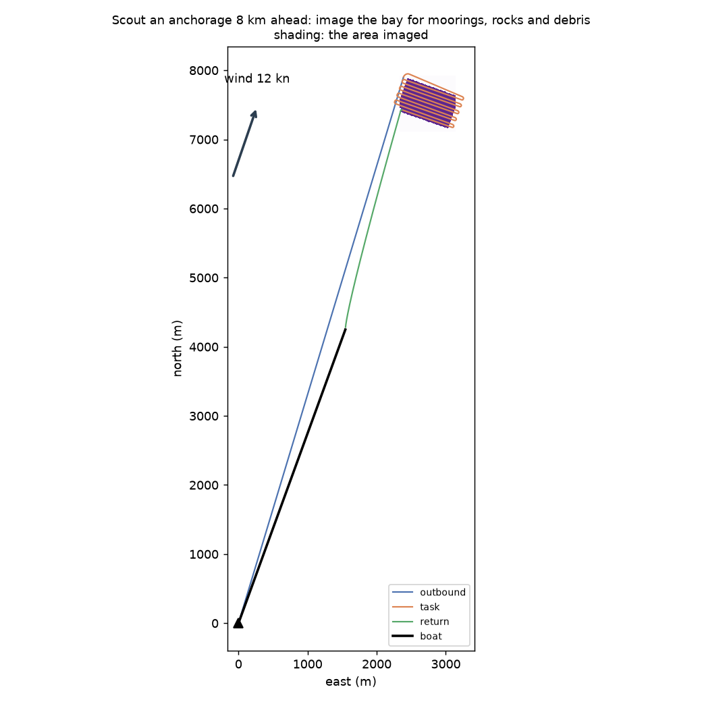
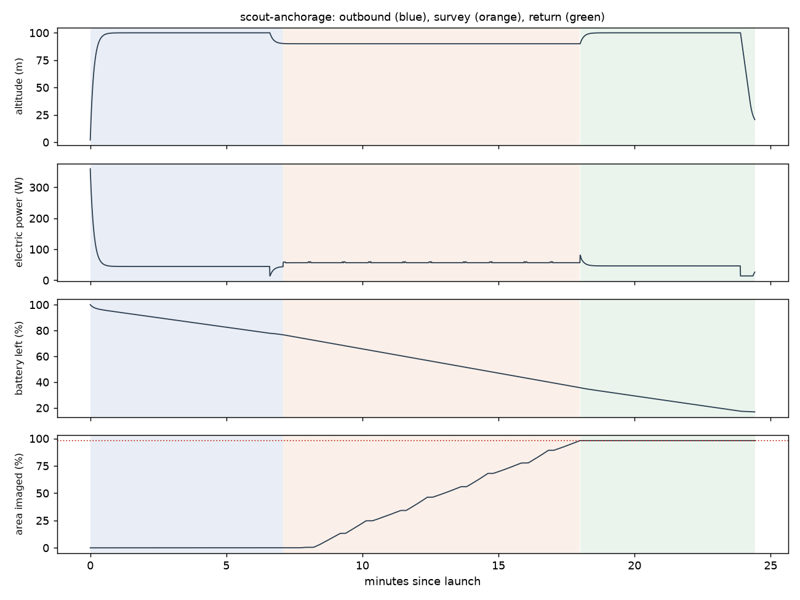

# Recon scout-anchorage: Scout an anchorage 8 km ahead: image the bay for moorings, rocks and debris

Generated 2026-11-06 at unknown by `uv run osprey recon --mission scout-anchorage`. Screening-level models; REF inputs in `design/recon/`.

## Sized airframe (OpenMDAO + OpenAeroStruct, SLSQP)

Optimizer converged: **yes**

| Quantity | Value |
|---|---|
| Task | survey, 10.7 km of track planned |
| Take-off mass | 1.38 kg (battery 0.16, shell 0.14, spar 0.027, fixed 1.05) |
| Span / area / aspect ratio | 1.40 m / 0.165 m² / 11.9 |
| Root / tip chord | 13.9 / 13.9 cm (tip Re 150,000) |
| Spar tube, root / tip | r 4.0 / 4.0 mm, wall 0.50 / 0.50 mm |
| Task speed, CL, L/D | 16.0 m/s, 0.53, 9.8 |
| Stall speed (sea level) | 11.6 m/s (limit 12) |
| Task power / endurance | 57 W / 27 min |
| Mission time estimate (+20% reserve) | 22 min |
| Printed panels (220 x 220 x 250 mm bed) | 6, chord fits: yes |

### Calibrating the mission-time model against the flight sim

Each round sizes the airframe, flies it with an unlimited battery, and scales the optimizer's mission-time model by the energy the flight really used.

| Round | Time factor | Mass (kg) | Battery (kg) | Flown / estimated energy (Wh) | Progress flown | Task flown (min) |
|---|---|---|---|---|---|---|
| 1 | 1.00 | 1.44 | 0.22 | 22 / 30 | 98% | 11 |
| 2 | 0.73 | 1.38 | 0.16 | 21 / 29 | 98% | 11 |

## Flown through the mission (3-DOF point mass)

Outcome: **recovered**; left the task because: goal

| Quantity | Value |
|---|---|
| On scene | 7.1 min after launch |
| Area imaged reached | 98% (goal 98%); goal at 18.0 min |
| Time on task | 10.9 min |
| Survey | 11 legs, 71 m swath at 53 m spacing; ground sample 1.7 cm (gimbal) |
| Pixels across each target | lobster buoy 17.2 px, debris log 22.9 px, kayak 51.6 px |
| Flight time / distance | 24.4 min / 20.9 km |
| Battery left at recovery | 17% |
| Mean power, max bank | 52 W, 35 deg |

