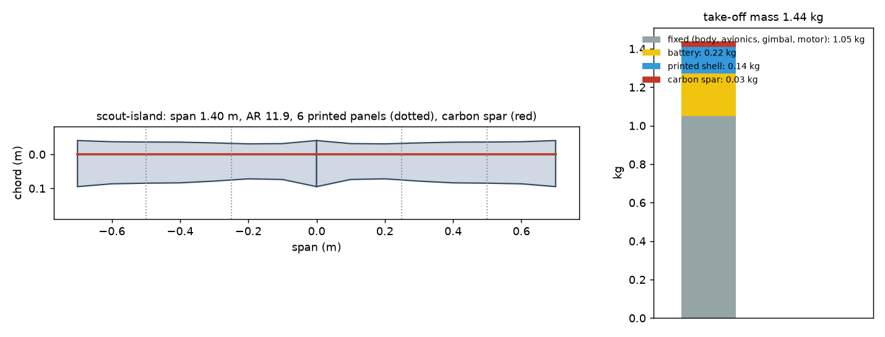
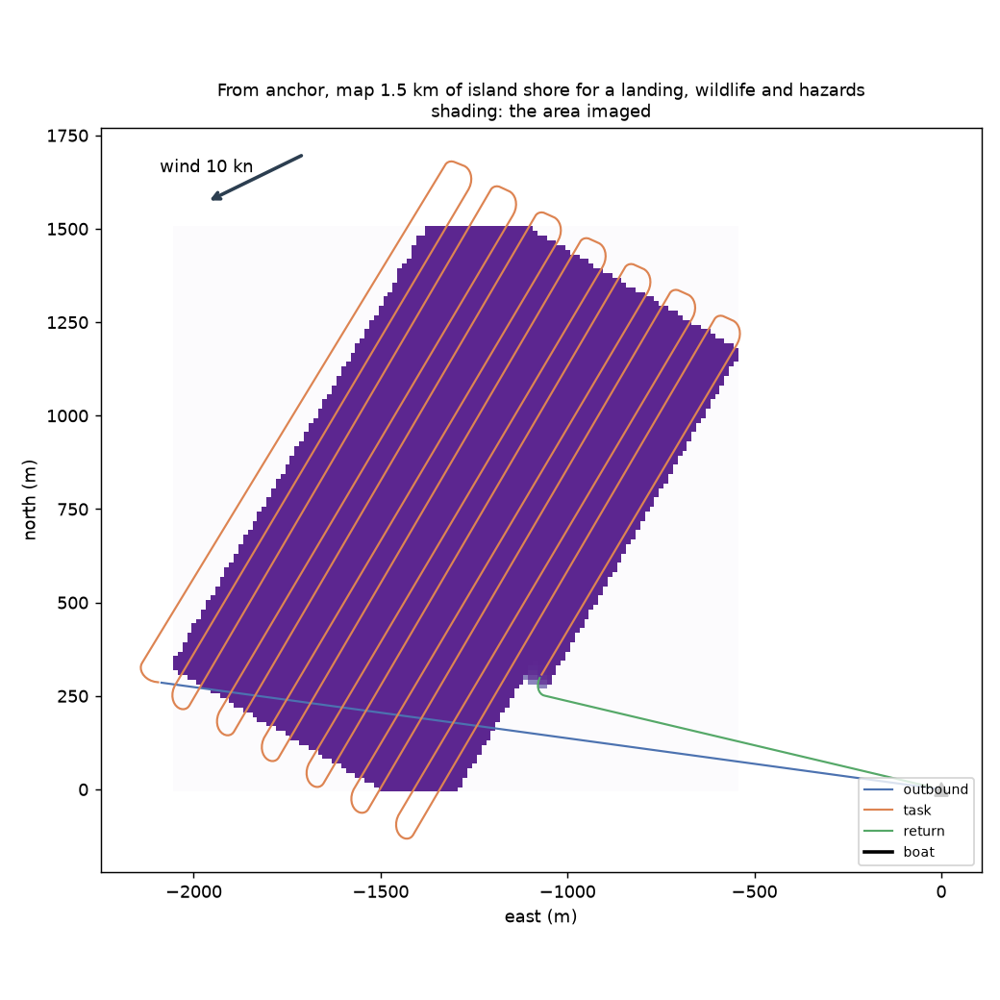
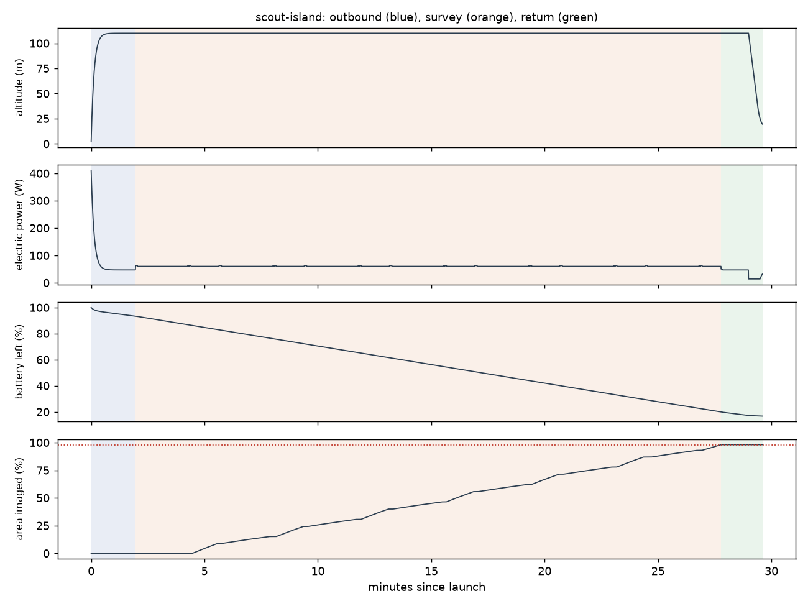

# Recon scout-island: From anchor, map 1.5 km of island shore for a landing, wildlife and hazards

Generated 2026-11-06 at unknown by `uv run osprey recon --mission scout-island`. Screening-level models; REF inputs in `design/recon/`.

## Sized airframe (OpenMDAO + OpenAeroStruct, SLSQP)

Optimizer converged: **yes**

| Quantity | Value |
|---|---|
| Task | survey, 25.3 km of track planned |
| Take-off mass | 1.44 kg (battery 0.22, shell 0.14, spar 0.027, fixed 1.05) |
| Span / area / aspect ratio | 1.40 m / 0.164 m² / 11.9 |
| Root / tip chord | 13.5 / 13.5 cm (tip Re 150,000) |
| Spar tube, root / tip | r 4.0 / 4.0 mm, wall 0.50 / 0.50 mm |
| Task speed, CL, L/D | 16.4 m/s, 0.53, 9.8 |
| Stall speed (sea level) | 11.8 m/s (limit 12) |
| Task power / endurance | 60 W / 35 min |
| Mission time estimate (+20% reserve) | 29 min |
| Printed panels (220 x 220 x 250 mm bed) | 6, chord fits: yes |

### Calibrating the mission-time model against the flight sim

Each round sizes the airframe, flies it with an unlimited battery, and scales the optimizer's mission-time model by the energy the flight really used.

| Round | Time factor | Mass (kg) | Battery (kg) | Flown / estimated energy (Wh) | Progress flown | Task flown (min) |
|---|---|---|---|---|---|---|
| 1 | 1.00 | 1.47 | 0.25 | 30 / 33 | 98% | 26 |
| 2 | 0.90 | 1.44 | 0.22 | 29 / 33 | 98% | 26 |

## Flown through the mission (3-DOF point mass)

Outcome: **recovered**; left the task because: goal

| Quantity | Value |
|---|---|
| On scene | 2.0 min after launch |
| Area imaged reached | 98% (goal 98%); goal at 27.8 min |
| Time on task | 25.8 min |
| Survey | 15 legs, 86 m swath at 69 m spacing; ground sample 2.1 cm (gimbal) |
| Pixels across each target | person in water 11.7 px, kayak 42.2 px, debris log 18.8 px |
| Flight time / distance | 29.6 min / 26.2 km |
| Battery left at recovery | 17% |
| Mean power, max bank | 59 W, 35 deg |

