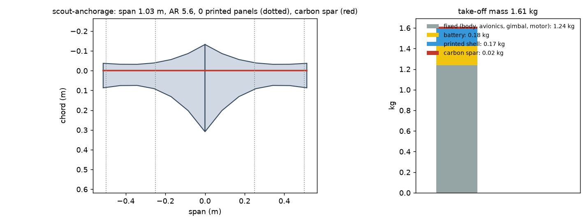
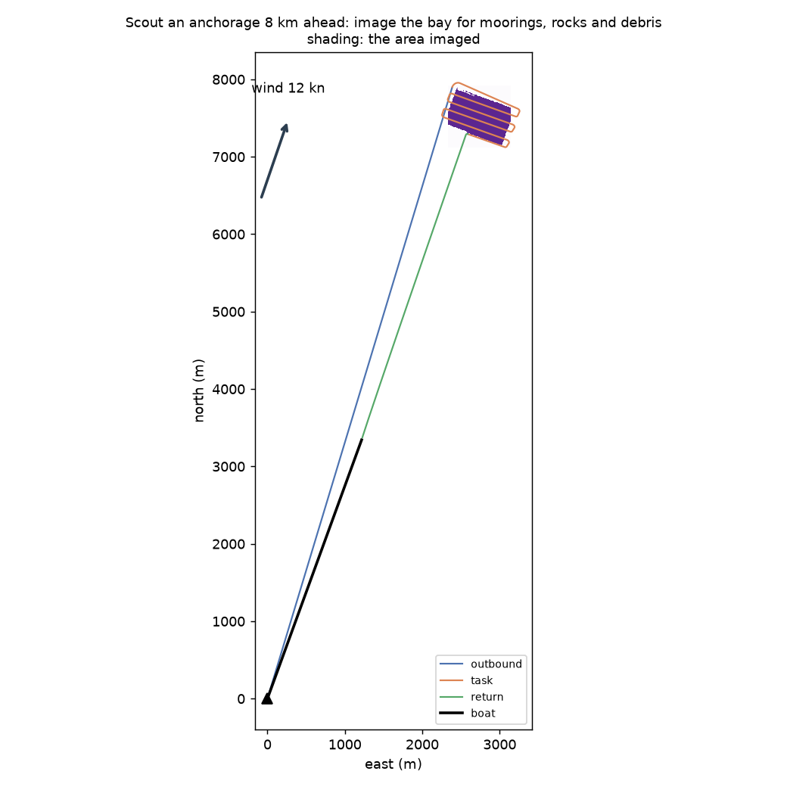
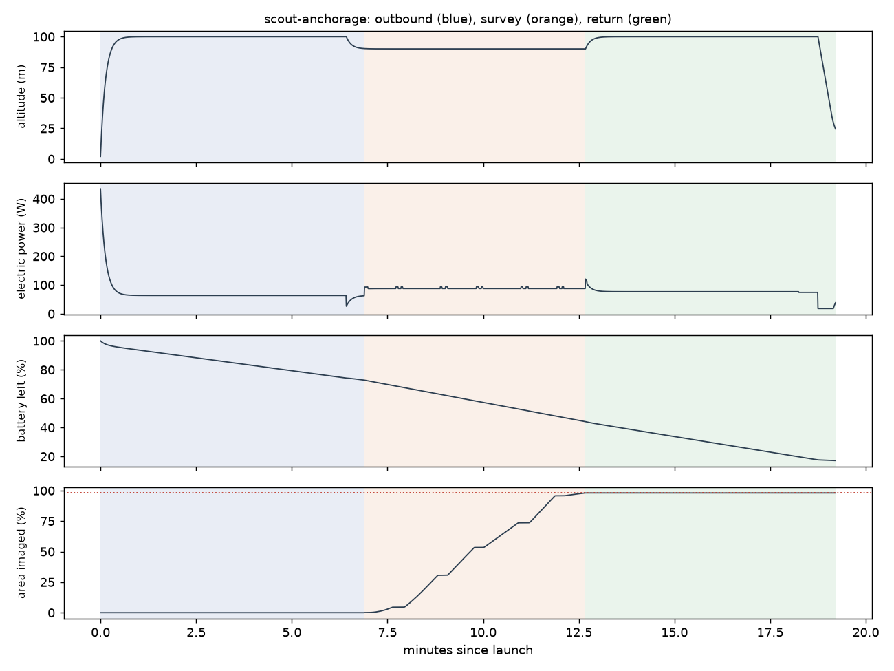

# Recon scout-anchorage: Scout an anchorage 8 km ahead: image the bay for moorings, rocks and debris

Generated 2026-11-07 at d01834a by `uv run osprey recon --mission scout-anchorage`. Screening-level models; REF inputs in `design/recon/`.

## Sized airframe (OpenMDAO + OpenAeroStruct, SLSQP)

Optimizer converged: **yes**

| Quantity | Value |
|---|---|
| Task | survey, 6.1 km of track planned |
| Take-off mass | 1.61 kg (battery 0.18, shell 0.17, spar 0.020, fixed 1.24) |
| Span / area / aspect ratio | 1.03 m / 0.189 m² / 5.6 |
| Root / tip chord | 44.1 / 12.4 cm (tip Re 150,000) |
| Spar tube, root / tip | r 4.0 / 4.0 mm, wall 0.50 / 0.50 mm |
| Task speed, CL, L/D | 17.9 m/s, 0.43, 7.7 |
| Stall speed (sea level) | 12.0 m/s (limit 12) |
| Task power / endurance | 88 W / 20 min |
| Mission time estimate (+20% reserve) | 17 min |
| Printed panels (220 x 220 x 250 mm bed) | 0, chord fits: yes |

### Calibrating the mission-time model against the flight sim

Each round sizes the airframe, flies it with an unlimited battery, and scales the optimizer's mission-time model by the energy the flight really used.

| Round | Time factor | Mass (kg) | Battery (kg) | Flown / estimated energy (Wh) | Progress flown | Task flown (min) |
|---|---|---|---|---|---|---|
| 1 | 1.00 | 1.69 | 0.25 | 24 / 33 | 98% | 6 |
| 2 | 0.73 | 1.61 | 0.18 | 24 / 34 | 98% | 6 |

## Flown through the mission (3-DOF point mass)

Outcome: **recovered**; left the task because: goal

| Quantity | Value |
|---|---|
| On scene | 6.9 min after launch |
| Area imaged reached | 98% (goal 98%); goal at 12.7 min |
| Time on task | 5.8 min |
| Survey | 6 legs, 141 m swath at 106 m spacing; ground sample 1.7 cm (two side PTZs, turned down) |
| Pixels across each target | lobster buoy 17.2 px, debris log 22.9 px, kayak 51.6 px |
| Flight time / distance | 19.2 min / 18.0 km |
| Battery left at recovery | 17% |
| Mean power, max bank | 76 W, 35 deg |

