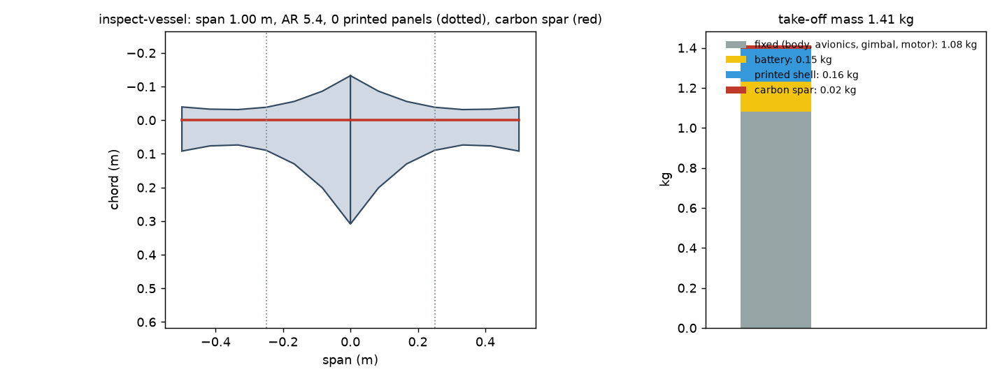
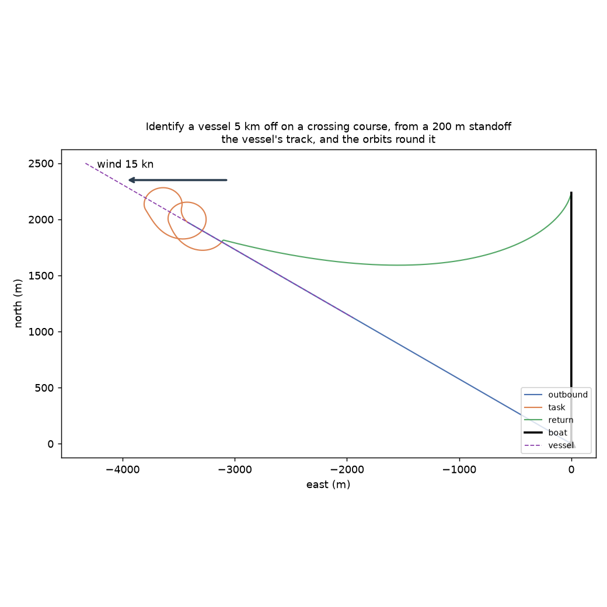
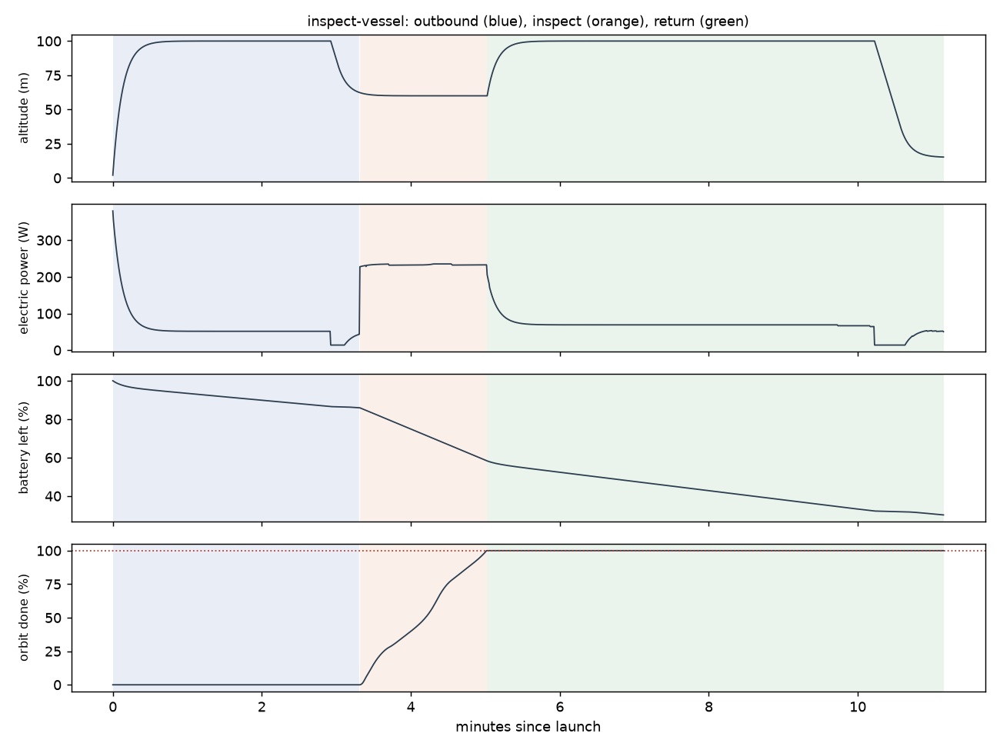

# Recon inspect-vessel: Identify a vessel 5 km off on a crossing course, from a 200 m standoff

Generated 2026-11-07 at d01834a by `uv run osprey recon --mission inspect-vessel`. Screening-level models; REF inputs in `design/recon/`.

## Sized airframe (OpenMDAO + OpenAeroStruct, SLSQP)

Optimizer converged: **yes**

| Quantity | Value |
|---|---|
| Task | inspect, 2.5 km of track planned |
| Take-off mass | 1.41 kg (battery 0.15, shell 0.16, spar 0.019, fixed 1.08) |
| Span / area / aspect ratio | 1.00 m / 0.184 m² / 5.4 |
| Root / tip chord | 44.1 / 13.1 cm (tip Re 249,684) |
| Spar tube, root / tip | r 4.0 / 4.0 mm, wall 0.50 / 0.50 mm |
| Task speed, CL, L/D | 28.1 m/s, 0.16, 3.4 |
| Stall speed (sea level) | 11.4 m/s (limit 12) |
| Task power / endurance | 232 W / 6 min |
| Mission time estimate (+20% reserve) | 5 min |
| Printed panels (220 x 220 x 250 mm bed) | 0, chord fits: yes |

### Calibrating the mission-time model against the flight sim

Each round sizes the airframe, flies it with an unlimited battery, and scales the optimizer's mission-time model by the energy the flight really used.

| Round | Time factor | Mass (kg) | Battery (kg) | Flown / estimated energy (Wh) | Progress flown | Task flown (min) |
|---|---|---|---|---|---|---|
| 1 | 1.00 | 1.43 | 0.16 | 14 / 21 | 100% | 3 |
| 2 | 0.64 | 1.41 | 0.15 | 16 / 31 | 100% | 2 |
| 3 | 0.51 | 1.41 | 0.15 | 17 / 34 | 100% | 2 |

## Flown through the mission (3-DOF point mass)

Outcome: **recovered**; left the task because: goal

| Quantity | Value |
|---|---|
| On scene | 3.3 min after launch |
| Orbit done reached | 100% (goal 100%); goal at 5.0 min |
| Time on task | 1.7 min |
| Inspection | 200 m standoff (207 m slant); 2.1 mm focal needed of 30 mm (gimbal); 37 px across; resolves it |
| Flight time / distance | 11.2 min / 9.9 km |
| Battery left at recovery | 30% |
| Mean power, max bank | 90 W, 35 deg |

