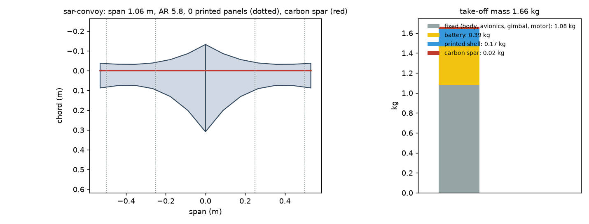
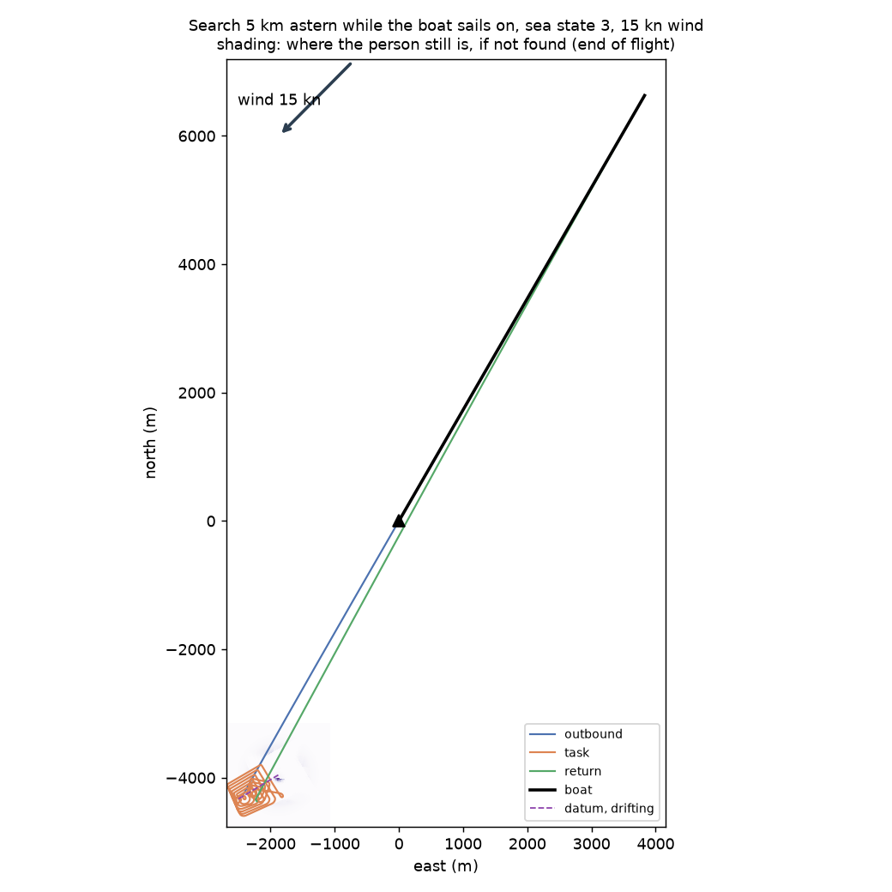
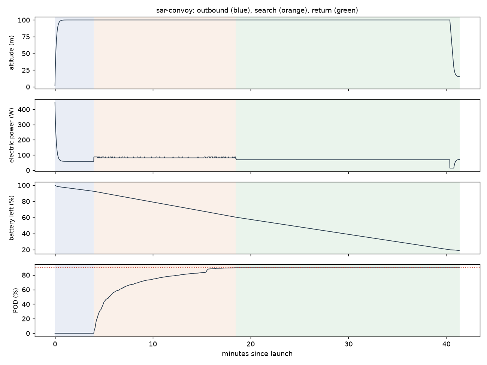

# Recon sar-convoy: Search 5 km astern while the boat sails on, sea state 3, 15 kn wind

Generated 2026-11-07 at d01834a by `uv run osprey recon --mission sar-convoy`. Screening-level models; REF inputs in `design/recon/`.

## Sized airframe (OpenMDAO + OpenAeroStruct, SLSQP)

Optimizer converged: **yes**

| Quantity | Value |
|---|---|
| Task | search, 19.2 km of track planned |
| Take-off mass | 1.66 kg (battery 0.39, shell 0.17, spar 0.022, fixed 1.08) |
| Span / area / aspect ratio | 1.06 m / 0.195 m² / 5.8 |
| Root / tip chord | 44.1 / 12.5 cm (tip Re 150,000) |
| Spar tube, root / tip | r 4.0 / 4.0 mm, wall 0.50 / 0.50 mm |
| Task speed, CL, L/D | 17.8 m/s, 0.43, 8.2 |
| Stall speed (sea level) | 12.0 m/s (limit 12) |
| Task power / endurance | 81 W / 46 min |
| Mission time estimate (+20% reserve) | 38 min |
| Printed panels (220 x 220 x 250 mm bed) | 0, chord fits: yes |

### Calibrating the mission-time model against the flight sim

Each round sizes the airframe, flies it with an unlimited battery, and scales the optimizer's mission-time model by the energy the flight really used.

| Round | Time factor | Mass (kg) | Battery (kg) | Flown / estimated energy (Wh) | Progress flown | Task flown (min) |
|---|---|---|---|---|---|---|
| 1 | 1.00 | 1.66 | 0.39 | 51 / 52 | 90% | 14 |

## Flown through the mission (3-DOF point mass)

Outcome: **recovered**; left the task because: goal

| Quantity | Value |
|---|---|
| On scene | 4.0 min after launch |
| Pod reached | 90% (goal 90%); goal at 18.5 min |
| Time on task | 14.5 min |
| Search plan | 40 m track spacing, effective sweep width 123 m, 2 pattern pass(es) |
| Flight time / distance | 41.3 min / 30.6 km |
| Battery left at recovery | 19% |
| Mean power, max bank | 73 W, 35 deg |

