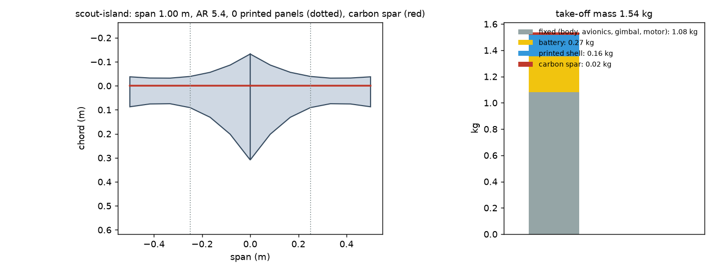
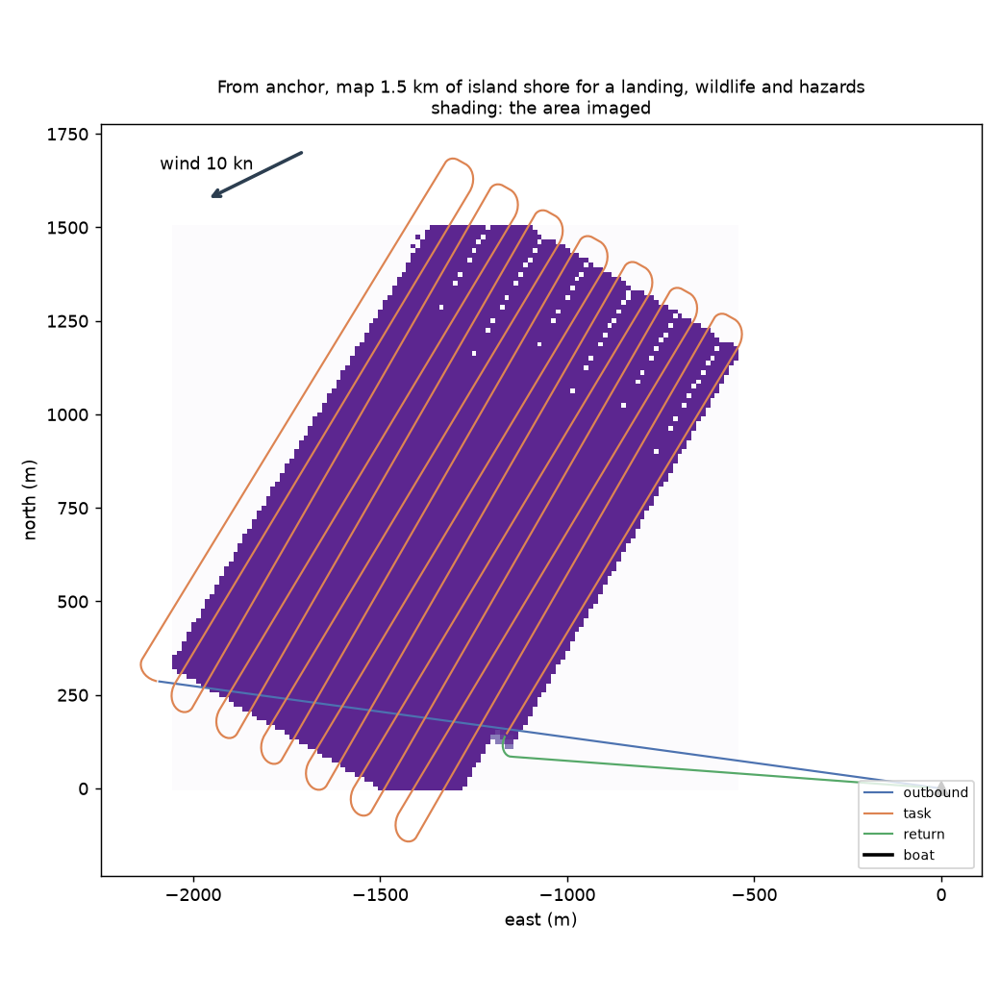
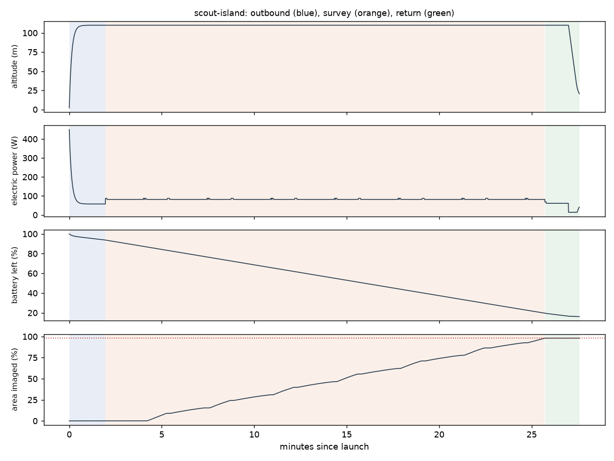

# Recon scout-island: From anchor, map 1.5 km of island shore for a landing, wildlife and hazards

Generated 2026-11-07 at d01834a by `uv run osprey recon --mission scout-island`. Screening-level models; REF inputs in `design/recon/`.

## Sized airframe (OpenMDAO + OpenAeroStruct, SLSQP)

Optimizer converged: **yes**

| Quantity | Value |
|---|---|
| Task | survey, 25.3 km of track planned |
| Take-off mass | 1.54 kg (battery 0.27, shell 0.16, spar 0.019, fixed 1.08) |
| Span / area / aspect ratio | 1.00 m / 0.184 m² / 5.4 |
| Root / tip chord | 44.1 / 12.5 cm (tip Re 150,000) |
| Spar tube, root / tip | r 4.0 / 4.0 mm, wall 0.50 / 0.50 mm |
| Task speed, CL, L/D | 17.8 m/s, 0.42, 7.5 |
| Stall speed (sea level) | 11.9 m/s (limit 12) |
| Task power / endurance | 82 W / 32 min |
| Mission time estimate (+20% reserve) | 27 min |
| Printed panels (220 x 220 x 250 mm bed) | 0, chord fits: yes |

### Calibrating the mission-time model against the flight sim

Each round sizes the airframe, flies it with an unlimited battery, and scales the optimizer's mission-time model by the energy the flight really used.

| Round | Time factor | Mass (kg) | Battery (kg) | Flown / estimated energy (Wh) | Progress flown | Task flown (min) |
|---|---|---|---|---|---|---|
| 1 | 1.00 | 1.57 | 0.31 | 37 / 41 | 98% | 23 |
| 2 | 0.90 | 1.54 | 0.27 | 37 / 40 | 98% | 24 |

## Flown through the mission (3-DOF point mass)

Outcome: **recovered**; left the task because: goal

| Quantity | Value |
|---|---|
| On scene | 2.0 min after launch |
| Area imaged reached | 98% (goal 98%); goal at 25.7 min |
| Time on task | 23.8 min |
| Survey | 15 legs, 86 m swath at 69 m spacing; ground sample 2.1 cm (gimbal) |
| Pixels across each target | person in water 11.7 px, kayak 42.2 px, debris log 18.8 px |
| Flight time / distance | 27.6 min / 26.7 km |
| Battery left at recovery | 16% |
| Mean power, max bank | 80 W, 35 deg |

