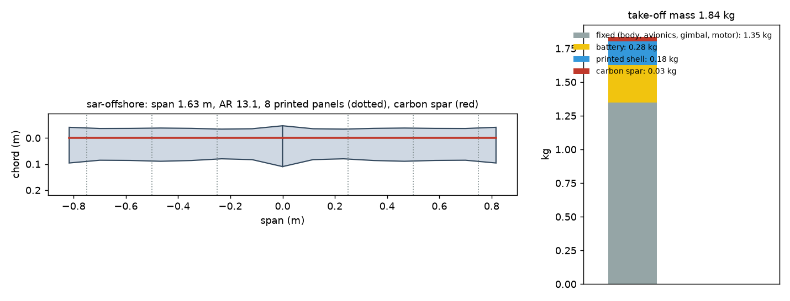
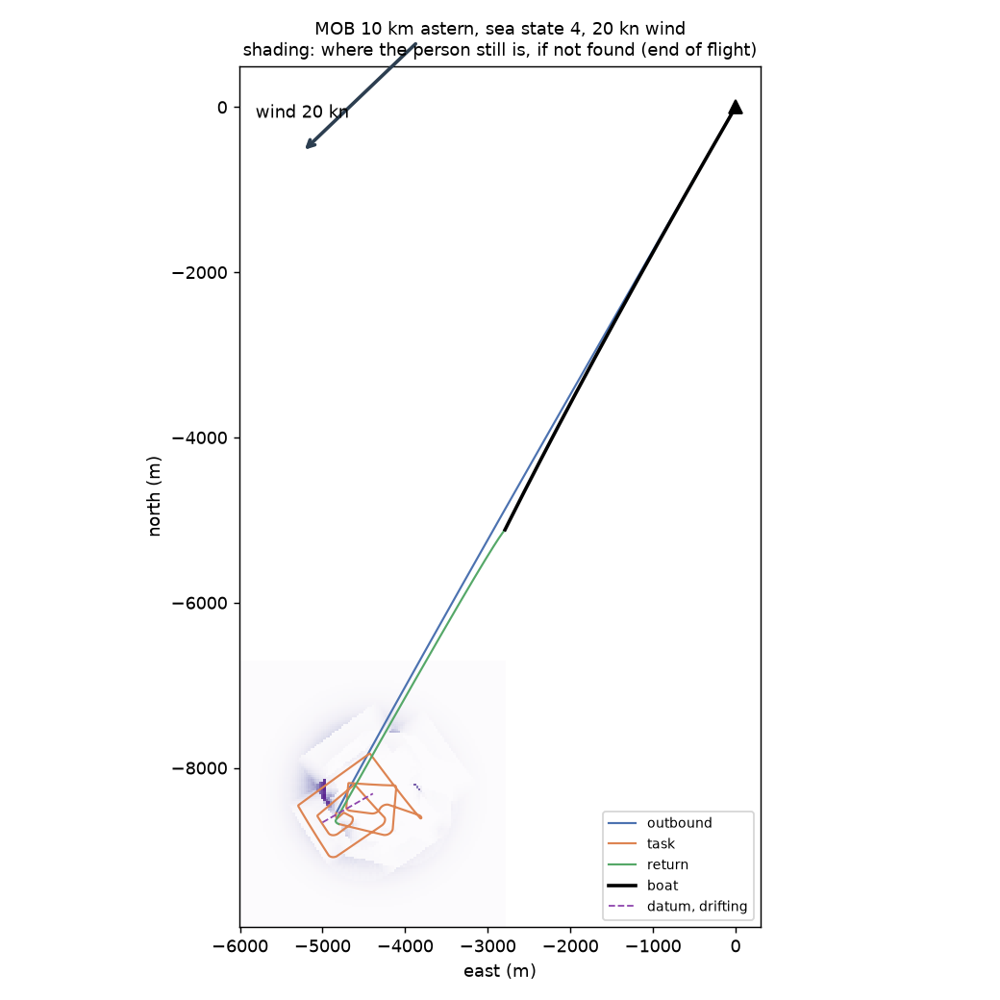
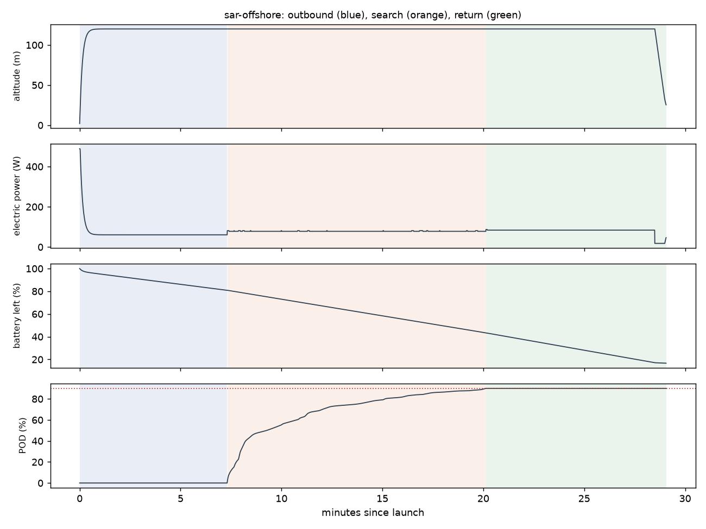

# Recon sar-offshore: MOB 10 km astern, sea state 4, 20 kn wind

Generated 2026-11-07 at d01834a by `uv run osprey recon --mission sar-offshore`. Screening-level models; REF inputs in `design/recon/`.

## Sized airframe (OpenMDAO + OpenAeroStruct, SLSQP)

Optimizer converged: **yes**

| Quantity | Value |
|---|---|
| Task | search, 13.7 km of track planned |
| Take-off mass | 1.84 kg (battery 0.28, shell 0.18, spar 0.031, fixed 1.35) |
| Span / area / aspect ratio | 1.63 m / 0.204 m² / 13.1 |
| Root / tip chord | 15.7 / 13.7 cm (tip Re 153,477) |
| Spar tube, root / tip | r 4.0 / 4.0 mm, wall 0.50 / 0.50 mm |
| Task speed, CL, L/D | 16.7 m/s, 0.54, 9.7 |
| Stall speed (sea level) | 12.0 m/s (limit 12) |
| Task power / endurance | 78 W / 34 min |
| Mission time estimate (+20% reserve) | 28 min |
| Printed panels (220 x 220 x 250 mm bed) | 8, chord fits: yes |

### Calibrating the mission-time model against the flight sim

Each round sizes the airframe, flies it with an unlimited battery, and scales the optimizer's mission-time model by the energy the flight really used.

| Round | Time factor | Mass (kg) | Battery (kg) | Flown / estimated energy (Wh) | Progress flown | Task flown (min) |
|---|---|---|---|---|---|---|
| 1 | 1.00 | 2.08 | 0.49 | 38 / 65 | 90% | 13 |
| 2 | 0.58 | 1.84 | 0.28 | 37 / 64 | 90% | 13 |

## Flown through the mission (3-DOF point mass)

Outcome: **recovered**; left the task because: goal

| Quantity | Value |
|---|---|
| On scene | 7.3 min after launch |
| Pod reached | 90% (goal 90%); goal at 20.1 min |
| Time on task | 12.8 min |
| Search plan | 226 m track spacing, effective sweep width 688 m, 2 pattern pass(es) |
| Flight time / distance | 29.1 min / 22.8 km |
| Battery left at recovery | 17% |
| Mean power, max bank | 77 W, 35 deg |

