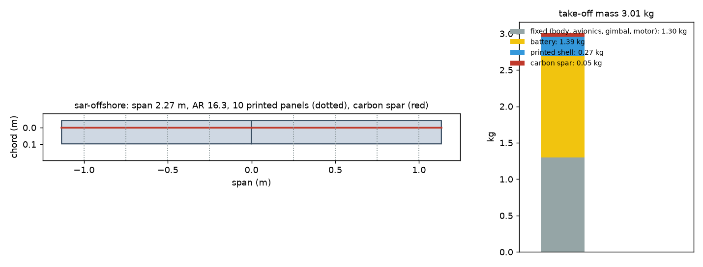
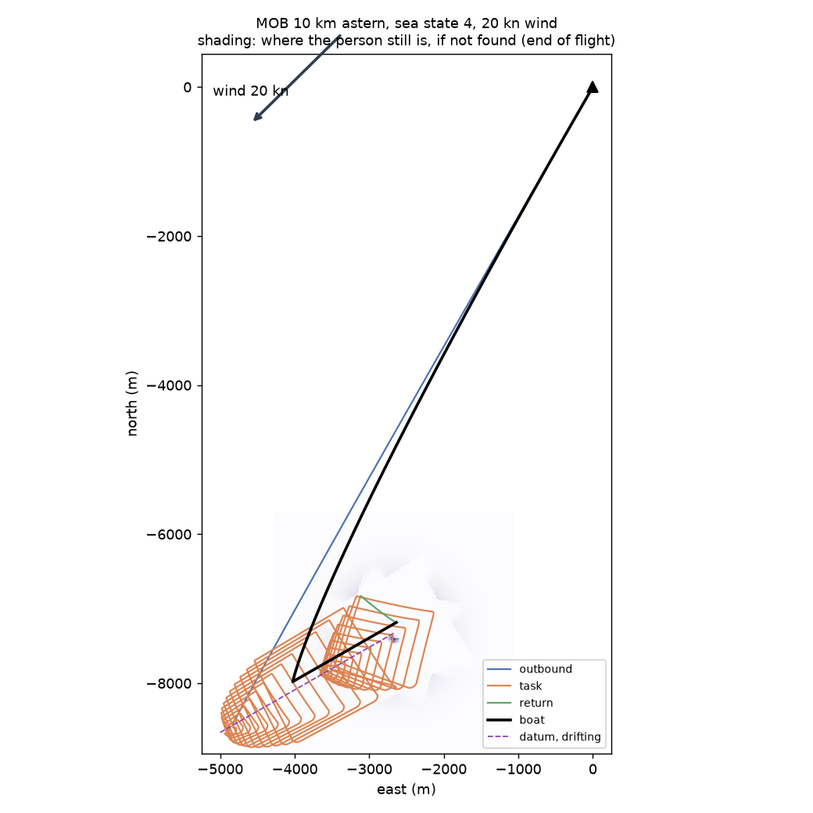
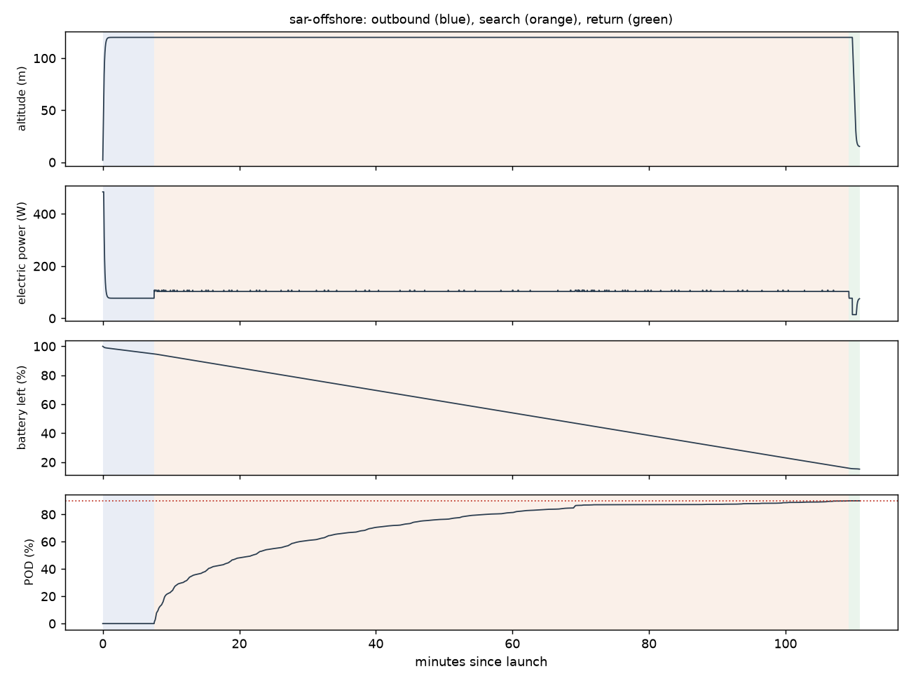

# Recon sar-offshore: MOB 10 km astern, sea state 4, 20 kn wind

Generated 2026-11-07 at d01834a by `uv run osprey recon --mission sar-offshore`. Screening-level models; REF inputs in `design/recon/`.

## Sized airframe (OpenMDAO + OpenAeroStruct, SLSQP)

Optimizer converged: **yes**

| Quantity | Value |
|---|---|
| Task | search, 63.8 km of track planned |
| Take-off mass | 3.01 kg (battery 1.39, shell 0.27, spar 0.052, fixed 1.30) |
| Span / area / aspect ratio | 2.27 m / 0.316 m² / 16.3 |
| Root / tip chord | 13.9 / 13.9 cm (tip Re 150,000) |
| Spar tube, root / tip | r 6.0 / 4.0 mm, wall 0.50 / 0.50 mm |
| Task speed, CL, L/D | 16.0 m/s, 0.60, 10.1 |
| Stall speed (sea level) | 11.5 m/s (limit 12) |
| Task power / endurance | 102 W / 130 min |
| Mission time estimate (+20% reserve) | 108 min |
| Printed panels (220 x 220 x 250 mm bed) | 10, chord fits: yes |

### Calibrating the mission-time model against the flight sim

Each round sizes the airframe, flies it with an unlimited battery, and scales the optimizer's mission-time model by the energy the flight really used.

| Round | Time factor | Mass (kg) | Battery (kg) | Flown / estimated energy (Wh) | Progress flown | Task flown (min) |
|---|---|---|---|---|---|---|
| 1 | 1.00 | 3.01 | 1.39 | 188 / 185 | 90% | 102 |

## Flown through the mission (3-DOF point mass)

Outcome: **recovered**; left the task because: goal

| Quantity | Value |
|---|---|
| On scene | 7.5 min after launch |
| Pod reached | 90% (goal 90%); goal at 109.3 min |
| Time on task | 101.8 min |
| Search plan | 49 m track spacing, effective sweep width 148 m, 2 pattern pass(es) |
| Flight time / distance | 110.8 min / 73.1 km |
| Battery left at recovery | 15% |
| Mean power, max bank | 102 W, 35 deg |

