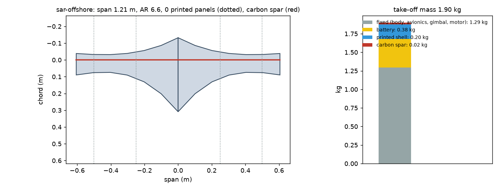
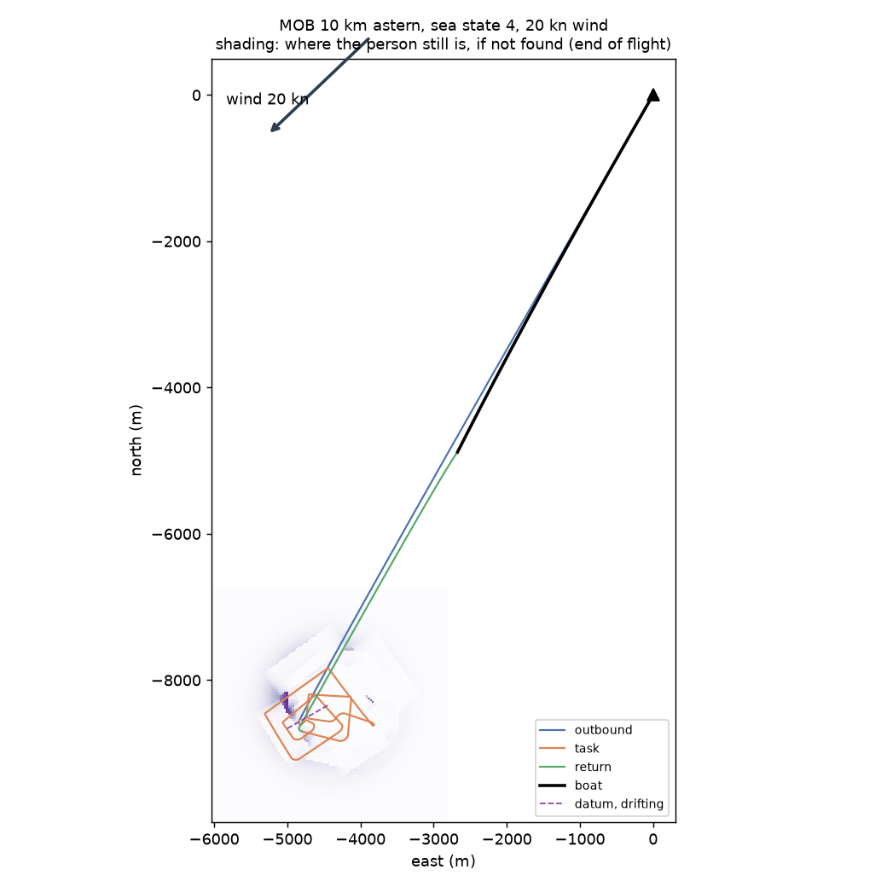
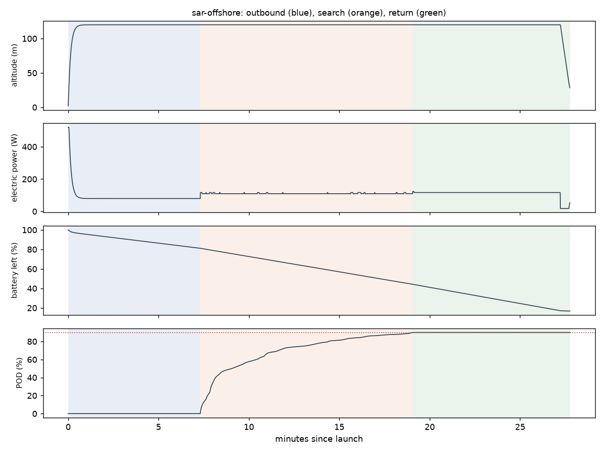

# Recon sar-offshore: MOB 10 km astern, sea state 4, 20 kn wind

Generated 2026-11-07 at cc958a0 by `uv run osprey recon --mission sar-offshore`. Screening-level models; REF inputs in `design/recon/`.

## Sized airframe (OpenMDAO + OpenAeroStruct, SLSQP)

Optimizer converged: **yes**

| Quantity | Value |
|---|---|
| Task | search, 13.7 km of track planned |
| Take-off mass | 1.90 kg (battery 0.38, shell 0.20, spar 0.023, fixed 1.29) |
| Span / area / aspect ratio | 1.21 m / 0.222 m² / 6.6 |
| Root / tip chord | 44.1 / 12.8 cm (tip Re 150,000) |
| Spar tube, root / tip | r 4.0 / 4.0 mm, wall 0.50 / 0.50 mm |
| Task speed, CL, L/D | 17.4 m/s, 0.45, 7.6 |
| Stall speed (sea level) | 12.0 m/s (limit 12) |
| Task power / endurance | 110 W / 32 min |
| Mission time estimate (+20% reserve) | 27 min |
| Printed panels (220 x 220 x 250 mm bed) | 0, chord fits: yes |

### Calibrating the mission-time model against the flight sim

Each round sizes the airframe, flies it with an unlimited battery, and scales the optimizer's mission-time model by the energy the flight really used.

| Round | Time factor | Mass (kg) | Battery (kg) | Flown / estimated energy (Wh) | Progress flown | Task flown (min) |
|---|---|---|---|---|---|---|
| 1 | 1.00 | 2.27 | 0.66 | 50 / 84 | 90% | 13 |
| 2 | 0.59 | 1.94 | 0.39 | 49 / 83 | 90% | 12 |
| 3 | 0.59 | 1.90 | 0.38 | 49 / 83 | 90% | 12 |
| 4 | 0.59 | 1.90 | 0.38 | 49 / 83 | 90% | 12 |

## Flown through the mission (3-DOF point mass)

Outcome: **recovered**; left the task because: goal

| Quantity | Value |
|---|---|
| On scene | 7.3 min after launch |
| Pod reached | 90% (goal 90%); goal at 19.1 min |
| Time on task | 11.7 min |
| Search plan | 226 m track spacing, effective sweep width 688 m, 2 pattern pass(es) |
| Flight time / distance | 27.8 min / 23.0 km |
| Battery left at recovery | 17% |
| Mean power, max bank | 105 W, 35 deg |

