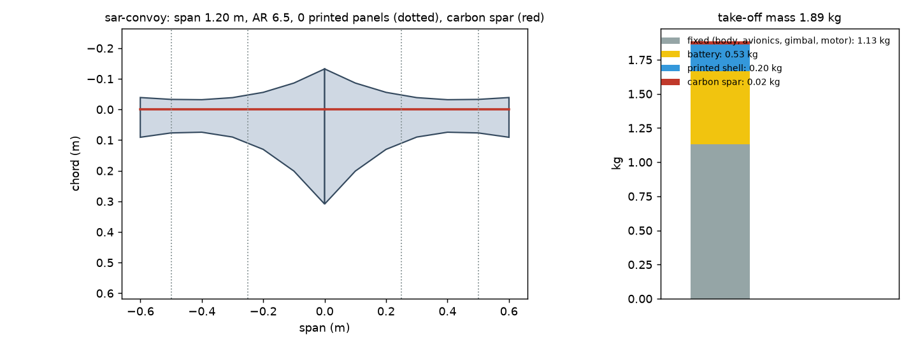
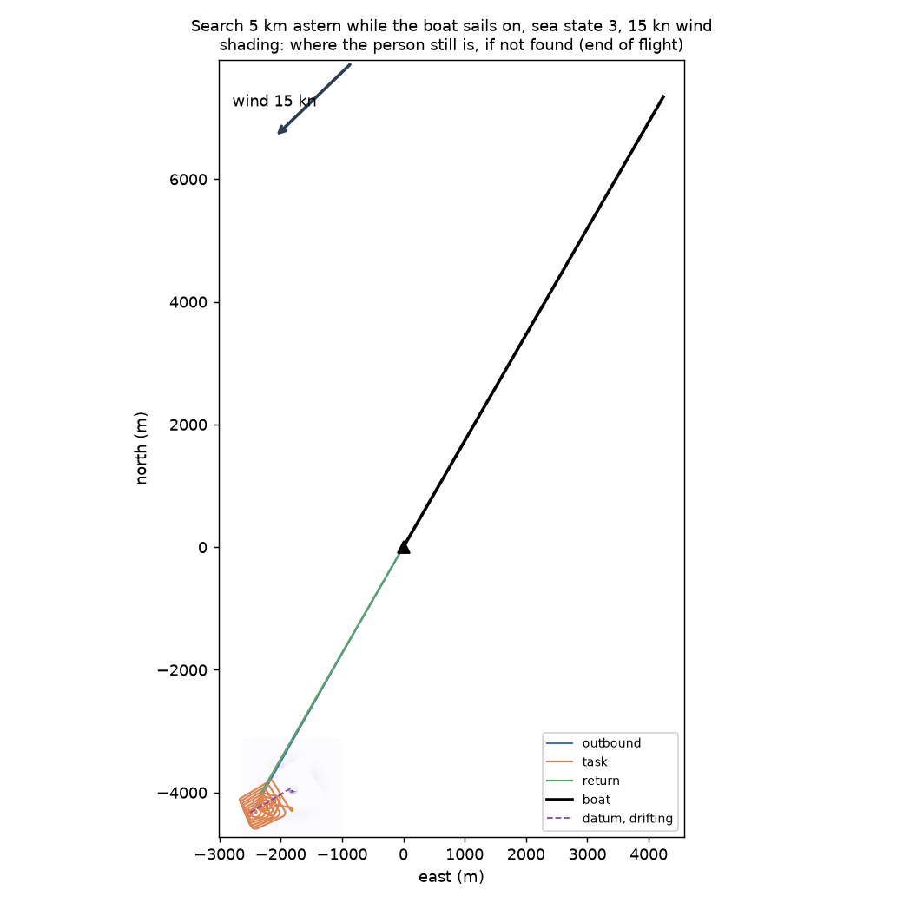
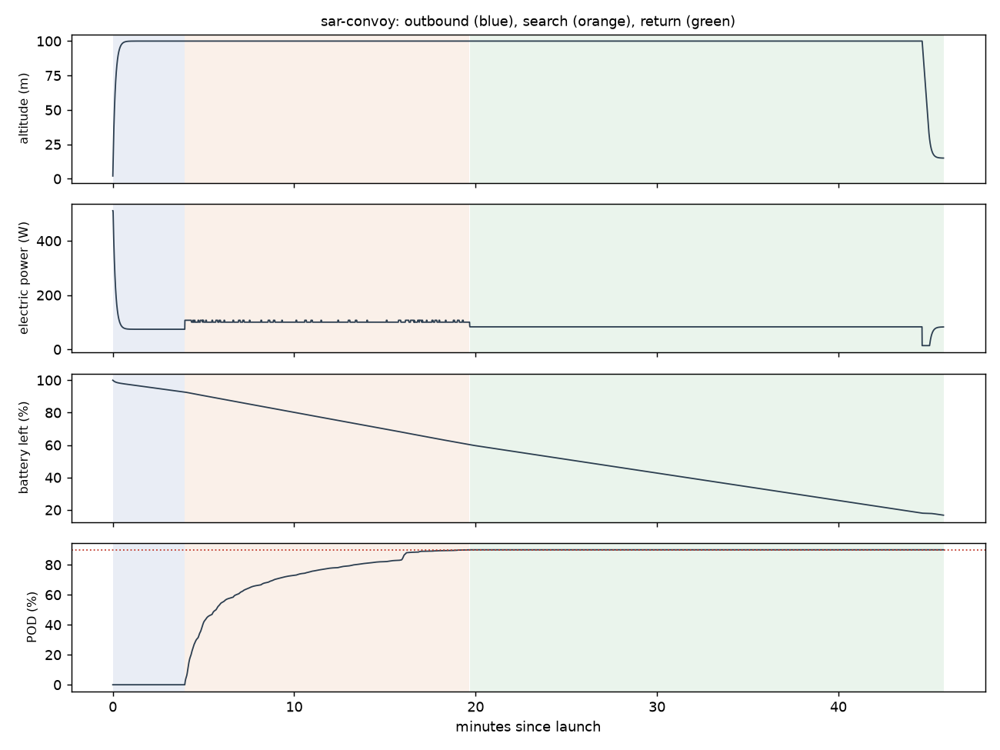

# Recon sar-convoy: Search 5 km astern while the boat sails on, sea state 3, 15 kn wind

Generated 2026-11-07 at cc958a0 by `uv run osprey recon --mission sar-convoy`. Screening-level models; REF inputs in `design/recon/`.

## Sized airframe (OpenMDAO + OpenAeroStruct, SLSQP)

Optimizer converged: **yes**

| Quantity | Value |
|---|---|
| Task | search, 19.2 km of track planned |
| Take-off mass | 1.89 kg (battery 0.53, shell 0.20, spar 0.024, fixed 1.13) |
| Span / area / aspect ratio | 1.20 m / 0.221 m² / 6.5 |
| Root / tip chord | 44.1 / 13.0 cm (tip Re 150,000) |
| Spar tube, root / tip | r 4.1 / 4.0 mm, wall 0.50 / 0.50 mm |
| Task speed, CL, L/D | 17.2 m/s, 0.47, 7.8 |
| Stall speed (sea level) | 12.0 m/s (limit 12) |
| Task power / endurance | 100 W / 49 min |
| Mission time estimate (+20% reserve) | 41 min |
| Printed panels (220 x 220 x 250 mm bed) | 0, chord fits: yes |

### Calibrating the mission-time model against the flight sim

Each round sizes the airframe, flies it with an unlimited battery, and scales the optimizer's mission-time model by the energy the flight really used.

| Round | Time factor | Mass (kg) | Battery (kg) | Flown / estimated energy (Wh) | Progress flown | Task flown (min) |
|---|---|---|---|---|---|---|
| 1 | 1.00 | 1.94 | 0.53 | 69 / 68 | 90% | 16 |
| 2 | 1.01 | 1.89 | 0.53 | 68 / 68 | 90% | 16 |
| 3 | 1.01 | 1.89 | 0.53 | 68 / 68 | 90% | 16 |

## Flown through the mission (3-DOF point mass)

Outcome: **recovered**; left the task because: goal

| Quantity | Value |
|---|---|
| On scene | 4.0 min after launch |
| Pod reached | 90% (goal 90%); goal at 19.7 min |
| Time on task | 15.7 min |
| Search plan | 40 m track spacing, effective sweep width 123 m, 2 pattern pass(es) |
| Flight time / distance | 45.8 min / 31.5 km |
| Battery left at recovery | 17% |
| Mean power, max bank | 89 W, 35 deg |

