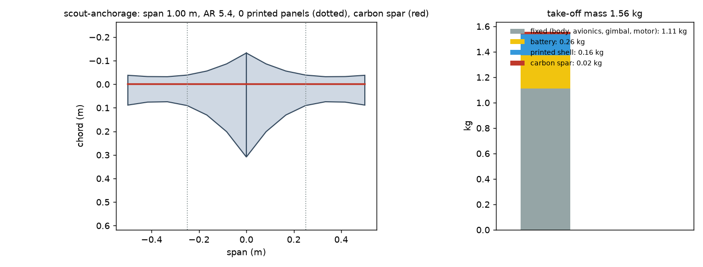
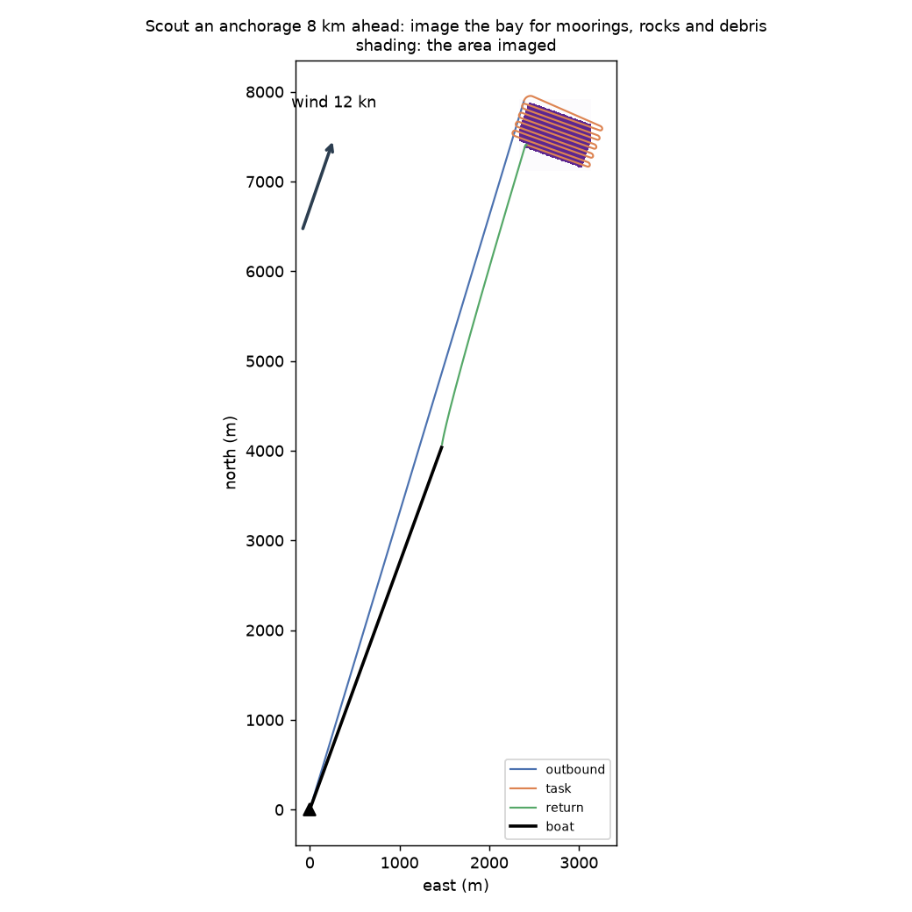
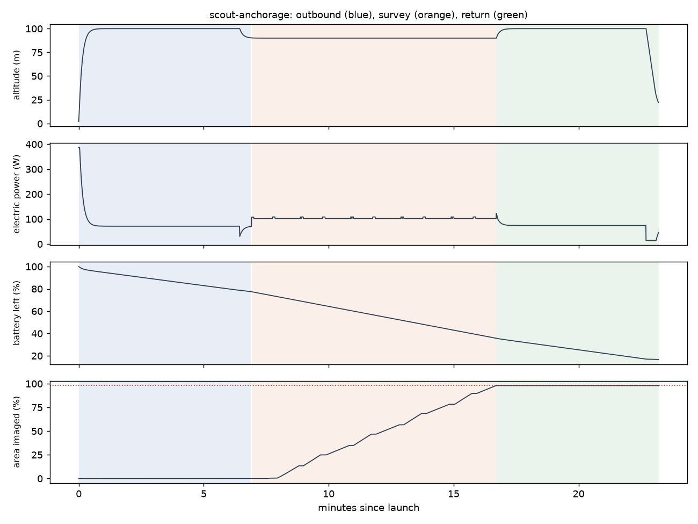

# Recon scout-anchorage: Scout an anchorage 8 km ahead: image the bay for moorings, rocks and debris

Generated 2026-11-07 at cc958a0 by `uv run osprey recon --mission scout-anchorage`. Screening-level models; REF inputs in `design/recon/`.

## Sized airframe (OpenMDAO + OpenAeroStruct, SLSQP)

Optimizer converged: **yes**

| Quantity | Value |
|---|---|
| Task | survey, 10.7 km of track planned |
| Take-off mass | 1.56 kg (battery 0.26, shell 0.16, spar 0.020, fixed 1.11) |
| Span / area / aspect ratio | 1.00 m / 0.184 m² / 5.4 |
| Root / tip chord | 44.1 / 12.6 cm (tip Re 150,000) |
| Spar tube, root / tip | r 4.0 / 4.0 mm, wall 0.50 / 0.50 mm |
| Task speed, CL, L/D | 17.6 m/s, 0.44, 6.5 |
| Stall speed (sea level) | 12.0 m/s (limit 12) |
| Task power / endurance | 102 W / 24 min |
| Mission time estimate (+20% reserve) | 20 min |
| Printed panels (220 x 220 x 250 mm bed) | 0, chord fits: yes |

### Calibrating the mission-time model against the flight sim

Each round sizes the airframe, flies it with an unlimited battery, and scales the optimizer's mission-time model by the energy the flight really used.

| Round | Time factor | Mass (kg) | Battery (kg) | Flown / estimated energy (Wh) | Progress flown | Task flown (min) |
|---|---|---|---|---|---|---|
| 1 | 1.00 | 1.76 | 0.37 | 33 / 46 | 98% | 10 |
| 2 | 0.72 | 1.58 | 0.27 | 34 / 47 | 98% | 10 |
| 3 | 0.72 | 1.56 | 0.26 | 33 / 47 | 98% | 10 |
| 4 | 0.72 | 1.56 | 0.26 | 33 / 47 | 98% | 10 |

## Flown through the mission (3-DOF point mass)

Outcome: **recovered**; left the task because: goal

| Quantity | Value |
|---|---|
| On scene | 6.9 min after launch |
| Area imaged reached | 98% (goal 98%); goal at 16.7 min |
| Time on task | 9.8 min |
| Survey | 11 legs, 71 m swath at 53 m spacing; ground sample 1.7 cm (gimbal) |
| Pixels across each target | lobster buoy 17.2 px, debris log 22.9 px, kayak 51.6 px |
| Flight time / distance | 23.2 min / 21.2 km |
| Battery left at recovery | 17% |
| Mean power, max bank | 86 W, 35 deg |

